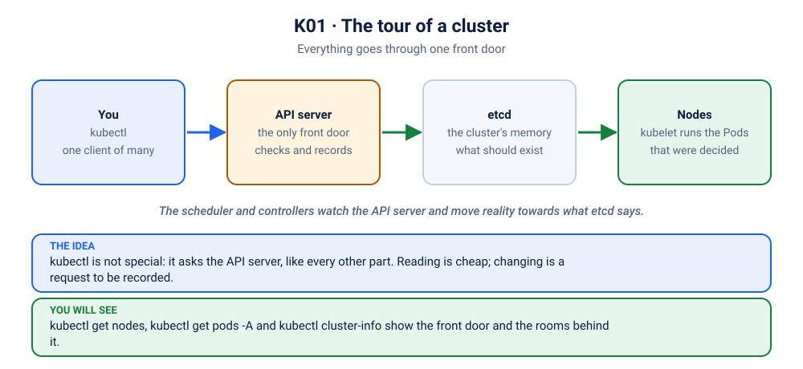

# Lab K01: Tour of a Kubernetes Cluster

> ⏱ 40 min · 🟢 Beginner · Needs: a running cluster ([setup](../../00-setup/README.md))
>
> 🧭 Do **[K00 Kubernetes Foundations](../00-foundations/README.md)** first: this lab puts its diagrams onto a real cluster.

## 🎯 What you'll learn
- Check your tools and connect to a cluster
- The parts of a cluster: control plane, worker nodes, system pods
- Find your way around: `get`, `describe`, `explain`, `api-resources`
- Load the course image into your cluster (needed from Lab K04)

## 🧠 Concept in 60 seconds



```
          kubectl ──HTTPS──▶ ┌──────────── CONTROL PLANE ────────────┐
                             │ kube-apiserver  ◀── the only front door │
                             │ etcd            ◀── the cluster's database (desired + actual state)
                             │ kube-scheduler  ◀── picks a node for each new Pod
                             │ controller-manager ◀── loops: make actual == desired
                             └──────────────────┬─────────────────────┘
                     ┌──────────────────────────┼──────────────────────────┐
              ┌─ WORKER NODE ─┐          ┌─ WORKER NODE ─┐          ┌─ WORKER NODE ─┐
              │ kubelet        │          │ kubelet        │          │ ...            │
              │ kube-proxy     │          │ kube-proxy     │
              │ containerd     │          │ containerd     │
              │ [pod] [pod]    │          │ [pod]          │
              └───────────────┘          └───────────────┘
```
**You declare the desired state** (for example, "3 copies of my app"). **Controllers keep working to make reality match it.** Everything in Kubernetes follows from this idea.

## 🧪 Hands-on

### Step 1: Versions
```bash
kubectl version --client
kubectl version             # client AND server; a skew of more than ±1 minor version prints a warning
```

### Step 2: Which cluster am I talking to?
```bash
kubectl config get-contexts         # * marks the current one
kubectl config current-context
kubectl cluster-info
```
> ⚠️ **Production habit:** always know your current context *before* running a command. Many outages started with "I thought I was on staging". Consider showing the context in your shell prompt (e.g. `kube-ps1`).

Switch context, if you have several:
```bash
kubectl config use-context docker-desktop      # or kind-z2h, minikube...
```

### Step 3: Nodes
```bash
kubectl get nodes
kubectl get nodes -o wide            # internal IP, OS, kernel, container runtime
kubectl describe node <node-name> | less
```
In `describe node`, find: **Capacity** vs **Allocatable**, **Conditions** (MemoryPressure, DiskPressure, Ready), and **Allocated resources**.

### Step 4: Namespaces and system Pods
```bash
kubectl get namespaces
kubectl get pods -A                  # -A = all namespaces
kubectl get pods -n kube-system -o wide
```
🔍 The control plane itself runs as Pods: `etcd-*`, `kube-apiserver-*`, `kube-scheduler-*`, `kube-controller-manager-*`, plus `coredns` (cluster DNS) and `kube-proxy`. Kubernetes runs on Kubernetes.

### Step 5: What can I create?
```bash
kubectl api-resources | head -40
kubectl api-resources --namespaced=false     # cluster-wide objects
kubectl explain pod
kubectl explain pod.spec.containers.resources
kubectl explain deployment.spec.strategy --recursive
```
`kubectl explain` is the built-in documentation for every YAML field. Use it all the time.

### Step 6: Output formats you'll use daily
```bash
kubectl get pods -n kube-system -o name
kubectl get pods -n kube-system -o yaml | less
kubectl get pods -n kube-system -o jsonpath='{.items[*].metadata.name}'; echo
kubectl get pods -n kube-system -o custom-columns=NAME:.metadata.name,NODE:.spec.nodeName,STATUS:.status.phase
kubectl get pods -n kube-system --sort-by=.metadata.creationTimestamp
kubectl get events -A --sort-by=.metadata.creationTimestamp | tail -20
```

### Step 7: Talk to the API directly (to see what kubectl does)
```bash
kubectl get --raw /version
kubectl get --raw /api/v1/namespaces | head -c 400; echo
kubectl get pods -n kube-system -v=6 2>&1 | grep -E 'GET|Response' | head -3   # the HTTP calls kubectl makes
```

### Step 8: Prepare the course image for the cluster ⭐
Most later labs use the course API image `z2h/api:1.0`. Build it and make it available to your cluster's nodes:
```bash
docker build -t z2h/api:1.0 apps/api
docker build -t z2h/frontend:1.0 apps/frontend
./scripts/load-image.sh z2h/api:1.0 z2h/frontend:1.0
```
The script detects Docker Desktop, kind, or minikube and does the right thing. ([Why is this needed?](../../docker/10-registry-tags/README.md#-checkpoint))

Smoke test:
```bash
kubectl run smoke --image=z2h/api:1.0 --image-pull-policy=IfNotPresent --restart=Never
kubectl get pod smoke -w            # wait for Running, then Ctrl+C
kubectl logs smoke
kubectl delete pod smoke
```

## 🏭 In production
- Managed Kubernetes (EKS, GKE, AKS) runs the control plane for you; you only see the worker nodes. The concepts and `kubectl` commands are identical.
- Access is per-context and per-user, controlled by RBAC (Lab K14). In real companies you rarely have cluster-admin.

## 🏆 Challenge
Using only `kubectl`, find which node runs a CoreDNS Pod, and what that Pod's IP address is. Then say which of the control-plane Pods you would look at first if `kubectl get nodes` hung.

<details><summary>Check your answer</summary>

`kubectl get pods -n kube-system -o wide | grep coredns` shows the node and the IP. If `kubectl` itself hangs, look at the `kube-apiserver` Pod: everything goes through it.
</details>

## ✅ Checkpoint
<details><summary>1. Which component decides which node a new Pod runs on?</summary>

The **kube-scheduler**. The **kubelet** on that node then starts the containers via the container runtime.
</details>
<details><summary>2. Where is the cluster's desired state stored?</summary>

In **etcd**, and only through the **kube-apiserver**. No component talks to etcd directly except the API server.
</details>
<details><summary>3. <code>kubectl get pods</code> shows nothing, but you know pods are running. Why?</summary>

You're looking at the `default` namespace (or the wrong context). Try `kubectl get pods -A` and `kubectl config current-context`.
</details>

➡️ Next: [K02: Pods](../02-pods/README.md)
