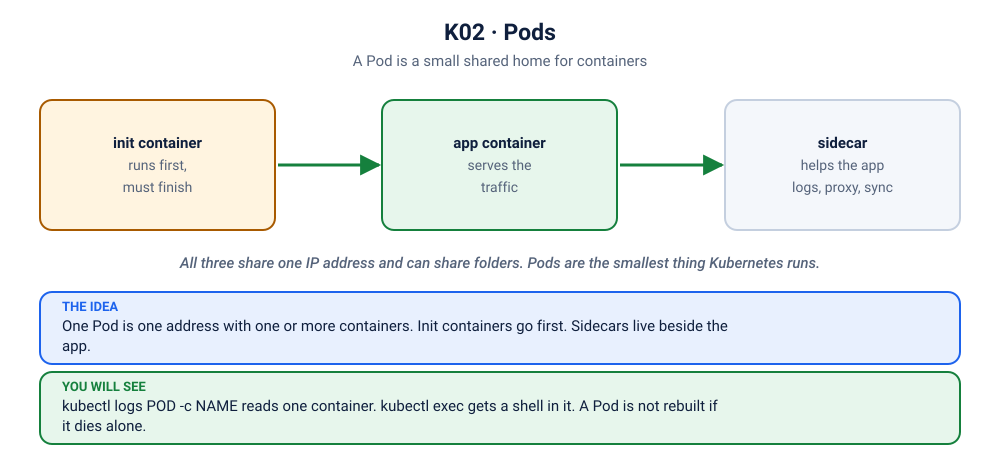

# Lab K02: Pods: the Smallest Deployable Unit

> ⏱ 50 min · 🟢 Beginner

## 🎯 What you'll learn
- Create Pods imperatively (commands) and declaratively (YAML)
- Inspect them: `get`, `describe`, `logs`, `exec`, `port-forward`
- Multi-container Pods: init containers and sidecars
- **Why you almost never create bare Pods in production**

## 🧠 Concept in 60 seconds



A **Pod** wraps one or more containers that are deployed together:
- They share **one network identity** (one IP; they reach each other on `localhost`)
- They can share **volumes**
- They are scheduled together onto **one node**

Pods are **disposable**. Don't treat a Pod IP as permanent; a replacement Pod gets a new name and a new IP.

## 🧪 Hands-on

### Step 1: Imperative: quick and good for experiments
```bash
kubectl run hello --image=nginx:1.27-alpine
kubectl get pods
kubectl get pods -o wide              # IP and node
```
Generate YAML without creating anything. This is the best way to start a manifest:
```bash
kubectl run hello2 --image=nginx:1.27-alpine --dry-run=client -o yaml
```

### Step 2: Declarative: YAML in Git (the production way)
Read [`pod.yaml`](pod.yaml), then:
```bash
kubectl apply -f kubernetes/02-pods/pod.yaml
kubectl get pod web --show-labels
```
Every manifest has the same four top-level fields:
```yaml
apiVersion: v1      # which API group/version
kind: Pod           # what type of object
metadata: {...}     # name, namespace, labels
spec: {...}         # the DESIRED state
```
After creation Kubernetes adds `status:` (the ACTUAL state):
```bash
kubectl get pod web -o yaml | grep -A 15 '^status:'
```

### Step 3: Describe: your #1 debugging command
```bash
kubectl describe pod web
```
Read it from the **bottom up**. The `Events:` section tells the story: `Scheduled → Pulling → Pulled → Created → Started`.

### Step 4: Logs, exec, port-forward
```bash
kubectl port-forward pod/web 8080:80       # leave running; open http://localhost:8080
```
In a second terminal:
```bash
curl -s localhost:8080 | head -4
kubectl logs web
kubectl logs web -f                         # follow (Ctrl+C)
kubectl exec web -- nginx -v
kubectl exec -it web -- sh                  # shell inside; type exit to leave
```

### Step 5: Pods are not self-healing
```bash
kubectl delete pod web
kubectl get pods                            # gone, and nothing brings it back
```
A bare Pod is like `docker run` without a restart policy at the cluster level: if it (or its node) dies, it's gone. **This is why we use Deployments** (Lab K04).

But the kubelet *does* restart crashed **containers** inside a living Pod:
```bash
kubectl run crashy --image=busybox:1.36 -- sh -c 'echo "started"; sleep 5; exit 1'
kubectl get pod crashy -w                   # Running → Error → CrashLoopBackOff, RESTARTS climbs
# Ctrl+C after ~1 minute
kubectl logs crashy                         # current attempt
kubectl logs crashy --previous              # the attempt that crashed ⭐ remember this flag
kubectl delete pod crashy
```

### Step 6: Multi-container Pods
Read [`multi-container.yaml`](multi-container.yaml), then:
```bash
kubectl apply -f kubernetes/02-pods/multi-container.yaml
kubectl get pod web-with-sidecar -w         # Init:0/1 → PodInitializing → Running (2/2)
kubectl port-forward pod/web-with-sidecar 8080:80 &
sleep 2; curl -s localhost:8080; curl -s localhost:8080/missing >/dev/null
kubectl logs web-with-sidecar -c log-shipper      # -c picks the container
kubectl logs web-with-sidecar -c write-content    # logs from the init container
kill %1
```
🔍 The sidecar read nginx's log file through the **shared volume**. Sidecars are how service meshes, log shippers, and secret agents are added without changing the app.

### Step 7: Pod lifecycle phases
| Phase | Meaning |
|---|---|
| `Pending` | accepted, but not running yet (scheduling, pulling image) |
| `Running` | bound to a node, at least one container running |
| `Succeeded` | all containers exited 0 and won't restart |
| `Failed` | all containers terminated, at least one failed |
| `Unknown` | the node stopped reporting |

`CrashLoopBackOff`, `ImagePullBackOff` and `ContainerCreating` are **container states/reasons** shown in the STATUS column, not phases. The troubleshooting scenarios cover each one.

## 🏭 In production
- Bare Pods are for one-off debugging only. Real workloads use **Deployments** (stateless), **StatefulSets** (stateful), **DaemonSets** (one per node), and **Jobs/CronJobs** (run to completion).
- `kubectl logs --previous` and `kubectl describe` Events answer most "why did it crash?" questions.
- Everything you apply should live in **Git**. If it only exists in the cluster, it's lost the next time someone rebuilds the cluster.

## 🏆 Challenge
1. Write a Pod manifest from scratch for `z2h/api:1.0` (with `imagePullPolicy: IfNotPresent`), setting env `TITLE=My First Pod`. Port-forward to 8080 and open it in the browser.
2. Use `kubectl debug` to attach an ephemeral debugging container to a running Pod:
   `kubectl debug -it web-with-sidecar --image=busybox:1.36 --target=nginx -- sh`, then run `ps` inside.

## ✅ Checkpoint
<details><summary>1. Two containers in the same Pod: how do they talk to each other?</summary>

Over `localhost`, because they share the Pod's network namespace. They can also share files through a volume.
</details>
<details><summary>2. A container crashed. Where do you find the logs of the crash?</summary>

`kubectl logs <pod> --previous` (add `-c <container>` for multi-container Pods).
</details>

## 🔥 Now break it
Pods fail in a handful of ways. Meet them on purpose:
- [K02](../scenarios/02-image-typo/README.md): image typo: ImagePullBackOff
- [K03](../scenarios/03-showdown-crashloop/README.md): crash loop
- [K24](../scenarios/24-showdown-wrong-command/README.md): a wrong start command
- [K26](../scenarios/26-showdown-init-stuck/README.md): an init container that waits forever
- [K29](../scenarios/29-log-sidecar-half-ready/README.md): a sidecar that is never Ready

## 🧹 Cleanup
```bash
kubectl delete pod hello web web-with-sidecar --ignore-not-found
```

➡️ Next: [K03: Namespaces, Labels & Selectors](../03-namespaces-labels/README.md)
