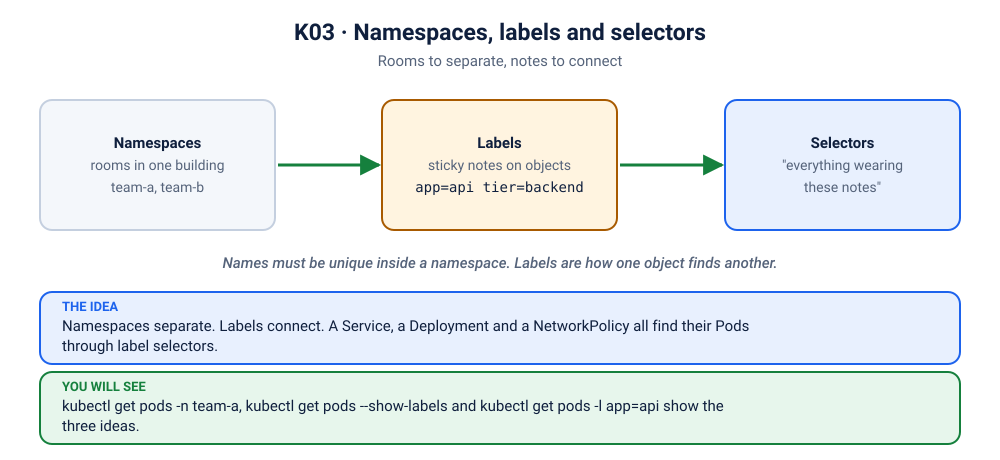

# Lab K03: Namespaces, Labels & Selectors

> ⏱ 30 min · 🟢 Beginner

## 🎯 What you'll learn
- Namespaces: how teams and environments share one cluster
- Labels and selectors: the "glue" that connects Deployments, Services and Pods
- Annotations, and the recommended label conventions

## 🧠 Concept in 60 seconds



- A **namespace** is a folder for objects: names must be unique *within* a namespace. It's also the unit for access control (RBAC), quotas, and network policies.
- A **label** is a key/value tag on an object (`app=shop`, `env=prod`).
- A **selector** is a query over labels (`app=shop,env=prod`). Deployments find their Pods by selector, and Services find their endpoints by selector. **A wrong label equals a broken app** ([scenario K04](../scenarios/04-it-tools-no-endpoints/README.md)).

## 🧪 Hands-on

### Step 1: Create namespaces and labelled pods
```bash
kubectl apply -f kubernetes/03-namespaces-labels/pods.yaml
kubectl get ns --show-labels | grep team
kubectl get pods -n team-a --show-labels
kubectl get pods -A -l app --show-labels
```

### Step 2: Selector queries
```bash
kubectl get pods -A -l env=prod
kubectl get pods -A -l 'tier=api,env!=dev'
kubectl get pods -A -l 'env in (staging,dev)'
kubectl get pods -A -l app=shop -L tier,env          # -L shows labels as columns
```

### Step 3: Change labels live
```bash
kubectl label pod shop-api-dev -n team-a env=qa --overwrite
kubectl label pod shop-api-dev -n team-a owner=alice
kubectl label pod shop-api-dev -n team-a owner-       # trailing "-" removes the label
kubectl get pod shop-api-dev -n team-a --show-labels
```

### Step 4: Work in a namespace without typing `-n` every time
```bash
kubectl config set-context --current --namespace=team-b
kubectl get pods                       # now shows team-b
kubectl config set-context --current --namespace=default    # switch back!
```

### Step 5: Annotations: non-identifying metadata
```bash
kubectl annotate pod blog-api-prod -n team-b oncall="team-b@example.com" runbook="https://wiki/blog-api"
kubectl describe pod blog-api-prod -n team-b | grep -A3 Annotations
```
Labels are for **selecting**. Annotations are for **information** (owners, links, tool configuration).

### Step 6: Namespaces are not network walls (by default)
```bash
kubectl get pod blog-api-prod -n team-b -o jsonpath='{.status.podIP}'; echo
kubectl run probe -n team-a --rm -it --restart=Never --image=busybox:1.36 -- wget -qO- -T 3 http://<that-ip> | head -3
```
🔍 A Pod in `team-a` can reach `team-b`. Isolation needs **NetworkPolicies** (Lab K15).

### Step 7: Deleting a namespace deletes everything in it
```bash
kubectl delete ns team-a team-b
```
⚠️ In production, `kubectl delete ns` is one of the most destructive commands there is.

## 🏭 Recommended labels
```yaml
metadata:
  labels:
    app.kubernetes.io/name: shop-api
    app.kubernetes.io/instance: shop-api-prod
    app.kubernetes.io/version: "1.4.2"
    app.kubernetes.io/component: api
    app.kubernetes.io/part-of: shop
    app.kubernetes.io/managed-by: helm
```
Tools like dashboards, Helm, and cost reports rely on these.

## 🏆 Challenge
Without editing any file, print the name and namespace of every Pod in the cluster that has the label `tier=api` and `env=prod`.

<details><summary>Check your answer</summary>

`kubectl get pods -A -l tier=api,env=prod -o custom-columns=NS:.metadata.namespace,NAME:.metadata.name`. Commas in a selector mean AND.
</details>

## ✅ Checkpoint
<details><summary>1. Can two Pods named <code>api</code> exist in the same cluster?</summary>

Yes, if they are in different namespaces.
</details>
<details><summary>2. Does a namespace stop Pods from talking to Pods in other namespaces?</summary>

No. Network isolation requires NetworkPolicies (and a CNI that enforces them).
</details>

➡️ Next: [K04: Deployments & ReplicaSets](../04-deployments/README.md)
