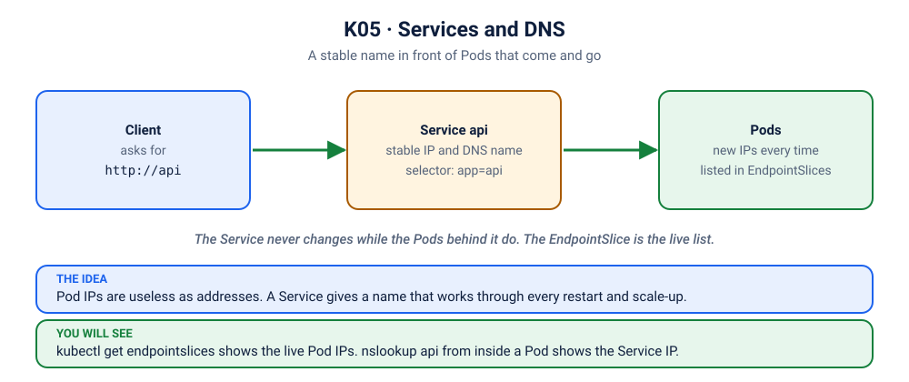

# Lab K05: Services & DNS: Stable Names for Changing Pods

> ⏱ 50 min · 🟢 Beginner → 🟡 Intermediate

## 🎯 What you'll learn
- Why Pod IPs are useless as addresses
- **ClusterIP**, **NodePort**, **LoadBalancer**, and **headless** Services
- How a Service finds its Pods (selector → **EndpointSlices**)
- Cluster DNS: `redis`, `redis.default`, `redis.default.svc.cluster.local`
- Fix K04's cliffhanger: shared state in Redis, reached **by name**

## 🧠 Concept in 60 seconds



```
 frontend Pod ──▶ http://api:8080 ──DNS──▶ Service "api" (stable virtual IP 10.96.x.x)
                                               │ selector app=api
                             ┌─────────────────┼─────────────────┐
                             ▼                 ▼                 ▼
                       Pod 10.244.0.7    Pod 10.244.0.8    Pod 10.244.0.9   ← come and go
```
| Type | Reachable from | Typical use |
|---|---|---|
| `ClusterIP` (default) | inside the cluster | service-to-service |
| `NodePort` | `<node-ip>:30000-32767` | simple external access, labs |
| `LoadBalancer` | a cloud load balancer | production entry point (cloud) |
| headless (`clusterIP: None`) | DNS returns Pod IPs | StatefulSets / databases (K10) |

## 🧪 Hands-on

### Step 1: Add Redis and point the API at it, by name
```bash
kubectl apply -f kubernetes/stack/redis.yaml
kubectl apply -f kubernetes/05-services/app.yaml          # same api, now with REDIS_HOST=redis
kubectl apply -f kubernetes/stack/frontend.yaml
kubectl rollout status deploy/api
kubectl port-forward svc/frontend 8080:80
```
Open http://localhost:8080. The badge now says **💾 votes in Redis**. Vote, delete Pods, scale to 10:
```bash
kubectl delete pod -l app=api --wait=false
kubectl scale deploy api --replicas=10
```
**The votes survive and stay consistent.** Pods are disposable; the data lives behind the `redis` Service. ✅ Cliffhanger solved.

### Step 2: How did "redis" become an IP?
```bash
kubectl run dns --rm -it --restart=Never --image=busybox:1.36 -- sh
# inside:
nslookup redis.default.svc.cluster.local
cat /etc/resolv.conf               # the "search" line is why the short name "redis" works
wget -qO- http://api:8080/api/info; echo
exit
```
| Name | Works from |
|---|---|
| `redis` | the same namespace |
| `redis.default` | any namespace |
| `redis.default.svc.cluster.local` | anywhere (fully qualified) |

### Step 3: How did the Service find its Pods?
```bash
kubectl get svc api
kubectl describe svc api | grep -E 'Selector|Endpoints'
kubectl get endpointslices -l kubernetes.io/service-name=api -o wide
kubectl get pods -l app=api -o custom-columns=NAME:.metadata.name,IP:.status.podIP
```
The endpoint IPs are exactly the Pod IPs, and the list updates itself as Pods come and go.

### Step 4: 📱 Let the room in
Option A, port-forward (works on every cluster). On your own screen only:
```bash
kubectl port-forward svc/frontend 8080:80
```
To share it with phones on the same Wi-Fi, listen on all interfaces instead:
```bash
kubectl port-forward --address 0.0.0.0 svc/frontend 8080:80
# share http://<laptop-ip>:8080   (macOS: ipconfig getifaddr en0)
```
⚠️ `--address 0.0.0.0` opens the app to everyone on the same network. Use it only on a network you trust, and press Ctrl+C when the demo is over. (On a playground such as Killercoda or iximiuz, `--address 0.0.0.0` is how the platform's port link reaches it.)
Option B, **NodePort**:
```bash
kubectl apply -f kubernetes/05-services/nodeport.yaml
kubectl get svc frontend-nodeport
```
- **Docker Desktop:** http://localhost:30080
- **minikube:** `http://$(minikube ip):30080`
- **Killercoda:** use the **Traffic / Ports** menu → port 30080
- **kind:** node ports live inside the node container; use port-forward, or create the cluster with `extraPortMappings` ([setup](../../00-setup/README.md))

Option C, **LoadBalancer** (on Docker Desktop it's published on `localhost`):
```bash
kubectl expose deployment frontend --name=frontend-lb --type=LoadBalancer --port=8090 --target-port=8080
kubectl get svc frontend-lb          # EXTERNAL-IP: localhost (Docker Desktop) / <pending> (kind)
```

### Step 5: The class-slide flow
```bash
kubectl create deployment web --image=nginx:1.27-alpine
kubectl expose deployment web --port=80 --type=ClusterIP
kubectl get services
kubectl port-forward service/web 8081:80        # http://localhost:8081
```

### Step 6: 💥 Break the selector, live
Keep the browser open, then introduce a one-letter typo:
```bash
kubectl patch svc api -p '{"spec":{"selector":{"app":"apii"}}}'
```
The browser turns **red**: every request fails. Yet:
```bash
kubectl get pods -l app=api                                   # all Running!
kubectl get endpointslices -l kubernetes.io/service-name=api  # ...but no endpoints
```
Fix it and watch the UI recover:
```bash
kubectl patch svc api -p '{"spec":{"selector":{"app":"api"}}}'
```
🔍 **Pods running ≠ service working.** A selector/label mismatch is one of the most common production outages ([scenario K04](../scenarios/04-it-tools-no-endpoints/README.md)).

## 🏭 In production
- Services talk to each other via **names**, never Pod IPs.
- External HTTP usually enters through **one** load balancer → Gateway → many ClusterIP Services (K12).
- Only **Ready** Pods receive traffic, and readiness probes (K08) decide who is Ready.

## 🏆 Challenge
Break the Service on purpose: change the selector of Service `api` to `app: apii`. Predict what `kubectl get endpointslices -l kubernetes.io/service-name=api` shows, then fix it again.

<details><summary>Check your answer</summary>

The endpoints list is empty: no Pod wears the label `app=apii`. The Pods stay Running and Ready, but nobody is sent to them. Put `app: api` back and the addresses return.
</details>

## ✅ Checkpoint
<details><summary>1. <code>port</code> vs <code>targetPort</code>?</summary>

`port` is what clients call on the Service; `targetPort` is the container port traffic is forwarded to.
</details>
<details><summary>2. DNS resolves, Pods are Running, but connections fail. First check?</summary>

The endpoints: `kubectl get endpointslices -l kubernetes.io/service-name=<svc>`. If there are none, the selector doesn't match or no Pod is Ready.
</details>

## 🧹 Cleanup
Keep the stack for K06, or:
```bash
kubectl delete -f kubernetes/05-services/ -f kubernetes/stack/ --ignore-not-found
kubectl delete svc frontend-lb web --ignore-not-found; kubectl delete deploy web --ignore-not-found
```

➡️ Next: [K06: Rolling Updates & Rollbacks](../06-rollouts/README.md)
