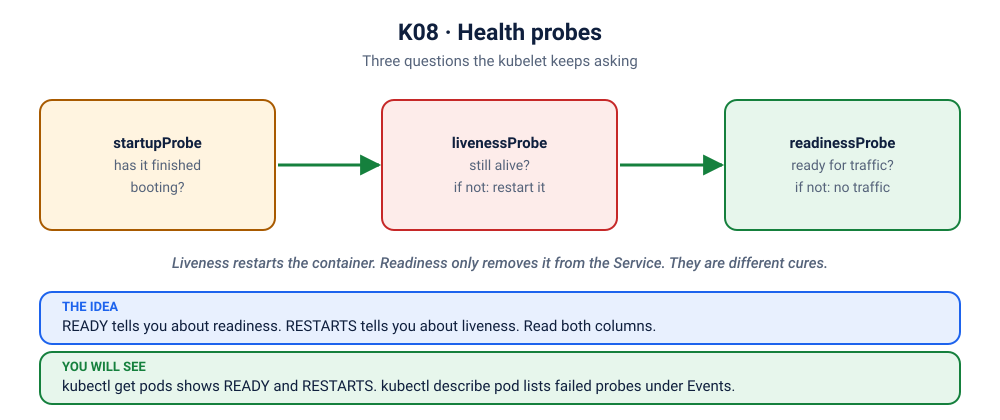

# Lab K08: Health Probes: Startup, Liveness, Readiness

> ⏱ 50 min · 🟡 Intermediate

## 🎯 What you'll learn
- The three probe types and what Kubernetes **does** when each fails
- Protect slow-starting apps with a **startupProbe**
- Watch readiness remove a Pod from load balancing, without restarting it
- The anti-pattern that turns a database blip into a full outage

## 🧠 Concept in 60 seconds



| Probe | Question | On failure | Should check dependencies? |
|---|---|---|---|
| **startupProbe** | Has the app finished booting? | keep waiting; kill after `failureThreshold` | no |
| **livenessProbe** | Is the process stuck or deadlocked? | **restart the container** | **never** |
| **readinessProbe** | Can I handle requests right now? | **remove from Service endpoints** (no restart) | yes, carefully |

> "Running" ≠ "Ready". The `READY` column (`1/1`) is driven by the readiness probe.

## 🧪 Hands-on

### Step 1: Deploy without Redis first
Start fresh: `kubectl delete deploy redis --ignore-not-found`. Read [`deployment.yaml`](deployment.yaml), then:
```bash
kubectl apply -f kubernetes/stack/frontend.yaml
kubectl apply -f kubernetes/08-probes/deployment.yaml
kubectl port-forward svc/frontend 8080:80 &          # open http://localhost:8080
kubectl get pods -l app=api -w
```
The browser stays **red**: no api Pod is Ready, so the Service has nowhere to send traffic.
Observe over ~30 seconds:
1. `Running 0/1` for about 20s: **startupProbe** is waiting for the slow boot. No restarts!
2. Still `Running 0/1` after boot: **readinessProbe** fails because Redis doesn't exist yet.
3. `RESTARTS` stays `0`: liveness (`/healthz`) passes. The process is fine.

```bash
kubectl describe pod -l app=api | grep -E 'Readiness|Startup|Liveness|Warning' | head
kubectl get endpointslices -l kubernetes.io/service-name=api -o wide     # no ready endpoints
```

### Step 2: Fix the dependency and watch them become Ready
```bash
kubectl apply -f kubernetes/stack/redis.yaml
kubectl get pods -l app=api -w            # within ~10s: 1/1 Ready, and the browser turns green ✅
kubectl get endpointslices -l kubernetes.io/service-name=api -o wide     # endpoints appear
```

### Step 3: Readiness under failure: traffic drains, nothing restarts
```bash
kubectl scale deploy redis --replicas=0
kubectl get pods -l app=api -w            # 0/1 again, RESTARTS still 0. Browser: red
kubectl scale deploy redis --replicas=1   # recover → Ready again
```

### Step 4: Liveness in action
`/api/crash` makes the process exit. Even without that, a failing liveness probe would restart it:
```bash
POD=$(kubectl get pod -l app=api -o name | head -1)
kubectl exec $POD -- wget -qO- localhost:8080/api/crash      # or press 💥 in the UI
kubectl get pods -l app=api               # RESTARTS = 1
kubectl describe $POD | grep -A4 'Last State'
```

### Step 5: Why the startupProbe matters 💥
Remove the startupProbe and use an aggressive liveness probe:
```bash
kubectl patch deploy api --type=json -p='[
 {"op":"remove","path":"/spec/template/spec/containers/0/startupProbe"},
 {"op":"replace","path":"/spec/template/spec/containers/0/livenessProbe/periodSeconds","value":3},
 {"op":"replace","path":"/spec/template/spec/containers/0/livenessProbe/failureThreshold","value":2}]'
kubectl get pods -l app=api -w
```
🔍 The new Pods never finish booting (20s) before liveness kills them (~6s): an endless **CrashLoopBackOff** of a perfectly good app. Lots of real outages look exactly like this after someone adds a "simple" liveness probe ([scenario K07](../scenarios/07-showdown-slow-start/README.md)).

Restore:
```bash
kubectl apply -f kubernetes/08-probes/deployment.yaml
```

### Step 6: Probe types
```yaml
httpGet:   { path: /healthz, port: 8080 }      # 200-399 = success
tcpSocket: { port: 5432 }                      # port accepts connections
exec:      { command: ["redis-cli","ping"] }   # exit code 0 = success
grpc:      { port: 9090 }                      # gRPC health checking protocol
```

## 🏭 In production
- **Liveness must never check dependencies.** If the database is down and liveness checks it, every Pod restarts at once, recovers at once, and hammers the database at the same time.
- Make probe endpoints **cheap**: no heavy queries, and respond in milliseconds.
- Pair readiness with **graceful shutdown**: on SIGTERM, start failing readiness, finish in-flight requests, then exit.
- Tune `timeoutSeconds`. The 1s default is too short for some JVM or Python apps under load and causes flapping.

## 🏆 Challenge
Write a readiness probe that asks for the path `/nope`. Predict `READY` and `RESTARTS`. Then make the *liveness* probe ask for `/nope` instead and predict again.

<details><summary>Check your answer</summary>

Readiness failing: `READY 0/1`, `RESTARTS 0` (no traffic, no restart). Liveness failing: `RESTARTS` keeps climbing, because the kubelet restarts the container.
</details>

## ✅ Checkpoint
<details><summary>1. A Pod is <code>Running</code> but shows <code>0/1</code> and RESTARTS is 0. Which probe is failing?</summary>

The readiness probe (or the startup probe is still in progress). Liveness failures would increase RESTARTS.
</details>
<details><summary>2. Why use a startupProbe instead of a long <code>initialDelaySeconds</code> on liveness?</summary>

The startupProbe adapts: it passes as soon as the app is up, even if that's fast, and allows up to `failureThreshold × periodSeconds` if it's slow. After startup, liveness can stay sensitive.
</details>

## 🧹 Cleanup
```bash
kubectl delete -f kubernetes/08-probes/ -f kubernetes/stack/ --ignore-not-found
```

➡️ Next: [K09: Resources, QoS & Quotas](../09-resources-qos/README.md)
