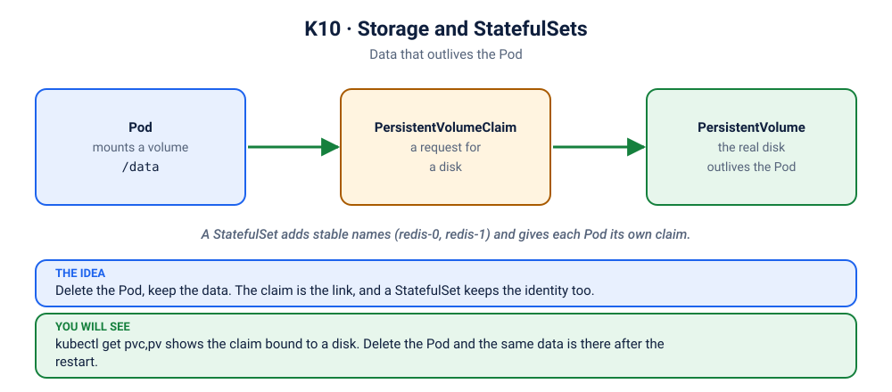

# Lab K10: Storage & StatefulSets

> ⏱ 50 min · 🟡 Intermediate

## 🎯 What you'll learn
- Volumes in Kubernetes: `emptyDir` → **PersistentVolumeClaim** → **PersistentVolume** → **StorageClass**
- Data that survives Pod deletion
- **StatefulSets**: stable names, ordered startup, one volume per replica
- Headless Services and per-Pod DNS

## 🧠 Concept in 60 seconds



```
 Pod ──uses──▶ PVC "I need 1Gi, ReadWriteOnce"     (written by the developer)
                 │ bound to
                 ▼
               PV  "a real 1Gi disk"                (created dynamically...)
                 ▲
           StorageClass "standard"                   (...by the provisioner: local-path, AWS EBS, GCE PD...)
```
| Workload | Pod names | Storage | Use for |
|---|---|---|---|
| Deployment | random (`api-7c9f-x2k`) | shared or none | stateless apps |
| StatefulSet | stable, ordered (`redis-0`, `redis-1`) | **one PVC per Pod**, kept across restarts | databases, queues, clustered systems |

## 🧪 Hands-on

### Step 1: What storage does your cluster offer?
```bash
kubectl get storageclass          # (default) marks the default one
```
Docker Desktop: `hostpath`. kind: `standard` (local-path). minikube: `standard`.

### Step 2: PVC + Pod
```bash
kubectl apply -f kubernetes/10-storage-statefulsets/pvc-pod.yaml
kubectl get pvc notes-data        # Pending until a Pod uses it (WaitForFirstConsumer), then Bound
kubectl get pv
sleep 15; kubectl exec writer -- cat /data/log.txt
```

### Step 3: Data outlives the Pod
```bash
kubectl delete pod writer
kubectl apply -f kubernetes/10-storage-statefulsets/pvc-pod.yaml     # a brand-new Pod
sleep 10; kubectl exec writer -- cat /data/log.txt                   # old lines are still there
```

### Step 4: StatefulSet
```bash
kubectl apply -f kubernetes/10-storage-statefulsets/redis-statefulset.yaml
kubectl get pods -l app=redis-sts -w      # redis-0 first, THEN redis-1 (ordered)
kubectl get pvc                           # data-redis-0, data-redis-1
```

### Step 5: Stable identity
```bash
kubectl exec redis-0 -- redis-cli set owner "I am redis-0"
kubectl exec redis-1 -- redis-cli set owner "I am redis-1"
kubectl delete pod redis-0
kubectl get pods -l app=redis-sts -w      # comes back with the SAME name: redis-0
kubectl exec redis-0 -- redis-cli get owner          # same data: it re-attached data-redis-0
```
Per-Pod DNS through the headless Service:
```bash
kubectl run dns --rm -it --restart=Never --image=busybox:1.36 -- nslookup redis-0.redis-headless.default.svc.cluster.local
```

### Step 6: Scaling down keeps the data
```bash
kubectl scale sts redis --replicas=1
kubectl get pvc                           # data-redis-1 is still there
kubectl scale sts redis --replicas=2      # redis-1 returns with its old data
kubectl exec redis-1 -- redis-cli get owner
```

## 🏭 In production
- **Reclaim policy:** `Delete` (default for dynamic volumes) destroys the disk when the PVC is deleted; `Retain` keeps it. Know which one your databases use.
- `ReadWriteOnce` = one **node** at a time. Shared file storage needs `ReadWriteMany` (NFS, EFS, Azure Files).
- Running databases on Kubernetes works, but needs backups, operators (CloudNativePG, Strimzi, etc.), and tested restore procedures. Many teams use managed databases instead.
- A PVC stuck in **Pending** usually means a wrong or missing StorageClass, or no capacity ([scenario K10](../scenarios/10-kanboard-pvc-pending/README.md)).

## 🏆 Challenge
Let the `writer` Pod from this lab run for a minute, delete it, create it again from the same file, and show that `/data/log.txt` still has the old lines. Which object kept the data?

<details><summary>Check your answer</summary>

The PersistentVolumeClaim `notes-data`: the Pod is disposable, the claim and the disk behind it are not. `kubectl exec writer -- cat /data/log.txt` shows lines older than the new Pod.
</details>

## ✅ Checkpoint
<details><summary>1. What's the difference between a PVC and a PV?</summary>

A PVC is a **request** for storage (in your namespace). A PV is the actual **piece of storage** (cluster-wide), usually created on demand by a StorageClass provisioner.
</details>
<details><summary>2. Why use a StatefulSet instead of a Deployment for a database?</summary>

Stable Pod names and DNS, ordered start and stop, and a dedicated PVC per replica that follows the Pod across restarts.
</details>

## 🧹 Cleanup
```bash
kubectl delete -f kubernetes/10-storage-statefulsets/
kubectl delete pvc -l app=redis-sts; kubectl delete pvc data-redis-0 data-redis-1 --ignore-not-found
```

➡️ Next: [K11: Jobs & CronJobs](../11-jobs-cronjobs/README.md)
