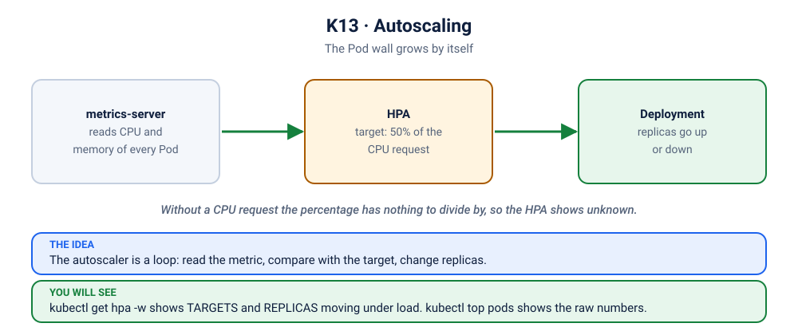

# Lab K13: Autoscaling with the HorizontalPodAutoscaler

> ⏱ 40 min · 🟡 Intermediate

## 🎯 What you'll learn
- Install **metrics-server** and use `kubectl top`
- Autoscale a Deployment on CPU with an **HPA**
- Why HPA needs resource **requests**
- How scale-up and scale-down behave (stabilisation windows)

## 🧠 Concept in 60 seconds



```
metrics-server ──(CPU per Pod)──▶ HPA controller: desired = ceil(current × actual% / target%)
                                        │
                                        └──▶ sets Deployment.spec.replicas
```
Example: 2 Pods at 150% of request, target 50% → `ceil(2 × 150/50)` = **6 Pods**.

## 🧪 Hands-on

### Step 1: Check metrics-server
You installed it during setup (and used `kubectl top` in K01). Check that it is still answering:
```bash
kubectl top nodes
```
Got numbers? Go to Step 2. Got an error? Install it (safe to repeat):
```bash
./scripts/install-metrics-server.sh
```
That script applies the pinned release `v0.9.1` and, on lab clusters, allows their self-signed kubelet certificates with `--kubelet-insecure-tls` (never in production).

### Step 2: Deploy the app and the HPA
```bash
kubectl apply -f kubernetes/stack/
kubectl apply -f kubernetes/13-autoscaling/hpa.yaml
kubectl port-forward svc/frontend 8080:80 &        # open http://localhost:8080 and watch the Pod wall
sleep 30; kubectl get hpa api            # TARGETS shows cpu: 1%/50% once metrics arrive
kubectl top pods -l app=api
```

### Step 3: Generate load and watch it scale 📈
Terminal 2:
```bash
kubectl get hpa api -w
```
Terminal 3:
```bash
kubectl get pods -l app=api -w
```
Terminal 1, start load (4 parallel workers calling a CPU-heavy endpoint):
```bash
kubectl run load --image=busybox:1.36 --restart=Never -- sh -c \
  'for w in 1 2 3 4; do (while true; do wget -qO- -T 10 "http://api:8080/api/burn?seconds=2" >/dev/null; done) & done; wait'
```
Within 1–2 minutes TARGETS climbs well above 50% and REPLICAS increases to as many as 6. On the big screen the **Pod wall fills up with new tiles by itself**: nobody typed `kubectl scale`. 📈
```bash
kubectl describe hpa api | tail -10       # "New size: N; reason: cpu resource utilization above target"
```

### Step 4: Stop the load and watch it scale down
```bash
kubectl delete pod load
```
After the 30s stabilisation window (5 minutes by default), replicas drop back to 1.

### Step 5: Without requests, HPA is blind 💥
```bash
kubectl set resources deployment api --requests=cpu=0 --limits=cpu=0
sleep 30; kubectl get hpa api             # TARGETS: <unknown>/50%
kubectl describe hpa api | grep -i -A2 'warning\|failed' | head -6
kubectl apply -f kubernetes/13-autoscaling/hpa.yaml     # restore
```

## 🏭 In production
- HPA on CPU is a start. Many teams scale on **requests per second, queue length, or latency** using custom or external metrics (Prometheus Adapter, **KEDA**).
- The HPA adds Pods, but Pods need **nodes**: pair it with **Cluster Autoscaler** or **Karpenter** so the cluster grows too.
- Set `minReplicas` ≥ 2 for production availability, and make sure `maxReplicas` fits within your ResourceQuota.
- Don't use HPA and manual `kubectl scale` on the same Deployment; the HPA will override you.

## 🏆 Challenge
Set the HPA's `minReplicas` to 3 and apply it without sending any load. Predict how many Pods you will have in a minute, and why.

<details><summary>Check your answer</summary>

Three: the HPA never lets the count fall below the minimum, so it scales the Deployment up on its own.
</details>

## ✅ Checkpoint
<details><summary>1. HPA shows <code>&lt;unknown&gt;</code> for targets. Two likely causes?</summary>

metrics-server isn't installed or working, or the Pods have no CPU **requests** (utilisation is a percentage of the request).
</details>

## 🔥 Now break it
When the autoscaler shrugs:
- [S5.3](../scenarios/5-scaling-self-healing-and-releases/3-showdown-hpa-not-scaling/README.md): the autoscaler says unknown
- [S5.x5](../scenarios/5-scaling-self-healing-and-releases/x5-autoscaler-pointing-at-nobody/README.md): an autoscaler pointing at a Deployment that does not exist

## 🧹 Cleanup
```bash
kubectl delete pod load --ignore-not-found; kubectl delete -f kubernetes/13-autoscaling/hpa.yaml
```

➡️ Next: [K14: RBAC & ServiceAccounts](../14-rbac/README.md)
