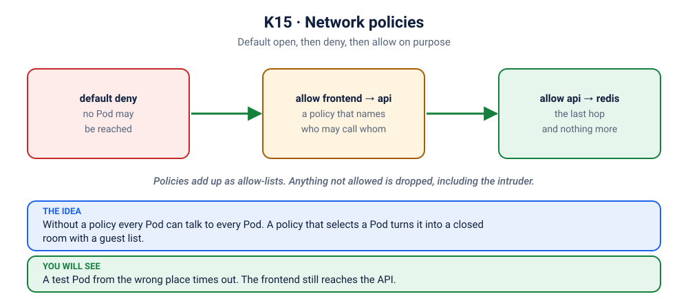

# Lab K15: Network Policies: a Firewall Between Pods

> ⏱ 40 min · 🟡 Intermediate → 🔴 Advanced

## 🎯 What you'll learn
- By default, **every Pod can reach every other Pod**
- Write **default-deny** and **allow** rules with labels
- Verify policies with real connection tests
- Egress policies and the DNS gotcha

## 🧠 Concept in 60 seconds



```
            ✅ 8080              ✅ 6379
 frontend ────────▶  api  ────────────▶ redis
 intruder ────✖────▶ api
 intruder ──────────────────✖─────────▶ redis
```
NetworkPolicies select Pods **by label** and say which traffic is **allowed**. Once any policy selects a Pod for a direction (ingress or egress), everything not explicitly allowed in that direction is denied.

> ⚠️ Policies are enforced by the **CNI plugin**. Calico, Cilium, and kind's kindnet (recent versions) enforce them. Some setups, including older Docker Desktop versions and Flannel, accept the objects but **don't enforce them**. Step 2 checks your cluster.

## 🧪 Hands-on

### Step 1: Deploy the app
```bash
kubectl apply -f kubernetes/15-network-policies/app.yaml
kubectl wait -n netpol-lab --for=condition=Ready pod --all --timeout=120s
```
Without policies, everything is reachable, including from the intruder:
```bash
kubectl exec -n netpol-lab frontend -- wget -qO- -T 3 'http://api:8080/api/vote?option=cats'; echo
kubectl exec -n netpol-lab intruder -- wget -qO- -T 3 'http://api:8080/api/vote?option=cats'; echo
kubectl exec -n netpol-lab intruder -- nc -zv -w 3 redis 6379
```
🔓 The intruder can talk to your database directly.

### Step 2: Apply the policies
```bash
kubectl apply -f kubernetes/15-network-policies/policies.yaml
kubectl get networkpolicy -n netpol-lab
```

### Step 3: Verify
```bash
echo "frontend → api (should WORK):";  kubectl exec -n netpol-lab frontend -- wget -qO- -T 3 'http://api:8080/api/vote?option=cats'; echo
echo "intruder → api (should FAIL):";  kubectl exec -n netpol-lab intruder -- wget -qO- -T 3 'http://api:8080/api/vote?option=cats' || echo "blocked ✅"
echo "intruder → redis (should FAIL):"; kubectl exec -n netpol-lab intruder -- nc -zv -w 3 redis 6379 || echo "blocked ✅"
echo "frontend → redis (should FAIL):"; kubectl exec -n netpol-lab frontend -- nc -zv -w 3 redis 6379 || echo "blocked ✅"
```
🔍 `frontend → api → redis` still works end to end, because the vote above succeeded. Every other path is blocked.

> If the intruder can still connect, your CNI doesn't enforce NetworkPolicy. Use kind (v0.24+), minikube with `--cni=calico`, or Killercoda to see enforcement.

### Step 4: Labels are the security boundary 😈
```bash
kubectl label pod -n netpol-lab intruder app=frontend --overwrite
kubectl exec -n netpol-lab intruder -- wget -qO- -T 3 'http://api:8080/api/vote?option=cats'; echo   # works now!
```
Anyone who can set labels can change which policies apply. Protect who can create and label Pods (RBAC, Lab K14; admission policies).

### Step 5: Egress and DNS
Add a default-deny **egress** policy and watch DNS break:
```bash
cat <<'EOF' | kubectl apply -f -
apiVersion: networking.k8s.io/v1
kind: NetworkPolicy
metadata: { name: frontend-deny-egress, namespace: netpol-lab }
spec:
  podSelector: { matchLabels: { app: frontend } }
  policyTypes: ["Egress"]
EOF
kubectl exec -n netpol-lab frontend -- wget -qO- -T 3 http://api:8080/ || echo "fails: even DNS lookups are blocked"
```
Allow DNS (port 53 to kube-system) and the API:
```bash
cat <<'EOF' | kubectl apply -f -
apiVersion: networking.k8s.io/v1
kind: NetworkPolicy
metadata: { name: frontend-deny-egress, namespace: netpol-lab }
spec:
  podSelector: { matchLabels: { app: frontend } }
  policyTypes: ["Egress"]
  egress:
    - to:
        - namespaceSelector: { matchLabels: { kubernetes.io/metadata.name: kube-system } }
      ports: [ { port: 53, protocol: UDP }, { port: 53, protocol: TCP } ]
    - to:
        - podSelector: { matchLabels: { app: api } }
      ports: [ { port: 8080 } ]
EOF
kubectl exec -n netpol-lab frontend -- wget -qO- -T 3 http://api:8080/; echo
```

## 🏭 In production
- Start every namespace with **default deny** and add explicit allows. It's the Kubernetes version of a zero-trust network.
- Forgetting DNS egress is the #1 NetworkPolicy outage ([scenario S3.5](../scenarios/3-services-ingress-and-networking/5-lockdown-blocks-dns/README.md)).
- Cilium and Calico add L7 rules (HTTP paths), FQDN egress rules (e.g. allow only `api.stripe.com`), and policy visualisation.

## 🏆 Challenge
From a Pod in `netpol-lab` that has no labels, try to reach Redis. Predict the result, then name the policy that lets the API in.

<details><summary>Check your answer</summary>

The connection times out: Redis only accepts the Pods its policy names. The policy is `redis-allow-api`, which allows traffic from Pods labelled `app=api`.
</details>

## ✅ Checkpoint
<details><summary>1. A namespace has no NetworkPolicies. What traffic is allowed?</summary>

All of it, in both directions.
</details>
<details><summary>2. After adding an egress policy, the app can't reach <code>http://api:8080</code> even though api traffic is allowed. Why?</summary>

DNS resolution of `api` goes to CoreDNS in kube-system on port 53. Allow it explicitly.
</details>

## 🧹 Cleanup
```bash
kubectl delete ns netpol-lab
```

➡️ Next: [K16: Pod Security](../16-pod-security/README.md)
