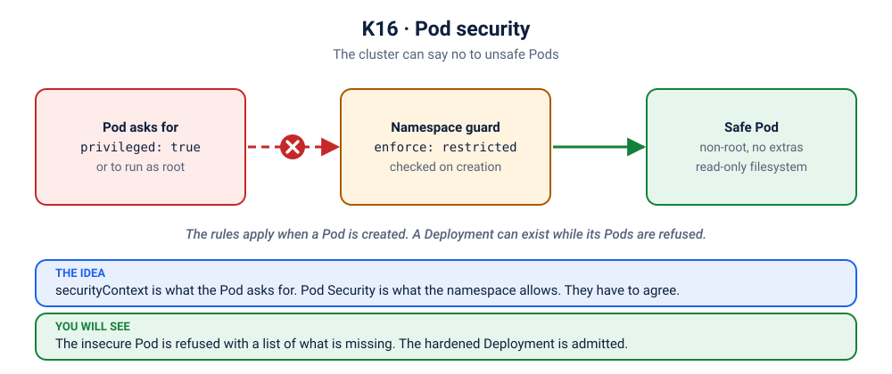

# Lab K16: Pod Security: securityContext & Pod Security Standards

> ⏱ 40 min · 🟡 Intermediate → 🔴 Advanced

## 🎯 What you'll learn
- Harden containers with `securityContext` (the Kubernetes version of [Lab D11](../../docker/11-limits-security/README.md))
- Enforce standards cluster-wide with **Pod Security Admission** (`privileged` / `baseline` / `restricted`)
- Read and fix admission rejections

## 🧠 Concept in 60 seconds



| Standard | Allows | Use for |
|---|---|---|
| `privileged` | everything | system components (CNI, storage drivers) |
| `baseline` | blocks known privilege escalations (hostPath, privileged, hostNetwork...) | most legacy apps |
| `restricted` | requires non-root, no privilege escalation, dropped capabilities, seccomp | **new apps; the target** |

You turn it on per namespace with a **label**. No extra software is needed: it's built into the API server.

## 🧪 Hands-on

### Step 1: A restricted namespace
```bash
kubectl apply -f kubernetes/16-pod-security/namespace.yaml
kubectl get ns secure-lab --show-labels
```

### Step 2: Insecure Pod → rejected
```bash
kubectl apply -f kubernetes/16-pod-security/insecure-pod.yaml
```
Expected:
```
Error from server (Forbidden): ... violates PodSecurity "restricted:latest":
allowPrivilegeEscalation != false, unrestricted capabilities, runAsNonRoot != true, seccompProfile ...
```
🔍 The error is a **checklist**: each item maps to a field.

### Step 3: Deployments fail more quietly ⚠️
```bash
kubectl create deployment naive -n secure-lab --image=nginx:1.27-alpine
kubectl get deploy,pods -n secure-lab              # Deployment exists, 0 Pods!
kubectl get rs -n secure-lab -o name | xargs kubectl describe -n secure-lab | grep -i forbidden | head -2
kubectl delete deploy naive -n secure-lab
```
The Deployment is accepted, but its ReplicaSet can't create Pods. **Always check ReplicaSet events when a Deployment shows 0 Pods.**

### Step 4: The compliant version
Read [`secure-deployment.yaml`](secure-deployment.yaml), then:
```bash
kubectl apply -f kubernetes/16-pod-security/secure-deployment.yaml
kubectl rollout status deploy/api -n secure-lab
POD=$(kubectl get pod -n secure-lab -l app=api -o name)
kubectl exec -n secure-lab $POD -- id                               # uid=10001
kubectl exec -n secure-lab $POD -- sh -c 'touch /app/x' || echo "read-only root ✅"
kubectl exec -n secure-lab $POD -- sh -c 'touch /tmp/x && echo "/tmp writable ✅"'
kubectl exec -n secure-lab $POD -- wget -qO- localhost:8080/healthz; echo
```

### Step 5: Audit an existing namespace before enforcing
```bash
kubectl label --dry-run=server --overwrite ns default pod-security.kubernetes.io/enforce=restricted
```
The warnings list every existing Pod that would violate the standard. This is how you roll out enforcement without breaking production.

## 🏭 In production
- Roll out in stages: `warn` → `audit` → `enforce`.
- Policy engines (**Kyverno**, **OPA Gatekeeper**, built-in **ValidatingAdmissionPolicy**) add rules PSA can't express: "images only from our registry", "every Deployment must have resource requests", "no `:latest` tags".
- Combine with image scanning (Lab D05), RBAC (K14), and NetworkPolicies (K15) for defence in depth.

## 🏆 Challenge
Take `insecure-pod.yaml` and edit it until the `secure-lab` namespace accepts it. How many settings did you have to add?

<details><summary>Check your answer</summary>

Four: `runAsNonRoot`, a `seccompProfile`, `allowPrivilegeEscalation: false` and dropping all capabilities. The refusal message lists all of them, so read the whole message once.
</details>

## ✅ Checkpoint
<details><summary>1. A Deployment shows READY 0/1 and there are no Pods at all. Where do you look?</summary>

`kubectl describe rs` (or the namespace events) for the ReplicaSet. Admission rejections such as PodSecurity or ResourceQuota show up there, not on Pods.
</details>

## 🔥 Now break it
The security rules, from the other side (when they lock *you* out):
- [K21](../scenarios/21-notice-board-runasnonroot/README.md): runAsNonRoot meets an image that wants root
- [K22](../scenarios/22-notice-board-readonly-fs/README.md): a read-only filesystem
- [K43](../scenarios/43-maintenance-van-wants-the-master-key/README.md): a privileged container in a baseline namespace
- [K44](../scenarios/44-the-checklist/README.md): the restricted checklist
- [K45](../scenarios/45-the-locked-down-kitchen/README.md): the restricted boss level

## 🧹 Cleanup
```bash
kubectl delete ns secure-lab
```

➡️ Next: [K17: Scheduling & Availability](../17-scheduling/README.md)
