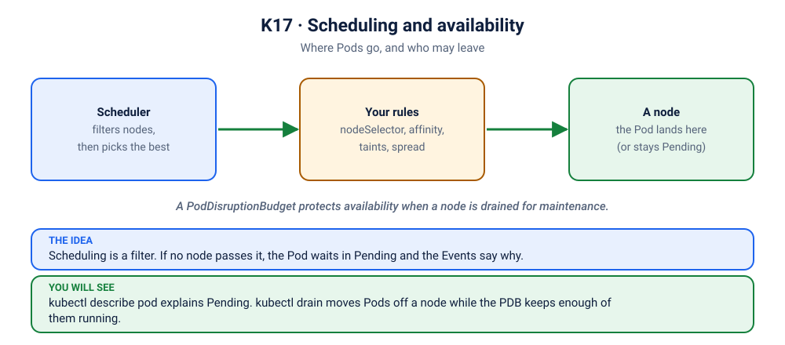

# Lab K17: Scheduling & Availability: Where Pods Run, and Staying Up During Maintenance

> ⏱ 60 min · 🔴 Advanced · Best with a **multi-node** cluster ([kind multi-node setup](../../00-setup/README.md#option-b-docker--kind)). Killercoda also has 2 nodes.

## 🎯 What you'll learn
- Steer Pods with **nodeSelector**, **node affinity**, **taints & tolerations**
- Keep replicas apart with **pod anti-affinity** and **topology spread**
- **cordon / drain** a node for maintenance
- **PodDisruptionBudgets**: never drain away all your replicas

## 🧠 Concept in 60 seconds



| Tool | Who sets it | Effect |
|---|---|---|
| `nodeSelector` / node affinity | Pod | "I want nodes with label X" (attraction) |
| taint on node + toleration on Pod | node + Pod | "keep out unless you tolerate me" (repulsion) |
| pod (anti-)affinity | Pod | "near / away from Pods labelled Y" |
| topologySpreadConstraints | Pod | "spread evenly across nodes/zones" |
| PodDisruptionBudget | app team | "at most N of my Pods may be voluntarily evicted at once" |

## 🧪 Hands-on
```bash
kubectl get nodes            # note your node names; examples use the kind names z2h-worker / z2h-worker2
```

### Step 1: nodeSelector → Pending until a node matches
```bash
kubectl apply -f kubernetes/17-scheduling/placement.yaml
kubectl get pods -l lab=scheduling -o wide
kubectl describe pod needs-ssd | grep -A3 Events     # "didn't match Pod's node affinity/selector"
```
Label a node and watch it schedule:
```bash
NODE=$(kubectl get nodes -o jsonpath='{.items[-1].metadata.name}')
kubectl label node $NODE disktype=ssd
kubectl get pod needs-ssd -o wide                     # Running on $NODE
```

### Step 2: Taints and tolerations
```bash
kubectl label node $NODE dedicated=gpu
kubectl taint node $NODE dedicated=gpu:NoSchedule
kubectl get pod gpu-job -o wide                       # runs: it tolerates the taint
kubectl run no-toleration --image=busybox:1.36 --overrides='{"spec":{"nodeSelector":{"dedicated":"gpu"}}}' -- sleep 3600
kubectl get pod no-toleration                         # Pending: "had untolerated taint"
kubectl delete pod no-toleration
```
🔍 Control-plane nodes use exactly this mechanism: `kubectl describe node <cp-node> | grep Taints`.

### Step 3: Anti-affinity
```bash
kubectl get pods -l app=cache -o wide
```
With 2 worker nodes, only 2 cache Pods run. The 3rd is **Pending**, because the rule is *required*. On a single-node cluster, only 1 runs.

### Step 4: Spread + PDB, then drain a node 🛠
```bash
kubectl taint node $NODE dedicated=gpu:NoSchedule-     # remove the taint first
kubectl apply -f kubernetes/17-scheduling/spread-and-pdb.yaml
kubectl get pods -l app=web -o wide                    # spread across nodes
kubectl get pdb web                                    # ALLOWED DISRUPTIONS: 1
```
Drain one worker, as you would before patching or upgrading it:
```bash
kubectl drain $NODE --ignore-daemonsets --delete-emptydir-data
kubectl get pods -l app=web -o wide                    # moved to the other node(s)
kubectl get nodes                                      # $NODE: SchedulingDisabled
```
🔍 The drain evicts Pods **one at a time within the PDB budget**. If evicting would drop `web` below 3 available, drain waits and retries. That's how clusters upgrade with no downtime.

Bring the node back:
```bash
kubectl uncordon $NODE
```
Existing Pods don't move back automatically; new ones are placed using the spread rules.

## 🏭 In production
- Spread replicas across **zones**: `topologyKey: topology.kubernetes.io/zone`.
- Every production Deployment with 2+ replicas should have a **PDB**. Without one, a node drain can evict all replicas at once.
- But a PDB that allows **zero** disruptions (e.g. `minAvailable` = replicas) blocks drains forever and stalls cluster upgrades. Platform teams watch for this.
- Taints are used for dedicated node pools: GPU nodes, spot/preemptible nodes, system nodes.

## 🏆 Challenge
Cordon one worker node, delete one `web` Pod, and see where its replacement lands. Then uncordon the node.

<details><summary>Check your answer</summary>

On another node: a cordoned node accepts no new Pods, but Pods already running there are left alone. `kubectl uncordon` makes it schedulable again.
</details>

## ✅ Checkpoint
<details><summary>1. A Pod is Pending with "node(s) had untolerated taint". Fix options?</summary>

Add a matching toleration to the Pod (if it should run there), remove the taint from the node, or make sure other untainted nodes have capacity.
</details>
<details><summary>2. What's the difference between cordon and drain?</summary>

`cordon` only marks the node unschedulable, so existing Pods keep running. `drain` cordons and then evicts Pods, respecting PDBs.
</details>

## 🔥 Now break it
Placement and maintenance, when they go wrong:
- [S1.1](../scenarios/1-architecture-and-pod-lifecycle/1-excalidraw-pending/README.md): a Pod stuck Pending
- [S2.3](../scenarios/2-workloads/3-watchman-skipped-a-gate/README.md): a DaemonSet that skips a tainted node
- [S1.x1](../scenarios/1-architecture-and-pod-lifecycle/x1-ai-trainer-needs-gpu/README.md): a Pod that needs a GPU
- [S1.x2](../scenarios/1-architecture-and-pod-lifecycle/x2-whoami-anti-affinity/README.md): anti-affinity with one replica too many
- [S5.x4](../scenarios/5-scaling-self-healing-and-releases/x4-robot-that-cannot-move-the-stalls/README.md): a PodDisruptionBudget that refuses every eviction

## 🧹 Cleanup
```bash
kubectl delete -f kubernetes/17-scheduling/ --ignore-not-found
kubectl label node $NODE disktype- dedicated- 2>/dev/null; kubectl uncordon $NODE
```

➡️ Next: [K18: Capstone: production-grade deployment](../18-capstone/README.md)
