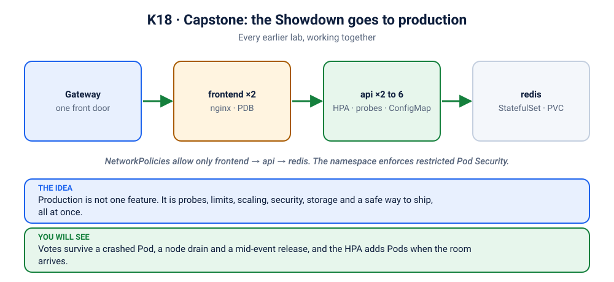

# Lab K18: 🏆 Capstone: The Showdown Goes to Production

> ⏱ 90–120 min · 🔴 Advanced · Uses everything from D01–K17

## 📖 The brief



Tonight is the final. The whole room, maybe the whole campus, will vote **live** in the 🐱 vs 🐶 Showdown. You're the platform engineer. The app must:

1. survive Pod crashes, node maintenance, and a Redis restart **without losing a single vote**
2. ship a new version **mid-event** with **zero failed requests**
3. **scale** when the crowd arrives
4. follow **least privilege**: non-root, read-only filesystem, network-isolated
5. be reachable through a single **Gateway**

```
                   Gateway (showdown.local / localhost)
                           │
                    ┌──────▼──────┐  NetworkPolicies: only frontend → api → redis
 namespace "shop"   │ frontend ×2  │  nginx · PDB
 PSA: restricted    └──────┬──────┘
                           │ http://api:8080
                    ┌──────▼──────┐
                    │   api ×2–6   │  HPA · PDB · probes · ConfigMap · preStop
                    └──────┬──────┘
                           │ redis:6379
                    ┌──────▼──────┐
                    │   redis-0    │  StatefulSet + PersistentVolumeClaim
                    └─────────────┘
```

## Part 1: Read before you apply (15 min)
For every block in [`manifests/`](manifests/), name the lab where you learned it.

| File | Look for |
|---|---|
| [`namespace.yaml`](manifests/namespace.yaml) | Pod Security `restricted` (K16) |
| [`redis.yaml`](manifests/redis.yaml) | StatefulSet, volumeClaimTemplates, headless Service, fsGroup (K10, K16) |
| [`api.yaml`](manifests/api.yaml) | ConfigMap → envFrom (K07), startup/liveness/readiness (K08), resources (K09), rolling strategy + preStop (K06), topology spread (K17), securityContext (K16), `enableServiceLinks: false` ([scenario K15](../scenarios/15-mystery-redis-port/README.md)) |
| [`frontend.yaml`](manifests/frontend.yaml) | read-only root FS with a `/tmp` emptyDir |
| [`resilience.yaml`](manifests/resilience.yaml) | HPA (K13), PDBs (K17), ResourceQuota (K09) |
| [`network-policies.yaml`](manifests/network-policies.yaml) | default deny + explicit allows (K15) |
| [`kustomization.yaml`](manifests/kustomization.yaml) | one command applies everything |

## Part 2: Deploy (15 min)
```bash
docker build -t z2h/api:1.0 apps/api && docker build -t z2h/frontend:1.0 apps/frontend
./scripts/load-image.sh z2h/api:1.0 z2h/frontend:1.0

kubectl kustomize kubernetes/18-capstone/manifests | less       # preview
kubectl apply -k kubernetes/18-capstone/manifests

kubectl -n shop rollout status statefulset/redis
kubectl -n shop rollout status deployment/api
kubectl -n shop rollout status deployment/frontend
kubectl -n shop get all,pvc,hpa,pdb,networkpolicy
```
Open it for the whole room:
```bash
kubectl -n shop port-forward --address 0.0.0.0 svc/frontend 8080:80
# big screen: http://localhost:8080 · phones: http://<laptop-ip>:8080
```
⚠️ `--address 0.0.0.0` opens the app to everyone on the same network. Use it only on a network you trust, and press Ctrl+C when the demo is over. (On a playground such as Killercoda or iximiuz, `--address 0.0.0.0` is how the platform's port link reaches it.)
Or through the Gateway (needs Envoy Gateway from [K12 Step 1](../12-gateway-ingress/README.md)):
```bash
kubectl apply -f kubernetes/18-capstone/gateway.yaml
kubectl -n shop wait gateway/shop --for=condition=Accepted --timeout=2m
kubectl wait -n envoy-gateway-system --for=condition=Ready pod -l gateway.envoyproxy.io/owning-gateway-name=shop --timeout=2m
SVC=$(kubectl get svc -n envoy-gateway-system -l gateway.envoyproxy.io/owning-gateway-name=shop -o jsonpath='{.items[0].metadata.name}')
kubectl -n envoy-gateway-system port-forward svc/$SVC 8888:80
```

## Part 3: 🔥 The Gauntlet (45 min)
Run each experiment **while the room is voting**. Before each one, ask the audience to **predict** what happens; then check the screen. The live health card is your scoreboard: **every failed request counts against you**.

| # | Experiment | Command | Expected |
|---|---|---|---|
| 1 | 💥 Crash button | Press **Crash this server** in the UI 5 times | Pods restart; votes intact; few or no failures |
| 2 | 🪓 Kill every app Pod | `kubectl -n shop delete pod -l app.kubernetes.io/name=api --wait=false` | New tiles on the Pod wall within seconds |
| 3 | 🗄️ Restart the database | `kubectl -n shop delete pod redis-0` | Brief red bar; **every vote survives** (PVC) |
| 4 | 🦄 "One more thing…" | `kubectl -n shop patch cm api-config --type merge -p '{"data":{"APP_VERSION":"2.0.0","VOTE_OPTIONS":"cats:🐱:Cats,dogs:🐶:Dogs,unicorns:🦄:Unicorns"}}'` then `kubectl -n shop rollout restart deploy/api` | Banner, unicorns appear, failed counter stays at 0 (or a rare one-off) |
| 5 | 🙈 Bad release | `kubectl -n shop set image deploy/api api=z2h/api:broken` | Rollout stalls; voting continues. Then `kubectl -n shop rollout undo deploy/api` |
| 6 | 📈 The crowd arrives | `kubectl -n shop run load --image=busybox:1.36 --restart=Never --labels=app.kubernetes.io/name=frontend --overrides='{"spec":{"securityContext":{"runAsNonRoot":true,"runAsUser":1000,"seccompProfile":{"type":"RuntimeDefault"}},"containers":[{"name":"load","image":"busybox:1.36","command":["sh","-c","while true; do wget -qO- http://api:8080/api/burn?seconds=1 >/dev/null; done"],"securityContext":{"allowPrivilegeEscalation":false,"capabilities":{"drop":["ALL"]}}}]}}'` | HPA adds Pods; the Pod wall grows by itself (needs metrics-server, K13) |
| 7 | 🕵️ Intruder | same as #6 but without `--labels`, running `nc -zv -w 3 redis 6379` | Blocked by NetworkPolicy |
| 8 | 👮 Insecure Pod | `kubectl -n shop run root --image=nginx:1.27-alpine` | Rejected by Pod Security |
| 9 | 🛠️ Node maintenance (multi-node) | `kubectl drain <node> --ignore-daemonsets --delete-emptydir-data` | PDBs keep ≥1 api and ≥1 frontend Pod serving |

> 💡 Why does #6 need all that JSON? The namespace enforces the **restricted** Pod Security standard, so even your load generator must be non-root with no capabilities. And why the `frontend` label? Without it, NetworkPolicy blocks it from the API. **Least privilege applies to you too.**

## Part 4: Make it yours (stretch goals)
- [ ] Redis **authentication**: a Secret with a password, `--requirepass`, and AUTH in `app.py`
- [ ] A **CronJob** that snapshots votes every minute (`redis-cli --rdb`) to a second PVC
- [ ] Kustomize **overlays** for `dev` / `prod`, or convert to a **Helm chart**
- [ ] HTTPS on the Gateway with **cert-manager**
- [ ] **Egress** NetworkPolicies, remembering DNS (K15 Step 5)
- [ ] A GitHub Actions pipeline: build → trivy scan → push → `kubectl apply -k`
- [ ] **kube-prometheus-stack** and a Grafana dashboard of votes per second

## ✅ Production-readiness checklist
- [ ] Images pinned, scanned, non-root (D05)
- [ ] ≥2 replicas + PDB + topology spread (K04, K17)
- [ ] Startup, liveness and readiness probes, with liveness never checking dependencies (K08)
- [ ] Requests on everything; memory limits (K09)
- [ ] Config in ConfigMaps; secrets in Secrets or an external store (K07)
- [ ] Persistent data on PVCs, with a tested backup (K10)
- [ ] Graceful shutdown: SIGTERM handling + `preStop` (D05, K06)
- [ ] HPA with sane min/max (K13)
- [ ] Least-privilege RBAC; no token automount unless needed (K14)
- [ ] Default-deny NetworkPolicies (K15)
- [ ] Pod Security `restricted` (K16)
- [ ] Single entry point via Gateway (K12)
- [ ] Everything in Git, applied with one command

## 🧹 Cleanup
```bash
kubectl delete -f kubernetes/18-capstone/gateway.yaml --ignore-not-found
kubectl delete -k kubernetes/18-capstone/manifests      # also deletes the namespace and the Redis PVC
```

🎉 **Zero to hero: done.** Now go break things on purpose: [Kubernetes break-and-fix scenarios](../scenarios/README.md), then 35 more in [troubleshoot-kubernetes-like-a-pro](https://github.com/vellankikoti/troubleshoot-kubernetes-like-a-pro).
