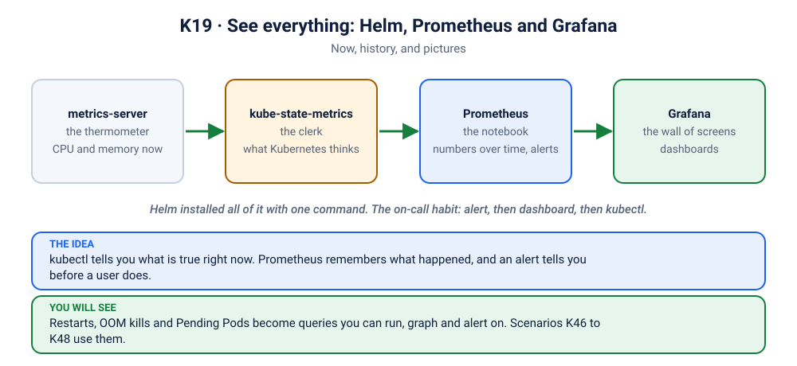

# Lab K19: See Everything: Helm, Prometheus & Grafana

> ⏱ 60 min · 🟡 Intermediate · Needs: K01 to K09, about 2 GB of free memory, `helm` ([install](https://helm.sh/docs/intro/install/))

## 🎯 What you'll learn
- **Helm** in ten minutes: chart, release, values, upgrade, rollback, uninstall
- Install a real-world monitoring stack with **one command** (`kube-prometheus-stack`)
- Read the cluster's story in **Grafana** and ask it questions in **Prometheus**
- The on-call habit: **alert → dashboard → `kubectl`**

## 🧠 Concept in 60 seconds



`kubectl` tells you what is true **right now**. A production team also needs to know what happened an hour ago, and to be woken up when something goes wrong. Four pieces split the job:

| Piece | Think of it as | Answers |
|---|---|---|
| **metrics-server** | a thermometer | "how much CPU and memory right now?" (`kubectl top`, the autoscaler) |
| **kube-state-metrics** | the clerk with the clipboard | "what does Kubernetes *think* is true?" (Pod phase, restarts, replicas wanted vs ready) |
| **Prometheus** | the notebook | "what were the numbers over the last hours?" and "should an alert fire?" |
| **Grafana** | the wall of screens | "show me" |

You do not install these one by one. People use **Helm**, the package manager of Kubernetes: a **chart** is the package, a **release** is one installed copy, and **values** are the settings you change.

## 🧪 Hands-on

### Step 1: Helm in ten minutes
```bash
helm version
helm repo add prometheus-community https://prometheus-community.github.io/helm-charts
helm repo update
helm search repo kube-prometheus-stack
helm show values prometheus-community/kube-prometheus-stack | head -30
```
A chart is just templates plus a values file. See the plain YAML it would create, without installing anything:
```bash
helm template demo prometheus-community/kube-prometheus-stack | grep -c '^kind:'
```
That is how many Kubernetes objects one `helm install` creates. No one writes that by hand.

### Step 2: Install the stack
```bash
./scripts/install-monitoring.sh
```
It installs chart version `93.1.2` into the namespace `monitoring` with lean settings from [`monitoring-values.yml`](monitoring-values.yml): no Alertmanager, no node-exporter, and the control-plane scrapes off (on a laptop cluster they could never be reached and would only raise false alarms). The first run takes a few minutes. Meanwhile:
```bash
helm list -A
kubectl get pods -n monitoring
kubectl get crd | grep monitoring.coreos.com
```
Notice the CRDs: `ServiceMonitor`, `PrometheusRule` and friends. Kubernetes did not know these words before. A chart can teach it new ones (Lab K12 did the same with the Gateway API).

### Step 3: Grafana, the wall of screens
```bash
kubectl port-forward -n monitoring svc/kube-prometheus-stack-grafana 3000:80
```
Open http://localhost:3000 and log in with `admin` / `z2h-grafana` (a lab password: never use a fixed one for real). Go to **Dashboards** and open:
1. **Kubernetes / Compute Resources / Cluster**: the whole cluster at a glance.
2. **Kubernetes / Compute Resources / Namespace (Pods)**: pick `kube-system`. Match each line to a Pod from the K01 tour.
3. **Kubernetes / Compute Resources / Pod**: pick one Pod and compare its CPU and memory with its requests and limits (Lab K09 made visible).

### Step 4: Prometheus, ask your own question
```bash
kubectl port-forward -n monitoring svc/kube-prometheus-stack-prometheus 9090:9090
```
Open http://localhost:9090, **Graph**, and run these one at a time:

| Question | Query |
|---|---|
| Is everything being scraped? | `up` |
| How many Pods per namespace? | `count by (namespace) (kube_pod_info)` |
| Who restarted in the last 15 minutes? | `increase(kube_pod_container_status_restarts_total[15m]) > 0` |
| Who was killed for memory? | `kube_pod_container_status_last_terminated_reason{reason="OOMKilled"} == 1` |
| Which Pods are stuck Pending? | `kube_pod_status_phase{phase="Pending"} == 1` |
| Who uses the most CPU? | `topk(5, sum by (namespace, pod) (rate(container_cpu_usage_seconds_total{container!=""}[2m])))` |

Each row is a scenario you already know: restarts are K03 and K07, OOM kills are K08 and K20, Pending is K09 and K16 to K18. Now you can see them **before** a user complains.

### Step 5: Alerts
Open **Alerts** in the Prometheus UI. A rule is a query plus a condition. Every red line there is a question someone decided was worth waking a person for. In real teams they go to Slack or a pager (that is Alertmanager's job, which we left out).

A real alert waits before it fires, so one blip does not wake anyone. Try it: run scenario [K03](../scenarios/03-showdown-crashloop/README.md) (a crash loop) and watch **KubePodCrashLooping**. It goes *pending* first and only turns *firing* after several minutes, because the rule says "for 15 minutes". That patience is on purpose.

### Step 6: Helm, the second half
```bash
helm get values kube-prometheus-stack -n monitoring           # what you changed
helm upgrade kube-prometheus-stack prometheus-community/kube-prometheus-stack \
  --version 93.1.2 -n monitoring --reuse-values --set prometheus.prometheusSpec.retention=3h
helm history kube-prometheus-stack -n monitoring
helm rollback kube-prometheus-stack 1 -n monitoring           # back to revision 1
```
Helm keeps every revision, so a bad upgrade has an undo, just like `kubectl rollout undo` (Lab K06).

## 🏭 In production
- Prometheus stores numbers for days or weeks. Teams add long-term storage (Thanos, Mimir) and Alertmanager to route pages.
- The alert rules matter more than the dashboards: dashboards are for looking, alerts are for being told.
- Pin chart versions and keep your values in Git. `helm upgrade` from a laptop is how outages start.

## 🏆 Challenge
Without opening a dashboard, write the one query that lists every Pod whose container is using more than 80% of its **memory limit**. Hint: the numbers are `container_memory_working_set_bytes` and `kube_pod_container_resource_limits{resource="memory"}`.

<details><summary>Check your answer</summary>

```
container_memory_working_set_bytes{container!=""}
  / on (namespace, pod, container) kube_pod_container_resource_limits{resource="memory"} > 0.8
```
Usage divided by limit, matched on the same Pod and container. Anything above 0.8 is close to being OOM-killed (K08, K20). Scenario [K20](../scenarios/20-surprise-limitrange-oom/README.md) is exactly this failure.
</details>

## 🔥 Now break it
Every scenario can now be watched, not only read with `kubectl`. These carry a short "👀 See it in monitoring" tip with the exact query:
- [K01](../scenarios/01-excalidraw-pending/README.md) a Pod stuck Pending · [K02](../scenarios/02-image-typo/README.md) a bad image name · [K03](../scenarios/03-showdown-crashloop/README.md) a crash loop
- [K08](../scenarios/08-ai-trainer-oomkilled/README.md) and [K20](../scenarios/20-surprise-limitrange-oom/README.md) memory kills · [K11](../scenarios/11-showdown-bad-rollout/README.md) a stuck rollout · [K25](../scenarios/25-showdown-hpa-not-scaling/README.md) the autoscaler

## ✅ Checkpoint
<details><summary>1. <code>kubectl top</code> and Prometheus both show CPU. What does Prometheus add?</summary>

History. `kubectl top` is the number right now; Prometheus keeps the numbers over time, so you can see what happened an hour ago, draw a graph, and fire an alert.
</details>
<details><summary>2. What is the difference between a chart and a release?</summary>

A chart is the package (templates plus default values). A release is one installed copy of it in a cluster. You can install the same chart twice under two release names.
</details>
<details><summary>3. Why is kube-state-metrics needed when the kubelet already reports container usage?</summary>

The kubelet reports what containers *use*. kube-state-metrics reports what Kubernetes *believes*: how many replicas are wanted and ready, which Pods are Pending, why a container last died. Restarts and OOM kills come from there.
</details>

## 🧹 Cleanup
```bash
./scripts/uninstall-monitoring.sh
```
It removes the release, the namespace and the CRDs the chart added (Helm never deletes CRDs). metrics-server stays.
