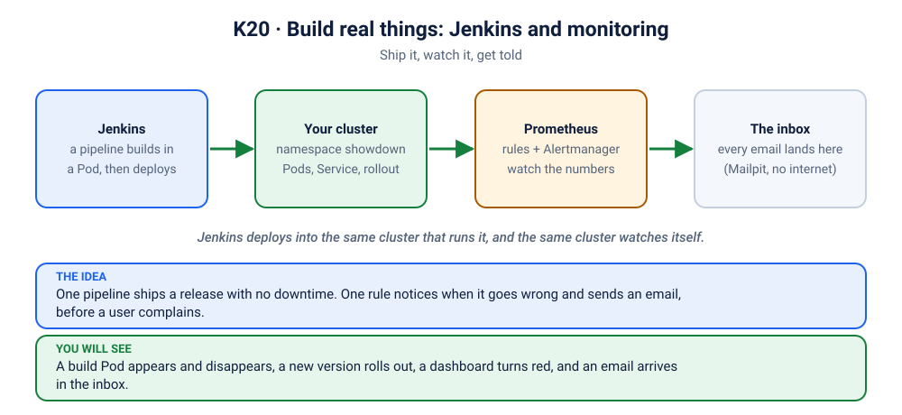

# Lab K20: Build Real Things: Two Projects, 30 Minutes Each

> ⏱ 70 min (2 × 30 min + setup) · 🟡 Intermediate · Needs: K01 to K09 and K19, about 4 GB of free memory, `helm`
>
> 🧭 This is the lab where the pieces come together. Follow it **live**, one command at a time.



## 🎯 What you will have at the end
- **Project 1, "Ship it":** a Jenkins that runs *inside your cluster*, builds in throwaway Pods, and **deploys and releases an app into the same cluster**, with an email for every success and failure.
- **Project 2, "Know before your users do":** a Grafana dashboard of the whole cluster, alerts that watch the app, and an **email that arrives while you are still breaking it**.

Everything runs on your laptop. No cloud account, no real email server (a local inbox catches every message).

## 🧰 Setup: do this before you start (about 10 minutes)
```bash
./scripts/install-metrics-server.sh       # the thermometer
./scripts/install-monitoring.sh           # Prometheus, Grafana, Alertmanager and the mail catcher
./scripts/install-jenkins.sh              # Jenkins
kubectl get pods -A | grep -v Running     # anything still starting? wait, then run it again
```
Open three terminals and leave these running (one per window):
```bash
kubectl port-forward -n jenkins svc/jenkins 8081:8080                              # http://localhost:8081  admin / z2h-jenkins
kubectl port-forward -n monitoring svc/kube-prometheus-stack-grafana 3000:80        # http://localhost:3000  admin / z2h-grafana
kubectl port-forward -n mail svc/mailpit 8025:8025                                  # http://localhost:8025  (the inbox)
```
(Passwords like these are for a lab. Never use fixed passwords for real.) Make sure the course images are loaded ([K01 Step 8](../01-cluster-tour/README.md)): the app deployed here uses `z2h/api:1.0` and `z2h/frontend:1.0`.

## 🚀 Project 1: Ship it with Jenkins (30 min)

**Story.** A team wants "push a button, the app is deployed". Jenkins is the button. The twist: Jenkins runs in the same cluster it deploys to, so its build agents are Pods.

### Step 1: Jenkins is just Kubernetes (3 min)
```bash
kubectl get pods,statefulset,svc,sa -n jenkins
```
Jenkins is a StatefulSet with a Service and a ServiceAccount, the same objects you built in K04, K05, K10 and K14. Nothing magic.

### Step 2: Who may deploy what? (3 min)
Jenkins builds run as the ServiceAccount `jenkins-deployer`. It may touch **only** namespace `showdown` ([`rbac.yaml`](rbac.yaml), Lab K14):
```bash
kubectl auth can-i create deployments -n showdown    --as=system:serviceaccount:jenkins:jenkins-deployer
kubectl auth can-i create deployments -n kube-system --as=system:serviceaccount:jenkins:jenkins-deployer
```
`yes`, then `no`. Least privilege, working.

### Step 3: Create the first job (5 min)
In Jenkins (http://localhost:8081): **New Item** → name `deploy-showdown` → **Pipeline** → OK. Under **Pipeline**, choose **Pipeline script from SCM**:
- SCM: **Git**, Repository URL: `https://github.com/vellankikoti/docker-k8s-zero-to-hero.git` (or your own fork)
- Branch: `*/main`
- Script Path: `kubernetes/20-projects/Jenkinsfile.deploy`

**Save.** Open [`Jenkinsfile.deploy`](Jenkinsfile.deploy) next to it: five stages, about 40 lines. Read it out loud once.

### Step 4: Create the second job (2 min)
Same again: name `release-showdown`, Script Path `kubernetes/20-projects/Jenkinsfile.release`.

### Step 5: Break it first, on purpose (3 min)
Run **`release-showdown`** now: **Build Now**. The app is not deployed yet, so the release has nothing to update, and it fails. Open the build, then **Console Output**: read the error. Now open the inbox (http://localhost:8025): a **❌ Showdown release FAILED** email has arrived. A failed pipeline that nobody hears about is the worst kind.

### Step 6: Deploy for real (5 min)
Start `deploy-showdown` with **Build Now**, and watch the cluster work, in another terminal:
```bash
kubectl get pods -n jenkins -w
```
A Pod named after the build **appears, runs, and disappears**. That is the build agent. When it finishes:
```bash
kubectl get all -n showdown
kubectl port-forward -n showdown svc/frontend 8080:80          # http://localhost:8080: vote!
```
The inbox has a **✅ Showdown deployed** email.

### Step 7: Release 2.0.0 with no downtime (5 min)
Open the app and keep voting. Then run **`release-showdown`** again. Watch the Pods roll (Lab K06) and refresh the app: a banner announces **version 2.0.0** and a 🦄 option appears. A ✅ email follows.
```bash
kubectl rollout history deployment/api -n showdown
```

### Step 8: Connect the dots (4 min)
Say it out loud, in plain words: *"A pipeline is a script in Git. Jenkins runs it in a Pod. The Pod's ServiceAccount decides what it may change. The change is a Deployment rollout."* Every noun in that sentence is a lab you did.

## 📊 Project 2: Know before your users do (30 min)

**Story.** The release is out. Now someone has to notice when it breaks, before the users do.

### Step 1: Teach Prometheus what to watch (4 min)
```bash
kubectl apply -f kubernetes/20-projects/alerts.yaml -f kubernetes/20-projects/dashboard.yaml
```
Two objects: [`alerts.yaml`](alerts.yaml) holds three rules (a `PrometheusRule`, a word Kubernetes learned from the Helm chart) and [`dashboard.yaml`](dashboard.yaml) is a dashboard stored as a ConfigMap. Grafana picks it up by itself because of the label `grafana_dashboard: "1"`. Everything as code, in Git, no clicking.

### Step 2: Look at the wall of screens (5 min)
Grafana (http://localhost:3000) → **Dashboards** → **Showdown + cluster at a glance** (give it a minute to appear). Walk the top row (nodes, Pods running, Pending, restarts, api Pods, alerts) and the graphs below. Then open **Kubernetes / Compute Resources / Namespace (Pods)** for `showdown` to compare.

### Step 3: Put some traffic on it (2 min)
```bash
kubectl run traffic -n showdown --image=busybox:1.36 --restart=Never -- \
  sh -c 'while true; do wget -q -O /dev/null "http://frontend/api/vote?option=cats"; sleep 1; done'
```
The CPU graph for `showdown` starts to move.

### Step 4: Incident 1, the app disappears (6 min)
```bash
kubectl scale deployment api -n showdown --replicas=0
```
Watch, in this order: the **"api Pods available"** tile turns red; in Prometheus (`kubectl port-forward -n monitoring svc/kube-prometheus-stack-prometheus 9090:9090`, http://localhost:9090/alerts) **ShowdownApiDown** goes *pending*, then *firing* (the rule says "for 30 seconds"); and about a minute later an email **[FIRING] ShowdownApiDown** arrives in the inbox. Fix it and watch the **[RESOLVED]** email follow:
```bash
kubectl scale deployment api -n showdown --replicas=3
```

### Step 5: Incident 2, a bad release (8 min)
This is a scenario you already know ([K03](../scenarios/03-showdown-crashloop/README.md), [K11](../scenarios/11-showdown-bad-rollout/README.md)), now seen from the control room:
```bash
kubectl set env deployment/api -n showdown PORT=eighty
kubectl rollout status deployment/api -n showdown --timeout=60s
kubectl get pods -n showdown
```
The new Pod crash-loops, the rollout is stuck, **and the old Pods keep serving** (keep voting: it still works). The dashboard's restart graph climbs and **ShowdownPodRestarting** mails you. Roll back:
```bash
kubectl rollout undo deployment/api -n showdown
```

### Step 6: Connect the dots (5 min)
Ask the room: *"Which of these did kubectl tell you? Which did only the graph or the email tell you?"* The graph shows **when it started and how bad**; the email tells you **without you looking**; `kubectl` tells you **why**. You need all three.

## 🧯 If something goes wrong
| Symptom | Fix |
|---|---|
| `install-jenkins.sh` times out | the first start downloads plugins: wait, then `kubectl get pods -n jenkins` and run the script again |
| The build agent Pod stays `Pending` or `ImagePullBackOff` | the node cannot pull `curlimages/curl` or the Jenkins agent image: check your connection |
| The build fails at "Get kubectl" | the agent has no internet: it downloads `kubectl` from `dl.k8s.io` |
| `Forbidden` in the deploy stage | `kubectl apply -f kubernetes/20-projects/rbac.yaml`, then build again |
| The app Pods are `ErrImageNeverPull` | the course images are not loaded: [K01 Step 8](../01-cluster-tour/README.md) |
| No email arrives | open http://localhost:8025 first; alert mail needs about a minute; check `kubectl get pods -n mail` |
| The dashboard is missing | wait a minute; check `kubectl get cm -n showdown -l grafana_dashboard=1` |

## ✅ Checkpoint
<details><summary>1. Why did the build agent show up as a Pod?</summary>

Jenkins asks Kubernetes for a Pod for each build (through its Kubernetes plugin) and deletes it afterwards. Builds are isolated, cheap and never leave a mess on a long-lived server.
</details>
<details><summary>2. Why can the deploy job change namespace <code>showdown</code> but not <code>kube-system</code>?</summary>

Its ServiceAccount is bound only to a Role in <code>showdown</code> (RBAC, Lab K14). Anything not allowed is denied.
</details>
<details><summary>3. Why did the alert wait before it fired?</summary>

The rule says <code>for: 30s</code>: the condition must stay true that long. It stops one short blip from waking anyone. Real teams use minutes.
</details>

## 🧹 Cleanup
```bash
kubectl delete pod traffic -n showdown --ignore-not-found
./scripts/uninstall-jenkins.sh        # Jenkins, namespaces jenkins and showdown
./scripts/uninstall-monitoring.sh     # Prometheus, Grafana, Alertmanager
kubectl delete namespace mail --ignore-not-found
```
