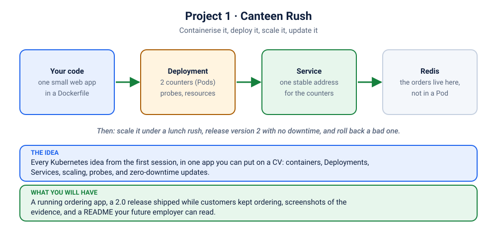

# Project 1 · Canteen Rush: Containerise It, Deploy It, Scale It, Update It

> ⏱ about 2.5 hours at your own pace (the ⭐ phases, about 45 minutes, are the live path) · 🟡 Intermediate · **Lab exercise 5** of the syllabus
>
> You will build this **once with us, then again with your own idea**. By the end you have a running project, evidence it works, and a README an interviewer can read in two minutes.



## 🍵 The story
College fest day. The canteen has one rule: *nobody leaves hungry, nobody waits long*. You have written a tiny ordering app. On your laptop it works. Now 3,000 hungry people arrive. Your job is to make it survive the lunch rush, ship the new menu *while people are ordering*, and survive the one bad release that every team eventually ships.

This is the same problem a real company has, at a size you can run on a laptop.

## 🎯 What this project covers (the syllabus, in one place)
| Syllabus topic | Where you use it |
|---|---|
| Container runtime and images | Phase 1 (build, run, inspect), Phase 2 (the cluster pulls the same image) |
| Kubernetes architecture: who does what | Phase 3 ("follow the apply") |
| Pods and lifecycle | Phases 3 and 5 |
| Deployments and ReplicaSets | Phases 3, 6 and 7 |
| Services | Phase 3 |
| Labels and annotations | Phases 3 and 7 |
| Namespaces and resource quotas | Phase 3 |
| Health probes and self-healing | Phase 5 |
| Autoscaling | Phase 6 |
| Rolling updates and deployment strategies | Phase 7 |
| Troubleshooting | Phase 8 |

## 🧰 Before you start
- A working cluster and `kubectl` ([setup](../../README.md)), metrics-server installed (`./scripts/install-metrics-server.sh`).
- Docker, to build the image.
- Optional but nice: `kubens` ([install](../../README.md)).
- Two terminals. One for commands, one for watching.

---

## Phase 0 · Meet the app (5 min)
It is a small Python web server. Read [`apps/canteen/app.py`](../../../apps/canteen/app.py) for two minutes, especially the endpoints listed at the top. Then run it with no Docker at all:
```bash
cd apps/canteen
python3 app.py                       # leave it running
```
In a second terminal:
```bash
curl -s localhost:8080/api/info
curl -s "localhost:8080/api/order?item=chai"
curl -s localhost:8080/healthz
```
Open http://localhost:8080 and order something. Stop the app with Ctrl+C.

✅ **Done when** you have ordered a chai and seen the count go up.

## Phase 1 · Put it in a container (10 min)
```bash
cd ../..                                              # back to the repo root
docker build -t canteen-rush:1.0.0 apps/canteen
docker run --rm -d --name canteen -p 8081:8080 canteen-rush:1.0.0
curl -s localhost:8081/api/info
docker logs canteen
docker exec canteen id -u                             # 10001: not root
docker stop canteen
```
Open [`apps/canteen/Dockerfile`](../../../apps/canteen/Dockerfile) and answer in your own words: *why a non-root user? why the exec-form `CMD`? why a pinned base image?* ([Docker labs D04 and D05](../../../docker/05-production-dockerfiles/README.md) explain each.)

> **Container runtime, in one line.** Docker built this image, but your cluster does not use Docker to run it. Nodes use a runtime such as **containerd**. The image is a standard OCI image, so both run the same bytes.

Build version 2 now, so it is ready for Phase 7 (same code, a different version label):
```bash
docker build -t canteen-rush:2.0.0 --build-arg VERSION=2.0.0 apps/canteen
```
✅ **Done when** you can explain the difference between an image and a container.

## Phase 2 · Get the image to the cluster (3 min)
```bash
./scripts/load-image.sh canteen-rush:1.0.0 canteen-rush:2.0.0
```
Your cluster nodes cannot see images on your laptop, so this copies them in. (In a company you would push to a registry instead; the Deployment would not change.)

## Phase 3 · ⭐ First deployment (10 min)
A namespace with a budget, then the app:
```bash
P=kubernetes/projects/project-1-canteen-rush/k8s
kubectl apply -f $P/00-namespace.yaml
kubectl apply -f $P/20-canteen-memory.yaml -f $P/22-service.yaml
kubectl get all -n canteen
kubectl describe quota -n canteen
kubectl port-forward -n canteen svc/canteen 8080:80
```
Open http://localhost:8080. Order a few things and refresh a few times.

**What is odd? Look at the numbers and the coloured chips.** Each refresh may show different totals. Each Pod keeps orders in *its own memory*, and the Service spreads you across two Pods. That is a bug you will fix in Phase 4.

**Follow the apply: who did what?** This is the architecture lesson, from real evidence:
```bash
kubectl get events -n canteen --sort-by=.lastTimestamp
kubectl get pods -n canteen -o wide --show-labels
kubectl get rs -n canteen
kubectl get pod -n canteen -o custom-columns=NAME:.metadata.name,OWNER:.metadata.ownerReferences[0].name,NODE:.spec.nodeName
```
<details><summary>Match each event to the component that caused it</summary>

| You see | Component |
|---|---|
| your `kubectl apply` was accepted and stored | **API server** (and **etcd**, its memory) |
| a ReplicaSet and two Pods appear | **Deployment controller** and **ReplicaSet controller** (in the controller-manager) |
| `Scheduled` (a node was chosen) | **kube-scheduler** |
| `Pulled`, `Created`, `Started` | **kubelet** on that node, asking the container runtime (**containerd**) |
| a request reaches a Pod through the Service | **kube-proxy** rules on the node |
</details>

Also notice: Pods wear labels (`app=canteen`, `tier=web`); the **ReplicaSet** owns the Pods; the Deployment owns the ReplicaSet; the **Service** finds Pods *only by label*. And `kubectl describe quota` shows the namespace budget in use.

✅ **Done when** you can name which component did each step above.

## Phase 4 · ⭐ Put the state outside (8 min)
```bash
kubectl apply -f $P/10-redis.yaml
kubectl apply -f $P/21-canteen.yaml
kubectl rollout status deployment/canteen -n canteen
```
`21-canteen.yaml` is the same app, with orders sent to Redis, probes added, resources declared and a safe update strategy. Applying it to the existing Deployment is your first **rolling update**. Refresh the page: every counter now shows the **same** numbers. Prove they survive:
```bash
kubectl delete pod -n canteen -l app=canteen
```
Order again: the totals did not reset.

✅ **Done when** the totals survive deleting every Pod.
📸 **Evidence:** screenshot the page showing Redis storage and the same totals before and after.

## Phase 5 · Self-healing and probes (8 min)
Two terminals: `kubectl get pods -n canteen -w` in one.

1. **Crash a counter.** Press the 💥 button on the page. Watch `RESTARTS` go up by one and a new container start. `kubectl describe pod -n canteen <name>` shows `Last State: Terminated, Exit Code: 1`.
2. **Delete a Pod.** `kubectl delete pod -n canteen <name>`. Another appears *before* you finish typing: the ReplicaSet notices the gap.
3. **Make the app "not ready".** The readiness probe also checks Redis. Take Redis away:
   ```bash
   kubectl scale deployment redis -n canteen --replicas=0
   kubectl get pods -n canteen
   kubectl get endpointslices -n canteen
   ```
   Pods turn `0/1`, restarts stay `0`, and the Service has **no endpoints**: the page stops answering. Bring Redis back (`--replicas=1`) and the Pods become Ready *by themselves*, with no restart.

**Say it in plain words:** *liveness restarts a container that is stuck. Readiness only stops sending it customers.*

✅ **Done when** you can explain why step 3 produced no restarts.

## Phase 6 · ⭐ Scale it: by hand, then automatically (12 min)
```bash
kubectl scale deployment canteen -n canteen --replicas=5
kubectl get pods -n canteen
```
Refresh the page: more coloured chips appear, one per counter that answered you. Now let Kubernetes decide:
```bash
kubectl apply -f $P/30-hpa.yaml
kubectl get hpa -n canteen -w                 # in a second terminal
```
Start the lunch rush (three customers, each asking a counter to work hard):
```bash
kubectl apply -f $P/40-rush.yaml
kubectl scale deployment rush -n canteen --replicas=3
kubectl top pods -n canteen
```
Watch `TARGETS` climb past `50%` and `REPLICAS` grow (up to 8). Send the customers home: `kubectl scale deployment rush -n canteen --replicas=0`, and watch the Pods shrink back after about a minute.

> **The rule behind it:** the target is *a percentage of what the Pod requested* (50m). No request, no percentage, and the autoscaler shows `<unknown>`.

✅ **Done when** you have seen the Pod count rise and fall without touching it.
📸 **Evidence:** a screenshot or paste of `kubectl get hpa -n canteen` showing REPLICAS above the minimum.

## Phase 7 · ⭐ Release version 2 while customers are ordering (15 min)
Start a watcher that asks the app for its version twice a second and shouts if it fails:
```bash
kubectl run watcher -n canteen --image=busybox:1.36 --restart=Never -- sh -c \
  'while true; do v=$(wget -q -T 2 -O - http://canteen/api/info | grep -o "\"version\": \"[^\"]*\""); echo "$(date +%T) ${v:-FAILED}"; sleep 0.5; done'
kubectl logs -f watcher -n canteen
```
Keep that log visible. In another terminal, **release 2.0.0**:
```bash
kubectl set image deployment/canteen canteen=canteen-rush:2.0.0 -n canteen
kubectl annotate deployment/canteen -n canteen kubernetes.io/change-cause="v2.0.0: new menu banner" --overwrite
kubectl rollout status deployment/canteen -n canteen
kubectl get rs -n canteen
kubectl rollout history deployment/canteen -n canteen
```
The watcher flips from `1.0.0` to `2.0.0` with **no FAILED line**. Refresh the page: a banner announces the release. Why was there no downtime? `maxUnavailable: 0` means an old Pod is only removed after a new one is Ready.

**Now ship a bad release** (the one every team ships):
```bash
kubectl set image deployment/canteen canteen=canteen-rush:9.9.9 -n canteen
kubectl get pods -n canteen
```
The new Pod sits in `ErrImagePull` / `ImagePullBackOff`, the rollout is stuck, **and the old Pods keep serving**: check the watcher. Undo it:
```bash
kubectl rollout undo deployment/canteen -n canteen
kubectl rollout status deployment/canteen -n canteen
```
**Compare strategies.** Switch to `Recreate` (stop everything, then start) and downgrade:
```bash
kubectl patch deployment canteen -n canteen -p '{"spec":{"strategy":{"type":"Recreate","rollingUpdate":null}}}'
kubectl set image deployment/canteen canteen=canteen-rush:1.0.0 -n canteen
```
The watcher prints **FAILED** lines: that gap is the cost of `Recreate`. Restore the safe strategy and the new version:
```bash
kubectl patch deployment canteen -n canteen -p '{"spec":{"strategy":{"type":"RollingUpdate","rollingUpdate":{"maxSurge":1,"maxUnavailable":0}}}}'
kubectl set image deployment/canteen canteen=canteen-rush:2.0.0 -n canteen
kubectl delete pod watcher -n canteen
```
<details><summary>Where do blue/green and canary fit?</summary>

Blue/green runs two Deployments side by side and moves the Service's selector (or a route) from one to the other in a single step. A canary sends a small share of traffic to the new version first: lab [K12](../../12-gateway-ingress/README.md) does it with Gateway API weights. Rolling update is the default because it needs no extra tooling.
</details>

✅ **Done when** a release finished with no FAILED line, a bad release was undone, and you can say when `Recreate` is acceptable (a batch app that can pause; a database that cannot have two copies).
📸 **Evidence:** the watcher log across the 1.0.0 to 2.0.0 flip.

## Phase 8 · Break it, fix it (15 min, optional but best for learning)
Three sabotages. For each: predict, run, find the cause, fix it.

| # | Sabotage | What to look at | Related scenario |
|---|---|---|---|
| 1 | `kubectl patch service canteen -n canteen -p '{"spec":{"selector":{"app":"canteeen"}}}'` | `kubectl get endpointslices -n canteen` | "The signboard that points at nobody" |
| 2 | `kubectl patch deployment canteen -n canteen --type json -p '[{"op":"replace","path":"/spec/template/spec/containers/0/readinessProbe/httpGet/path","value":"/nope"}]'` | the rollout stalls, old Pods keep serving | "The doorbell on the wrong door" |
| 3 | `kubectl set resources deployment canteen -n canteen --requests=memory=64Gi` | `kubectl describe rs -n canteen`: the **quota** refuses | "The deploy that created nothing" |

Fix #2 and #3 with `kubectl rollout undo`; fix #1 by patching the selector back to `canteen`.

## Phase 9 · Showcase it (20 min)
A project nobody can see is a project that never happened.

**1. Evidence folder.** Keep the 📸 items, plus `kubectl get all -n canteen -o wide` and `kubectl rollout history deployment/canteen -n canteen`.

**2. A README for your repository.** Copy this and fill in your own words:
```markdown
# <Your project name>
<One sentence: what it does and who it is for.>

## Architecture
<A small diagram or list: user -> Service -> Deployment (N Pods) -> Redis.>

## What I built
- Containerised a <language> service (non-root image, health endpoints).
- Deployed it on Kubernetes: a Deployment, a Service and Redis for state.
- Added probes, resource requests and limits, and a namespace quota.
- Autoscaled it with an HPA and proved it under load (screenshot).
- Shipped version 2 with a zero-downtime rolling update, and rolled back a bad release.

## Run it
<The exact commands, in order, that a stranger could copy.>

## What I learned / what broke
<Two or three honest bullets. This is what interviewers read first.>
```

**3. Resume bullets (pick two, use your real numbers):**
- *Containerised and deployed a web service on Kubernetes (Deployments, Services, probes, resource limits) and shipped zero-downtime rolling updates with tested rollback.*
- *Configured Horizontal Pod Autoscaling from 2 to 8 replicas under synthetic load and verified scale-up and scale-down using `kubectl` and metrics-server.*
- *Diagnosed and fixed Service selector, readiness-probe and quota failures using events, `describe` and rollout history.*

**4. Be ready for these questions:**
1. What happens between `kubectl apply` and a Pod running? (Phase 3 table.)
2. Liveness versus readiness: what did you see when Redis disappeared?
3. How did you get zero downtime? What do `maxSurge` and `maxUnavailable` do?
4. Why does the autoscaler need a CPU request?
5. A release is stuck at 1 of 2 new Pods. What do you check, in order?
6. Why is state in Redis and not in the Pod?
7. When would you choose `Recreate`?
8. What does the ResourceQuota protect against?

## 🧑‍🍳 Make it yours: your own Project 1
Do the phases again with **your own idea** (a hostel mess token system, a library seat tracker, a gym slot booker, an exam-hall finder). Your app can be in any language, as long as it keeps this contract:

| The contract | Why |
|---|---|
| listens on one port (8080) and logs to stdout | so a Service and `kubectl logs` just work |
| answers `/healthz` (alive) and `/readyz` (ready) | so probes have something honest to ask |
| takes its settings from environment variables | so config changes need no rebuild |
| keeps state outside (Redis, a database), not in memory | so Pods can come and go |
| runs as a non-root user | so it passes real security rules |

Swap these in the manifests: the image name, the port, the env, the probe paths. Keep these **eight things** in your version: a Dockerfile, a Deployment with probes and resources, a Service, a namespace with a quota, an HPA, a rolling update with a rollback, an evidence folder, and a README.

**How a mentor can mark it (out of 20):**
| | 0 | 1 | 2 |
|---|---|---|---|
| Image is small, pinned and non-root | | | |
| Probes are honest (they check something real) | | | |
| Requests and limits are set on purpose | | | |
| State survives deleting every Pod | | | |
| Autoscaling shown with evidence | | | |
| A release with no failed requests, shown | | | |
| A bad release rolled back, shown | | | |
| Labels and annotations are used, not decoration | | | |
| README lets a stranger run it | | | |
| "What broke" section is honest | | | |

## 🧯 If something goes wrong
| Symptom | Fix |
|---|---|
| `ErrImageNeverPull` or `ImagePullBackOff` on `canteen-rush:1.0.0` | the image is not on the nodes: `./scripts/load-image.sh canteen-rush:1.0.0` |
| Pods stay `Pending` and the ReplicaSet says `exceeded quota` | the namespace budget is full: `kubectl describe quota -n canteen`, scale something down |
| `kubectl get hpa` shows `<unknown>` | metrics-server is not working: `kubectl top nodes`, then `./scripts/install-metrics-server.sh` |
| The page loads but numbers differ per refresh | you are still on `20-canteen-memory.yaml`: apply `10-redis.yaml` and `21-canteen.yaml` |
| `port-forward` says the port is busy | use another local port: `8082:80` |

## 🧹 Clean up
```bash
kubectl delete namespace canteen
```
Then continue with [Project 2](../project-2-canteen-helm/README.md): the same canteen, with a menu, a secret, scheduled jobs and a Helm chart.
