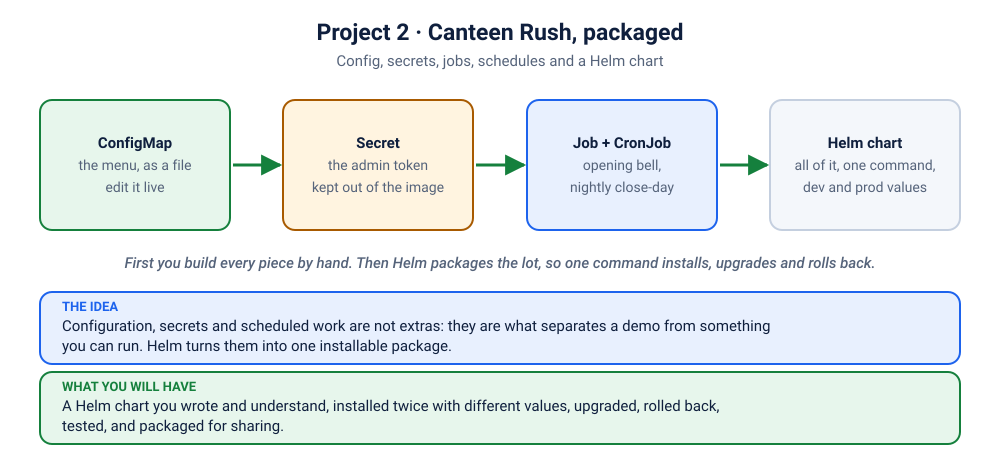

# Project 2 · Canteen Rush, Packaged: Config, Secrets, Jobs, CronJobs and Helm

> ⏱ about 2.5 hours at your own pace (the ⭐ phases, about 50 minutes, are the live path) · 🟡→🔴 Intermediate · **Lab exercise 6** of the syllabus
>
> Project 1 made the canteen *run*. This project makes it *operable*: a menu you can change, a secret you can rotate, work that happens at night, and one command that installs the lot.



## 🔔 The story
The fest is over, and the canteen is staying. Now real life arrives: the menu changes every week (and nobody wants a rebuild), the "close the day" button must not be pressed by strangers, someone has to total the sales at midnight *without a human*, and the college wants a second canteen in the other campus with different numbers. Copy-pasting YAML will not survive that. A **Helm chart** will.

## 🎯 What this project covers
| Syllabus topic | Where |
|---|---|
| ConfigMaps | Phases 1 to 3 |
| Secrets | Phases 1, 2, 4 and 6 |
| Jobs | Phase 5 |
| CronJobs | Phase 6 |
| Helm charts (install, values, upgrade, rollback, test, package) | Phases 7 to 9 |
| Deployments, Services, probes, labels, quotas (revision from Project 1) | all along |
| Troubleshooting | the drills in Phases 3, 5, 6 and 8 |

## 🧰 Before you start
- A cluster, `kubectl` and **`helm`** ([install](../../README.md)).
- The app images loaded (Project 1, Phases 1 and 2): `canteen-rush:1.0.0` and `canteen-rush:2.0.0`. If not: `docker build -t canteen-rush:1.0.0 apps/canteen`, `docker build -t canteen-rush:2.0.0 --build-arg VERSION=2.0.0 apps/canteen`, then `./scripts/load-image.sh canteen-rush:1.0.0 canteen-rush:2.0.0`.
- Project 1 is *not* required to be running. This project has its own namespace.

> **The plan.** Phases 1 to 6 build every piece **by hand**, so you know what each object does. Phases 7 to 9 replace all that hand-work with a chart. If you skip the hand-work, the chart is magic. If you do it, the chart is just a tidy way to say what you already said.

---

## Phase 1 · The recipe book and the safe (10 min)
A **ConfigMap** holds settings. A **Secret** holds sensitive settings. Neither belongs inside an image.
```bash
R=kubernetes/projects/project-2-canteen-helm/k8s-raw
kubectl apply -f $R/00-namespace.yaml -f $R/10-redis.yaml -f $R/20-menu-configmap.yaml
kubectl create secret generic canteen-admin --from-literal=admin-token=z2h-demo-token -n canteen2
kubectl get configmap,secret -n canteen2
kubectl get secret canteen-admin -n canteen2 -o jsonpath='{.data.admin-token}' | base64 --decode; echo
```
The last command printed your "secret". **A Secret is base64, which is encoding, not encryption.** What protects it is *who may read it* (RBAC, lab K14) and encryption at rest on the cluster. Never put one in Git in plain form; the chart in Phase 7 shows the safer habit.

✅ **Done when** you can explain why a Secret is not safe just because it looks scrambled.

## Phase 2 · Use them (8 min)
```bash
kubectl apply -f $R/30-canteen.yaml
kubectl rollout status deployment/canteen -n canteen2
kubectl describe pod -n canteen2 -l app=canteen | grep -A12 "Environment:"
kubectl exec -n canteen2 deploy/canteen -- cat /etc/canteen/menu.txt
kubectl port-forward -n canteen2 svc/canteen 8080:80
```
Open http://localhost:8080 and see the menu. In `describe` the token shows as `<set to the key 'admin-token' in secret 'canteen-admin'>`: the value is not printed, and **it is not in the Deployment YAML either**. Check: `kubectl get deployment canteen -n canteen2 -o yaml | grep -i -B2 -A3 admin`.

## Phase 3 · ⭐ Change the menu without touching the app (8 min)
Add a dish to the menu while the app is running:
```bash
kubectl edit configmap canteen-menu -n canteen2        # add a line:  biryani|🍛|Biryani|120   (under menu.txt)
```
Watch the file change inside a running Pod (it takes up to a minute or two: the kubelet syncs ConfigMaps periodically):
```bash
kubectl exec -n canteen2 deploy/canteen -- cat /etc/canteen/menu.txt
```
Refresh the page: **the biryani appears, and no Pod restarted.**

**The same data as an environment variable behaves differently.** Try it:
```bash
kubectl set env deployment/canteen -n canteen2 --from=configmap/canteen-menu --keys=MENU
kubectl rollout status deployment/canteen -n canteen2
kubectl edit configmap canteen-menu -n canteen2        # change the MENU line (for example drop "samosa")
sleep 90
kubectl exec -n canteen2 deploy/canteen -- sh -c 'echo "env:  $MENU"; echo "file:"; cat /etc/canteen/menu.txt'
```
The **file** is up to date. The **environment variable** is still the old value: it was copied when the container started. *That one fact explains a whole class of "I changed the config and nothing happened" incidents* (the scenario "Dark mode is on, the site is still white" is exactly this).

✅ **Done when** you can say which of the two needs a restart, and why.

## Phase 4 · The protected button (6 min)
The app has an endpoint that closes the day: it saves the report and resets the counts. Only someone holding the token may call it.
```bash
curl -s -X POST localhost:8080/api/admin/close-day; echo                                # no token
curl -s -X POST -H 'X-Admin-Token: wrong' localhost:8080/api/admin/close-day; echo       # wrong token
curl -s -X POST -H 'X-Admin-Token: z2h-demo-token' localhost:8080/api/admin/close-day; echo   # right token
```
Two refusals (HTTP 401), then success. Order a few more things first if you want to see the totals reset to zero. The token the app compares against came from the Secret.

## Phase 5 · ⭐ A Job: the opening bell (8 min)
A **Job** runs a Pod **to completion** and stops. This one places five sample orders.
```bash
kubectl apply -f $R/40-job-opening-bell.yaml
kubectl get job,pods -n canteen2
kubectl logs job/opening-bell -n canteen2
```
`COMPLETIONS 1/1` and a Pod in `Completed`: it did its work and left. Refresh the page: five orders.

**Make a Job fail on purpose** and watch what Kubernetes does (retries, then gives up):
```bash
kubectl create job bad -n canteen2 --image=busybox:1.36 -- sh -c 'echo trying; exit 1'
kubectl get pods -n canteen2 -l job-name=bad -w          # a new Pod per attempt, with growing waits (Ctrl+C when bored)
kubectl describe job bad -n canteen2 | grep -A3 -i "conditions\|backoff"
kubectl delete job bad -n canteen2
```
`backoffLimit` is how many times it tries. After that the Job is `Failed` and stays that way until a human looks. (The scenario "The nightly reset that gave up" is this, with a typo as the cause.)

## Phase 6 · ⭐ A CronJob: the nightly close-day (12 min)
A **CronJob** makes a Job on a schedule. Ours runs every 2 minutes so that "a night" fits in a class.
```bash
kubectl apply -f $R/50-cronjob-nightly.yaml
kubectl get cronjob -n canteen2
kubectl get jobs -n canteen2 -w                 # wait up to 2 minutes for the first one (Ctrl+C after it appears)
kubectl logs -n canteen2 job/<the job name you see>
```
The log has the day's report, then `closing the day`, then the saved report. Refresh the page: totals back to zero. And the history (note the token again):
```bash
curl -s -H 'X-Admin-Token: z2h-demo-token' localhost:8080/api/admin/history; echo
```
Read the YAML as you go: `schedule` (five fields: minute hour day month weekday), `concurrencyPolicy: Forbid` (never two nights at once), the two `...HistoryLimit` lines (how many finished Jobs to keep for reading). Useful controls:
```bash
kubectl create job night-now --from=cronjob/nightly -n canteen2            # run it right now
kubectl patch cronjob nightly -n canteen2 -p '{"spec":{"suspend":true}}'   # pause it (use false to resume)
```
**Drill: rotate the secret.** Change the token in the Secret and watch what breaks:
```bash
kubectl create secret generic canteen-admin -n canteen2 --from-literal=admin-token=oops --dry-run=client -o yaml | kubectl apply -f -
kubectl create job night-now2 --from=cronjob/nightly -n canteen2
kubectl logs -n canteen2 job/night-now2          # the close-day step is refused
```
The new Job started *after* the change, so it carries the new token. The app Pods did not (environment variables are copied at start), so they still expect the old one: **401**. Fix it the way real teams do:
```bash
kubectl rollout restart deployment/canteen -n canteen2
kubectl rollout status deployment/canteen -n canteen2
kubectl create job night-now3 --from=cronjob/nightly -n canteen2
kubectl logs -n canteen2 job/night-now3          # success
```
✅ **Done when** you can explain why rotating a Secret needs a restart of the app, and why the Job failed *before* the restart.
📸 **Evidence:** the successful report from a CronJob-created Job.

## Phase 7 · ⭐ From YAML to Helm (12 min)
You just applied six files, one secret command and some `kubectl edit`. Now the same canteen, as a chart. Start clean:
```bash
kubectl delete namespace canteen2
cd kubernetes/projects/project-2-canteen-helm
ls -R chart/canteen
```
Open three files and match them to what you built by hand: [`values.yaml`](chart/canteen/values.yaml) (every setting in one place), [`templates/deployment.yaml`](chart/canteen/templates/deployment.yaml) (your Deployment, with `{{ }}` where numbers used to be) and [`templates/cronjob.yaml`](chart/canteen/templates/cronjob.yaml). A chart has no magic: **templates + values = ordinary YAML.**
```bash
helm lint chart/canteen
helm template canteen chart/canteen | head -60          # the YAML Helm WOULD send. Nothing is installed.
helm install canteen chart/canteen -n canteen-helm --create-namespace --wait
helm list -n canteen-helm
kubectl get all,configmap,secret,cronjob -n canteen-helm
helm test canteen -n canteen-helm
kubectl port-forward -n canteen-helm svc/canteen 8080:80
```
One command created the Deployment, Service, Redis, ConfigMap, Secret and CronJob. The opening-bell Job ran as a **hook** (a Job Helm runs at a moment you choose, here right after install) and cleaned itself up, so it does not appear in `kubectl get jobs`, but its five orders are on the page. `helm test` ran a Pod that checked `/healthz`.

✅ **Done when** `helm template` output looks familiar, and you can say what a *release* is.

## Phase 8 · ⭐ Environments, upgrade and rollback (12 min)
**Change one setting, no YAML editing:**
```bash
helm upgrade canteen chart/canteen -n canteen-helm --set replicaCount=4
helm history canteen -n canteen-helm
kubectl get pods -n canteen-helm -l app.kubernetes.io/component=web
```
**Same chart, different environment.** `values-dev.yaml` is a laptop (1 replica). `values-prod.yaml` turns on autoscaling, a real nightly schedule, and expects *you* to provide the Secret (so it never sits in Git):
```bash
kubectl create secret generic canteen-prod-admin -n canteen-helm --from-literal=admin-token=a-real-secret-here
helm upgrade canteen chart/canteen -n canteen-helm -f chart/canteen/values-prod.yaml
kubectl get hpa,cronjob,secret -n canteen-helm
```
**Ship version 2 with Helm:**
```bash
helm upgrade canteen chart/canteen -n canteen-helm -f chart/canteen/values-prod.yaml --set image.tag=2.0.0
kubectl rollout status deployment/canteen -n canteen-helm
```
**Ship a bad one, and undo it.** Helm keeps every revision:
```bash
helm upgrade canteen chart/canteen -n canteen-helm -f chart/canteen/values-prod.yaml --set image.tag=9.9.9 --wait --timeout 60s
helm history canteen -n canteen-helm              # the last revision is "failed"
helm rollback canteen -n canteen-helm             # back to the last good revision
kubectl get pods -n canteen-helm
```
(Helm 3 can do the undo for you with `--atomic`; Helm 4 calls it `--rollback-on-failure`.) **Change the menu through Helm:** put your dishes in a file `menu.txt` and `helm upgrade ... --set-file menu=menu.txt`.

✅ **Done when** you have rolled back a failed upgrade and read `helm history` to prove it.
📸 **Evidence:** `helm history` showing a failed revision followed by a rollback.

## Phase 9 · Package it (8 min)
```bash
helm package chart/canteen            # creates canteen-0.1.0.tgz
helm show chart canteen-0.1.0.tgz
```
Two version numbers, and people mix them up: **`version`** in `Chart.yaml` is the *chart's* (bump it when the chart changes), **`appVersion`** is the *application's* (what it ships by default). To share, you push the package to a registry; for example `helm push canteen-0.1.0.tgz oci://ghcr.io/<you>/charts` once you have logged in. Do not run that line unless you have your own registry.

## Phase 10 · Showcase it (25 min)
**1. Evidence folder (📸).** The CronJob report, `helm history` with a rollback, the page with your own menu, `kubectl get all,cm,secret,cronjob -n canteen-helm`.

**2. Your repository's README** (same shape as Project 1's, with these extra honest bullets):
```markdown
## What I built
- Externalised configuration: menu in a ConfigMap (live reload), admin token in a Secret.
- A Job (one-time setup) and a CronJob (nightly close-day) with concurrency and history policy.
- A Helm chart with dev and prod values, a test, upgrade and rollback proven by `helm history`.
## What broke (and what I learned)
- Rotating the Secret broke the nightly job until the app restarted: env vars are copied at start.
```

**3. Resume bullets (pick two):**
- *Packaged a Kubernetes application as a Helm chart with per-environment values, tests and hooks; performed upgrades and rollbacks and verified them with release history.*
- *Externalised configuration with ConfigMaps and Secrets, and automated nightly work with CronJobs (concurrency and retention policies), diagnosing a secret-rotation failure.*

**4. Be ready for these questions:**
1. ConfigMap as a file versus as an environment variable: which updates live?
2. Is a Secret encrypted? What actually protects it?
3. Job versus CronJob versus Deployment: when each?
4. What is `backoffLimit`? What does `concurrencyPolicy: Forbid` prevent?
5. What is a Helm *release*, a *chart* and a *values file*?
6. How do you undo a bad `helm upgrade`?
7. Chart `version` versus `appVersion`?
8. How would you keep a production secret out of Git?

## 🧑‍🍳 Make it yours: your own Project 2
Take **your own Project 1 app** and give it the same treatment. Your chart must have: a ConfigMap (and say how the app reads it), a Secret (or an `existingSecret` option), at least one Job or CronJob that does *real* work for your app (clean up old data, send a daily summary, rebuild a cache), `values.yaml` plus a dev and a prod file, a `helm test`, and `helm lint` passing. Start with `helm create myapp`, then delete what you do not need and bring in what you recognise from this chart.

**How a mentor can mark it (out of 20):**
| | 0 | 1 | 2 |
|---|---|---|---|
| Config is outside the image, with a clear reason for file or env | | | |
| The Secret is not in Git, and rotation is explained | | | |
| The scheduled work does something real and has retry/history settings | | | |
| `helm lint` passes, `helm template` reads well | | | |
| Dev and prod values really differ | | | |
| An upgrade, a failed upgrade and a rollback are shown | | | |
| `helm test` exists and passes | | | |
| The chart is packaged and versioned sensibly | | | |
| README lets a stranger install it | | | |
| "What broke" is honest | | | |

## 🧯 If something goes wrong
| Symptom | Fix |
|---|---|
| Pods say `CreateContainerConfigError` | the Secret is missing: create it (Phase 1) or point `existingSecret` at one that exists |
| `helm install` says "cannot re-use a name that is still in use" | `helm list -A`, then `helm uninstall canteen -n canteen-helm` |
| The CronJob never creates a Job | check `kubectl get cronjob` (is `SUSPEND` true?) and wait the full 2 minutes |
| `helm upgrade ... --wait` times out | that is the point of the bad-release drill; look at `kubectl get pods`, then `helm rollback` |
| The menu change does not show | give the ConfigMap file up to two minutes; the page re-reads the file on each request |
| `helm: command not found` | install it: `brew install helm` / `winget install Helm.Helm` / see helm.sh |

## 🧹 Clean up
```bash
helm uninstall canteen -n canteen-helm
kubectl delete namespace canteen-helm canteen2 --ignore-not-found
rm -f canteen-0.1.0.tgz
```
