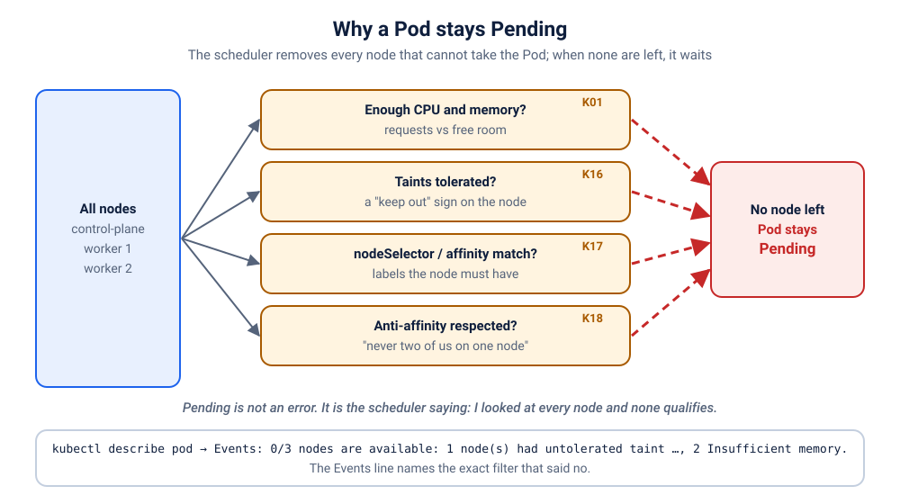

# K01 · The whiteboard that never starts

*We asked for a whiteboard. Kubernetes heard "a data centre".*

⏱ 10 min · beginner · Excalidraw whiteboard (`excalidraw/excalidraw`, about 44 MB) · Pending, scheduler, requests vs limits

⬇️ The tiny 4 MB visitor image downloads when you break it. The Excalidraw image (about 44 MB) downloads only at fix time, because the whiteboard Pod never starts while it is broken. On a cold cluster the fix moment waits on that download (the first time, up to a minute or two). Presenters: preload it (`kubernetes/scenarios/preload.sh`) or run the scenario once before class, on good Wi-Fi.

Output columns and wording can differ a little between kubectl and cluster versions (kind, minikube, Docker Desktop, playgrounds). The ideas never change.

## 📖 The story
It's the week before the Christ University hackathon, and Lakshmi is setting up a shared whiteboard (Excalidraw) for all the teams. To be "safe", she copy-pastes the resource block from the big backend service her seniors wrote, the one that asks for 64 GiB of memory. She applies it, `kubectl` says `created`, and then... nothing. No error, no crash, no running whiteboard. The Pod just sits there, waiting.

## 🧠 The concept: why, what, how
Before Kubernetes starts a Pod, a component called the **scheduler** must pick a **node** (a machine) for it. To choose, it reads the Pod's **requests**: the amount of memory and CPU the Pod is *reserving*.

- A **request** is a reservation, like booking a table at a restaurant: "table for 64 GiB, please". The scheduler only places a Pod on a node that still has that much *unreserved*.
- A **limit** is a cap, like a "no more than this" sign: a Pod that goes beyond its memory limit gets stopped. Limits do not decide *where* a Pod goes.
- The whole request must fit on **one** node. Two nodes with 8 GiB each do not add up to a 16 GiB table.
- If no node fits, the Pod stays **Pending**: "not placed yet". The scheduler writes the reason in the Pod's **Events**.

```
 Pod asks for 64Gi  ──▶  scheduler checks every node:
                           node 1: 8Gi total   ✖ Insufficient memory
                           node 2: 8Gi total   ✖ Insufficient memory
                         result: Pending
```

## 🏢 Where you'll meet this at work
- **Copy-pasted requests from a big service** into a small one (every developer, every platform team).
- **Pending Pods on launch day:** traffic spikes, the Deployment scales up, and the cluster has no room left (SRE).
- **Cluster autoscaler** adds machines *because* of Pending Pods, but never for a request bigger than any machine it can create (platform team).

## 💥 Break it
```bash
cd break && ./break.sh
```
What the room should see: the script says the whiteboard was deployed, but there is no running Pod. The Deployment exists, nothing crashed, and nobody can open the whiteboard. A small `visitor` Pod keeps asking for it every 2 seconds and gets no answer:
```bash
kubectl logs -f visitor -n k-01-pending
```
```
❌ 00:28:28 no answer from http://draw
❌ 00:28:31 no answer from http://draw
❌ 00:28:34 no answer from http://draw
```
You can stop it with Ctrl+C. We'll watch it again live when we fix things.

## 🔍 Investigate
Guess first, then run these **in order**.

**1. What state is the Pod in?**
```bash
kubectl get pods -n k-01-pending
```
```
NAME                    READY   STATUS    RESTARTS   AGE
draw-5c698fdb55-pxm6x   0/1     Pending   0          9s
visitor                 1/1     Running   0          9s
```
(Ages will differ.)
`Pending`, with `0` restarts. The `visitor` is fine, so the cluster works. Only the whiteboard Pod is stuck, and it never even started (nothing to restart).

<details><summary>💡 Hint</summary>
Pending means "no node has been chosen yet". Who chooses? And what did this Pod ask for, compared with what a node has?
</details>

**2. Why? Ask the Pod.** The reason is always written in the Events at the bottom of `describe`.
```bash
kubectl describe pod -n k-01-pending -l app=draw
```
```
Name:             draw-5c698fdb55-pxm6x
Node:             <none>
Status:           Pending
...
Events:
  Type     Reason            Age   From               Message
  ----     ------            ----  ----               -------
  Warning  FailedScheduling  1s    default-scheduler  0/3 nodes are available: 1 node(s) had untolerated taint {node-role.kubernetes.io/control-plane: }, 2 Insufficient memory. preemption: 0/3 nodes are available: 1 Preemption is not helpful for scheduling, 2 No preemption victims found for incoming pod.
```
(shortened) `Node: <none>`: nobody picked a node. The scheduler's own words are `Insufficient memory`. Your numbers will differ: on one-node clusters (minikube, Docker Desktop) it says `0/1 nodes are available`, and the control-plane taint part appears only on multi-node clusters. Look for **Insufficient memory**.

**3. How much did the Pod ask for?**
```bash
kubectl describe pod -n k-01-pending -l app=draw | grep -A3 Requests
```
```
    Requests:
      cpu:        100m
      memory:     64Gi
    Readiness:    http-get http://:80/ delay=0s timeout=1s period=10s #success=1 #failure=3
```
`64Gi` of memory, for one whiteboard.

**4. How much does a node actually have?**
```bash
kubectl get nodes -o custom-columns=NAME:.metadata.name,CPU:.status.allocatable.cpu,MEMORY:.status.allocatable.memory
```
```
NAME                     CPU   MEMORY
z2h-test-control-plane   4     8125288Ki
z2h-test-worker          4     8125288Ki
z2h-test-worker2         4     8125288Ki
```
(Your node names and sizes will differ.) About 8 million Ki is roughly 8 GiB per node. The Pod wants 64 GiB. Unless your node really has 64 GiB free, none is even close.

## 🩺 Root cause
<details><summary>Reveal after the room guesses</summary>

The Deployment's `resources.requests.memory` is `64Gi`, far more than any node has. The scheduler can't find a node that fits, so the Pod stays `Pending` and the Events say `Insufficient memory`. Nothing is wrong with the image, the app, or the cluster: it is one number in the YAML.


</details>

## 🔧 Fix it
Before you run it, open a **second terminal** and start the live visitor log, so the room sees red turn green:
```bash
kubectl logs -f visitor -n k-01-pending
```
Then, in the first terminal:
```bash
cd ../fix && ./fix.sh
```
Within a few seconds once Excalidraw is downloaded (the first time, up to a minute or two) the log flips from ❌ to ✅ lines (Ctrl+C to stop it). What changed: the request shrinks to what a whiteboard needs, and we add a limit as a safety cap.
```bash
diff ../break/app.yaml app.yaml
```
```
29,30c29,32
<               memory: 64Gi
<               cpu: 100m
---
>               memory: 64Mi    # a small, honest reservation
>               cpu: 50m
>             limits:
>               memory: 128Mi   # a cap: the Pod is stopped if it goes beyond this
```

By hand (this replaces `./fix.sh`, so you don't need to run both): apply the fixed file from the `fix` folder.
```bash
kubectl apply -f app.yaml
```
Kubernetes starts a new Pod with the new numbers and removes the stuck one.

## ✅ Verify it yourself
```bash
kubectl get pods -n k-01-pending
```
```
NAME                    READY   STATUS    RESTARTS   AGE
draw-65fdd4465f-67xwc   1/1     Running   0          15s
visitor                 1/1     Running   0          21s
```
(Ages and Pod names will differ.) The whiteboard Pod is `Running` and `1/1` Ready. The visitor's log is green again (if you still see a ❌, wait a few seconds and run it again):
```bash
kubectl logs visitor -n k-01-pending --tail=3
```
```
✅ 00:32:01 HTTP 200
✅ 00:32:03 HTTP 200
✅ 00:32:05 HTTP 200
```
Now open it yourself. In a **second terminal** (leave it running):
```bash
kubectl port-forward -n k-01-pending svc/draw 9201:80
```
```
Forwarding from 127.0.0.1:9201 -> 80
Forwarding from [::1]:9201 -> 80
```
On a playground, add `--address 0.0.0.0` and open the URL for port 9201.
Back in the first terminal:
```bash
curl -s -o /dev/null -w '%{http_code}\n' localhost:9201
```
```
200
```
Or open http://localhost:9201 in your browser and draw something. Press Ctrl+C in the second terminal to stop the port-forward.

## 🎯 Key takeaways
- **Requests are reservations** the scheduler must fit on a single node; **limits are caps** enforced while the Pod runs.
- **Pending = the scheduler said no.** No restarts, no logs: the story is in `kubectl describe pod` → Events.
- Size requests from real measurements (`kubectl top pods`), not from another service's YAML.
- A request can be bigger than every node in the cluster. Then no amount of waiting helps.

## 💎 Lifelong lesson
> Pending is the scheduler saying no. Read the Events. It always says why.

## 🧹 Clean up
Press Ctrl+C in the port-forward terminal first, then:
```bash
cd .. && ./cleanup.sh
```

## Next →
[K02](../02-image-typo/README.md): One missing letter. Kubernetes tries, waits, tries again… forever.
