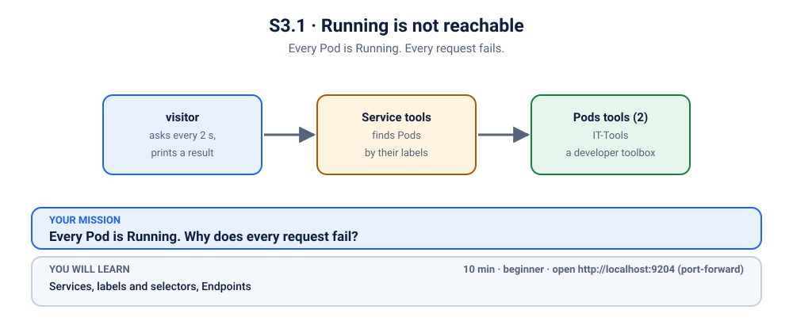
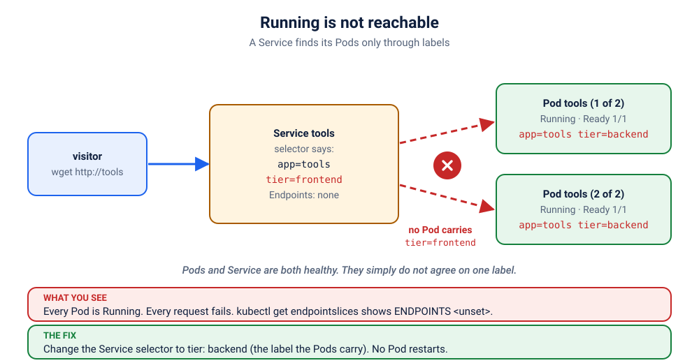

# K04 · Running is not reachable

*Every Pod is Running. Every request fails.*

⏱ 10 min · beginner · IT-Tools (`corentinth/it-tools`, about 24 MB) · Services, labels and selectors, Endpoints

⬇️ First run downloads about 24 MB (IT-Tools) plus a tiny 4 MB visitor image. A slow first download is normal: do it on good Wi-Fi, before the session.

Output columns and wording can differ a little between kubectl versions and clusters (kind, minikube, Docker Desktop, playgrounds). The ideas never change.

## 📖 The story
Lakshmi's team runs a small "developer toolbox" (IT-Tools) for the whole class. Last week someone tidied the YAML and renamed a label while the rest of the team was at lunch. The deploy went green, `kubectl get pods` shows two happy `Running` Pods, and still every student gets a failed page. Nothing crashed. Nothing restarted. Nobody can get in.



## 🧠 The concept: why, what, how
Pods come and go, and every new Pod gets a new IP address. So you never talk to a Pod directly. You talk to a **Service**: one stable name and address (here `tools`) that sends your request to whichever Pods are alive right now.

- How does a Service know *which* Pods? By **labels**. Every Pod carries labels (`app=tools`, `tier=backend`). The Service holds a **selector**: "send traffic to Pods that have *all* of these labels".
- Kubernetes keeps a live list of the matching, Ready Pods' addresses. That list is the Service's **endpoints** (stored in objects called **EndpointSlices**).
- **No match means an empty list, so there is nowhere to send traffic.** The Service still exists, still has an address, and just can't deliver.
- Think of a hotel front desk (the Service) with a list of room numbers (the endpoints). If the list is empty, the desk is open but can't connect your call.

```
 visitor ──▶ Service "tools"  selector: app=tools, tier=frontend
                                   │  looks for Pods with BOTH labels…
                                   ✗  Pods say: app=tools, tier=backend  (no match: endpoints list is empty)
```

## 🏢 Where you'll meet this at work
- **A typo in Helm values** (`tier: fronted`) or one label renamed in a refactor: the app deploys fine and nothing can reach it (developer, platform team).
- **A copy-pasted Service** whose selector still points at the old app's labels (SRE, on-call).
- **Any "it works with port-forward to the Pod, but not through the Service" mystery**: check the endpoints first.

## 💥 Break it
```bash
cd break && ./break.sh
```
What the room should see: the script finishes happily. Two IT-Tools Pods are `Running`, the Service exists, nothing is red. But a small `visitor` Pod, which asks for the tools every 2 seconds, never gets an answer:
```bash
kubectl logs -f visitor -n k-04-no-endpoints
```
```
❌ 01:03:40 no answer from http://tools
❌ 01:03:43 no answer from http://tools
```
You can stop it with Ctrl+C. We'll watch it again live when we fix things.

## 🔮 Predict first (60 seconds)
The Pods say `Running` and `1/1`. Before you type a single command, say out loud:
1. Is the *app* broken?
2. If not, which object would you suspect first, and why?

<details><summary>Check your prediction</summary>

The app is fine: a Pod that is `Running` and `1/1` Ready is doing its job. Suspect the thing *between* the visitor and the Pods: the Service. It is the only piece whose whole job is to find Pods, and finding is where this story goes wrong.
</details>

## 🔍 Investigate
Guess first, then run these **in order**. The visitor's log already told us the symptom: requests fail.

**1. Are the Pods OK?**
```bash
kubectl get pods -n k-04-no-endpoints
```
```
NAME                     READY   STATUS    RESTARTS   AGE
tools-6bffbb44fc-q9qkm   1/1     Running   0          8s
tools-6bffbb44fc-wxj7d   1/1     Running   0          8s
visitor                  1/1     Running   0          8s
```
(Ages and Pod names will differ.) Both `tools` Pods are `Running` and `1/1` Ready, with no restarts. The app is fine. So why can't the visitor reach it?

<details><summary>💡 Hint</summary>
The visitor doesn't talk to a Pod. It talks to the <em>Service</em>. How does a Service decide which Pods to send traffic to? Compare what the Service asks for with what the Pods actually have, label by label.
</details>

**2. What labels do the Pods have?**
```bash
kubectl get pods -n k-04-no-endpoints --show-labels
```
```
NAME                     READY   STATUS    RESTARTS   AGE   LABELS
tools-6bffbb44fc-q9qkm   1/1     Running   0          8s    app=tools,pod-template-hash=6bffbb44fc,tier=backend
tools-6bffbb44fc-wxj7d   1/1     Running   0          8s    app=tools,pod-template-hash=6bffbb44fc,tier=backend
visitor                  1/1     Running   0          8s    <none>
```
The tools Pods carry `app=tools` and `tier=backend`. (`pod-template-hash` is added by Kubernetes itself; ignore it.)

**3. What does the Service look for?** Check the `SELECTOR` column.
```bash
kubectl get svc tools -n k-04-no-endpoints -o wide
```
```
NAME    TYPE        CLUSTER-IP     EXTERNAL-IP   PORT(S)   AGE   SELECTOR
tools   ClusterIP   10.96.229.99   <none>        80/TCP    8s    app=tools,tier=frontend
```
The Service wants Pods with `app=tools` **and** `tier=frontend`. Compare with step 2: the Pods say `backend`.

**4. Does the Service have any endpoints?** The final proof.
```bash
kubectl get endpointslices -n k-04-no-endpoints -l kubernetes.io/service-name=tools
```
```
NAME          ADDRESSTYPE   PORTS     ENDPOINTS   AGE
tools-pz5c8   IPv4          <unset>   <unset>     8s
```
`ENDPOINTS` is `<unset>`: empty. The Service has nobody to send traffic to. (Older clusters show the same idea with `kubectl get endpoints tools -n k-04-no-endpoints`.) Want to see the match yourself? Ask for Pods using the Service's selector:
```bash
kubectl get pods -n k-04-no-endpoints -l app=tools,tier=frontend
```
```
No resources found in k-04-no-endpoints namespace.
```
Zero Pods match, so zero endpoints.

An extra clue, if you have a minute to spare: `kubectl port-forward -n k-04-no-endpoints svc/tools 9204:80` has no Pod to connect to, so it hangs for about a minute and then gives up (here with `error: timed out waiting for the condition`; the exact wording varies by version). Press Ctrl+C if you don't want to wait.

**5. Do the Pods ever hear the visitor?** The strongest evidence is what the app itself never sees. In a **second terminal**, follow one of the `tools` Pods' own logs, and keep the visitor's log open next to it:
```bash
kubectl logs -f deploy/tools -n k-04-no-endpoints
```
IT-Tools is an nginx web server, and nginx prints one log line for every request it receives. While the visitor keeps asking every 2 seconds and failing, **nothing new appears here**: the requests are not reaching the Pods at all. A client that fails while the server stays silent points at the road between them (the Service), not at the app. Press Ctrl+C when you've seen enough. We'll come back to this log after the fix.

**6. (A new tool) What does `selector` even mean?** You do not need to leave the terminal to find out. Kubernetes can explain any field of any object:
```bash
kubectl explain service.spec.selector
```
It prints the documentation for that exact field, straight from your cluster's own API. Try `kubectl explain pod.metadata.labels` too. When you meet a field you do not know, `kubectl explain` beats searching the web, because it describes the version you are really running.

## 🪤 The tempting wrong fix: restart the Pods
"Have you tried turning it off and on again?" Try it:
```bash
kubectl delete pods -n k-04-no-endpoints -l app=tools
kubectl get pods -n k-04-no-endpoints --show-labels
```
Two brand-new Pods appear, with exactly the same labels as before, so the Service *still* finds nothing. Restarting is great for a stuck process and useless for wrong wiring. The Pods were never the problem.

## 🩺 Root cause
<details><summary>Reveal after the room guesses</summary>

The Service `tools` selects Pods labelled `app=tools` **and** `tier=frontend`. The Pods are labelled `tier=backend`. Nothing matches, so the Service has no endpoints and every request to `http://tools` has nowhere to go. The Pods are healthy; they're just invisible to the Service. Nothing is wrong with the app, the image or the cluster.


</details>

## 🔧 Fix it
Before you run it, open a **second terminal** and start the live visitor log, so the room sees red turn green:
```bash
kubectl logs -f visitor -n k-04-no-endpoints
```
Then, in the first terminal:
```bash
cd ../fix && ./fix.sh
```
Within about ten seconds the log flips from ❌ to ✅ lines (Ctrl+C to stop it). No Pod was restarted: we only changed which labels the Service looks for. What changed:
```bash
diff ../break/app.yaml app.yaml
```
```
37c37
<     tier: frontend
---
>     tier: backend
```

By hand (this replaces `./fix.sh`, so you don't need to run both): from the `fix` folder, apply the corrected file.
```bash
kubectl apply -f app.yaml
```
A Service's selector can be changed in place, so a plain apply is enough. Kubernetes notices the new selector, finds the two matching Pods and fills in the endpoints.

## ✅ Verify it yourself
Short on time? `cd .. && ./check.sh` says in one line whether you are done. It only looks, it never changes anything. The steps below show you *why* it says so.

```bash
kubectl get endpointslices -n k-04-no-endpoints -l kubernetes.io/service-name=tools
```
```
NAME          ADDRESSTYPE   PORTS   ENDPOINTS                 AGE
tools-pz5c8   IPv4          80      10.244.2.51,10.244.1.45   2m50s
```
(Addresses and ages will differ.) Two addresses, one per Pod. The visitor's log is green (if you still see a ❌, wait a few seconds and run it again):
```bash
kubectl logs visitor -n k-04-no-endpoints --tail=3
```
```
✅ 01:06:22 HTTP 200
✅ 01:06:24 HTTP 200
✅ 01:06:26 HTTP 200
```
Now open it yourself. In a **second terminal** (leave it running):
```bash
kubectl port-forward -n k-04-no-endpoints svc/tools 9204:80
```
```
Forwarding from 127.0.0.1:9204 -> 80
Forwarding from [::1]:9204 -> 80
```
On a playground, add `--address 0.0.0.0` and open the URL for port 9204.
Back in the first terminal:
```bash
curl -s -o /dev/null -w '%{http_code}\n' localhost:9204
```
```
200
```
Look back at the Pod log from step 5: with the endpoints filled in, the visitor's requests now arrive and new request lines appear every few seconds (the two Pods share the visitor's requests). The Pods were never the problem, they were just never asked.

Or open http://localhost:9204 in your browser and try a tool, like the token generator. Press Ctrl+C in the second terminal to stop the port-forward.

## 🎯 Key takeaways
- **A Service finds Pods by labels.** It sends traffic only to Ready Pods that match *all* of its selector.
- **No match means no endpoints.** The Service still exists, which is why nothing looks broken.
- **`Running` and `Ready` describe the Pod. They say nothing about whether a Service can find it.**
- Debug path: Service `SELECTOR` → Pod `--show-labels` → `get endpointslices`. Compare character by character.

## 💎 Lifelong lesson
> Running is not the same as reachable.

## 🧹 Clean up
Press Ctrl+C in the port-forward terminal first, then:
```bash
cd .. && ./cleanup.sh
```

## 🧪 Quick recap (3 questions)
Answer from memory, then peek.
1. A Service has no endpoints but all its Pods are Ready. What do you compare?
2. Does a Service find Pods by their Deployment, or by their labels?
3. You delete a Pod and the Service still finds nothing. Why?

<details><summary>Answers</summary>

1. The Service's `selector` against the Pods' labels (`kubectl get svc -o wide` and `kubectl get pods --show-labels`).
2. By labels only. It has no idea which Deployment made a Pod.
3. The replacement Pod gets the same labels from the same Deployment, so nothing changed.
</details>

## 🏋️ Now you try: the "Services find Pods" practice lane
You have seen the idea once, with every step explained. Now lock it in with three more problems, each with less help than the last:

| # | Practice | What is new | Hand-holding |
|---|----------|-------------|--------------|
| [K31](../31-two-stalls-one-signboard/README.md) | Two stalls, one signboard | a Service that matches *too many* Pods | guided questions + hint ladder |
| [K32](../32-label-on-the-wrong-object/README.md) | The label on the wrong object | labels on a Deployment are not on its Pods | questions only |
| [K33](../33-canteen-two-bugs/README.md) | Two bugs in one trench coat | two stacked faults (boss) | no hints for 5 minutes |

Each one has a `./check.sh` that tells you, any time, whether you are done.

## Next →
Finish the lane above, then [K05](../05-excalidraw-wrong-port/README.md): Endpoints exist. The Pod is fine. Still: connection refused.
