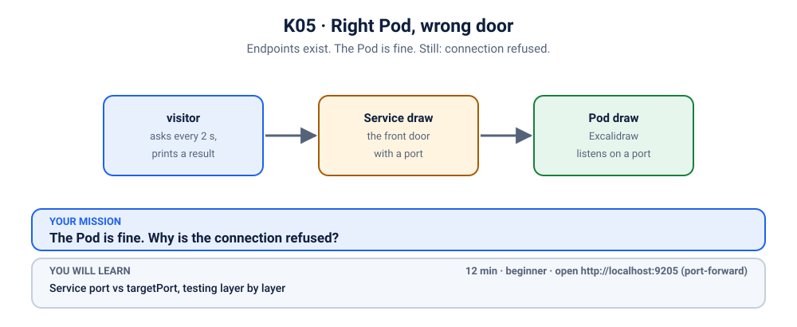
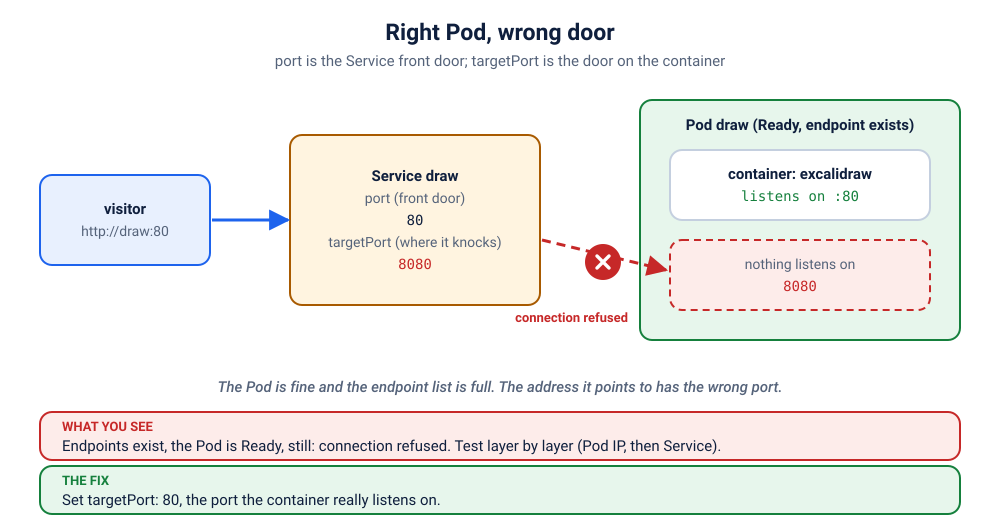

# K05 · Right Pod, wrong door

*Endpoints exist. The Pod is fine. Still: connection refused.*

⏱ 12 min · beginner · Excalidraw (`excalidraw/excalidraw`, about 44 MB) · Service `port` vs `targetPort`, testing layer by layer

⬇️ First run downloads about 44 MB (Excalidraw) plus a tiny 4 MB visitor image. A slow first download is normal: do it on good Wi-Fi, before the session.

Output columns and wording can differ a little between kubectl versions and clusters (kind, minikube, Docker Desktop, playgrounds). The ideas never change.

## 📖 The story
Ravi's hackathon team shares a whiteboard (Excalidraw) for sketching designs. Last time the Service didn't find the Pods ([K04](../04-it-tools-no-endpoints/README.md)); this time Meera fixed the labels, and `kubectl get pods` is green. The Service even lists two addresses. Yet every request comes back refused. Someone copied a Service from another project that "used 8080", and nobody checked what Excalidraw really listens on.



## 🧠 The concept: why, what, how
A request to a Service passes through two ports, and they don't have to be the same number:

- **`port`** is the door the *Service* opens for callers (`http://draw` means port 80).
- **`targetPort`** is the door on the *container* that the Service knocks on. It must be the port your app really listens on.
- If `targetPort` points at a port where nothing listens, the Pod's operating system answers "nobody is home" immediately. That is a **connection refused**. It is not a timeout, and the Pod is perfectly healthy.
- Think of a hotel: the front desk (Service, port 80) forwards your call to a room extension (targetPort). Dial extension 8080 in a hotel that only has extension 80 and the line just goes dead, even though the room is occupied.

```
 visitor ──▶ Service "draw"  port 80 ──▶ targetPort 8080 ──▶ Pod IP:8080   nothing listens: REFUSED
                                                             Pod IP:80     Excalidraw is here
```

## 🏢 Where you'll meet this at work
- **An image that moved its port.** Switching from plain `nginx` (port 80) to `nginx-unprivileged` (port 8080) is the classic: the image changes, the Service YAML doesn't (developer, platform team).
- **A copy-pasted Service** from another app that used a different port (SRE, on-call).
- **Any "endpoints exist but nothing answers" ticket.** Before blaming the network, compare the Service's `targetPort` with the container's port.

## 💥 Break it
```bash
cd break && ./break.sh
```
What the room should see: the script finishes happily. Two Excalidraw Pods are `Running`, the Service exists and even has endpoints. But a small `visitor` Pod, which asks for the whiteboard every 2 seconds, never gets an answer:
```bash
kubectl logs -f visitor -n k-05-wrong-port
```
```
❌ 01:14:19 no answer from http://draw
❌ 01:14:21 no answer from http://draw
```
You can stop it with Ctrl+C. We'll watch it again live when we fix things.

## 🔍 Investigate
Guess first, then run these **in order**. The visitor's log already told us the symptom: requests fail.

**1. Are the Pods OK?**
```bash
kubectl get pods -n k-05-wrong-port
```
```
NAME                    READY   STATUS    RESTARTS   AGE
draw-745749c656-6jwm2   1/1     Running   0          3s
draw-745749c656-mcc6p   1/1     Running   0          3s
visitor                 1/1     Running   0          3s
```
(Ages and Pod names will differ.) Both `draw` Pods are `Running` and `1/1` Ready, with no restarts. So the app is up. Is it the labels again, like in K04?

**2. Does the Service have endpoints?** The K04 check, because it is the first thing to rule out.
```bash
kubectl get endpointslices -n k-05-wrong-port -l kubernetes.io/service-name=draw
```
```
NAME         ADDRESSTYPE   PORTS   ENDPOINTS                 AGE
draw-nbj5p   IPv4          8080    10.244.1.56,10.244.2.63   3s
```
(Addresses and ages will differ.) This time the addresses are there: two Pods found. The labels are fine.

<details><summary>💡 Hint</summary>
The Service found its Pods, so the problem is not <em>who</em> it sends traffic to but <em>which door</em> it knocks on. Compare the port the Service forwards to with the port Excalidraw really listens on.
</details>

**3. Which port does the Service forward to?** The Service found its Pods, so the next suspect is the door it knocks on.
```bash
kubectl get svc draw -n k-05-wrong-port -o jsonpath='{.spec.ports}'; echo
```
```
[{"port":80,"protocol":"TCP","targetPort":8080}]
```
Callers use `port` 80, and the Service forwards to `targetPort` **8080** on the Pod.

**4. Which port does the container listen on?** Ask the Pod's spec what it declares.
```bash
kubectl get pod -n k-05-wrong-port -l app=draw -o jsonpath='{..containerPort}'; echo
```
```
80 80
```
Two Pods, each declaring port **80**. (`containerPort` is the Pod author's statement of where the app listens; the image's documentation says the same for Excalidraw.) So the Service knocks on 8080 while the app waits on 80.

**5. Prove it, one layer at a time.** Skip the Service and talk to a Pod IP directly from a throwaway Pod. First grab a Pod's IP, then try both ports:
```bash
POD_IP=$(kubectl get pod -n k-05-wrong-port -l app=draw -o jsonpath='{.items[0].status.podIP}')
kubectl run tmp -n k-05-wrong-port --rm -i --restart=Never --image=busybox:1.36 -- wget -qO- -T 3 http://$POD_IP:80
```
```
<!doctype html><html lang="en"><head><meta charset="utf-8"/><title>Excalidraw Whiteboard</title> ...
```
(shortened: it prints the whole HTML page of the whiteboard). Port **80** answers. Now the port the Service uses:
```bash
kubectl run tmp -n k-05-wrong-port --rm -i --restart=Never --image=busybox:1.36 -- wget -qO- -T 3 http://$POD_IP:8080
```
```
wget: can't connect to remote host (10.244.1.56): Connection refused
pod "tmp" deleted from k-05-wrong-port namespace
pod k-05-wrong-port/tmp terminated (Error)
```
There it is: **refused** on 8080 (the exact wording of the last two lines varies by kubectl version). The Pod is healthy; the Service is knocking on the wrong door.

An extra clue, if you have a minute to spare: `kubectl port-forward -n k-05-wrong-port svc/draw 9205:80` also follows the Service's `targetPort`. It starts happily, but the first time you open the page it fails (the terminal prints something like `Forwarding from 127.0.0.1:9205 -> 8080`, then `an error occurred forwarding 9205 -> 8080 … connection refused` and `error: lost connection to pod`; the wording varies by version). Notice the `-> 8080` in the first line. Press Ctrl+C to stop it.

## 🩺 Root cause
<details><summary>Reveal after the room guesses</summary>

The Service `draw` has `port: 80` and `targetPort: 8080`. Excalidraw listens on port **80**, so nothing is listening on 8080 inside the Pods, and every connection is refused. The Pods are healthy, the labels match and the endpoints exist: only the single number `targetPort` is wrong. Nothing is wrong with the app, the image or the cluster.


</details>

## 🔧 Fix it
Before you run it, open a **second terminal** and start the live visitor log, so the room sees red turn green:
```bash
kubectl logs -f visitor -n k-05-wrong-port
```
Then, in the first terminal:
```bash
cd ../fix && ./fix.sh
```
Within about ten seconds the log flips from ❌ to ✅ lines (Ctrl+C to stop it):
```
❌ 01:14:25 no answer from http://draw
✅ 01:14:27 HTTP 200
✅ 01:14:29 HTTP 200
```
(shortened.) No Pod was restarted: we only changed which port the Service knocks on. What changed:
```bash
diff ../break/app.yaml app.yaml
```
```
38c38
<       targetPort: 8080
---
>       targetPort: 80
```

By hand (this replaces `./fix.sh`, so you don't need to run both): from the `fix` folder, apply the corrected file.
```bash
kubectl apply -f app.yaml
```
A Service's `targetPort` can be changed in place, so a plain apply is enough. Pro tip for real projects: give the container port a **name** (`name: http`) and set `targetPort: http`, so the Service follows the container definition and the two can never drift apart.

## ✅ Verify it yourself
```bash
kubectl get endpointslices -n k-05-wrong-port -l kubernetes.io/service-name=draw
```
```
NAME         ADDRESSTYPE   PORTS   ENDPOINTS                 AGE
draw-nbj5p   IPv4          80      10.244.1.56,10.244.2.63   34s
```
(Addresses and ages will differ.) Same two addresses, but `PORTS` now says `80`. The visitor's log is green (if you still see a ❌, wait a few seconds and run it again):
```bash
kubectl logs visitor -n k-05-wrong-port --tail=3
```
```
✅ 01:14:29 HTTP 200
✅ 01:14:31 HTTP 200
✅ 01:14:33 HTTP 200
```
Now open it yourself. In a **second terminal** (leave it running):
```bash
kubectl port-forward -n k-05-wrong-port svc/draw 9205:80
```
```
Forwarding from 127.0.0.1:9205 -> 80
Forwarding from [::1]:9205 -> 80
```
On a playground, add `--address 0.0.0.0` and open the URL for port 9205.
Back in the first terminal:
```bash
curl -s -o /dev/null -w '%{http_code}\n' localhost:9205
```
```
200
```
(The port-forward terminal also prints `Handling connection for 9205`.) Or open http://localhost:9205 in your browser and draw something. Press Ctrl+C in the second terminal to stop the port-forward.

## 🎯 Key takeaways
- **`port` is the Service's door; `targetPort` is the container's door.** They only match if you make them match.
- **Endpoints existing does not mean traffic flows.** The addresses are Pod IPs; the `PORTS` column shows which port will be used.
- **"Connection refused" means the machine answered and nobody was listening.** A timeout would point somewhere else (network, firewall, wrong IP).
- Debug path: Service `targetPort` → container's real port → `wget` the Pod IP on each port.

## 💎 Lifelong lesson
> Test one layer at a time: Pod, then Service, then the outside.

## 🧹 Clean up
Press Ctrl+C in the port-forward terminal first, then:
```bash
cd .. && ./cleanup.sh
```

## Next →
[K06](../06-kanboard-never-ready/README.md): It's running. It's healthy. It just never gets any visitors.
