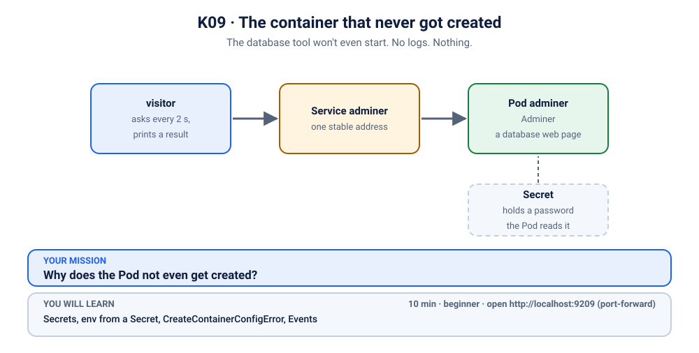
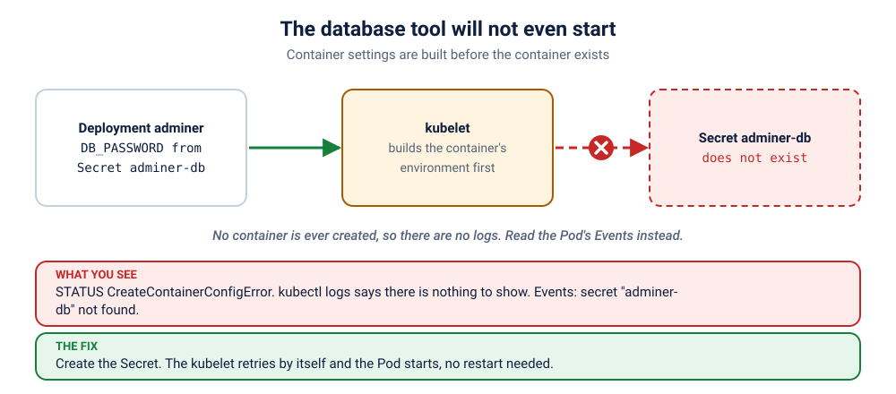

# K09 · The container that never got created

*The database tool won't even start. No logs. Nothing.*

⏱ 10 min · beginner · Adminer (`adminer`, about 46 MB, a web page for looking inside databases) · Secrets, env from a Secret, `CreateContainerConfigError`, Events

⬇️ First run downloads about 46 MB (Adminer) plus a tiny 4 MB visitor image. A slow first download is normal: do it on good Wi-Fi, before the session.

Output columns and wording can differ a little between kubectl versions and clusters (kind, minikube, Docker Desktop, playgrounds). The ideas never change.

## 📖 The story
Ravi's team uses Adminer, a small web page for peeking into the project database. It worked perfectly in the staging namespace. Today he applies the same Deployment to a fresh namespace for the hackathon, and the Pod just sits there. He runs `kubectl logs`, hoping for an error message, and gets nothing useful. The app has not crashed. It has not even started.



## 🧠 The concept: why, what, how



A Pod can take its settings from a **Secret**: a small object that holds sensitive values such as passwords, kept out of your YAML and your image.

- In the Deployment, an environment variable says "fill `DB_PASSWORD` from Secret `adminer-db`, key `password`".
- Before the **kubelet** (the agent on each node that starts containers) creates the container, it looks up that Secret and builds the environment.
- If the Secret (or the key) is missing, the kubelet can't build the environment. So it **never creates the container**, and shows the status `CreateContainerConfigError`.
- No container means no process, and no process means **no logs**. The error lives in the Pod's **Events** instead.
- Think of a chef who won't open the kitchen until every ingredient on the checklist has arrived. The checklist is the Pod spec. The missing ingredient is the Secret.

```
 Deployment ──▶ Pod ──▶ kubelet: "env needs Secret adminer-db…"  ──▶ not found
                                  └─▶ container is never created ──▶ nothing runs ──▶ nothing to log
```

## 🏢 Where you'll meet this at work
- **The Secret is in the wrong namespace.** It exists in `staging`, but the app is deployed to `production`. Secrets are namespaced, so the Pod can't see it (developer, platform team).
- **A typo in the Secret's name or key.** The Secret `db-pass` exists, but the Pod asks for `db-password`, or for key `pasword` (anyone who edits YAML).
- **A secret-manager sync lag.** A tool such as External Secrets copies passwords from a vault into the cluster, and the Pod is applied a few seconds before the copy finishes (SRE, platform team).

## 💥 Break it
```bash
cd break && ./break.sh
```
What the room should see: the script finishes happily and the Adminer Pod exists, but it never becomes `Running`. A small `visitor` Pod, which asks for Adminer every 2 seconds, never gets an answer:
```bash
kubectl logs -f visitor -n k-09-missing-secret
```
```
❌ 04:52:02 no answer from http://adminer
❌ 04:52:05 no answer from http://adminer
```
You can stop it with Ctrl+C. We'll watch it again live when we fix things.

## 🔮 Predict first (60 seconds)
The Deployment asks for a Secret that does not exist. Before you look:
1. Will there be any logs?
2. What will `STATUS` say?

<details><summary>Check your prediction</summary>

1. No. No container was ever created, so there is nothing to log.
2. `CreateContainerConfigError`.
</details>

## 🔍 Investigate
Guess first, then run these **in order**. The visitor's log already told us the symptom: nobody is served.

**1. Is the Pod OK?** Always start with the Pods.
```bash
kubectl get pods -n k-09-missing-secret
```
```
NAME                       READY   STATUS                       RESTARTS   AGE
adminer-849b85df4c-twq95   0/1     CreateContainerConfigError   0          3s
visitor                    1/1     Running                      0          3s
```
(Ages and Pod names will differ.) The `adminer` Pod is not `Running`, not `CrashLoopBackOff`, not `Pending`. The status is `CreateContainerConfigError`: there is a problem with the container's **configuration**, and `RESTARTS` is 0 because nothing ever ran.

<details><summary>💡 Hint</summary>
Nothing has crashed, so there is nothing to restart. The status says the container could not be <i>created</i>. What does the container need before it can be built? Think about where its settings come from.
</details>

**2. What does the app say?** The usual next step for an unhappy app is its logs.
```bash
kubectl logs -n k-09-missing-secret -l app=adminer
```
```
Error from server (BadRequest): container "adminer" in pod "adminer-849b85df4c-twq95" is waiting to start: CreateContainerConfigError
```
(Exact wording can vary a little by kubectl version.) There are **no logs**, and that is the clue: the container never started, so it never wrote a single line. When the logs are empty, the answer is somewhere else.

**3. Where does Kubernetes write down what went wrong?** In the Pod's Events, at the bottom of `describe`.
```bash
kubectl describe pod -n k-09-missing-secret -l app=adminer | grep -A5 "^Events"
```
```
Events:
  Type     Reason     Age              From               Message
  ----     ------     ----             ----               -------
  Normal   Scheduled  3s               default-scheduler  Successfully assigned k-09-missing-secret/adminer-849b85df4c-twq95 to z2h-test-worker
  Normal   Pulled     2s (x2 over 2s)  kubelet            spec.containers{adminer}: Container image "adminer:5.4.1" already present on machine
  Warning  Failed     2s (x2 over 2s)  kubelet            spec.containers{adminer}: Error: secret "adminer-db" not found
```
(On a fresh cluster you will also see a `Pulling` line, and the exact event columns vary by kubectl version.) The `Warning` says it plainly: **secret "adminer-db" not found**. Which part of the Pod asks for it?
```bash
kubectl describe pod -n k-09-missing-secret -l app=adminer | grep -B1 -A3 "Environment:"
```
```
    Readiness:      http-get http://:8080/ delay=0s timeout=1s period=2s #success=1 #failure=3
    Environment:
      ADMINER_DEFAULT_SERVER:  db
      DB_PASSWORD:             <set to the key 'password' in secret 'adminer-db'>  Optional: false
    Mounts:
```
The environment variable `DB_PASSWORD` is filled from the key `password` of Secret `adminer-db`, and `Optional: false` means "the Pod must not start without it".

**4. Does that Secret exist here?** Secrets are per namespace, so list the ones in this namespace.
```bash
kubectl get secrets -n k-09-missing-secret
```
```
No resources found in k-09-missing-secret namespace.
```
The namespace has no Secrets at all. (Adminer itself shows you a login page and never reads `DB_PASSWORD`. In this demo the variable stands for any app that needs a password at start-up.)

## 🪤 The tempting wrong fix: delete the Pod
"Maybe it will find the Secret on a second try."
```bash
kubectl delete pods -n k-09-missing-secret -l app=adminer
kubectl get pods -n k-09-missing-secret
```
The new Pod asks for the same missing Secret and stops at the same place. Restarting cannot create a Secret that nobody created.

## 🩺 Root cause
<details><summary>Reveal after the room guesses</summary>

The Deployment asks for `DB_PASSWORD` from Secret `adminer-db`, key `password`, but that Secret doesn't exist in this namespace. The kubelet builds a container's environment **before** it creates the container, so it stopped at `CreateContainerConfigError` and no container was ever created. That is why there were no logs: nothing ran. The Events had the answer all along. Nothing is wrong with the image, the cluster or the Pod.
</details>

## 🔧 Fix it
Before you run it, open a **second terminal** and start the live visitor log, so the room sees red turn green:
```bash
kubectl logs -f visitor -n k-09-missing-secret
```
Then, in the first terminal:
```bash
cd ../fix && ./fix.sh
```
Within about ten seconds (sometimes a little longer) the log flips from ❌ to ✅ lines (Ctrl+C to stop it):
```
❌ 04:52:08 no answer from http://adminer
❌ 04:52:11 no answer from http://adminer
✅ 04:52:13 HTTP 200
✅ 04:52:15 HTTP 200
```
(shortened.) What changed? Not the Deployment: `fix/` only adds one file, the Secret.
```bash
ls
cat secret.yaml
```
```
fix.sh
secret.yaml
# K09 fix: create the Secret the Pod was waiting for. The existing Pod needs no change.
apiVersion: v1
kind: Secret
metadata:
  name: adminer-db
  namespace: k-09-missing-secret
type: Opaque
stringData:
  password: change-me-123
```
Look at the Pod: it is the **same Pod** as before, with the same name and `RESTARTS 0`. The kubelet keeps retrying while a Pod waits for its Secret, so once the Secret appeared it simply built the container and started it. No new ReplicaSet and no rollout were needed, which is why `fix.sh` checks the Pod itself and not `kubectl rollout status`.

By hand (this replaces `./fix.sh`, so you don't need to run both): create the Secret, then watch the same Pod start.
```bash
kubectl apply -f secret.yaml
kubectl get pods -n k-09-missing-secret -w
```
Press Ctrl+C once the `adminer` Pod shows `1/1`. (One line instead of the file also works: `kubectl create secret generic adminer-db --from-literal=password=change-me-123 -n k-09-missing-secret`.)

## ✅ Verify it yourself
Short on time? `cd .. && ./check.sh` says in one line whether you are done. It only looks, it never changes anything. The steps below show you *why* it says so.

```bash
kubectl get pods -n k-09-missing-secret
```
```
NAME                       READY   STATUS    RESTARTS   AGE
adminer-849b85df4c-twq95   1/1     Running   0          16s
visitor                    1/1     Running   0          16s
```
(Names and ages will differ.) `READY` is **1/1** and the Pod name is the same as in the broken state. The Secret now exists:
```bash
kubectl get secret adminer-db -n k-09-missing-secret
```
```
NAME         TYPE     DATA   AGE
adminer-db   Opaque   1      9s
```
The visitor's log is green (if you still see a ❌, wait a few seconds and run it again):
```bash
kubectl logs visitor -n k-09-missing-secret --tail=3
```
```
✅ 04:53:05 HTTP 200
✅ 04:53:07 HTTP 200
✅ 04:53:09 HTTP 200
```
Now open it yourself. In a **second terminal** (leave it running):
```bash
kubectl port-forward -n k-09-missing-secret svc/adminer 9209:80
```
```
Forwarding from 127.0.0.1:9209 -> 8080
Forwarding from [::1]:9209 -> 8080
```
On a playground, add `--address 0.0.0.0` and open the URL for port 9209.
Back in the first terminal:
```bash
curl -s -o /dev/null -w "%{http_code}\n" localhost:9209
```
```
200
```
(The port-forward terminal also prints `Handling connection for 9209`. It shows `8080` because the Service's port 80 leads to Adminer's port 8080 inside the Pod.) Or open http://localhost:9209 in your browser: you should see the Adminer login page, with the server field already set to `db`. There is no database behind it in this demo, so just admire the page. Press Ctrl+C in the second terminal to stop the port-forward.

## 👀 See it in monitoring (optional)
If you installed the monitoring stack ([lab K19](../../19-observability/README.md)), watch a container that was never created as a number. In Prometheus (`kubectl port-forward -n monitoring svc/kube-prometheus-stack-prometheus 9090:9090`, then http://localhost:9090) run:
```
kube_pod_container_status_waiting_reason{namespace="k-09-missing-secret",reason="CreateContainerConfigError"} == 1
```
No restarts and no logs, only this waiting reason. It is the monitoring way of saying "look at the Pod events".

## 🎯 Key takeaways
- **No logs means it never started.** A container that was never created can't write a log line.
- **`CreateContainerConfigError` means the kubelet couldn't build the container's settings,** usually a missing Secret or ConfigMap (or a wrong key).
- **Secrets and ConfigMaps are namespaced** and must exist before the Pod starts. Deploy them together with the app.
- **It heals itself.** Once the missing object exists, the kubelet retries and the same Pod starts. No restart of the Deployment is needed.
- Debug path: `get pods` → `logs` (none) → `describe pod` (Events) → `get secrets -n …`.

## 💎 Lifelong lesson
> No logs? Then it never started. Read the Events.

## 🧹 Clean up
Press Ctrl+C in the port-forward terminal first, then:
```bash
cd .. && ./cleanup.sh
```

## 🧪 Quick recap (3 questions)
1. Why are there no logs?
2. When does the kubelet resolve a container's environment from a Secret?
3. After you create the missing Secret, must you restart the Pod?

<details><summary>Answers</summary>

1. The container was never created.
2. Before it creates the container.
3. No. The kubelet keeps retrying, so the existing Pod picks the Secret up on its own.
</details>

## Next →
Next, in this section: [K10](../10-kanboard-pvc-pending/README.md): The Pod isn't crashing. It isn't even starting. It's waiting for a disk that doesn't exist.
