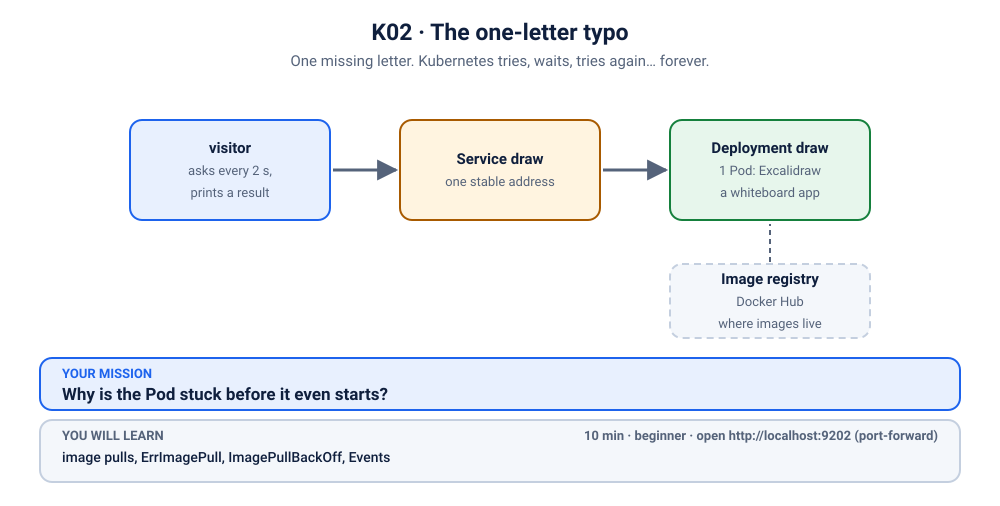
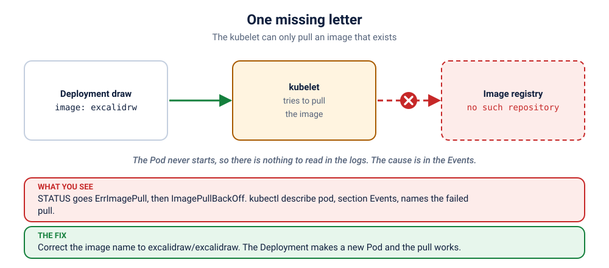

# S1.2 · The one-letter typo

*One missing letter. Kubernetes tries, waits, tries again… forever.*

⏱ 10 min · beginner · Excalidraw whiteboard (`excalidraw/excalidraw`, about 44 MB) · image pulls, ErrImagePull, ImagePullBackOff, Events

⬇️ The tiny 4 MB visitor image downloads when you break it. The Excalidraw image (about 44 MB) downloads only at fix time, because the whiteboard Pod never starts while it is broken. On a cold cluster the fix moment waits on that download (the first time, up to a minute or two). Presenters: preload it (`kubernetes/scenarios/preload.sh`) or run the scenario once before class, on good Wi-Fi.

Output columns and wording can differ a little between kubectl, container runtimes and registries (kind, minikube, Docker Desktop, playgrounds). The ideas never change.

## 📖 The story
It's the night before the Christ University fest demo. Ravi is tidying the whiteboard's YAML, and while "cleaning up" the image line he drops one letter: `excalidrw` instead of `excalidraw`. He applies it, `kubectl` happily says `created`, and goes to get chai. When he comes back, the Pod is not running. It isn't crashing either. It just says `ImagePullBackOff`, and keeps saying it.



## 🧠 The concept: why, what, how



A container needs an **image** (the packaged app). Kubernetes doesn't carry images around: each **node** has an agent, the **kubelet**, and the kubelet **pulls** the image from a **registry** (Docker Hub here) onto its own node before starting the container.

- If the pull fails, the kubelet doesn't give up. It tries again, but waits a bit longer each time: about 10 s, 20 s, 40 s… up to 5 minutes. Think of it as redialling a busy number, with longer and longer pauses.
- **`ErrImagePull`** means "the pull just failed". **`ImagePullBackOff`** means "I'm waiting before the next try". The Pod flips between the two.
- The reason is never in the status. It is in the Pod's **Events**: the registry's own words.
- Typos in the name, a tag that doesn't exist, a private registry without a login: they all look the same from the outside.

```
 Pod  ──▶  kubelet on a node  ──▶  registry: "excalidraw/excalidrw?"
                  ▲                        │
                  └── "never heard of it" ◀┘   wait 10s… 20s… 40s… up to 5 min, then try again
```

## 🏢 Where you'll meet this at work
- **A typo or a deleted tag in a deploy** (every developer): the pipeline is green, the Pods never start.
- **Private registries:** the image exists, but the cluster has no credentials (`imagePullSecrets`). The error even says "may require authorization" (platform team, SRE).
- **Registry rate limits** on busy days, when many nodes pull the same public image at once (SRE).

## 💥 Break it
```bash
cd break && ./break.sh
```
What the room should see: the script says the whiteboard was deployed, but there is no running Pod. The Deployment exists, nothing crashed, and nobody can open the whiteboard. A small `visitor` Pod keeps asking for it every 2 seconds and gets no answer:
```bash
kubectl logs -f visitor -n k-02-image-typo
```
```
❌ 00:42:50 no answer from http://draw
❌ 00:42:53 no answer from http://draw
❌ 00:42:56 no answer from http://draw
```
You can stop it with Ctrl+C. We'll watch it again live when we fix things.

## 🔮 Predict first (60 seconds)
The image name has a one-letter typo. Before you look:
1. Is the *app* crashing?
2. Which command will show the real reason?

<details><summary>Check your prediction</summary>

1. No. No container ever started: the image could not even be downloaded.
2. `kubectl describe pod` (or `kubectl get events`). The reason is in the Events, not in the logs.
</details>

## 🔍 Investigate
Guess first, then run these **in order**.

**1. What state is the Pod in?**
```bash
kubectl get pods -n k-02-image-typo
```
```
NAME                    READY   STATUS             RESTARTS   AGE
draw-74476d7d7c-49ggd   0/1     ImagePullBackOff   0          23s
visitor                 1/1     Running            0          23s
```
(Ages and Pod names will differ.) Run it a few times: `STATUS` flips between `ErrImagePull` and `ImagePullBackOff` (you may catch both). `0` restarts, because the container never even started. The `visitor` is fine, so the cluster works. Only the whiteboard Pod is stuck.

<details><summary>💡 Hint</summary>
"Pull" means downloading the image. The status only says that the pull failed. Where does Kubernetes write <em>why</em>? And what is the exact image name the Deployment asks for? Read it letter by letter.
</details>

**2. Why? Ask the Pod.** The reason is always written in the Events at the bottom of `describe`.
```bash
kubectl describe pod -n k-02-image-typo -l app=draw | grep -A12 '^Events'
```
```
Events:
  Type     Reason     Age                From               Message
  ----     ------     ----               ----               -------
  Normal   Scheduled  35s                default-scheduler  Successfully assigned k-02-image-typo/draw-74476d7d7c-pkz9c to z2h-test-worker2
  Normal   Pulling    18s (x2 over 35s)  kubelet            spec.containers{draw}: Pulling image "excalidraw/excalidrw:latest@sha256:f7ee194a…"
  Warning  Failed     16s (x2 over 33s)  kubelet            spec.containers{draw}: Failed to pull image "excalidraw/excalidrw:latest@sha256:f7ee194a…": failed to pull and unpack image "docker.io/excalidraw/excalidrw@sha256:f7ee194a…": failed to resolve reference "docker.io/excalidraw/excalidrw@sha256:f7ee194a…": pull access denied, repository does not exist or may require authorization: server message: insufficient_scope: authorization failed
  Warning  Failed     16s (x2 over 33s)  kubelet            spec.containers{draw}: Error: ErrImagePull
  Normal   BackOff    6s (x2 over 32s)   kubelet            spec.containers{draw}: Back-off pulling image "excalidraw/excalidrw:latest@sha256:f7ee194a…"
  Warning  Failed     6s (x2 over 32s)   kubelet            spec.containers{draw}: Error: ImagePullBackOff
```
(shortened: the long digest `sha256:f7ee194a…` is cut, and the wording of the registry's error varies with the runtime and registry. Your Pod names and node names will differ.) The scheduler did its job (`Scheduled`). Then the kubelet tried to pull (`Pulling`), the registry said no (`Failed to pull image`), and the kubelet started waiting (`BackOff`). Look for the registry's words: here `pull access denied, repository does not exist`. Other registries say `not found` or `manifest unknown`. Notice the `(x2 over …)`: it has already retried.

**3. What exactly does the Deployment ask for?**
```bash
kubectl get deploy draw -n k-02-image-typo -o jsonpath='{..image}'; echo
```
```
excalidraw/excalidrw:latest@sha256:f7ee194addd607bf831d2af0f0a34463dd4225e426cf35199ef0b12a803398e9
```
Read the repository name slowly: `excalidraw/excalidrw`. A letter is missing (the `a` in `excalidraw`). The digest after `@sha256:` is the real, correct one, but it belongs to a repository that Docker Hub does not have under this name.

## 🪤 The tempting wrong fix: delete the Pod
"Maybe it just needs a fresh start."
```bash
kubectl delete pods -n k-02-image-typo -l app=draw
kubectl get pods -n k-02-image-typo
```
A new Pod appears, and it fails to pull the same misspelled image for the same reason. The Pod was never the problem: the *name* in the Deployment is.

## 🩺 Root cause
<details><summary>Reveal after the room guesses</summary>

The Deployment's image is `excalidraw/excalidrw`, one letter short of the real `excalidraw/excalidraw`. The registry has no such repository (or won't show it to us), so the kubelet's pull fails, again and again, with a growing wait between tries. `ErrImagePull` / `ImagePullBackOff` is only the symptom: the Events hold the cause. Nothing is wrong with the cluster, the app or the network.
</details>

## 🔧 Fix it
Before you run it, open a **second terminal** and start the live visitor log, so the room sees red turn green:
```bash
kubectl logs -f visitor -n k-02-image-typo
```
Then, in the first terminal:
```bash
cd ../fix && ./fix.sh
```
Within a few seconds once Excalidraw is downloaded (the first time, up to a minute or two) the log flips from ❌ to ✅ lines (Ctrl+C to stop it). It doesn't wait for the back-off timer: changing the image makes a **new** Pod, and a new Pod pulls straight away. What changed: just the one letter.
```bash
diff ../break/app.yaml app.yaml
```
```
19c19
<           image: excalidraw/excalidrw:latest@sha256:f7ee194addd607bf831d2af0f0a34463dd4225e426cf35199ef0b12a803398e9
---
>           image: excalidraw/excalidraw:latest@sha256:f7ee194addd607bf831d2af0f0a34463dd4225e426cf35199ef0b12a803398e9
```

By hand (this replaces `./fix.sh`, so you don't need to run both): apply the fixed file from the `fix` folder.
```bash
kubectl apply -f app.yaml
```
Kubernetes starts a new Pod with the right image and removes the stuck one. (The one-line alternative is `kubectl set image deploy/draw -n k-02-image-typo draw=excalidraw/excalidraw:latest@sha256:f7ee194addd607bf831d2af0f0a34463dd4225e426cf35199ef0b12a803398e9`.)

## ✅ Verify it yourself
Short on time? `cd .. && ./check.sh` says in one line whether you are done. It only looks, it never changes anything. The steps below show you *why* it says so.

```bash
kubectl get pods -n k-02-image-typo
```
```
NAME                    READY   STATUS    RESTARTS   AGE
draw-745749c656-4xh8k   1/1     Running   0          17s
visitor                 1/1     Running   0          54s
```
(Ages and Pod names will differ.) One whiteboard Pod, `Running` and `1/1` Ready. The stuck one is gone. The visitor's log is green again (if you still see a ❌, wait a few seconds and run it again):
```bash
kubectl logs visitor -n k-02-image-typo --tail=3
```
```
✅ 00:43:14 HTTP 200
✅ 00:43:16 HTTP 200
✅ 00:43:18 HTTP 200
```
Now open it yourself. In a **second terminal** (leave it running):
```bash
kubectl port-forward -n k-02-image-typo svc/draw 9202:80
```
```
Forwarding from 127.0.0.1:9202 -> 80
Forwarding from [::1]:9202 -> 80
```
On a playground, add `--address 0.0.0.0` and open the URL for port 9202.
Back in the first terminal:
```bash
curl -s -o /dev/null -w '%{http_code}\n' localhost:9202
```
```
200
```
Or open http://localhost:9202 in your browser and draw something. Press Ctrl+C in the second terminal to stop the port-forward.

## 👀 See it in monitoring (optional)
If you installed the monitoring stack ([lab K19](../../../19-observability/README.md)), watch a pull that never works as a number. In Prometheus (`kubectl port-forward -n monitoring svc/kube-prometheus-stack-prometheus 9090:9090`, then http://localhost:9090) run:
```
kube_pod_container_status_waiting_reason{namespace="k-02-image-typo",reason=~"ErrImagePull|ImagePullBackOff"} == 1
```
The reason flips between `ErrImagePull` and `ImagePullBackOff` as Kubernetes backs off. A real team alerts on this reason, because nothing crashes and nothing restarts.

## 🎯 Key takeaways
- **The kubelet on each node pulls the image.** A failed pull is retried with a growing wait (about 10 s up to 5 min).
- **`ErrImagePull` = the pull just failed. `ImagePullBackOff` = waiting before the next try.** Neither one tells you why.
- **The why is in the Events** (`kubectl describe pod`): read the registry's exact words (`not found`, `pull access denied`, `toomanyrequests`).
- A changed image means a new Pod, which pulls immediately: no need to wait out the back-off.

## 💎 Lifelong lesson
> BackOff means "I'm waiting to retry". The real error is in the Events.

## 🧹 Clean up
Press Ctrl+C in the port-forward terminal first, then:
```bash
cd .. && ./cleanup.sh
```

## 🧪 Quick recap (3 questions)
1. What is the difference between `ErrImagePull` and `ImagePullBackOff`?
2. Where do you find the real cause?
3. Why does the wait between retries keep growing?

<details><summary>Answers</summary>

1. `ErrImagePull`: the pull just failed. `ImagePullBackOff`: Kubernetes is waiting before it tries again.
2. In the Pod's Events (`describe pod`).
3. A back-off, so a broken pull does not hammer the registry.
</details>

## Next →
Next, in this section: [S1.3](../3-showdown-crashloop/README.md): It starts. It dies. It starts. It dies. Welcome to the loop.
