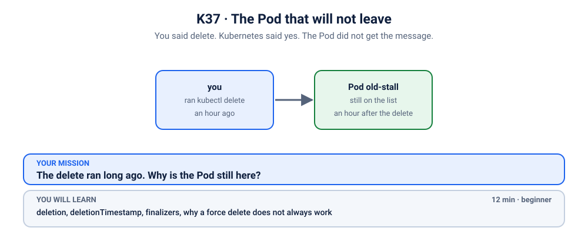
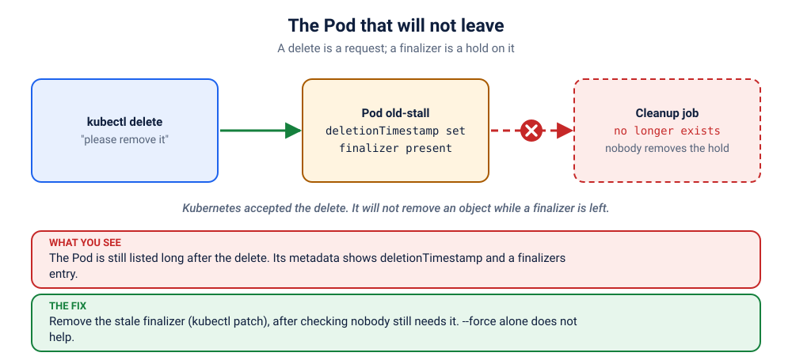

# S1.5 · The Pod that will not leave

*You said delete. Kubernetes said yes. The Pod did not get the message.*

⏱ 12 min · beginner · An old stall (`hashicorp/http-echo`, about 17 MB) · deletion, `deletionTimestamp`, finalizers, why a force delete does not always work

⬇️ First run downloads about 17 MB (the stall). A slow first download is normal: do it on good Wi-Fi, before the session.

Output columns and wording can differ a little between kubectl versions and clusters (kind, minikube, Docker Desktop, playgrounds). The ideas never change.

> 🧭 **New topic: things that will not go away.** This is the worked example, with every step explained. Nothing in this scenario touches your nodes or anything outside its own namespace.

## 📖 The story
Priya closed the old tea stall for good and ran `kubectl delete pod old-stall`. Kubernetes answered "deleted", very politely, an hour ago.

The Pod is still on the list, with a status that looks like it is on its way out (`Terminating`, or `Completed` once its container has stopped). It is a bit like a guest who said goodbye at the door twenty minutes ago and is still standing in the hallway, holding their coat, looking at you.



## 🧠 The concept: why, what, how



Deleting in Kubernetes is a *request*, not an instant action. When you delete something:
1. Kubernetes stamps it with a **`deletionTimestamp`**: "this is going away".
2. It then waits until the object's **finalizers** list is empty, and only then removes it.

A **finalizer** is a note stuck on an object that says: *"Do not remove this until I have cleaned up."* Controllers use them to unmount storage, delete a cloud load balancer or a DNS record first. When the cleanup is done, the controller removes its own note.

If the controller that owns the note is gone (uninstalled, crashed, or buggy), nobody ever removes it, and the object waits forever. That is `Terminating`.

```
 kubectl delete ──▶ deletionTimestamp set ──▶ any finalizers left?
                                                 no  ──▶ object removed ✔
                                                 yes ──▶ wait… (still listed)
```


## 🔮 Predict first (60 seconds)
You deleted a Pod an hour ago.
1. What will `kubectl get pods` show for it?
2. You are tempted to run `kubectl delete pod … --force --grace-period=0`. Will that make it vanish? Write down yes or no.

<details><summary>Check your prediction</summary>

1. It is **still listed**. The `STATUS` may say `Terminating`, or, on current kubectl once the container has stopped, `Completed` or `Error`. Either way the delete was accepted and something is stopping it from finishing. (Notice that `STATUS` is not a reliable guide here: the `deletionTimestamp` below is.)
2. Keep your guess: you will test it for real in a few minutes.
</details>

## 💥 Break it
```bash
cd break && python3 run.py
```
It starts a Pod, then deletes it, and finishes. Now watch:
```bash
kubectl get pods -n k-37-stuck-pod -w
```
The Pod stays on the list. Its `STATUS` is `Terminating` while the container is shutting down, and on current kubectl it changes to `Completed` or `Error` once the container has stopped. Don't be fooled either way: the Pod is not gone, and it is not going to go on its own. (Ctrl+C to stop.) Nothing is red, nothing is crashing. It is just stuck.

## 🔍 Investigate: you drive
**Q1. Has the delete actually been accepted?**
<details><summary>💡 Hint</summary>

An accepted delete leaves a timestamp on the object:
```bash
kubectl get pod old-stall -n k-37-stuck-pod -o jsonpath='{.metadata.deletionTimestamp}{"\n"}'
```
A value here means "yes, Kubernetes agreed to delete this".
</details>

**Q2. If the delete was accepted, what is holding the Pod back?**
<details><summary>💡 Hint 1</summary>
Think about the concept above: what does Kubernetes wait for before removing an object?
</details>
<details><summary>💡 Hint 2: the command</summary>

```bash
kubectl get pod old-stall -n k-37-stuck-pod -o jsonpath='{.metadata.finalizers}{"\n"}'
```
</details>

**Q3. Who owns that finalizer, and is that owner still around?**
<details><summary>💡 Hint</summary>
A finalizer's name looks like <code>domain/name</code>, and the domain usually tells you which controller put it there (real ones look like <code>kubernetes.io/pvc-protection</code>). Here the name is made up for this exercise, so there is <em>no</em> controller to remove it. In real life, finding the owner is the most important step: it tells you whether it is safe to remove the note.
</details>

## 🪤 The tempting wrong fix: force delete
You made a prediction earlier. Now test it:
```bash
kubectl delete pod old-stall -n k-37-stuck-pod --grace-period=0 --force --wait=false
kubectl get pods -n k-37-stuck-pod
```
You get a warning about immediate deletion, and the Pod is **still there**. (Try it once *without* `--wait=false`: the command never returns, because by default `kubectl delete` waits for the object to be gone, and that includes waiting for its finalizers. Press Ctrl+C. That hang is this whole scenario in miniature.) A force delete skips *waiting for the container to stop*. It does not skip the finalizer, because that note is not about the container. Force deleting usually works only because, normally, nothing is holding the object.

## 🩺 Root cause
<details><summary>Reveal after the room guesses</summary>

The Pod carries a finalizer, `z2h.example/cleanup-lock`, added by a cleanup job that no longer exists. Kubernetes accepted the delete and set `deletionTimestamp`, but it will not remove an object while finalizers remain. Nobody is left to remove this one, so the Pod stays `Terminating` for ever.
</details>

## 🔧 Fix it
```bash
cd ../fix && python3 run.py
```
That removes the finalizer. By hand, it is one command:
```bash
kubectl patch pod old-stall -n k-37-stuck-pod --type merge -p '{"metadata":{"finalizers":null}}'
```
The moment the list is empty, the pending delete completes and the Pod disappears.

> ⚠️ **Before you do this for real:** removing a finalizer skips the cleanup it was guarding. Check which controller owns it, whether that controller still exists, and what it would have cleaned up (a cloud disk? a DNS record?). Skipping a cleanup that still matters can leave real resources orphaned.

## ✅ Verify it yourself
```bash
cd .. && ./check.sh
```
A green message means the Pod is really gone.

## 🎯 Key takeaways
- **Deleting is a request.** The object goes away only when its finalizers are empty.
- **A Pod that stays listed long after a delete almost always has a finalizer.** Look at `metadata.deletionTimestamp` and `metadata.finalizers`, not just `STATUS`: it reads `Terminating` while the container runs, and `Completed` or `Error` after.
- **A force delete does not remove a finalizer.**
- **Find the owner first, then remove the note.** Removing it skips the cleanup.
- The same thing happens to **namespaces, volumes and custom resources**: a namespace stuck `Terminating` is usually an object inside it with a finalizer whose controller is gone.

## 💎 Lifelong lesson
> Deleting is a request, not a command.

## 🏢 Where you'll meet this at work
- **A namespace stuck `Terminating`** after uninstalling an operator whose resources still carry its finalizers (platform team).
- **A volume claim that will not delete** because a Pod is still using it (the built-in `pvc-protection` finalizer).
- **A resource from a tool that was removed** before it could clean up after itself (SRE).

## 🧹 Clean up
```bash
python3 cleanup.py
```
The cleanup lifts the finalizer first, which is what lets the namespace be deleted at all. (A namespace with a stuck Pod would otherwise be stuck too.)

## Next →
Next, the next section: [S2.1](../../2-workloads/1-label-on-the-wrong-object/README.md): The label is right there. Kubernetes is looking somewhere else.
