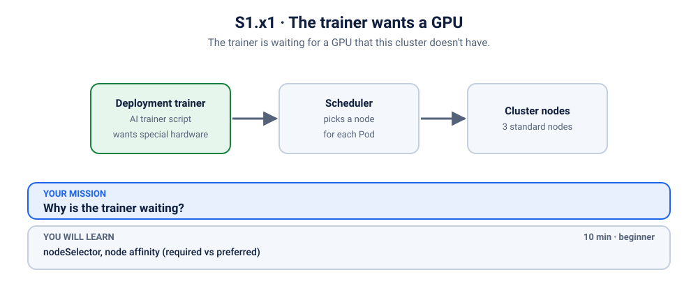
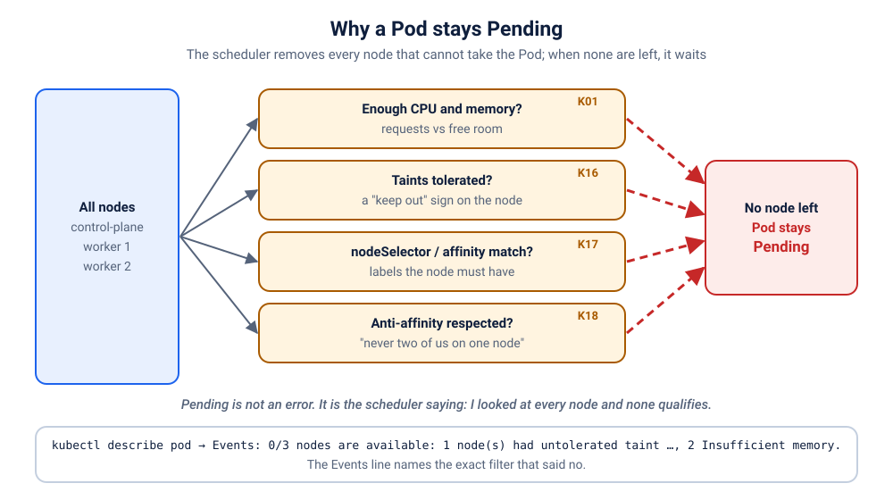

# S1.x1 · The trainer wants a GPU

*The trainer is waiting for a GPU that this cluster doesn't have.*

⏱ 10 min · beginner · an "AI trainer" script (`python:3.12-alpine`, about 19 MB) · `nodeSelector`, node affinity (required vs preferred)

⬇️ The Python image (about 19 MB) downloads at fix time, because the Pod never starts while it is broken. On a cold cluster the fix moment waits on that download. A slow first download is normal: presenters, preload it (`kubernetes/scenarios/preload.sh`) or run the scenario once before class, on good Wi-Fi.

Output columns and wording can differ a little between kubectl versions and clusters (kind, minikube, Docker Desktop, playgrounds). The ideas never change.

## 📖 The story
Arjun copies a training Deployment from a blog post and applies it to the college lab cluster. The Pod never starts. It doesn't crash and prints no error, because it never even began: it sits in `Pending`, forever. Nothing else on the cluster is wrong.



## 🧠 The concept: why, what, how
The **scheduler** is the part of Kubernetes that decides which node a new Pod runs on. By default it picks any node with enough room. Sometimes you want to steer it:

- A **`nodeSelector`** says "only nodes with this label". It is a **requirement**. If no node matches, the Pod waits in `Pending` until one does.
- **Node affinity** is the more flexible version, and it comes in two flavours:
  - `requiredDuringSchedulingIgnoredDuringExecution`: a **promise the cluster must keep**. No match, no Pod. (This is what `nodeSelector` is, in short form.)
  - `preferredDuringSchedulingIgnoredDuringExecution`: a **wish**. The scheduler favours matching nodes (a higher `weight` means a stronger wish), but if there are none, it still places the Pod on another node.
- The long words end in `IgnoredDuringExecution`: the rule is only checked when the Pod is *placed*. Changing a node's labels later doesn't evict a Pod that is already running.
- A **label** is just a name tag on a node, like `accelerator=nvidia-gpu`.

Think of booking a cab. "Only an electric car" is a requirement: no electric car, no ride. "Preferably an electric car" gets you one if there is one nearby, and a petrol cab if not.

```
 nodeSelector accelerator=nvidia-gpu   (required)
   node A  no label ─✗   node B  no label ─✗   node C  no label ─✗   ──▶ Pending, forever

 preferred affinity accelerator=nvidia-gpu   (a wish)
   node A  no label ─▶ fine    node B  ─▶ fine    node C  ─▶ fine     ──▶ Running (a GPU node would be favoured, if one existed)
```

## 🏢 Where you'll meet this at work
- **GPU and special hardware nodes.** Training jobs ask for GPU nodes; a typo in the label, or a cluster that has none, leaves them `Pending` (ML engineer, platform team).
- **Spreading across zones or machine types.** "Prefer the cheaper spot nodes", "keep the database near its disk": preferences that must never block a deploy (SRE).
- **A deploy that works in staging and hangs in production.** The staging cluster has the label on its nodes; production doesn't (developer).

## 💥 Break it
```bash
cd break && ./break.sh
```
What the room should see: the script says it is starting the AI trainer, and then finishes. The training never starts. There is **no web page and no port to open** in this scenario (it isn't a web app), so everything we do, finding the problem and checking the fix, happens in the terminal.

## 🔮 Predict first (60 seconds)
The Deployment requires a node label that no node has. Before you look:
1. Will the Pod crash or stay `Pending`?
2. Which field in the Deployment is responsible?

<details><summary>Check your prediction</summary>

1. `Pending`: it never gets a node.
2. `nodeSelector`, a required rule.
</details>

## 🔍 Investigate
Guess first, then run these **in order**.

**1. What state is the Pod in?** Start with the Pods, always.
```bash
kubectl get pods -n k-17-needs-gpu
```
```
NAME                       READY   STATUS    RESTARTS   AGE
trainer-7549685b98-lcdc7   0/1     Pending   0          0s
```
(Ages and Pod names will differ, and the age keeps counting up.) `Pending` with `0` restarts: it is not crashing, it hasn't started at all. Compare with [S1.3](../../3-showdown-crashloop/README.md) and [S5.5](../../../5-scaling-self-healing-and-releases/5-ai-trainer-oomkilled/README.md), where the Pod started and then died.

<details><summary>💡 Hint</summary>
A Pod that is `Pending` with no restarts has not been given a node yet. Who decides that, and what would make it say no? Ask Kubernetes for the Pod's story: the answer is in its events.
</details>

**2. Why is it still Pending?** `describe` ends with the Pod's events, and the scheduler writes its reasons there.
```bash
kubectl describe pod -n k-17-needs-gpu -l app=trainer | grep -A6 '^Events:'
```
```
Events:
  Type     Reason            Age   From               Message
  ----     ------            ----  ----               -------
  Warning  FailedScheduling  1s    default-scheduler  0/3 nodes are available: 1 node(s) had untolerated taint(s), 2 node(s) didn't match Pod's node affinity/selector. preemption: 0/3 nodes are available: 3 Preemption is not helpful for scheduling.
```
(Shortened to the part that matters; the exact wording and node counts depend on your Kubernetes version and cluster. On a one-node cluster it reads like `0/1 nodes are available: 1 node(s) didn't match Pod's node affinity/selector.`) The scheduler looked at every node and refused all of them. The clue is **`didn't match Pod's node affinity/selector`**: the Pod is picky about *which* node. (If the event names `node.kubernetes.io/not-ready` instead, the cluster was created moments ago and is still starting: wait a minute and run `break.sh` again.) (The other part, a `control-plane` taint, is the usual "keep ordinary apps off the control-plane node" rule from [S2.3](../../../2-workloads/3-watchman-skipped-a-gate/README.md); it only appears on clusters with a separate control-plane node.)

**3. What is the Pod asking for?** The Pod's spec shows what it insisted on.
```bash
kubectl get pod -n k-17-needs-gpu -l app=trainer -o yaml | grep -A1 nodeSelector
```
```
    nodeSelector:
      accelerator: nvidia-gpu
```
The Pod will only run on a node whose label `accelerator` equals `nvidia-gpu`. Does any node have it?

**4. Does any node have that label?** `-L` adds a column showing the value of one label for each node.
```bash
kubectl get nodes -L accelerator
```
```
NAME                     STATUS   ROLES           AGE   VERSION   ACCELERATOR
z2h-test-control-plane   Ready    control-plane   45m   v1.33.1   
z2h-test-worker          Ready    <none>          45m   v1.33.1   
z2h-test-worker2         Ready    <none>          45m   v1.33.1   
```
(Your node names and versions will differ.) The `ACCELERATOR` column is empty on every node. The Pod waits for something that does not exist, and nothing in Kubernetes will ever create it on its own.

## 🪤 The tempting wrong fix: label a node
"Just tell Kubernetes one of the nodes has a GPU."
Labelling a node `accelerator=nvidia-gpu` would satisfy the scheduler, and the Pod would start. The node would still have no GPU, so the "GPU" trainer would run, badly, on a machine that cannot do the job. (Text only.) A label is a statement of fact: do not make it a lie to get a Pod scheduled.

## 🩺 Root cause
<details><summary>Reveal after the room guesses</summary>

The Deployment has `nodeSelector: {accelerator: nvidia-gpu}`, a **required** rule, and **no node in the cluster has that label** (the cluster has no GPU nodes at all). The scheduler can't place the Pod anywhere, so it records a `FailedScheduling` event (`didn't match Pod's node affinity/selector`) and the Pod stays `Pending`. It will wait forever, and it will start the moment *some* node gets that label, which is the other way to fix this.

The lab cluster has only ordinary CPU nodes, so no node can ever match. The deeper point: this little script doesn't even need a GPU (it only "trains" a tiny model). The word "GPU" was a hard requirement where, at most, a *preference* was meant.


</details>

## 🔧 Fix it
```bash
cd ../fix && ./fix.sh
```
The script waits for the new Pod and for the training to finish (about 10 seconds once the Python image is on the node; on a cold cluster, add the image download). What changed: only the placement rule. Compare the two files:
```bash
diff ../break/app.yaml app.yaml
```
```
1c1,2
< # S1.x1 break: the "AI trainer". No Service: this app has no web page.
---
> # S1.x1 fix: the same trainer, but the GPU is only a preference (preferred node affinity), not a requirement.
> # No Service: this app has no web page.
16,17c17,26
<       nodeSelector:
<         accelerator: nvidia-gpu
---
>       affinity:
>         nodeAffinity:
>           # "Preferred": use a GPU node if one exists, otherwise any node. (A nodeSelector is "required".)
>           preferredDuringSchedulingIgnoredDuringExecution:
>             - weight: 100
>               preference:
>                 matchExpressions:
>                   - key: accelerator
>                     operator: In
>                     values: ["nvidia-gpu"]
```
The hard `nodeSelector` becomes a **preferred** node affinity: "I'd love a GPU node, but any node will do." On this cluster no node has a GPU, so the scheduler simply picks a normal one.

**Careful with "preferred".** It means "train on a CPU if there is no GPU". That is right here only because this script is fine on a CPU. For a real model, silently falling back to a CPU can be painfully slow. If a CPU is not acceptable, keep a *required* rule and make sure real GPU hardware (and the label) exists.

**The other fix (not used here): give a node the label.** You could instead tell Kubernetes "this node counts as a GPU node" with `kubectl label node <node-name> accelerator=nvidia-gpu`, and the Pending Pod would start on it at once. That is the right move when a node really has a GPU. Here it would be a lie, and it changes a shared node, so we don't do it. (If you ever try it on your own practice cluster, undo it with `kubectl label node <node-name> accelerator-`.)

By hand (this replaces `./fix.sh`, so you don't need to run both): apply the fixed file from the `fix` folder.
```bash
kubectl apply -f app.yaml
```
Kubernetes starts a new Pod, which the scheduler can now place, and removes the old Pending one. Wait about 10 seconds (longer on a cold cluster) before you start verifying.

## ✅ Verify it yourself
Short on time? `cd .. && ./check.sh` says in one line whether you are done. It only looks, it never changes anything. The steps below show you *why* it says so.

There is no web page to open, so we read the proof. Is the Pod running, and which node did it land on?
```bash
kubectl get pods -n k-17-needs-gpu -o wide
```
```
NAME                       READY   STATUS    RESTARTS   AGE   IP            NODE               NOMINATED NODE   READINESS GATES
trainer-6cdb4d78cc-nvqr4   1/1     Running   0          7s    10.244.1.51   z2h-test-worker2   <none>           <none>
```
(Ages, IPs and node names will differ.) One Pod, `1/1` Ready, on an ordinary node: the `NODE` column is the proof that the scheduler placed it. Did the training finish?
```bash
kubectl logs -n k-17-needs-gpu -l app=trainer
```
```
epoch 1/6 ... loading 25 MB
epoch 2/6 ... loading 25 MB
epoch 3/6 ... loading 25 MB
epoch 4/6 ... loading 25 MB
epoch 5/6 ... loading 25 MB
epoch 6/6 ... loading 25 MB
✅ model trained
```
And the rule in the Deployment is now a preference:
```bash
kubectl get deploy trainer -n k-17-needs-gpu -o yaml | grep -A9 ' affinity:'
```
```
      affinity:
        nodeAffinity:
          preferredDuringSchedulingIgnoredDuringExecution:
          - preference:
              matchExpressions:
              - key: accelerator
                operator: In
                values:
                - nvidia-gpu
            weight: 100
```
The word `preferred` is the whole fix. (The Pod's own `Node-Selectors:` line in `kubectl describe pod` now says `<none>`.)

## 🎯 Key takeaways
- `Pending` with `0` restarts means no node has been chosen yet: read the **events** (`kubectl describe pod`) for `FailedScheduling`.
- `didn't match Pod's node affinity/selector` means the Pod asked for a node label that no node has. `kubectl get nodes -L <label>` shows who has it.
- `nodeSelector` and `requiredDuringScheduling…` are **requirements**: unmet, the Pod waits forever. `preferredDuringScheduling…` is a **wish**: unmet, the Pod runs anyway.
- Two valid fixes: relax the rule (preferred), or make the cluster match the rule (label a node that truly has the hardware).
- Debug path: `get pods` (Pending, no restarts) → `describe` (FailedScheduling) → the Pod's `nodeSelector` → the nodes' labels.

## 💎 Lifelong lesson
> Required rules are promises the cluster must keep. Prefer "preferred" unless you truly mean "never run otherwise".

## 🧹 Clean up
```bash
cd .. && ./cleanup.sh
```

## 🧪 Quick recap (3 questions)
1. What is the difference between a `nodeSelector` and node affinity?
2. What is the difference between `required` and `preferred`?
3. How do you see a node's labels?

<details><summary>Answers</summary>

1. Both match node labels. Affinity is more expressive and can be soft.
2. Required must be met or the Pod stays `Pending`. Preferred is a wish: the scheduler tries, but will place the Pod anyway.
3. `kubectl get nodes --show-labels`.
</details>

## Next →
[S1.x2](../2-whoami-anti-affinity/README.md): One replica too many. "Never two on the same node" just met reality.
