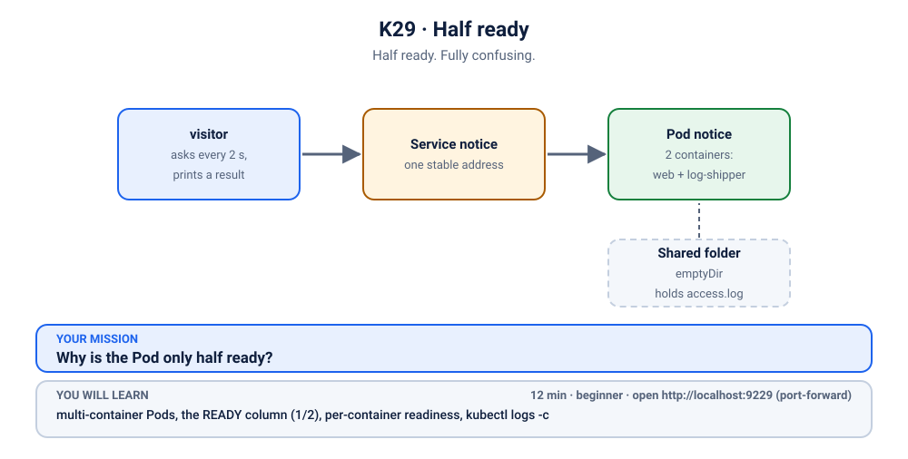
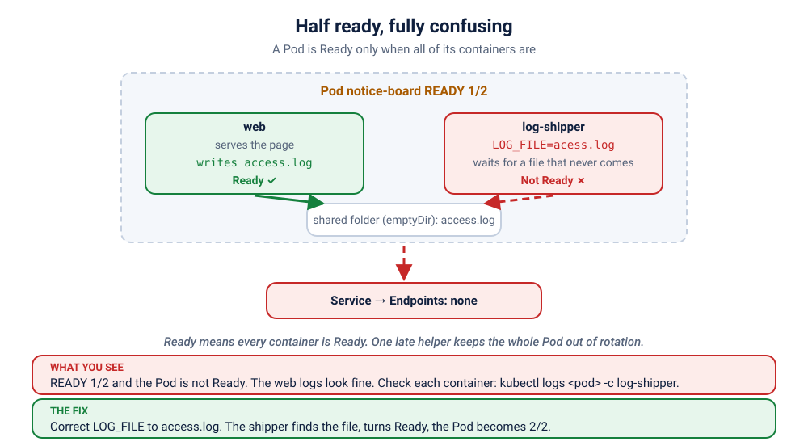

# S1.x3 · Half ready

*Half ready. Fully confusing.*

⏱ 12 min · beginner · Hostel Notice Board (a small offline HTML page, served by `nginxinc/nginx-unprivileged:1.27.5-alpine`) plus a log helper (`busybox:1.36`) · multi-container Pods, the `READY` column (`1/2`), per-container readiness, `kubectl logs -c`

⬇️ First run downloads about 22 MB (nginx-unprivileged) and a tiny 4 MB image (`busybox`, used by the visitor and the log helper). The fix needs no new download. A slow first download is normal on slow Wi-Fi: presenters, preload (`kubernetes/scenarios/preload.sh`) or run the scenario once before class.

Output columns and wording can differ a little between kubectl versions and clusters (kind, minikube, Docker Desktop, playgrounds). The ideas never change.

## 📖 The story
Priya looks after the hostel's **Notice Board** page: the mess menu, the laundry slots and the quiet-hours reminder. This semester the warden wants to see who actually visits it, so Ravi adds a second container to the same Pod: a small helper that follows the web server's access log and prints each line, the first step towards "ship the logs to a central place". He deploys it and runs `kubectl get pods`. The Pod says `1/2`. The website is down, but when Ravi reads the server's logs, nginx looks perfectly happy. Half ready. Fully confusing.



## 🧠 The concept: why, what, how
A Pod can hold **more than one container**. They run side by side on the same node, share the Pod's network, and can share folders (volumes). A common recipe is a **sidecar**: the main container does the job (here: nginx serves the page), and a helper container does a chore next to it (here: follow the log file). They talk through a folder both can see, an `emptyDir` (scratch space that lives as long as the Pod).

- The `READY` column in `kubectl get pods` counts **containers**: `1/2` means "one of the two containers is ready".
- Each container has its own readiness check (a **readiness probe**), its own logs and its own state. A container can be `Running` and still not be ready.
- A Pod is **Ready only when ALL its containers are Ready**. A Service sends traffic only to Ready Pods, so one unready helper can take the whole Pod out of the Service. The main container can be perfectly healthy and the site is still down.
- Every container tells its own story, so to read a story you name the container with `-c <name>`.

Analogy: a shop with a cashier and a guard. The shop only opens when both have signed in. If the guard is stuck at the gate, customers are turned away, even though the cashier is standing at the counter, smiling.

```
 one Pod
 +------------------------------------------------+
 |  web  (ready)  ---writes--->  [ shared folder ]  |
 |  log-shipper (NOT ready) <--reads--'            |
 +------------------------------------------------+
 Pod Ready = web ready AND log-shipper ready   ->   1/2 = not Ready = the Service sends nothing here
```

## 🏢 Where you'll meet this at work
- **Log and metrics sidecars.** A helper container ships logs or metrics next to the app (a log agent, an exporter). If the helper breaks, the whole Pod can turn unready (SRE, platform team).
- **Service-mesh proxies.** Mesh tools add a proxy container to every Pod; when it is not ready, the app container is fine, but the Pod gets no traffic (platform team, developer).
- **On-call debugging.** `kubectl logs` on a Pod with several containers shows only one container's story. The key skill is asking the right container (SRE, developer).

## 💥 Break it
```bash
cd break && ./break.sh
```
What the room should see: the script deploys the notice board and finishes. Something is not fully up. A small `visitor` Pod, which asks for the board every few seconds, gets no answer:
```bash
kubectl logs visitor -n k-29-sidecar --tail=3
```
```
❌ 00:30:14 no answer from http://notice
❌ 00:30:17 no answer from http://notice
❌ 00:30:20 no answer from http://notice
```
(Times will differ.) You can follow it live with `kubectl logs -f visitor -n k-29-sidecar` and stop it with Ctrl+C. We'll watch it again live when we fix things.

## 🔮 Predict first (60 seconds)
A helper container waits for a log file with the wrong name. Before you look:
1. What will `READY` show for the Pod?
2. Will the web page work?

<details><summary>Check your prediction</summary>

1. `1/2`: one container is Ready, the other is not.
2. No: a Pod is only Ready when *all* its containers are, so the Service sends it nothing.
</details>

## 🔍 Investigate
Guess first, then run these **in order**. The visitor's log already told us the symptom: nobody answers.

**1. What state are the Pods in?** Start with the Pods, always.
```bash
kubectl get pods -n k-29-sidecar
```
```
NAME                      READY   STATUS    RESTARTS   AGE
notice-869c7d956d-j4v8h   1/2     Running   0          9s
visitor                   1/1     Running   0          9s
```
(Ages and Pod names will differ.) The `visitor` is `1/1`. The `notice` Pod says `Running`, no restarts, no error, but `READY` is `1/2`. Nothing has crashed; something is just not ready.

<details><summary>💡 Hint</summary>
A Pod counts as Ready only when <em>every</em> container in it is Ready, and every container keeps its own logs. Find out <em>which</em> container is not ready, then read that container's logs, not the other one's.
</details>

**2. Is the Service sending traffic to this Pod?** The visitor talks to the Service, so check who the Service is sending traffic to.
```bash
kubectl get endpoints notice -n k-29-sidecar
```
```
Warning: v1 Endpoints is deprecated in v1.33+; use discovery.k8s.io/v1 EndpointSlice
NAME     ENDPOINTS   AGE
notice               9s
```
(The warning is only about the older name of this object; the answer is the same. Newer clusters may print it, older ones may not.) The `ENDPOINTS` column is empty: the Service has **nobody to send traffic to**. A Service only routes to Pods that are Ready, and a `1/2` Pod is not Ready. That is why the visitor sees ❌ even though the website itself may be fine.

**3. Which container is not ready?** Ask the Pod for each container's own status; use your own Pod name from step 1.
```bash
kubectl get pod notice-869c7d956d-j4v8h -n k-29-sidecar -o jsonpath='{range .status.containerStatuses[*]}{.name}{"\tready="}{.ready}{"\trestarts="}{.restartCount}{"\n"}{end}'
```
```
log-shipper	ready=false	restarts=0
web	ready=true	restarts=0
```
`web` is ready. `log-shipper` is the one that is not ready, and it has never restarted: it is running, but its readiness check keeps saying no. The Pod's events say the same:
```bash
kubectl describe pod notice-869c7d956d-j4v8h -n k-29-sidecar | grep Unhealthy
```
```
  Warning  Unhealthy  2s (x4 over 9s)  kubelet            spec.containers{log-shipper}: Readiness probe failed:
```
(The kubelet repeats this every few seconds.) The probe fails with no message of its own, so the explanation must be in the container's logs.

**4. What does `kubectl logs` say?** Now read the logs, the way most people do, with just the Pod name.
```bash
kubectl logs notice-869c7d956d-j4v8h -n k-29-sidecar 2>&1 | head -4
```
```
Defaulted container "web" out of: web, log-shipper
/docker-entrypoint.sh: /docker-entrypoint.d/ is not empty, will attempt to perform configuration
/docker-entrypoint.sh: Looking for shell scripts in /docker-entrypoint.d/
/docker-entrypoint.sh: Launching /docker-entrypoint.d/10-listen-on-ipv6-by-default.sh
```
(`2>&1 | head -4` just keeps the first four lines of the long nginx output; the first line is a notice that kubectl prints separately.) The end of that output is all calm too: nginx lists its worker processes and waits for visitors.

This is the trap. Recent kubectl does not stop you; it quietly picks the **first container** (`web`) and says so in the first line: `Defaulted container "web" out of: web, log-shipper`. nginx started cleanly, so the logs look great. (The `can not modify default.conf` line you may see is a harmless note from the stock nginx image.) Older kubectl versions refuse instead, with something like `a container name must be specified for pod ..., choose one of: [web log-shipper]`. Either way the lesson is the same: this Pod has two containers, and we have only heard one of them.

**5. What does the other container say?** Name it with `-c`.
```bash
kubectl logs notice-869c7d956d-j4v8h -n k-29-sidecar -c log-shipper
```
```
tail: can't open '/logs/acess.log': No such file or directory
```
There it is. The helper runs `tail -F` on a file, and the file is not there. `tail -F` does not give up: it keeps waiting and retrying, so the container stays running (zero restarts), and the readiness check keeps failing.

**6. How do I hear everyone at once?** `--all-containers` prints every container's logs, and `--prefix` labels each line with who said it.
```bash
kubectl logs notice-869c7d956d-j4v8h -n k-29-sidecar --all-containers --prefix | grep -E 'log-shipper|worker process 28|ready for start'
```
```
[pod/notice-869c7d956d-j4v8h/web] /docker-entrypoint.sh: Configuration complete; ready for start up
[pod/notice-869c7d956d-j4v8h/web] 2026/11/09 00:30:13 [notice] 1#1: start worker process 28
[pod/notice-869c7d956d-j4v8h/log-shipper] tail: can't open '/logs/acess.log': No such file or directory
```
(The `grep` picks three lines out of the long nginx output.) Two containers, two stories: `web` is happy, and `log-shipper` can't find its file.

**7. What file does the web container really write?** Look in the shared folder from both sides. The shared folder is mounted at `/var/log/web` in `web` and at `/logs` in `log-shipper`.
```bash
kubectl exec notice-869c7d956d-j4v8h -n k-29-sidecar -c web -- ls /var/log/web
kubectl exec notice-869c7d956d-j4v8h -n k-29-sidecar -c log-shipper -- ls /logs
```
```
access.log
access.log
```
The file exists, and both containers see it. So the file the helper is told to follow must be spelled differently. Where is that name set?
```bash
kubectl get deploy notice -n k-29-sidecar -o jsonpath='{.spec.template.spec.containers[1].env}{"\n"}'
```
```
[{"name":"LOG_FILE","value":"/logs/acess.log"}]
```
The helper is told to follow `/logs/acess.log`. Read it slowly against `access.log`.

## 🪤 The tempting wrong fix: ignore the helper
"The web server is fine. The helper is just logging, so leave it."
```bash
kubectl delete pods -n k-29-sidecar -l app=notice
kubectl get pods -n k-29-sidecar
```
A new Pod comes up `1/2` again. The helper is not optional: one unready container keeps the whole Pod out of the Service, however healthy the web container is.

## 🩺 Root cause
<details><summary>Reveal after the room guesses</summary>

The `log-shipper` container's setting `LOG_FILE` has a typo: `acess.log` instead of `access.log`. The web container writes `access.log`, so the helper's `tail -F` waits for a file that never appears, and its readiness check (`test -f` on the same wrong name) keeps failing. One unready container makes the whole Pod `1/2`, the Pod is not Ready, and the Service has no endpoints. nginx was fine all along.


</details>

## 🔧 Fix it
Before you run it, open a **second terminal** and start the live visitor log, so the room sees red turn green:
```bash
kubectl logs -f visitor -n k-29-sidecar
```
Then, in the first terminal:
```bash
cd ../fix && ./fix.sh
```
Within about half a minute the log flips from ❌ to ✅ lines (Ctrl+C to stop it):
```
❌ 00:30:26 no answer from http://notice
✅ 00:30:28 HTTP 200
✅ 00:30:30 HTTP 200
```
(shortened.) What changed:
```bash
diff ../break/app.yaml app.yaml
```
```
1,3c1
< # S1.x3 break (2/3): the Hostel Notice Board. One Pod, two containers that share a folder.
< #   web          serves the page and writes its access log into the shared folder
< #   log-shipper  follows the log file and prints each line (a stand-in for "ship it to a log server")
---
> # S1.x3 fix: the same Pod. The log shipper now follows the file the web container really writes.
42c40
<               value: /logs/acess.log
---
>               value: /logs/access.log
```
One letter. The Deployment replaces the old Pod with a new one.

By hand (this replaces `./fix.sh`, so you don't need to run both): from the `fix` folder, apply the corrected file.
```bash
kubectl apply -f app.yaml
```

## ✅ Verify it yourself
Short on time? `cd .. && ./check.sh` says in one line whether you are done. It only looks, it never changes anything. The steps below show you *why* it says so.

```bash
kubectl get pods -n k-29-sidecar
```
```
NAME                      READY   STATUS    RESTARTS   AGE
notice-578487d68c-7qj2z   2/2     Running   0          10s
visitor                   1/1     Running   0          23s
```
(Names and ages will differ. For a few seconds the old Pod may still show `Terminating`.) `2/2`: both containers are ready, so the Pod is Ready. Does the Service have somewhere to send traffic now?
```bash
kubectl get endpoints notice -n k-29-sidecar
```
```
Warning: v1 Endpoints is deprecated in v1.33+; use discovery.k8s.io/v1 EndpointSlice
NAME     ENDPOINTS          AGE
notice   10.244.1.25:8080   23s
```
An address appears. (Yours will differ.) Is each container ready on its own?
```bash
kubectl get pod notice-578487d68c-7qj2z -n k-29-sidecar -o jsonpath='{range .status.containerStatuses[*]}{.name}{"\tready="}{.ready}{"\n"}{end}'
```
```
log-shipper	ready=true
web	ready=true
```
Now the helper does its job: it prints the web server's access log. The visitor asks for the page every 2 seconds, and each visit appears as a line.
```bash
kubectl logs notice-578487d68c-7qj2z -n k-29-sidecar -c log-shipper --tail=3
```
```
10.244.1.24 - - [09/Nov/2026:00:30:30 +0000] "GET / HTTP/1.1" 200 4747 "-" "Wget"
10.244.1.24 - - [09/Nov/2026:00:30:32 +0000] "GET / HTTP/1.1" 200 4747 "-" "Wget"
10.244.1.24 - - [09/Nov/2026:00:30:34 +0000] "GET / HTTP/1.1" 200 4747 "-" "Wget"
```
Those lines were written by nginx into the shared file and read by the other container. The visitor's log is green (if you still see a ❌, wait a few seconds and run it again):
```bash
kubectl logs visitor -n k-29-sidecar --tail=3
```
```
✅ 00:30:30 HTTP 200
✅ 00:30:32 HTTP 200
✅ 00:30:34 HTTP 200
```
Now look at the board yourself. In a **second terminal** (leave it running):
```bash
kubectl port-forward -n k-29-sidecar svc/notice 9229:80
```
```
Forwarding from 127.0.0.1:9229 -> 8080
Forwarding from [::1]:9229 -> 8080
```
On a playground, add `--address 0.0.0.0` and open the URL for port 9229.
Back in the first terminal:
```bash
curl -s -o /dev/null -w '%{http_code}\n' localhost:9229
```
```
200
```
(The port-forward terminal also prints `Handling connection for 9229`.) That visit is now in the helper's log too:
```bash
kubectl logs notice-578487d68c-7qj2z -n k-29-sidecar -c log-shipper | grep curl
```
```
127.0.0.1 - - [09/Nov/2026:00:30:40 +0000] "GET / HTTP/1.1" 200 4747 "-" "curl/8.7.1"
```
(The `curl/…` version will differ on your computer.) Or open http://localhost:9229 in your browser: pick a day on the mess menu, book a laundry slot, and watch the quiet-hours countdown. The page needs no internet. Each reload adds a line to the helper's log. Press Ctrl+C in the second terminal to stop the port-forward.

## 👀 See it in monitoring (optional)
If you installed the monitoring stack ([lab K19](../../../19-observability/README.md)), watch a Pod that is half ready as a number. In Prometheus (`kubectl port-forward -n monitoring svc/kube-prometheus-stack-prometheus 9090:9090`, then http://localhost:9090) run:
```
kube_pod_container_status_ready{namespace="k-29-sidecar"}
```
One series per container: the app container reads 1, the sidecar reads 0. The Pod as a whole is not Ready until every container is.

## 🎯 Key takeaways
- **`READY 1/2` counts containers.** The Pod is Ready only when all of them are, and a Service sends traffic only to Ready Pods.
- **"The web server is fine but the site is down" can be a helper's fault.** One unready sidecar takes the whole Pod out of the Service.
- **A failing readiness check never restarts anything.** It only takes the Pod out of the Service. Restarts come from a crash or a failing liveness probe, which is why `RESTARTS` stayed at 0 here.
- **Every container has its own logs.** `kubectl logs <pod>` may quietly show just one (or refuse, on older kubectl). Use `-c <name>`, or `--all-containers --prefix` for everyone.
- **`tail -F` waits instead of failing.** A container can be `Running`, restart zero times and still be stuck; the readiness check is what tells you.

## 💎 Lifelong lesson
> In a multi-container Pod, every container tells its own story. Name the one you're asking.

## 🧹 Clean up
Press Ctrl+C in the port-forward terminal first, then:
```bash
cd .. && ./cleanup.sh
```

## 🧪 Quick recap (3 questions)
1. What does `READY 1/2` mean?
2. How do you read the logs of one container in a multi-container Pod?
3. Why does one unready container stop the whole Pod?

<details><summary>Answers</summary>

1. One of the Pod's two containers is Ready.
2. `kubectl logs <pod> -c <container name>`.
3. Readiness is per Pod: the Service only uses a Pod when all of its containers are Ready.
</details>

## Next →
[S6.x3](../../6-namespaces-quotas-helm-and-troubleshooting/x3-friday-5pm-outage/README.md): Friday, 5 PM. Three things broke. Nobody knows that yet.
