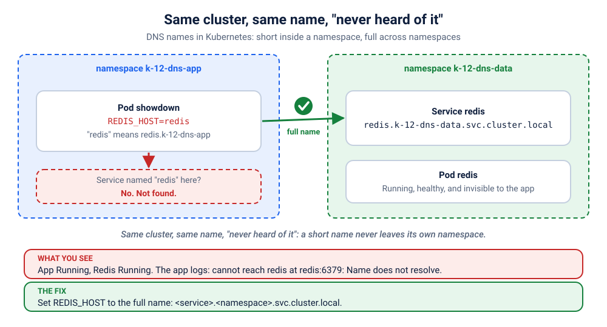

# K12 · Same cluster, same name, "never heard of it"

*The Redis is running. The app is running. And the app swears Redis does not exist.*

⏱ 10 min · beginner · Cats vs Dogs voting app (`python:3.12-alpine`, about 19 MB) plus Redis (`redis:7.4.12-alpine`, about 59 MB on disk) · DNS, Services, namespaces

⬇️ First run downloads about 19 MB (Python), about 59 MB (Redis) and a tiny 4 MB visitor image. A slow first download is normal: do it on good Wi-Fi, before the session.

Output columns and wording can differ a little between kubectl, container runtimes and clusters (kind, minikube, Docker Desktop, playgrounds). The ideas never change.

## 📖 The story
The platform team at a Bengaluru startup gives every team a shared Redis, so nobody runs their own. It lives in its own namespace, `k-12-dns-data`. Meera's "Cats vs Dogs" poll for the campus fest runs in `k-12-dns-app`, and her config says `REDIS_HOST=redis`. It worked perfectly on her laptop, where everything sat in one namespace. In the shared cluster the Redis Pod is healthy, the Service is there, and yet the poll says it cannot find Redis. Same cluster. Same name. "Never heard of it."

## 🧠 The concept: why, what, how
A **namespace** is a folder inside the cluster: it groups objects and keeps names from clashing. Two teams can both have a Service called `redis`, as long as they are in different namespaces. Every Service also gets a **DNS name**, and Kubernetes' DNS answers this question: "which IP is `redis`?"

A Service's full name is `<service>.<namespace>.svc.cluster.local`. To save typing, every Pod gets a list of **search domains** in `/etc/resolv.conf`, and a short name like `redis` is tried against them, starting with the Pod's own namespace. So `redis` quietly means `redis.<my-own-namespace>.svc.cluster.local`.

Think of two offices in a company. Inside your office you can shout "Priya!" and the right Priya turns around. To reach the Priya in the other office, you say "Priya from the Data office", or better, the full name and floor.

```
 Pod in k-12-dns-app asks for "redis"
   tries  redis.k-12-dns-app.svc.cluster.local   -> no such Service
   tries  redis.svc.cluster.local                -> no
   tries  redis.cluster.local                    -> no     = "Name does not resolve"

 The real one:  redis.k-12-dns-data.svc.cluster.local  -> 10.96.x.x
```

## 🏢 Where you'll meet this at work
- **Shared platform services** (databases, caches, message queues) that live in their own namespace while many teams' apps call them (developer, platform team).
- **Moving a service to another namespace** during a re-organisation: callers using short names silently break (SRE, developer).
- **Dev, staging and prod in one cluster**, where the same Service name exists in every namespace and a short name must never reach the wrong one (platform team).

## 💥 Break it
```bash
cd break && ./break.sh
```
What the room should see: the script says Redis is running and the app is running too, but the app says it is not ready and nobody can vote. A small `visitor` Pod asks the app `/readyz` every 2 seconds ("are you ready?") and gets "not ready" every time:
```bash
kubectl logs -f visitor -n k-12-dns-app
```
```
❌ 05:10:09 http://showdown/readyz says: not ready
❌ 05:10:11 http://showdown/readyz says: not ready
❌ 05:10:13 http://showdown/readyz says: not ready
```
You can stop it with Ctrl+C. We'll watch it again live when we fix things.

## 🔍 Investigate
Guess first, then run these **in order**.

**1. What does Kubernetes say about the app?** Start with the Pods in both namespaces: this is the symptom.
```bash
kubectl get pods -n k-12-dns-app
kubectl get pods -n k-12-dns-data
```
```
NAME                        READY   STATUS    RESTARTS   AGE
showdown-855c7ff6bf-lmzf7   1/1     Running   0          11s
visitor                     1/1     Running   0          10s
NAME                     READY   STATUS    RESTARTS   AGE
redis-7f87b86754-f4zwb   1/1     Running   0          19s
```
(Ages and Pod names will differ.) Everything is `Running` and `1/1`. Kubernetes thinks all is well, because this app has no readiness probe: "running" only means the process started. The visitor's log above is where the truth shows: "not ready", every 2 seconds.

<details><summary>💡 Hint</summary>
Redis is Running, and the app is Running. So what exactly is failing? Read the app's own log for the word it uses for the problem. Then ask: which <em>namespace</em> is the app in, and which one is Redis in? When you type a short name like <code>redis</code>, where does DNS look?
</details>

**2. What does the app itself say?** Its log has the real error.
```bash
kubectl logs -n k-12-dns-app -l app=showdown --tail=2
```
```
2026-11-08T05:10:09 [showdown-855c7ff6bf-lmzf7] readiness failed: cannot reach redis at redis:6379: [Errno -2] Name does not resolve
2026-11-08T05:10:11 [showdown-855c7ff6bf-lmzf7] readiness failed: cannot reach redis at redis:6379: [Errno -2] Name does not resolve
```
(Timestamps and the Pod name will differ.) Not "connection refused" and not "timed out", but **"Name does not resolve"**: the app never even got an address for `redis`. This is a DNS problem, not a Redis problem.

**3. Can the Pod resolve the name itself?** Ask the same question the app asks, from inside its own Pod.
```bash
kubectl exec -n k-12-dns-app deploy/showdown -- python -c "import socket;print(socket.gethostbyname('redis'))"
```
```
Traceback (most recent call last):
  File "<string>", line 1, in <module>
socket.gaierror: [Errno -2] Name does not resolve
command terminated with exit code 1
```
Same failure, reproduced by hand. (The exact wording of this error comes from the Python image's C library; the idea is the same everywhere.)

**4. Does a Service called `redis` exist at all?** Look in every namespace.
```bash
kubectl get svc -A | grep redis
```
```
k-12-dns-data   redis        ClusterIP   10.96.62.241   <none>        6379/TCP                 20s
```
(The IP address will differ.) It exists, and it is healthy. But it is in `k-12-dns-data`, and our app is in `k-12-dns-app`. Different namespace.

**5. Where does a short name get looked up?** The Pod's `resolv.conf` has the search rules.
```bash
kubectl exec -n k-12-dns-app deploy/showdown -- cat /etc/resolv.conf
```
```
search k-12-dns-app.svc.cluster.local svc.cluster.local cluster.local
nameserver 10.96.0.10
options ndots:5
```
(The `nameserver` IP differs between clusters, and some clusters add extra search domains at the end.) The first search domain is `k-12-dns-app.svc.cluster.local`: the Pod's **own** namespace. So `redis` becomes `redis.k-12-dns-app.svc.cluster.local`, which does not exist. Prove that the full name works:
```bash
kubectl exec -n k-12-dns-app deploy/showdown -- python -c "import socket;print(socket.gethostbyname('redis.k-12-dns-data.svc.cluster.local'))"
```
```
10.96.62.241
```
The full name finds it right away.

## 🩺 Root cause
<details><summary>Reveal after the room guesses</summary>

The app's setting is `REDIS_HOST=redis`, a **short name**. Short names are expanded with the search domains in the Pod's `/etc/resolv.conf`, and the first one is the Pod's own namespace: `redis.k-12-dns-app.svc.cluster.local`. The Redis Service lives in another namespace, `k-12-dns-data`, so DNS answers "no such name". Nothing is broken in Redis or in the network. The fix is to use the full name `redis.k-12-dns-data.svc.cluster.local`.


</details>

## 🔧 Fix it
Before you run it, open a **second terminal** and start the live visitor log, so the room sees red turn green:
```bash
kubectl logs -f visitor -n k-12-dns-app
```
Then, in the first terminal:
```bash
cd ../fix && ./fix.sh
```
The log flips from ❌ to ✅ lines within about ten seconds of the new Pod starting (Ctrl+C to stop it). What changed:
```bash
diff ../break/app.yaml app.yaml
```
```
23c23
<               value: "redis"
---
>               value: "redis.k-12-dns-data.svc.cluster.local"
```
One real change: the value of `REDIS_HOST`. The `<service>.<namespace>.svc.cluster.local` form works from any namespace. (The first lines are only comments.)

By hand (this replaces `./fix.sh`, so you don't need to run both): apply the fixed file from the `fix` folder.
```bash
kubectl apply -f app.yaml
```
Kubernetes starts a new Pod with the new setting and removes the old one. Wait about ten seconds for the new Pod to become `1/1` before you start verifying.

## ✅ Verify it yourself
```bash
kubectl get pods -n k-12-dns-app
```
```
NAME                        READY   STATUS    RESTARTS   AGE
showdown-6f74cf8d78-qpblt   1/1     Running   0          26s
visitor                     1/1     Running   0          57s
```
(Ages and Pod names will differ.) A new app Pod replaced the old one. The visitor's log is green (if you still see a ❌, wait a few seconds and run it again):
```bash
kubectl logs visitor -n k-12-dns-app --tail=3
```
```
✅ 05:10:49 HTTP 200
✅ 05:10:51 HTTP 200
✅ 05:10:53 HTTP 200
```
The app now says where it keeps the votes:
```bash
kubectl logs -n k-12-dns-app -l app=showdown --tail=3
```
```
2026-11-08T05:10:39 [showdown-6f74cf8d78-qpblt] 🚀 Cats vs Dogs v1.0.0 (Cats vs Dogs) listening on :8080, votes stored in redis redis.k-12-dns-data.svc.cluster.local
```
(Only one line yet, until someone votes.) And the Pod can resolve the name it was missing:
```bash
kubectl exec -n k-12-dns-app deploy/showdown -- python -c "import socket;print(socket.gethostbyname('redis.k-12-dns-data.svc.cluster.local'))"
```
```
10.96.62.241
```
Now open it yourself. In a **second terminal** (leave it running):
```bash
kubectl port-forward -n k-12-dns-app svc/showdown 9212:80
```
```
Forwarding from 127.0.0.1:9212 -> 8080
Forwarding from [::1]:9212 -> 8080
```
On a playground, add `--address 0.0.0.0` and open the URL for port 9212.
Back in the first terminal: ask if it is ready, cast a vote, and read the results:
```bash
curl -s localhost:9212/readyz; echo
curl -s "localhost:9212/api/vote?option=cats"; echo
curl -s localhost:9212/api/results; echo
```
```
{"status": "ready", "storage": "redis"}
{"voted": "cats", "results": {"cats": 1, "dogs": 0}, "total": 1, "storage": "redis", "served_by": "showdown-6f74cf8d78-qpblt", "version": "1.0.0"}
{"results": {"cats": 1, "dogs": 0}, "total": 1, "storage": "redis", "served_by": "showdown-6f74cf8d78-qpblt", "version": "1.0.0"}
```
(The Pod name will differ.) The vote went to the Redis in the other namespace. Prove it, by asking Redis itself:
```bash
kubectl exec -n k-12-dns-data deploy/redis -- redis-cli hgetall votes
```
```
cats
1
```
Or open http://localhost:9212 in your browser and vote. Press Ctrl+C in the second terminal to stop the port-forward.

## 🎯 Key takeaways
- **A Service name is only short inside its own namespace.** `redis` means `redis.<my-namespace>.svc.cluster.local`.
- **Across namespaces, use the full name:** `<service>.<namespace>.svc.cluster.local`. Often `<service>.<namespace>` is enough too, but the full name leaves no doubt.
- **"Running" is not "working".** Without a readiness probe, Kubernetes shows `1/1 Running` while the app cannot reach its database.
- Debug path: the app's log (`Name does not resolve`) → `gethostbyname` from inside the Pod → `get svc -A | grep` (which namespace?) → `/etc/resolv.conf` (the search domains).

## 💎 Lifelong lesson
> Names are local. Addresses are global. Use the full name across namespaces.

## 🧹 Clean up
Press Ctrl+C in the port-forward terminal first, then:
```bash
cd .. && ./cleanup.sh
```

## Next →
[K13](../13-lockdown-blocks-dns/README.md): Security locked the app down so it can only talk to Redis. And now the app cannot even find Redis.
