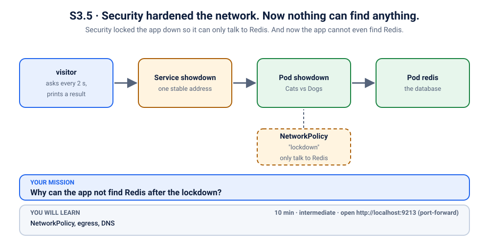
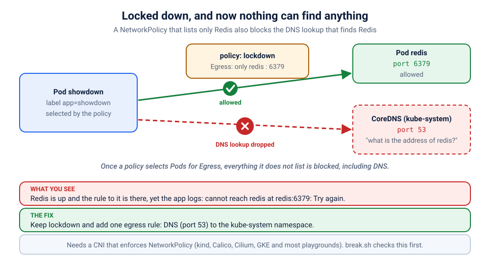

# K13 · Security hardened the network. Now nothing can find anything.

*Security locked the app down so it can only talk to Redis. And now the app cannot even find Redis.*

⏱ 10 min · intermediate · Cats vs Dogs voting app (`python:3.12-alpine`, about 19 MB) plus Redis (`redis:7.4.12-alpine`, about 59 MB on disk) · NetworkPolicy, egress, DNS

⬇️ First run downloads about 19 MB (Python), about 59 MB (Redis) and a tiny 4 MB visitor image. A slow first download is normal: do it on good Wi-Fi, before the session.

⚠️ This scenario needs a cluster that **enforces** NetworkPolicy: kind, Killercoda or iximiuz. `break.sh` checks this first (a throwaway test in a namespace called `k-13-probe`, deleted straight after). Some clusters (often Docker Desktop or a default minikube) accept NetworkPolicy objects but ignore them: the script checks yours first, and if policies aren't enforced it stops with a clear message.

Output columns and wording can differ a little between kubectl, container runtimes and clusters. The ideas never change.

## 📖 The story
Before the campus-fest launch, the security team at a Bengaluru startup runs a "hardening sprint". Their rule: the poll app may talk to Redis and nothing else. Ravi applies the NetworkPolicy, checks that Redis is still allowed, and goes home happy. The next morning Lakshmi opens the poll: not ready, nobody can vote. Redis is running. The Service is there. The policy even *allows* Redis. So what is blocked?



## 🧠 The concept: why, what, how
A **NetworkPolicy** is a firewall rule for Pods. By default every Pod can talk to everything. But the moment a policy **selects** a Pod for `Egress` (traffic going *out*), that Pod is on a guest list: anything not listed is dropped. Rules only ever *add* to the list; there is no "deny" rule, only "everything else is denied".

And DNS is traffic too. To find `redis`, the Pod first sends a question to CoreDNS (the cluster's phone book, in the `kube-system` namespace) on **port 53**. Allowing "Redis on 6379" does not allow "the phone book on 53".

Think of a hostel with a strict gate list: "students may go to the library". You can go to the library, but you can't look up its address, because the information desk is not on the list either.

```
 app Pod  --(1) "where is redis?" UDP/53 -->  CoreDNS (kube-system)   BLOCKED by the policy
 app Pod  --(2) connect  redis:6379     -->  Redis Pod                allowed, but never reached
```

## 🏢 Where you'll meet this at work
- **Zero-trust rollouts**: "default deny, then allow what is needed". The first allow-list nearly always forgets DNS (platform team, SRE).
- **Compliance hardening sprints** (PCI, ISO 27001), where egress is locked down before an audit (security engineer, developer).
- **Restricting outbound traffic** so a hacked Pod cannot phone home, which is great, until the Pod also cannot find its own database (developer).

## 💥 Break it
```bash
cd break && ./break.sh
```
What the room should see: the script first runs a quick enforcement check, then says Redis is running and the app is running too, but the app says it is not ready and nobody can vote. A small `visitor` Pod asks the app `/readyz` ("are you ready?") and gets "not ready" every time:
```bash
kubectl logs -f visitor -n k-13-lockdown
```
```
❌ 09:13:51 http://showdown/readyz says: not ready
❌ 09:13:58 http://showdown/readyz says: not ready
❌ 09:14:05 http://showdown/readyz says: not ready
```
(One line about every 7 seconds: each failed check takes 5 seconds to give up.) You can stop it with Ctrl+C. We'll watch it again live when we fix things.

## 🔮 Predict first (60 seconds)
A policy allows Redis on port 6379 and nothing else outbound. Before you look:
1. Is Redis reachable by its IP address?
2. Why can the app still not find it?

<details><summary>Check your prediction</summary>

1. Yes: that exact rule is allowed.
2. The app uses a *name*, and the lookup (DNS on port 53) is dropped, because the policy does not list it.
</details>

## 🔍 Investigate
Guess first, then run these **in order**.

**1. What does Kubernetes say about the app?** Start with the Pods: this is the symptom.
```bash
kubectl get pods -n k-13-lockdown
```
```
NAME                        READY   STATUS    RESTARTS   AGE
redis-7f87b86754-6d9zz      1/1     Running   0          7s
showdown-855c7ff6bf-6c9wl   1/1     Running   0          7s
visitor                     1/1     Running   0          7s
```
(Ages and Pod names will differ.) Everything is `Running` and `1/1`. This app has no readiness probe, so "running" only means the process started. The visitor's log above is where the truth shows.

<details><summary>💡 Hint</summary>
Look at <em>how</em> the failure is worded in the app's log: it is not "connection refused" and not "unknown host". Something is not answering, and everything that did start is healthy. Ask: what must a Pod do <em>before</em> it can connect to a name like <code>redis</code>? And did anyone change the network rules recently?
</details>

**2. What does the app itself say?** Its log has the real error.
```bash
kubectl logs -n k-13-lockdown -l app=showdown --tail=2
```
```
2026-11-08T09:13:45 [showdown-855c7ff6bf-6c9wl] 🚀 Cats vs Dogs v1.0.0 (Cats vs Dogs) listening on :8080, votes stored in redis redis
2026-11-08T09:13:51 [showdown-855c7ff6bf-6c9wl] readiness failed: cannot reach redis at redis:6379: [Errno -3] Try again
```
(Timestamps and the Pod name will differ; later runs show only "readiness failed" lines.) "Try again" is the name-resolution error: the lookup of `redis` got no answer, so the app never even got an address to connect to. (Exact wording depends on the C library in the image.)

**3. Can the Pod resolve the name itself?** Ask the same question the app asks, from inside its own Pod. Notice how long it takes before it gives up.
```bash
kubectl exec -n k-13-lockdown deploy/showdown -- python -c "import socket;print(socket.gethostbyname('redis'))"
```
```
Traceback (most recent call last):
  File "<string>", line 1, in <module>
socket.gaierror: [Errno -3] Try again
command terminated with exit code 1
```
Same failure, reproduced by hand, after a wait of about 5 seconds. A wrong name fails instantly ("Name does not resolve", as in [K12](../12-showdown-dns-namespaces/README.md)). A slow failure means the question is being **dropped**, not answered.

**4. Is Redis itself reachable?** Skip the name: connect straight to the Service's IP address.
```bash
kubectl get svc redis -n k-13-lockdown
```
```
NAME    TYPE        CLUSTER-IP     EXTERNAL-IP   PORT(S)    AGE
redis   ClusterIP   10.96.63.119   <none>        6379/TCP   13s
```
Use the `CLUSTER-IP` from **your** output in the next command:
```bash
kubectl exec -n k-13-lockdown deploy/showdown -- python -c "import socket;s=socket.create_connection(('10.96.63.119',6379),timeout=3);s.sendall(b'PING\r\n');print(s.recv(20))"
```
```
b'+PONG\r\n'
```
By IP address, Redis answers right away ("PONG"). So the network path to Redis is fine; only *finding* it by name is broken. And only the DNS question is being dropped.

**5. Who is dropping packets?** A firewall for Pods is a NetworkPolicy. Look for one.
```bash
kubectl get networkpolicy -n k-13-lockdown
```
```
NAME       POD-SELECTOR   AGE
lockdown   app=showdown   13s
```
There it is: `lockdown`, aimed at `app=showdown`: our app Pods. Read its rules:
```bash
kubectl get networkpolicy lockdown -n k-13-lockdown -o yaml | grep -A13 "^spec"
```
```
spec:
  egress:
  - ports:
    - port: 6379
      protocol: TCP
    to:
    - podSelector:
        matchLabels:
          app: redis
  podSelector:
    matchLabels:
      app: showdown
  policyTypes:
  - Egress
```
(Key order can differ.) `policyTypes: Egress` plus a single rule: "to Redis Pods, port 6379". Nothing for port 53. That is the whole guest list.

## 🪤 The tempting wrong fix: delete the policy
"Security broke it, so remove the lockdown."
That does bring the app back: with the policy gone, nothing blocks DNS any more. But you have just removed the protection the security team asked for, to fix a problem that only needed one more rule. (This one is text only: running it would undo the scenario.) The policy was right. It was incomplete.

## 🩺 Root cause
<details><summary>Reveal after the room guesses</summary>

The `lockdown` NetworkPolicy selects the app Pods for **Egress**, so everything outbound that isn't listed is dropped. It lists Redis on 6379 but not DNS. Before the app can connect to `redis` it must ask CoreDNS (in `kube-system`, port 53, UDP and TCP) for the address, and that question is silently dropped. The lookup times out after 5 seconds ("Try again"), and `/readyz` answers 503. Redis, the Service and the network path to Redis are all fine (connecting by IP works). The fix is to add a rule that allows DNS.


</details>

## 🔧 Fix it
Before you run it, open a **second terminal** and start the live visitor log, so the room sees red turn green:
```bash
kubectl logs -f visitor -n k-13-lockdown
```
Then, in the first terminal:
```bash
cd ../fix && ./fix.sh
```
The log flips from ❌ to ✅ lines within about fifteen seconds (Ctrl+C to stop it). No Pod restarts: a policy change takes effect on running Pods. What changed:
```bash
diff ../break/app.yaml app.yaml
```
```
70a71,79
>     - to:
>         - namespaceSelector:
>             matchLabels:
>               kubernetes.io/metadata.name: kube-system
>       ports:
>         - port: 53
>           protocol: UDP
>         - port: 53
>           protocol: TCP
```
One real change: a second egress rule that lets the app reach `kube-system` (where CoreDNS lives) on port 53, UDP and TCP. (The first lines are only comments.)

By hand (this replaces `./fix.sh`, so you don't need to run both; `cd ../fix` first if you are not already there): apply the fixed file from the `fix` folder.
```bash
kubectl apply -f app.yaml
```
Wait about fifteen seconds before you start verifying.

## ✅ Verify it yourself
Short on time? `cd .. && ./check.sh` says in one line whether you are done. It only looks, it never changes anything. The steps below show you *why* it says so.

```bash
kubectl get pods -n k-13-lockdown
```
```
NAME                        READY   STATUS    RESTARTS   AGE
redis-7f87b86754-6d9zz      1/1     Running   0          45s
showdown-855c7ff6bf-6c9wl   1/1     Running   0          45s
visitor                     1/1     Running   0          45s
```
(Ages and Pod names will differ.) The same Pods, never restarted: only the rules changed. The visitor's log is green (if you still see a ❌, wait a few seconds and run it again):
```bash
kubectl logs visitor -n k-13-lockdown --tail=3
```
```
✅ 09:14:23 HTTP 200
✅ 09:14:25 HTTP 200
✅ 09:14:27 HTTP 200
```
And the Pod can resolve the name it was missing, instantly:
```bash
kubectl exec -n k-13-lockdown deploy/showdown -- python -c "import socket;print(socket.gethostbyname('redis'))"
```
```
10.96.63.119
```
(The IP address will differ.) Now open it yourself. In a **second terminal** (leave it running):
```bash
kubectl port-forward -n k-13-lockdown svc/showdown 9213:80
```
```
Forwarding from 127.0.0.1:9213 -> 8080
Forwarding from [::1]:9213 -> 8080
```
On a playground, add `--address 0.0.0.0` and open the URL for port 9213.
Back in the first terminal: ask if it is ready, cast a vote, and read the results:
```bash
curl -s localhost:9213/readyz; echo
curl -s "localhost:9213/api/vote?option=cats"; echo
curl -s localhost:9213/api/results; echo
```
```
{"status": "ready", "storage": "redis"}
{"voted": "cats", "results": {"cats": 1, "dogs": 0}, "total": 1, "storage": "redis", "served_by": "showdown-855c7ff6bf-6c9wl", "version": "1.0.0"}
{"results": {"cats": 1, "dogs": 0}, "total": 1, "storage": "redis", "served_by": "showdown-855c7ff6bf-6c9wl", "version": "1.0.0"}
```
(The Pod name will differ.) Prove the vote reached Redis, by asking Redis itself:
```bash
kubectl exec -n k-13-lockdown deploy/redis -- redis-cli hgetall votes
```
```
cats
1
```
Or open http://localhost:9213 in your browser and vote. Notice the policy only restricts what the app sends *out*: the browser could always reach the app. Press Ctrl+C in the second terminal to stop the port-forward.

## 🎯 Key takeaways
- **Once a NetworkPolicy selects a Pod for Egress, everything not listed is blocked.** Allow-lists only add; there is no deny rule.
- **DNS is traffic too.** Every egress policy needs a rule for port 53 (UDP and TCP) to CoreDNS in `kube-system`.
- **Slow failure means dropped; instant failure means refused or unknown.** "Try again" after 5 seconds points at a firewall, not at a typo.
- Debug path: the app's log (can't resolve) → resolve by hand (slow fail) → connect by IP (works!) → `get networkpolicy -o yaml` (no port 53).
- Not every cluster enforces policies. Some clusters (often Docker Desktop or a default minikube) accept them and ignore them, so the same YAML "works" in dev and blocks in production.

## 💎 Lifelong lesson
> When everything breaks at once, suspect the shared thing: DNS.

## 🧹 Clean up
Press Ctrl+C in the port-forward terminal first, then:
```bash
cd .. && ./cleanup.sh
```

## 🧪 Quick recap (3 questions)
1. What is the difference between ingress and egress rules?
2. What happens to outbound traffic once a policy selects Pods for egress?
3. What must an egress rule allow so that name-based access works?

<details><summary>Answers</summary>

1. Ingress controls traffic coming *in* to the Pods. Egress controls traffic going *out*.
2. Everything not listed is blocked.
3. DNS (port 53, UDP and TCP, to CoreDNS in `kube-system`) as well as the destination itself.
</details>

## Next →
[K14](../14-leaderboard-bot-forbidden/README.md): The bot has a valid ID card. The API still says: not allowed.
