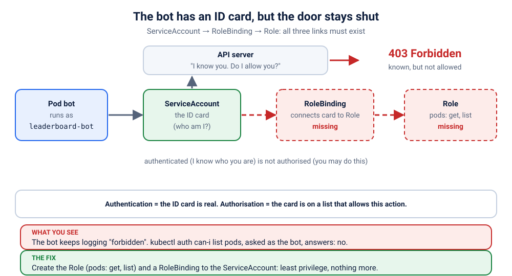

# K14 · The bot has an ID card, but the door stays shut

*The bot has a valid ID card. The API still says: not allowed.*

⏱ 10 min · beginner · a "leaderboard bot" (`curlimages/curl`, about 12 MB) · authentication vs authorisation, ServiceAccount, Role, RoleBinding, 403 Forbidden, least privilege

⬇️ First run downloads about 12 MB (curl) and 4 MB (busybox). A slow first download is normal: do it on good Wi-Fi, before the session.

Output columns and wording can differ a little between kubectl, Kubernetes versions and clusters (kind, minikube, Docker Desktop, playgrounds). The ideas never change.

## 📖 The story
It's hackathon night at Christ University. Ravi writes a small "leaderboard bot" that asks the Kubernetes API, every 5 seconds, "which player Pods are alive?" and shows the count on the big screen. He deploys it, the Pod is `Running`, no restarts, everything green. The screen stays empty. Lakshmi checks the logs and sees the bot is being told, politely and again and again: *forbidden*. The bot did log in. It just isn't allowed to do anything.

## 🧠 The concept: why, what, how
Programs inside a cluster often need to talk to the Kubernetes API itself (CI deployers, operators, monitoring agents). Kubernetes asks two separate questions, in this order:

1. **Authentication: who are you?** Every Pod runs as a **ServiceAccount**, an ID card for programs. Kubernetes puts its token inside the Pod (`/var/run/secrets/kubernetes.io/serviceaccount/`). A valid token answers "who".
2. **Authorisation: what may you do?** That is **RBAC** (Role-Based Access Control). By default a ServiceAccount may do **nothing**. A **Role** lists permissions (verbs like `get`, `list` on resources like `pods`). A **RoleBinding** says *who* gets that Role.

Think of a college campus. The ID card gets you through the main gate (authentication). Whether the library door opens for you depends on the access list at that door (authorisation). Nobody wrote the bot's name on any list.

```
 bot ── token ──▶ API server ──▶ who? ✅ leaderboard-bot ──▶ may it "list pods"? ──▶ no Role, no RoleBinding ──▶ 403 Forbidden
                                                                     ▲
                                  Role (get, list pods) + RoleBinding (to the ServiceAccount) = ✅
```

HTTP **401** means "I don't know who you are". HTTP **403** means "I know exactly who you are, and the answer is no".

## 🏢 Where you'll meet this at work
- **A CI/CD deployer or Helm job** moved to a new namespace or cluster: it worked yesterday, today it gets 403 (developer, platform team).
- **An operator or controller** (cert-manager, an autoscaler, a database operator) that reads or creates objects and was installed without its Roles (SRE, platform team).
- **A monitoring agent** that must list Pods and Nodes to show a dashboard, which should have read-only permission and nothing more (SRE).

## 💥 Break it
```bash
cd break && ./break.sh
```
What the room should see: the script says the bot is running, but the leaderboard stays empty. There is **no web page and no port to open** in this scenario (the bot is not a web app), so everything we do happens in the terminal with `logs` and `kubectl auth can-i`.

## 🔍 Investigate
Guess first, then run these **in order**.

**1. Is the bot alive?** Check the Pods first: this is the symptom.
```bash
kubectl get pods -n k-14-forbidden
```
```
NAME                       READY   STATUS    RESTARTS   AGE
bot                        1/1     Running   0          2s
players-6bc46449d8-l5m2c   1/1     Running   0          2s
players-6bc46449d8-mdwdk   1/1     Running   0          2s
```
(Pod names and ages will differ.) The bot is `Running`, `1/1` Ready, `0` restarts. There are two "player" Pods too. Everything looks healthy, so the problem is not the Pod itself.

**2. What does the bot say?** The bot prints the result of every try, so read it.
```bash
kubectl logs -f bot -n k-14-forbidden
```
```
❌ 403 Forbidden: pods is forbidden: User "system:serviceaccount:k-14-forbidden:leaderboard-bot" cannot list resource "pods" in API group "" in the namespace "k-14-forbidden"
❌ 403 Forbidden: pods is forbidden: User "system:serviceaccount:k-14-forbidden:leaderboard-bot" cannot list resource "pods" in API group "" in the namespace "k-14-forbidden"
```
(Shortened: a new identical line appears every 5 seconds. Press Ctrl+C when you've seen enough.) Look at what the API says: **403**, not 401. It knows the bot.

<details><summary>💡 Hint</summary>
Read the 403 message slowly. It names three things: <i>who</i> is asking, <i>which action</i> was refused (a verb), and <i>on which resource</i>. A ServiceAccount starts with no permissions at all. Where does Kubernetes keep the list of what a ServiceAccount is allowed to do?
</details>

**3. Ask the API directly.** `kubectl auth can-i` asks the same question the bot asked, pretending to be the bot (`--as=`).
```bash
kubectl auth can-i list pods -n k-14-forbidden --as=system:serviceaccount:k-14-forbidden:leaderboard-bot
```
```
no
```
A plain `no` (and exit code 1). The bot's identity is fine; the permission is missing.

**4. Where would the permission live?** Permissions come from Roles, and RoleBindings attach them to someone. Look for both.
```bash
kubectl get role,rolebinding -n k-14-forbidden
```
```
No resources found in k-14-forbidden namespace.
```
No Role, no RoleBinding. Nobody ever granted this ServiceAccount anything. (The ServiceAccount itself does exist: `kubectl get serviceaccount -n k-14-forbidden` shows `leaderboard-bot` next to `default`.)

## 🩺 Root cause
<details><summary>Reveal after the room guesses</summary>

The bot authenticates fine as the ServiceAccount `leaderboard-bot`, but RBAC **denies by default**. No Role grants `list` on `pods`, and no RoleBinding connects such a Role to the ServiceAccount, so the API server answers **403 Forbidden** to every request. The message told us everything: who (`system:serviceaccount:k-14-forbidden:leaderboard-bot`), the verb (`list`), the resource (`pods`) and the namespace (`k-14-forbidden`).


</details>

## 🔧 Fix it
Before you run it, start the live view in a **second terminal** to watch the bot change its mind:
```bash
kubectl logs -f bot -n k-14-forbidden
```
Then, in the first terminal:
```bash
cd ../fix && ./fix.sh
```
The script adds the missing permission and waits for the bot's next successful try (up to about 15 seconds). What changed: nothing in the bot. The `break` folder had no Role at all; the `fix` folder adds one (a file named `rbac.yaml`):
```bash
cat rbac.yaml
```
```
# K14 fix: a Role that allows exactly "get" and "list" on pods in this namespace, bound to the bot's ServiceAccount.
apiVersion: rbac.authorization.k8s.io/v1
kind: Role
metadata: { name: pod-reader, namespace: k-14-forbidden }
rules:
  - apiGroups: [""]
    resources: ["pods"]
    verbs: ["get", "list"]
---
apiVersion: rbac.authorization.k8s.io/v1
kind: RoleBinding
metadata: { name: leaderboard-bot-reads-pods, namespace: k-14-forbidden }
subjects:
  - kind: ServiceAccount
    name: leaderboard-bot
    namespace: k-14-forbidden
roleRef:
  kind: Role
  name: pod-reader
  apiGroup: rbac.authorization.k8s.io
```
The Role grants exactly what the 403 message asked for: `list` (and `get`) on `pods`, in this namespace only. The RoleBinding attaches it to the ServiceAccount `leaderboard-bot`. The bot is **not restarted**: in the second terminal, the next line flips from ❌ to ✅ by itself:
```
❌ 403 Forbidden: pods is forbidden: User "system:serviceaccount:k-14-forbidden:leaderboard-bot" cannot list resource "pods" in API group "" in the namespace "k-14-forbidden"
✅ found 3 players (pods)
✅ found 3 players (pods)
```
(Shortened.) Three "players" are the 2 player Pods plus the bot itself. Press Ctrl+C in the second terminal.

By hand (this replaces `./fix.sh`, so you don't need to run both): apply the file from the `fix` folder.
```bash
kubectl apply -f rbac.yaml
```
```
role.rbac.authorization.k8s.io/pod-reader created
rolebinding.rbac.authorization.k8s.io/leaderboard-bot-reads-pods created
```

## ✅ Verify it yourself
There is no web page to open, so we read the proof. What does the bot say now?
```bash
kubectl logs bot -n k-14-forbidden --tail=3
```
```
✅ found 3 players (pods)
✅ found 3 players (pods)
✅ found 3 players (pods)
```
All ✅, and the Pod never restarted (`kubectl get pods -n k-14-forbidden` still shows `0` restarts). Does the API agree?
```bash
kubectl auth can-i list pods -n k-14-forbidden --as=system:serviceaccount:k-14-forbidden:leaderboard-bot
```
```
yes
```
And did we grant only what was needed? Try two things the bot should **not** be allowed to do:
```bash
kubectl auth can-i delete pods -n k-14-forbidden --as=system:serviceaccount:k-14-forbidden:leaderboard-bot
kubectl auth can-i list secrets -n k-14-forbidden --as=system:serviceaccount:k-14-forbidden:leaderboard-bot
```
```
no
no
```
Still `no` for both. That is **least privilege**: the bot can read Pods in its own namespace and nothing else. Finally, see the grant itself:
```bash
kubectl get role,rolebinding -n k-14-forbidden
```
```
NAME                                        CREATED AT
role.rbac.authorization.k8s.io/pod-reader   2026-11-08T05:03:40Z

NAME                                                               ROLE              AGE
rolebinding.rbac.authorization.k8s.io/leaderboard-bot-reads-pods   Role/pod-reader   19s
```
(The time and age will differ.)

## 🎯 Key takeaways
- **Authentication** answers "who are you?" (the ServiceAccount token). **Authorisation** answers "what may you do?" (RBAC). 401 is the first failing, 403 is the second.
- A ServiceAccount can do **nothing** until a Role is granted through a RoleBinding. Role = the list of permissions, RoleBinding = who gets it.
- The 403 message names the **who, the verb and the resource**. Copy them into your Role.
- `kubectl auth can-i <verb> <resource> --as=system:serviceaccount:<ns>:<name>` tests permissions without running the app.
- Debug path: `logs` (read the 403) → `auth can-i … --as=…` → `get role,rolebinding -n …`.
- Grant the minimum (`get`, `list` on `pods`, one namespace). Never reach for `cluster-admin` to make an error go away.

## 💎 Lifelong lesson
> 403 tells you exactly what's missing: verb, resource, who. Grant only that.

## 🧹 Clean up
```bash
cd .. && ./cleanup.sh
```

## Next →
[K15](../15-mystery-redis-port/README.md): Nobody set REDIS_PORT. Kubernetes did.

