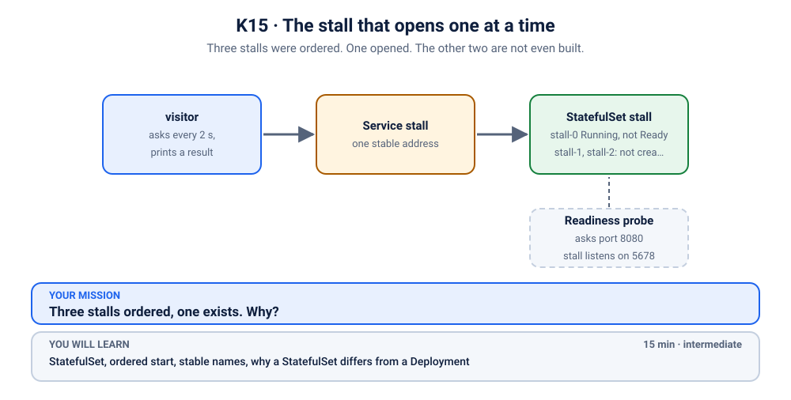

# K15 · The mystery variable

*Nobody set `REDIS_PORT`. Kubernetes did.*

⏱ 10 min · beginner · a tiny Python "score worker" (`python:3.12-alpine`) plus a real Redis (`redis:7.4.12-alpine`, about 59 MB on disk) · service environment variables, `enableServiceLinks`, `CrashLoopBackOff`, `logs --previous`

⬇️ First run downloads Python (about 19 MB) and Redis. A slow first download is normal: do it on good Wi-Fi, before the session.

Output columns and wording can differ a little between kubectl versions and clusters (kind, minikube, Docker Desktop, playgrounds). The ideas never change.

## 📖 The story
Priya writes a small worker for the campus fest scoreboard. It reads the Redis port from a variable called `REDIS_PORT`, and it works perfectly with `docker run`. On Kubernetes it crashes within a second, with an error about `REDIS_PORT`. She searches her YAML: the word `REDIS_PORT` is nowhere in it. Nobody set it. So who did? 👻



## 🧠 The concept: why, what, how
Long before DNS names were common in clusters, Docker's old "links" feature told one container about another by putting variables in its environment. Kubernetes kept the habit and calls it **service links**.

- When a Pod starts, Kubernetes looks at every **Service** in the same namespace and adds environment variables for each: `<NAME>_SERVICE_HOST`, `<NAME>_SERVICE_PORT`, and the Docker-style `<NAME>_PORT=tcp://<ip>:<port>`.
- A Service named `redis` therefore creates a variable called **`REDIS_PORT`**, and its value is a URL like `tcp://10.96.234.78:6379`, not a number.
- Only Pods that start **after** the Service exists get the variables (a Pod that was already running never changes).
- Our worker does `int(os.environ.get("REDIS_PORT", "6379"))`, expecting `6379`. `int("tcp://…")` fails, the container exits, and Kubernetes restarts it again and again.
- Think of a hotel that slips a card under *every* guest's door listing the room numbers of everything in the building. Most guests ignore it. One guest has a habit of reading a card called "port" as a number.

```
 Service "redis" exists  ──▶  new Pod starts  ──▶  Kubernetes adds REDIS_PORT=tcp://10.96…:6379
                                                        └─▶ int("tcp://…") ──▶ ValueError ──▶ CrashLoopBackOff
```

## 🏢 Where you'll meet this at work
- **The classic collisions.** A Service called `redis` or `mysql` plus an app that reads `REDIS_PORT` or `MYSQL_PORT` as a number (developer).
- **Helm charts and platform defaults.** Many charts and company templates set `enableServiceLinks: false` on purpose, so a new Service can never break an old app (platform team).
- **"It works in staging."** Staging has no Service with that name, production does, so the same image behaves differently (SRE).

## 💥 Break it
```bash
cd break && ./break.sh
```
What the room should see: the script finishes and says Redis is running while the score worker keeps crashing and restarting. Nothing has been published or exposed, so there is no web page here, only Pods and logs.

## 🔮 Predict first (60 seconds)
Nobody set `REDIS_PORT` in the YAML. Before you look:
1. Where could the variable come from?
2. Which Pods get it?

<details><summary>Check your prediction</summary>

1. Kubernetes injects variables for every Service in the namespace into new Pods. The Service `redis` produced `REDIS_PORT`.
2. Pods that start after the Service exists.
</details>

## 🔍 Investigate
Guess first, then run these **in order**.

**1. Is everything running?** Always start with the Pods.
```bash
kubectl get pods -n k-15-mystery-env
```
```
NAME                           READY   STATUS             RESTARTS     AGE
redis-7f87b86754-rtwc6         1/1     Running            0            12s
score-worker-596fc496b-nkr5s   0/1     CrashLoopBackOff   1 (10s ago)  12s
```
(Names and ages will differ.) Redis is fine. The worker restarts again and again: `CrashLoopBackOff` means the container starts, dies, and Kubernetes waits a little longer before each retry.

<details><summary>💡 Hint</summary>
The program starts and then dies on its own, so it must have said something just before it died. Where do the last words of a container that already exited go? And later: the YAML never mentions the variable, so who else could put variables into a Pod?
</details>

**2. What were its last words?** The container is not running right now, so ask for the logs of the *previous* run.
```bash
kubectl logs -n k-15-mystery-env -l app=score-worker --previous
```
```
Traceback (most recent call last):
  File "<string>", line 2, in <module>
ValueError: invalid literal for int() with base 10: 'tcp://10.96.234.78:6379'
```
(The IP will differ.) The worker tried to turn `tcp://10.96.234.78:6379` into a number. That text is the value of `REDIS_PORT`. It looks like a URL, not a port.

**3. Did we set it?** Check what the Deployment itself puts in the environment.
```bash
kubectl get deploy score-worker -n k-15-mystery-env -o jsonpath='{.spec.template.spec.containers[0].env}'
```
```
(no output)
```
Empty: there is no `env:` section at all. So the value came from somewhere other than our YAML.

**4. What does a Pod in this namespace actually see?** Look at the real environment. The worker keeps crashing, so `kubectl exec` into it is unreliable (it is only alive for a split second). A throwaway Pod in the same namespace starts after the Service exists, so it gets exactly the same variables:
```bash
kubectl run envcheck -n k-15-mystery-env --rm -it --restart=Never --image=busybox:1.36 -- sh -c 'env | grep REDIS'
```
```
REDIS_SERVICE_PORT=6379
REDIS_PORT=tcp://10.96.234.78:6379
REDIS_PORT_6379_TCP_ADDR=10.96.234.78
REDIS_PORT_6379_TCP_PORT=6379
REDIS_PORT_6379_TCP_PROTO=tcp
REDIS_PORT_6379_TCP=tcp://10.96.234.78:6379
REDIS_SERVICE_HOST=10.96.234.78
pod "envcheck" deleted from k-15-mystery-env namespace
```
(Order, IP and the last line vary a little; the first image pull may add a line or two.) `REDIS_PORT=tcp://10.96.234.78:6379` is there, and so are six cousins. We never wrote them. That IP looks like a Service address:

**5. Who owns that IP?** List the Services.
```bash
kubectl get svc -n k-15-mystery-env
```
```
NAME    TYPE        CLUSTER-IP     EXTERNAL-IP   PORT(S)    AGE
redis   ClusterIP   10.96.234.78   <none>        6379/TCP   30s
```
The `CLUSTER-IP` is the same address. The Service called `redis` caused a variable called `REDIS_PORT`.

## 🪤 The tempting wrong fix: restart the worker
"A fresh Pod will have a fresh environment."
```bash
kubectl delete pods -n k-15-mystery-env -l app=score-worker
kubectl logs -n k-15-mystery-env -l app=score-worker --tail=3
```
The Service `redis` still exists, so the new Pod gets the same injected variable and fails the same way. The environment is rebuilt from the Services, every time.

## 🩺 Root cause
<details><summary>Reveal after the room guesses</summary>

For every Service in the namespace, Kubernetes injects Docker-links-style variables into each **new** Pod. The Service `redis` produced `REDIS_PORT=tcp://10.96.234.78:6379`, and the worker's `int(os.environ.get("REDIS_PORT", "6379"))` could not read a URL as a number. Nothing is wrong with Redis, the image or the cluster. A name we chose for a Service collided with a name the code chose for a variable.
</details>

## 🔧 Fix it
```bash
cd ../fix && ./fix.sh
```
What changed? Compare the two worker files (the only difference besides the first comment line is one new line):
```bash
diff ../break/worker.yaml worker.yaml
```
```
16a17
>       enableServiceLinks: false      # no more REDIS_PORT=tcp://... from the "redis" Service
```
`enableServiceLinks: false` in the Pod spec tells Kubernetes: don't inject the Service variables into this Pod. It is a change to the Pod template, so the Deployment starts a **new** Pod (a rollout) and retires the crashing one. Redis and its Service are untouched; DNS (`redis`) still works, which is how the worker finds Redis.

By hand (this replaces `./fix.sh`, so you don't need to run both):
```bash
kubectl apply -f worker.yaml
kubectl rollout status deployment/score-worker -n k-15-mystery-env
```
```
deployment.apps/score-worker configured
Waiting for deployment "score-worker" rollout to finish: 1 old replicas are pending termination...
deployment "score-worker" successfully rolled out
```
(shortened: the "Waiting…" line repeats a few times.) The alternative fix is a rename: have the code read a variable nobody else will invent, such as `APP_REDIS_PORT`.

## ✅ Verify it yourself
```bash
kubectl get pods -n k-15-mystery-env
```
```
NAME                            READY   STATUS    RESTARTS   AGE
redis-7f87b86754-rtwc6          1/1     Running   0          36s
score-worker-7cfd59dcc4-zl229   1/1     Running   0          18s
```
(Names and ages will differ. If the old worker still shows `Terminating`, wait a few seconds and run it again.) The new worker is **1/1** with no restarts. Its logs:
```bash
kubectl logs -n k-15-mystery-env -l app=score-worker
```
```
worker connected to redis:6379
```
The worker really sent `PING` to Redis and got `PONG` back. Finally, prove the variables are gone from this Pod while the Service is still there:
```bash
kubectl exec -n k-15-mystery-env deploy/score-worker -- env | grep -c REDIS
```
```
0
```
`0` matching lines. (`grep -c` prints the count, and also exits with an error code when it is 0; that is normal.) This scenario has no web page, so there is no port-forward to open.

## 🎯 Key takeaways
- **Kubernetes injects `<SERVICE>_PORT`, `<SERVICE>_SERVICE_HOST` and friends** into every new Pod, for every Service in its namespace.
- **The value of `REDIS_PORT` is a URL, not a number.** Names like `REDIS_PORT` and `MYSQL_PORT` collide with app settings all the time.
- **Only Pods that start after the Service get them.** A Pod created before the Service never gets the variables; a restart after the Service exists can suddenly break it.
- **`enableServiceLinks: false` switches it off.** Use DNS names (`redis`) to find other Services; you don't need the variables.
- Debug path: `get pods` → `logs --previous` → look at the env → `get svc`.
- How our own app is immune: `apps/api/app.py` (Cats vs Dogs) carries this line, which accepts both `6379` and the URL form:
  ```python
  REDIS_PORT = int(os.environ.get("REDIS_PORT", "6379").rsplit(":", 1)[-1])
  ```
  That is the defensive way: the variable still arrives, but the code copes with it.

## 💎 Lifelong lesson
> If a value surprises you, find out who set it. It might be the platform.

## 🧹 Clean up
```bash
cd .. && ./cleanup.sh
```

## 🧪 Quick recap (3 questions)
1. What does the injected variable look like?
2. Why did the worker fail on it?
3. How do you stop Kubernetes injecting these variables?

<details><summary>Answers</summary>

1. Something like `tcp://<cluster IP>:6379`, a URL, not a port number.
2. The worker read it as a number and could not parse a URL.
3. Set `enableServiceLinks: false` in the Pod spec.
</details>

## Next →
[K16](../16-game-server-vip-node/README.md): The nodes are up. The game is ready. Kubernetes says: you're not on the list.
