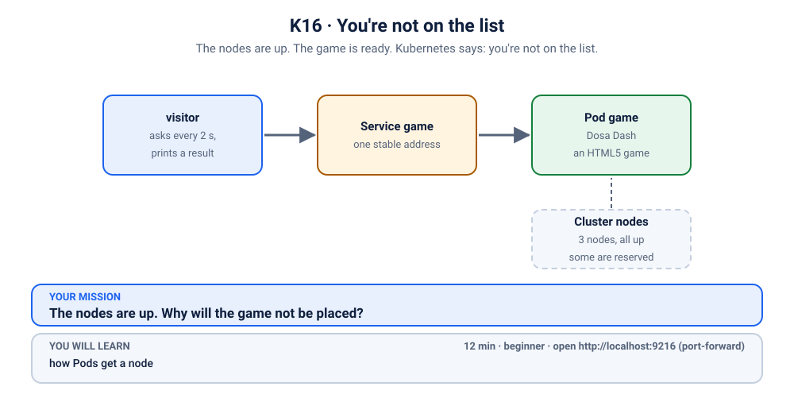
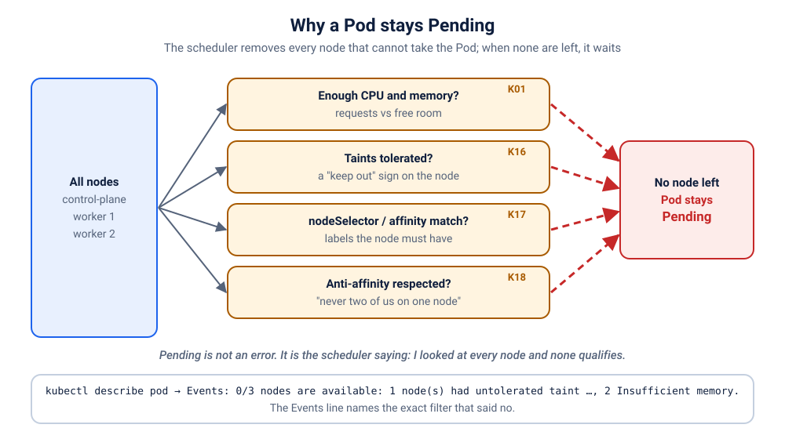

# K16 · You're not on the list

*The nodes are up. The game is ready. Kubernetes says: you're not on the list.*

⏱ 12 min · beginner · Dosa Dash (a small HTML5 game, served by `nginx:1.27.5-alpine`) · how Pods get a node

⬇️ The tiny 4 MB visitor image downloads when you break it. The nginx image (about 21 MB) downloads only at fix time, because the game Pods never start while it is broken. On a cold cluster the fix moment waits on that download (up to a minute or two). Presenters: preload it (`kubernetes/scenarios/preload.sh`) or run the scenario once before class, on good Wi-Fi.

Output columns and wording can differ a little between kubectl versions and clusters (kind, minikube, Docker Desktop, playgrounds). The ideas never change.

> **This scenario changes every node in the cluster; `cleanup.sh` reverts it exactly.** Run it on a practice cluster, not a shared one, and always finish with `./cleanup.sh`. If you skip it, the change stays on every node, and every later scenario's Pods will sit in `Pending` with an event that looks just like this one. Recovery: re-run `./cleanup.sh` (safe at any time; the Clean up section has the manual command).

## 📖 The story
Priya has built **Dosa Dash**, a catch-the-dosa game for the college fest, and Ravi deploys it. The cluster is healthy and every node says `Ready`. But the game never starts: both Pods sit in `Pending`. Yesterday Meera from the platform team changed something on the nodes before the big fest demo, and nobody told the game's team. The cluster has plenty of room, yet nothing new gets a place.



## 🧠 The concept: why, what, how
Normally the scheduler may put a Pod on any node with room. Sometimes a team wants to say "not here, unless you really need to be":

- A **taint** is a mark on a **node** that *repels* Pods: `z2h-vip=true:NoSchedule` means "no new Pod may land here".
- A **toleration** is a note in the **Pod** that says "I can live with that taint". It is a *permission*, not an instruction.
- A toleration does **not attract** a Pod to a node. It only stops the node from refusing it. (Steering Pods *towards* certain nodes is a different tool: you will meet it in [K17](../17-ai-trainer-needs-gpu/README.md).)
- `NoSchedule` only blocks *new* Pods; Pods already running stay. (`NoExecute`, not used here, also evicts running Pods that don't tolerate it.)
- Think of a club with a guest list: the taint is the bouncer's rule ("VIPs only"), the toleration is your name on the list. Being on the list lets you in; it does not make you walk there.

```
 node:  taint z2h-vip=true:NoSchedule        "no new Pod, unless it tolerates this"
          ▲
 Pod without toleration  ──▶ refused   → Pending: "0/N nodes are available"
 Pod with toleration     ──▶ allowed   → Running
```

## 🏢 Where you'll meet this at work
- **Reserved nodes.** GPU nodes, or a node pool for one team or one noisy workload, are tainted so ordinary Pods stay away (platform team, SRE).
- **Control-plane nodes.** Kubernetes itself taints them so your apps don't land there; system add-ons carry the matching tolerations (everyone, without noticing).
- **A node going bad.** Kubernetes can add a taint like `node.kubernetes.io/unreachable` by itself, which is how Pods get moved off a sick node (SRE on-call).

## 💥 Break it
```bash
cd break && ./break.sh
```
What the room should see: the script announces a cluster-wide node change, then deploys the game and finishes. Two `game` Pods are not running. A small `visitor` Pod, which asks for the game every few seconds, gets no answer:
```bash
kubectl logs -f visitor -n k-16-vip-node
```
```
❌ 19:41:12 no answer from http://game
❌ 19:41:15 no answer from http://game
❌ 19:41:18 no answer from http://game
```
(Times will differ.) You can stop it with Ctrl+C. We'll watch it again live when we fix things. (The visitor itself *does* run: it is the player, not the game, so it was set up differently from the start. We'll see how later.)

## 🔍 Investigate
Guess first, then run these **in order**. The visitor's log already told us the symptom: nobody answers.

**1. What state are the Pods in?** Start with the Pods, always.
```bash
kubectl get pods -n k-16-vip-node
```
```
NAME                    READY   STATUS    RESTARTS   AGE
game-6f85c5c5bf-5mwqs   0/1     Pending   0          13s
game-6f85c5c5bf-nk6hp   0/1     Pending   0          13s
visitor                 1/1     Running   0          13s
```
(Ages and Pod names will differ.) The `visitor` runs, but both `game` Pods are `Pending`, and `RESTARTS` is 0: they never started at all. `Pending` means no node has accepted them yet.

<details><summary>💡 Hint</summary>
The Pods are not crashing, not pulling an image and not waiting for a disk. They are <em>waiting for a home</em>. Somebody decides which node a Pod may go to, and that somebody writes down its reasons. Read them. Then ask the nodes what they are refusing.
</details>

**2. Why Pending?** The scheduler leaves a note on every Pod it can't place. Use one of your own Pod names from step 1:
```bash
kubectl describe pod game-6f85c5c5bf-5mwqs -n k-16-vip-node | grep -A6 '^Events'
```
```
Events:
  Type     Reason            Age   From               Message
  ----     ------            ----  ----               -------
  Warning  FailedScheduling  13s   default-scheduler  0/3 nodes are available: 3 node(s) had untolerated taint(s). preemption: 0/3 nodes are available: 3 Preemption is not helpful for scheduling.
```
(Names, ages and the node count will differ: it says `0/1` on a one-node cluster.) The scheduler checked **every** node and each one has a taint this Pod doesn't tolerate. Current Kubernetes (1.37) only says `untolerated taint(s)` and does not name the taint; older versions printed it, as in `had untolerated taint {z2h-vip: true}`. If the message mentions a control-plane taint as well, keep reading: the idea is the same. So the event tells you **taints** are the problem, and the nodes will tell you **which**.

**3. What are the nodes refusing?** The event says a taint is in the way, not which one. Ask the nodes themselves.
```bash
kubectl describe nodes | grep -A2 Taints
```
```
Taints:             node-role.kubernetes.io/control-plane:NoSchedule
                    z2h-vip=true:NoSchedule
Unschedulable:      false
--
Taints:             z2h-vip=true:NoSchedule
Unschedulable:      false
Lease:
--
Taints:             z2h-vip=true:NoSchedule
Unschedulable:      false
Lease:
```
(shortened.) This is the output of a 3-node kind cluster, where the control-plane node has its own built-in taint on top. On a one-node cluster you see one block. Every node carries `z2h-vip=true:NoSchedule`: "no new Pod, unless it tolerates this".

**4. Does the game tolerate it?** Last check: does the Deployment's Pod template say anything about tolerations?
```bash
kubectl get deploy game -n k-16-vip-node -o yaml | grep -A4 tolerations
```
It prints **nothing**. There is no `tolerations:` section at all: the game is not on the list. (For comparison, `kubectl get pod visitor -n k-16-vip-node -o yaml | grep -A5 tolerations` shows the toleration the visitor was given.)

## 🩺 Root cause
<details><summary>Reveal after the room guesses</summary>

Every node carries the taint `z2h-vip=true:NoSchedule` ("reserved for VIP workloads"). The `game` Deployment has no toleration for it, so the scheduler refuses to place its Pods on any node and they stay `Pending` with a `FailedScheduling` event. Nothing is wrong with the image, the code, the Service or the capacity. Taints repel; only a toleration in the Pod can get past them.


</details>

## 🔧 Fix it
Before you run it, open a **second terminal** and start the live visitor log, so the room sees red turn green:
```bash
kubectl logs -f visitor -n k-16-vip-node
```
Then, in the first terminal:
```bash
cd ../fix && ./fix.sh
```
Within about twenty seconds once nginx is downloaded (the first time, up to a minute or two) the log flips from ❌ to ✅ lines (Ctrl+C to stop it):
```
❌ 19:41:21 no answer from http://game
✅ 19:41:23 HTTP 200
✅ 19:41:25 HTTP 200
```
(shortened.) What changed:
```bash
diff ../break/app.yaml app.yaml
```
```
1c1
< # K16 break (2/3): Dosa Dash, served by nginx.
---
> # K16 fix: the same game, now with a toleration for the VIP taint.
16a17,21
>       tolerations:
>         - key: z2h-vip
>           operator: Equal
>           value: "true"
>           effect: NoSchedule
```
The Pod template changed, so the Deployment rolled out two new Pods and retired the two `Pending` ones. The nodes were **not** touched.

By hand (this replaces `./fix.sh`, so you don't need to run both): from the `fix` folder, apply the corrected file.
```bash
kubectl apply -f app.yaml
```

**Why a toleration, and not removing the taint?** You *could* un-reserve the nodes (`kubectl taint nodes --all z2h-vip-`, with the trailing `-`) and the Pods would land at once. But the taint is somebody else's decision: Meera reserved those nodes on purpose, and removing it would quietly break her VIP plan. The game's team owns the game's YAML, so the app-side fix is to say "this Pod is allowed there". If the reservation itself is wrong, that is a conversation with whoever owns the nodes. (To undo it afterwards, `./cleanup.sh` removes the taint for you.)

## ✅ Verify it yourself
```bash
kubectl get pods -n k-16-vip-node -o wide
```
```
NAME                    READY   STATUS    RESTARTS   AGE   IP            NODE               NOMINATED NODE   READINESS GATES
game-745487c754-66qnc   1/1     Running   0          8s    10.244.1.41   z2h-test-worker2   <none>           <none>
game-745487c754-s8t62   1/1     Running   0          8s    10.244.2.56   z2h-test-worker    <none>           <none>
visitor                 1/1     Running   0          22s   10.244.2.55   z2h-test-worker    <none>           <none>
```
(Names, IPs, ages and nodes will differ; on kind the game lands on the worker nodes only, because the control-plane's own taint is still not tolerated.) Both game Pods are `Running`, and the taint is still on the nodes: the Pods simply have permission now. The visitor's log is green (if you still see a ❌, wait a few seconds and run it again):
```bash
kubectl logs visitor -n k-16-vip-node --tail=3
```
```
✅ 19:41:25 HTTP 200
✅ 19:41:27 HTTP 200
✅ 19:41:29 HTTP 200
```
Now play it yourself. In a **second terminal** (leave it running):
```bash
kubectl port-forward -n k-16-vip-node svc/game 9216:80
```
```
Forwarding from 127.0.0.1:9216 -> 80
Forwarding from [::1]:9216 -> 80
```
On a playground, add `--address 0.0.0.0` and open the URL for port 9216.
Back in the first terminal:
```bash
curl -s -o /dev/null -w '%{http_code}\n' localhost:9216
```
```
200
```
(The port-forward terminal also prints `Handling connection for 9216`.) Or open http://localhost:9216 in your browser and catch some dosas (idli +3, vada +5). Your best scores are kept in your own browser. Press Ctrl+C in the second terminal to stop the port-forward.

## 🎯 Key takeaways
- **Taints repel, tolerations permit.** A taint is on the node, a toleration is in the Pod, and a Pod gets in only if it tolerates *every* taint the node has.
- **A toleration doesn't attract.** It never picks a node for the Pod; it only removes one reason to be refused.
- **`Pending` is a message, not a mystery.** `kubectl describe pod` → Events says why; then `kubectl describe nodes | grep -A2 Taints` shows what the nodes want.
- Fix it on the side you own: the Pod's toleration, not someone else's taint.

## 💎 Lifelong lesson
> Pending means "no node would take me". Ask the nodes what they're refusing.

## 🧹 Clean up
Press Ctrl+C in the port-forward terminal first, then:
```bash
cd .. && ./cleanup.sh
```
This also removes the `z2h-vip` taint from every node. Don't skip it: otherwise the taint stays on every node, and every later scenario's Pods sit in `Pending` with an event that looks just like this one. If that happens, re-run `./cleanup.sh` (safe at any time) or run `kubectl taint nodes --all z2h-vip-`. You can check: `kubectl describe nodes | grep -A2 Taints` no longer lists `z2h-vip`.

## Next →
[K17](../17-ai-trainer-needs-gpu/README.md): The trainer is waiting for a GPU that this cluster doesn't have.
