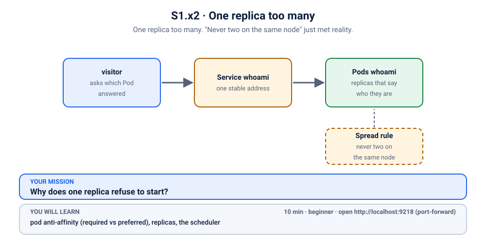
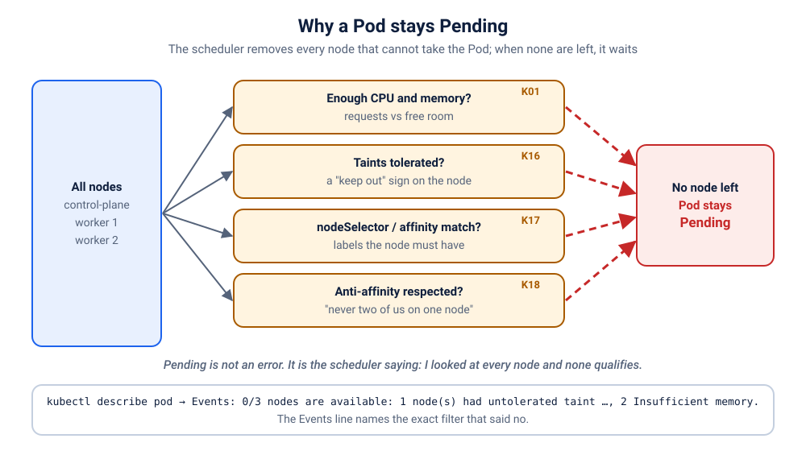

# K18 · One replica too many

*One replica too many. "Never two on the same node" just met reality.*

⏱ 10 min · beginner · `traefik/whoami` (about 6 MB, tells you which Pod answered) · pod anti-affinity (required vs preferred), replicas, the scheduler

⬇️ The whoami image is tiny (about 6 MB), plus the tiny 4 MB visitor image. A slow first download is normal on a cold cluster: presenters, preload it (`kubernetes/scenarios/preload.sh`) or run the scenario once before class.

Output columns and wording can differ a little between kubectl versions and clusters (kind, minikube, Docker Desktop, playgrounds). The ideas never change.

## 📖 The story
It's the college open house, and Lakshmi's team is expecting a crowd on the campus info page. Ravi scales the little `whoami` service up so every visitor is served by one of several copies, and nothing turns red: the site still answers. But a small check that counts which copies actually answer is not happy. This one is easy to miss, because there is no outage to point at.



## 🧠 The concept: why, what, how
Running several copies (**replicas**) of a Pod is how you survive a node dying: if all copies sit on one node and that node goes down, everything goes with it. So you tell the **scheduler** (the part of Kubernetes that picks a node for each new Pod) to keep copies apart. That is **pod anti-affinity**: "don't put me near Pods that look like me".

- The **`topologyKey: kubernetes.io/hostname`** says what "near" means: "on the same node". (Use a zone label instead and it means "in the same zone".)
- **`requiredDuringSchedulingIgnoredDuringExecution`** is a **hard rule**: no node free of siblings means no home for the Pod, which waits in `Pending`.
- **`preferredDuringSchedulingIgnoredDuringExecution`** is a **wish** (with a `weight`): spread out as well as you can, but always find a home.
- The long words end in `IgnoredDuringExecution`: the rule is only checked when a Pod is *placed*; Pods already running are never moved.

Think of seating at a wedding: "no two cousins at one table" works until you have more cousins than tables. A hard rule then leaves a cousin standing; a preference seats the extra one at the least bad table.

```
 3 replicas, hard rule, 2 nodes that can take Pods (kind: the control-plane node refuses ordinary Pods)

   node A [whoami]     node B [whoami]     (no third node)     whoami #3 ──▶ Pending, forever

 3 replicas, preferred rule

   node A [whoami]     node B [whoami][whoami]                  all 3 run, spread as well as possible
```

**Why this scenario has "nodes + 1" replicas.** `break.sh` counts the nodes that accept ordinary Pods and asks for one more Pod than that. On a 3-node kind cluster the control-plane node is tainted (see [K16](../16-game-server-vip-node/README.md)), so only 2 nodes count and you get **3 replicas**. On a 1-node cluster (minikube, Docker Desktop, many playgrounds) you get **2 replicas**. Either way, exactly one Pod has no room.

## 🏢 Where you'll meet this at work
- **High availability.** "Spread my replicas over different nodes (or zones) so one failure doesn't take the service down" (SRE, platform team).
- **A scale-up that quietly doesn't scale.** Autoscaling asks for more Pods than there are nodes or zones, and the extra ones sit `Pending` while dashboards stay green (developer, SRE).
- **Small clusters.** A rule written for production (10 nodes) is copied to a laptop or staging cluster (2 nodes) and half of it never starts (developer).

## 💥 Break it
```bash
cd break && ./break.sh
```
What the room should see: the script scales `whoami` for the open house and finishes. The site still answers. Then in a **second terminal**, start the visitor and leave it running:
```bash
kubectl logs -f visitor -n k-18-anti-affinity
```
The visitor calls the Service (until every expected Pod has answered, or 60 tries) and counts how many *different* Pods answered, against how many there should be.

## 🔍 Investigate
Guess first, then run these **in order**. Note what is *not* happening: the website is not down. Some replicas are serving, so this is a capacity problem, not an outage.

**1. What do the Pods look like?** Start with the Pods, always.
```bash
kubectl get pods -n k-18-anti-affinity
```
```
NAME                      READY   STATUS    RESTARTS   AGE
visitor                   1/1     Running   0          2s
whoami-85f467d95f-gkzgh   1/1     Running   0          2s
whoami-85f467d95f-lksdp   0/1     Pending   0          2s
whoami-85f467d95f-tnsqz   1/1     Running   0          2s
```
(Ages and Pod names will differ. On a 1-node cluster you will see 2 `whoami` Pods: 1 Running, 1 Pending.) The `Running` Pods are fine; one `whoami` Pod is `Pending` with `0` restarts: it hasn't been given a node at all. The visitor in your second terminal says the same thing in its own words:
```
❌ 00:03:11 only 2 of 3 Pods answered (gkzgh,tnsqz)
```
(Shortened; the visitor prints a line every second or so. It keeps calling the Service until every expected Pod has answered, so ❌ here is real: the missing Pod never answers. It shows the last five characters of each Pod name.)

<details><summary>💡 Hint</summary>
Only the <em>last</em> Pod is stuck, and all of them are copies of the same Deployment, so the Pod itself is fine. Something about <em>where</em> it may run has run out. Who decides that, and where does it write its reasons? Look at the events.
</details>

**2. Why is that one Pod waiting?** The scheduler writes its reasons as events.
```bash
kubectl get events -n k-18-anti-affinity --field-selector reason=FailedScheduling
```
```
LAST SEEN   TYPE      REASON             OBJECT                        MESSAGE
14s         Warning   FailedScheduling   pod/whoami-85f467d95f-lksdp   0/3 nodes are available: 1 node(s) had untolerated taint(s), 2 node(s) didn't match pod anti-affinity rules. preemption: 0/3 nodes are available: 1 Preemption is not helpful for scheduling, 2 No preemption victims found for incoming pod.
```
(The exact wording and node counts depend on your Kubernetes version and cluster. On a one-node cluster it reads like `0/1 nodes are available: 1 node(s) didn't match pod anti-affinity rules.`) The clue is **`didn't match pod anti-affinity rules`**: the nodes have room, but the Pod's own rule about neighbours rules them out. (The `control-plane` taint part is the usual "keep ordinary apps off the control-plane node" rule from [K16](../16-game-server-vip-node/README.md); it appears only on clusters with a separate control-plane node.)

**3. How many nodes could take a Pod, and where did the others go?** The `-o wide` view shows the node of each Pod.
```bash
kubectl get nodes
kubectl get pods -n k-18-anti-affinity -o wide
```
```
NAME                     STATUS   ROLES           AGE   VERSION
z2h-test-control-plane   Ready    control-plane   5h    v1.33.1
z2h-test-worker          Ready    <none>          5h    v1.33.1
z2h-test-worker2         Ready    <none>          5h    v1.33.1
NAME                      READY   STATUS    RESTARTS   AGE   IP             NODE               NOMINATED NODE   READINESS GATES
visitor                   1/1     Running   0          14s   10.244.2.194   z2h-test-worker    <none>           <none>
whoami-85f467d95f-gkzgh   1/1     Running   0          14s   10.244.1.177   z2h-test-worker2   <none>           <none>
whoami-85f467d95f-lksdp   0/1     Pending   0          14s   <none>         <none>             <none>           <none>
whoami-85f467d95f-tnsqz   1/1     Running   0          14s   10.244.2.193   z2h-test-worker    <none>           <none>
```
(Your node names, IPs and node count will differ; on a 1-node cluster the one Running Pod simply sits on the only node.) The Running Pods each sit on a different node, and the Pending one has nowhere left to go. The `visitor` is a different kind of Pod and is allowed to share a node.

**4. What rule does the Deployment carry?** The Pod template shows what whoami insisted on.
```bash
kubectl get deployment whoami -n k-18-anti-affinity -o yaml | grep -A7 ' affinity:'
```
```
      affinity:
        podAntiAffinity:
          requiredDuringSchedulingIgnoredDuringExecution:
          - labelSelector:
              matchLabels:
                app: whoami
            topologyKey: kubernetes.io/hostname
      containers:
```
A **required** anti-affinity: never two `app=whoami` Pods on the same node.

## 🩺 Root cause
<details><summary>Reveal after the room guesses</summary>

The Deployment has a **required** pod anti-affinity on `kubernetes.io/hostname` ("never two whoami Pods on one node"), and `break.sh` asked for **one more replica than there are nodes that accept Pods**. The scheduler placed one Pod per node, then had no node left that satisfied the rule. It recorded `didn't match pod anti-affinity rules` and left the last Pod `Pending`. Because the other Pods serve traffic, the Service never went down: the only symptoms are fewer copies than you asked for (`2/3` ready) and the visitor counting fewer answering Pods.

The rule is fine for 2 replicas on 2 nodes. It is a time bomb for "scale to 3", or for a cluster that loses a node.


</details>

## 🔧 Fix it
```bash
cd ../fix && ./fix.sh
```
The script waits for the rollout (a few seconds; the image is already on the nodes). What changed:
```bash
diff ../break/app.yaml app.yaml
```
```
1,2c1,2
< # K18 break (1/2): whoami says which Pod answered. break.sh scales it up after this file is applied,
< # so there is no "replicas:" here on purpose (a later kubectl apply must never reset the scale).
---
> # K18 fix: the same whoami, but "different nodes" is a preference (preferred podAntiAffinity), not a rule.
> # Still no "replicas:" on purpose: apply keeps whatever scale break.sh set.
9a10,13
>   # Recreate, not a rolling update: the old Pods still carry the old hard rule, and a hard rule also
>   # keeps NEW Pods away from them, so a rolling update could never find room for its first new Pod.
>   strategy:
>     type: Recreate
18,21c22,28
<           requiredDuringSchedulingIgnoredDuringExecution:
<             - labelSelector:
<                 matchLabels: { app: whoami }
<               topologyKey: kubernetes.io/hostname
---
>           # "Preferred": spread across nodes as well as possible, but never leave a Pod without a home.
>           preferredDuringSchedulingIgnoredDuringExecution:
>             - weight: 100
>               podAffinityTerm:
>                 labelSelector:
>                   matchLabels: { app: whoami }
>                 topologyKey: kubernetes.io/hostname
```
The **hard rule becomes a preference**: "spread out if you can". Two details worth knowing:

- **Why `Recreate`?** A hard rule also keeps *new* Pods away from the *old* Pods that still carry it. A normal rolling update would start a new Pod first, find every node blocked by an old Pod, and wait forever. `Recreate` stops the old Pods, then starts the new ones. For a few seconds nothing answers, and the visitor goes quiet or shows a `❌`. That is acceptable for a demo; in production you would avoid `Recreate` by freeing capacity (adding a node) or fixing the rule *before* scaling up. (Once the rule is a preference, later updates can roll normally.)
- **The replica count stays.** The fix files have no `replicas:` line, so `kubectl apply` leaves the scale that `break.sh` set.

Start the visitor in a second terminal **before** running the fix to watch the moment live. After the fix it ends like this (shortened):
```
❌ 00:03:16 only 2 of 3 Pods answered (gkzgh,tnsqz)
❌ 00:03:17 only 2 of 3 Pods answered (gkzgh,tnsqz)
✅ 00:03:20 all 3 of 3 Pods answered (n8p9j,rcfm2,ttcqx)
✅ 00:03:21 all 3 of 3 Pods answered (n8p9j,rcfm2,ttcqx)
```
(The two `❌` lines are the old, still-broken state: 2 of 3 Pods. The pause before the first `✅` is the `Recreate` gap, a few seconds with no line while the old Pods are gone and the new ones start. The Pod names are new because the Pods were replaced. Depending on timing you may also see a `❌ only 1 of 3` or `0 of 3` line there.)

By hand (this replaces `./fix.sh`, so you don't need to run both): apply the fixed file from the `fix` folder.
```bash
kubectl apply -f app.yaml
```
Wait about 10 seconds before you verify.

## ✅ Verify it yourself
All replicas should be Ready, and the extra one should share a node with a sibling:
```bash
kubectl get pods -n k-18-anti-affinity -o wide
```
```
NAME                      READY   STATUS    RESTARTS   AGE   IP             NODE               NOMINATED NODE   READINESS GATES
visitor                   1/1     Running   0          29s   10.244.2.194   z2h-test-worker    <none>           <none>
whoami-55675954bf-n8p9j   1/1     Running   0          11s   10.244.1.178   z2h-test-worker2   <none>           <none>
whoami-55675954bf-rcfm2   1/1     Running   0          11s   10.244.2.196   z2h-test-worker    <none>           <none>
whoami-55675954bf-ttcqx   1/1     Running   0          11s   10.244.2.195   z2h-test-worker    <none>           <none>
```
(Ages, IPs and node names will differ. Two on one node is the point: spread as well as possible, none left out.) The rule in the Deployment is now a preference:
```bash
kubectl get deployment whoami -n k-18-anti-affinity -o yaml | grep -A8 ' affinity:'
```
```
      affinity:
        podAntiAffinity:
          preferredDuringSchedulingIgnoredDuringExecution:
          - podAffinityTerm:
              labelSelector:
                matchLabels:
                  app: whoami
              topologyKey: kubernetes.io/hostname
            weight: 100
```
And the page itself. In a second terminal:
```bash
kubectl port-forward -n k-18-anti-affinity svc/whoami 9218:80
```
(On a playground (Killercoda, iximiuz), write `kubectl port-forward -n k-18-anti-affinity --address 0.0.0.0 svc/whoami 9218:80` instead and open the URL for port 9218.) Then, in the first terminal:
```bash
curl -s localhost:9218 | head -n 4
```
```
Hostname: whoami-55675954bf-n8p9j
IP: 127.0.0.1
IP: ::1
IP: 10.244.1.178
```
The `Hostname:` line is the Pod that answered. Note that `port-forward` connects to **one** Pod and sticks with it, so refreshing never changes the name; to see all of them, look at the visitor (`kubectl logs visitor -n k-18-anti-affinity --tail=3`), which calls the Service from inside the cluster (stop the port-forward with Ctrl+C):
```
✅ 00:03:30 all 3 of 3 Pods answered (n8p9j,rcfm2,ttcqx)
```
(If the first lines are still ❌, wait a few seconds.)

## 🎯 Key takeaways
- A Deployment can look "up" while it is short of replicas: check `READY` (`2/3`) and look for `Pending` Pods, not only whether the page loads.
- `didn't match pod anti-affinity rules` in a `FailedScheduling` event means the Pod's own neighbour rule ruled out every node.
- **Required** rules are promises the cluster must keep: when there are more Pods than places, the extra Pods wait forever. **Preferred** rules spread when possible and still place every Pod.
- A required rule also blocks a rolling update, because new Pods can't sit next to old ones. That is why the fix uses `Recreate`.
- Debug path: `get pods` (Pending, no restarts) → events (`FailedScheduling`) → how many nodes can take Pods → the Deployment's affinity.

## 💎 Lifelong lesson
> Every hard rule needs enough room to be obeyed.

## 🧹 Clean up
```bash
cd .. && ./cleanup.sh
```

## Next →
[K19](../19-hackathon-quota/README.md): The deploy succeeded. Kubernetes created… nothing.
