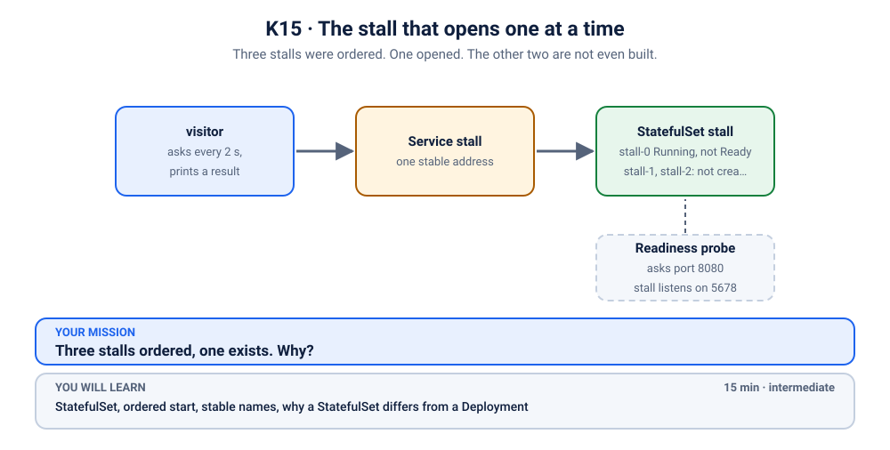
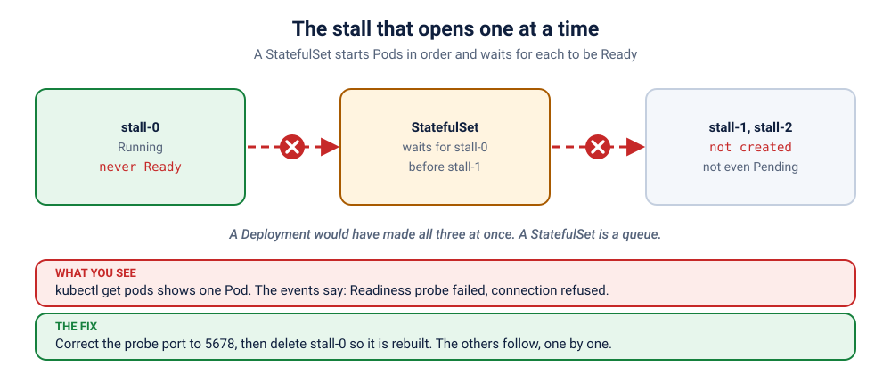

# S2.2 · The stall that opens one at a time

*Three stalls were ordered. One opened. The other two are not even built.*

⏱ 15 min · intermediate · Street-food stalls (`http-echo`, 17 MB) · StatefulSet, ordered start, stable names, why a StatefulSet differs from a Deployment

⬇️ Nothing big: the 17 MB `hashicorp/http-echo` image and the 4 MB busybox visitor. A slow first pull is normal.

Output columns and wording can differ a little between kubectl versions and clusters (kind, minikube, Docker Desktop, playgrounds). The ideas never change.

> 🧭 **Section 2, "Workloads"** (Deployments, ReplicaSets, StatefulSets, DaemonSets, Jobs, CronJobs). Previous: [S2.1](../1-label-on-the-wrong-object/README.md). Next: [S2.3](../3-watchman-skipped-a-gate/README.md).

## 📖 The story
A street-food stall must open in order: the first stall lights the stove, *then* the second may open, *then* the third. That is how the market committee runs its **StatefulSet**: three numbered stalls (`stall-0`, `stall-1`, `stall-2`), each with its own name that never changes, each opened only when the one before it says "ready". Tonight the first stall says "ready" to nobody. The committee politely waits. The other two stalls are not even built, and nothing crashed.

## 🏆 Rules of this one
- **Predict first.** How many Pods will exist?
- **Questions only after the first hint tier.** Open one hint at a time.
- **Say what a Deployment would have done differently.**



## 🧠 The concept



A **StatefulSet** is a Deployment for things that need an identity: stable names (`stall-0`, `stall-1`), a stable DNS name per Pod (through a *headless* Service), and (when you add `volumeClaimTemplates`) a disk that follows the name. By default it starts, updates and stops Pods **in order, one at a time**, and it waits for each to be **Ready** before moving on (`podManagementPolicy: OrderedReady`). That is perfect for a database cluster and a trap when the first Pod is never Ready.

| | Deployment | StatefulSet |
|---|---|---|
| Pod names | random (`api-7c9f-x2k`) | numbered (`stall-0`, `stall-1`) |
| Start order | all at once | one at a time, in order |
| A Pod is replaced | by any new name | by the same name |
| Used for | stateless apps | databases, queues, anything with identity |

## 🔮 Predict first
The StatefulSet wants 3 stalls, and the first one never turns Ready. How many Pods exist? Write it down.

<details><summary>Check your prediction</summary>

One. A StatefulSet will not create `stall-1` until `stall-0` is Ready, so the other two do not exist at all (not even Pending). A Deployment would have created all three straight away.
</details>

## 💥 Break it
```bash
cd break && python3 run.py
```
```bash
kubectl get statefulset,pods -n k-15-statefulset
kubectl logs -f visitor -n k-15-statefulset
```
Stop the logs with Ctrl+C.

## 🔍 Investigate: you drive
**What is the first thing you look at?**
<details><summary>💡 Tier 1: a nudge</summary>
Count the Pods, then ask the one Pod that exists why it is not Ready.
</details>
<details><summary>💡 Tier 2: the commands</summary>

```bash
kubectl describe pod stall-0 -n k-15-statefulset | tail -n 12
kubectl get statefulset stall -n k-15-statefulset -o jsonpath='{.spec.template.spec.containers[0].readinessProbe}{"\n"}'
```
Which port does the probe use, and which port does the container listen on? (`describe` shows both.)
</details>
<details><summary>💡 Tier 3: the answers to look for</summary>

The event says `Readiness probe failed: connection refused`. The probe knocks on port **8080**; the stall listens on **5678**. The Pod is Running but never Ready, so the StatefulSet never goes on to `stall-1`.
</details>

## 🪤 The tempting wrong fix
Scale the StatefulSet up, or switch it to `podManagementPolicy: Parallel`, "so the others start". It hides the bug: the stalls open, but every one of them still fails its readiness probe, so the Service sends customers to none of them. **A StatefulSet waiting is a symptom. Find what it is waiting for.**

## 🩺 Root cause
<details><summary>Reveal after the room guesses</summary>

The readiness probe checks the wrong port, so `stall-0` is Running but never Ready. The StatefulSet creates Pods in order and only continues when the previous one is Ready, so `stall-1` and `stall-2` are never created. Because a StatefulSet also will not replace a never-Ready Pod on its own, correcting the template is not enough: the stuck Pod has to be deleted so it is rebuilt from the new template.
</details>

## 🔧 Fix it
```bash
cd ../fix && python3 run.py
```
The reference fix corrects the probe port to `5678` and deletes `stall-0`. By hand: `kubectl edit statefulset stall -n k-15-statefulset`, then `kubectl delete pod stall-0 -n k-15-statefulset`. Watch the three stalls open one after another.

## ✅ Verify it yourself
```bash
cd .. && ./check.sh
```
It checks that all three are Ready and the visitor shows ✅.

## 🎯 Key takeaways
- **A StatefulSet starts Pods in order and waits for Ready.** One stuck Pod blocks the rest.
- **Stable names matter** (`stall-0`): databases and queues rely on them.
- **A StatefulSet will not replace a never-Ready Pod by itself.** Fix the template, then delete the Pod.
- **Headless Service** = a stable DNS name per Pod.

## 💎 Lifelong lesson
> A Deployment is a crowd. A StatefulSet is a queue.

## 🏢 Where you'll meet this at work
- **Databases and message queues** (Postgres, Kafka, Redis clusters) run as StatefulSets (platform team).
- **"Only pod-0 exists"** during an upgrade of such a cluster (everyone on call).

## 🧹 Clean up
```bash
./cleanup.sh
```

## Next →
Next, in this section: [S2.3](../3-watchman-skipped-a-gate/README.md): A watchman was posted at every gate. One gate has nobody. Kubernetes says everything is fine.
