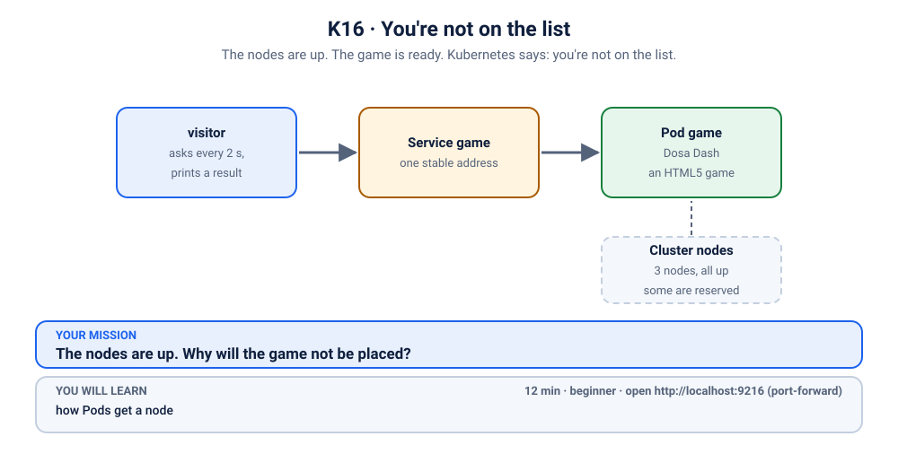
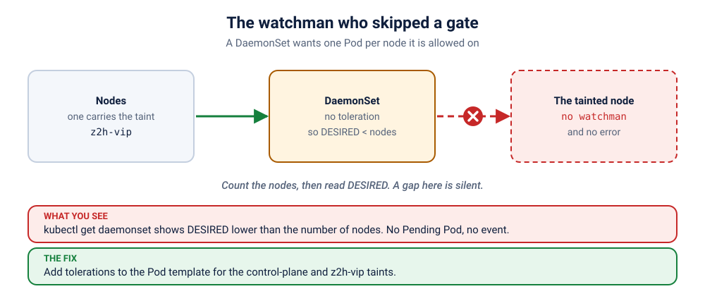

# S2.3 · The watchman who skipped a gate

*A watchman was posted at every gate. One gate has nobody. Kubernetes says everything is fine.*

⏱ 12 min · intermediate · Watchmen (`http-echo`, 17 MB) · DaemonSet (one per node), taints and tolerations, "desired" versus "ready"

⬇️ Nothing big: the 17 MB `hashicorp/http-echo` image. A slow first pull is normal.

Output columns and wording can differ a little between kubectl versions and clusters (kind, minikube, Docker Desktop, playgrounds). The ideas never change.

> 🧭 **Section 2, "Workloads"**. Previous: [S2.2](../2-stall-that-opens-one-at-a-time/README.md). Next: [S2.4](../4-leaderboard-reset-job/README.md).

## 📖 The story
The market has several gates, and the committee posts one **watchman at every gate**: that is what a **DaemonSet** is, one Pod on every node. Log collectors, monitoring agents and the network plugin all work this way. Tonight someone hung a "reserved" sign on one gate. The watchman looks at the sign, shrugs, and does not go there. Nothing is *broken*: Kubernetes quietly reports that it wants one fewer watchman than there are gates.

## 🏆 Rules of this one
- **Count the gates, then count the watchmen.** That is the whole investigation.
- **No red text anywhere.** The clue is in two numbers that do not match.



## 🧠 The concept



A **DaemonSet** runs one Pod on **every node**, and on new nodes the moment they join. It needs no replica count: the number of nodes *is* the count. But a node can say "keep out" with a **taint**, and a Pod gets in only if it carries a matching **toleration**. That is why the control-plane node usually has no application Pods, and why system DaemonSets (kube-proxy, the network plugin) carry tolerations for it.

`DESIRED` counts the nodes where the Pod is *allowed* to run. A tainted node is simply not counted, so there is no error, no event and no Pending Pod. You only notice if you compare it with the number of nodes.

## 🔮 Predict first
There are N nodes and one of them is tainted. What will `kubectl get daemonset` show under `DESIRED`: N, or fewer? Write it down.

<details><summary>Check your prediction</summary>

Fewer. `DESIRED` only counts nodes the Pod may run on. A tainted node is silently left out, with no error and no Pending Pod.
</details>

## 💥 Break it
```bash
cd break && ./break.sh
```
```bash
kubectl get nodes
kubectl get daemonset,pods -n k-16-daemonset -o wide
```

## 🔍 Investigate: you drive
**What is the first thing you look at?**
<details><summary>💡 Tier 1: a nudge</summary>
Compare two numbers: how many nodes, and what does `DESIRED` say? Then ask the node why it was left out.
</details>
<details><summary>💡 Tier 2: the commands</summary>

```bash
kubectl get nodes -o custom-columns=NAME:.metadata.name,TAINTS:.spec.taints[*].key
kubectl get daemonset watchman -n k-16-daemonset -o jsonpath='{.spec.template.spec.tolerations}{"\n"}'
```
Some nodes carry a taint (`z2h-vip`; a control-plane node carries its own), and the watchman has no toleration for it.
</details>
<details><summary>💡 Tier 3: the answers to look for</summary>

The nodes list shows a taint, `z2h-vip=true:NoSchedule`, on one node (and on kind, the control plane has its own). The DaemonSet's Pod template has no `tolerations`, so the controller does not place a watchman there. Counted `DESIRED` is therefore smaller than the node count.
</details>

## 🪤 The tempting wrong fix
Remove the taint ("the sign is in the way"). The gate gets its watchman, but the sign had a reason: that node is reserved. If the rule is right, change the *watchman*, not the sign. Here the watchman is a monitoring agent that **should** be everywhere, so a toleration is the correct answer.

## 🩺 Root cause
<details><summary>Reveal after the room guesses</summary>

The nodes carry taints (a reserved node, and the control plane's own). A Pod runs on a tainted node only if it tolerates the taint. The DaemonSet's template has no tolerations, so those nodes are excluded from `DESIRED` and get no watchman. Nothing fails: the DaemonSet is correct about what it is allowed to do.
</details>

## 🔧 Fix it
```bash
cd ../fix && ./fix.sh
```
The reference fix adds two tolerations to the Pod template: one for the control-plane taint and one for `z2h-vip`. By hand: `kubectl edit daemonset watchman -n k-16-daemonset`. The DaemonSet adds the missing watchmen on its own.

## ✅ Verify it yourself
```bash
cd .. && ./check.sh
```
It checks that the number of watchmen Ready equals the number of nodes.

## 🎯 Key takeaways
- **A DaemonSet is one Pod per node.** The node count is the replica count.
- **`DESIRED` skips nodes the Pod may not run on.** A gap is silent.
- **Taints repel; tolerations are the key.** Agents that must run everywhere need to tolerate them.
- **Compare `DESIRED` with `kubectl get nodes`.**

## 💎 Lifelong lesson
> A gate with no watchman is not an error. It is a missing line in the form.

## 🏢 Where you'll meet this at work
- **A monitoring or logging agent** that misses one node, so that node is invisible (platform team).
- **Tainted GPU or spot nodes** where a node-level agent was never given a toleration (everyone).

## 🧹 Clean up
```bash
./cleanup.sh
```

## Next →
Next, in this section: [S2.4](../4-leaderboard-reset-job/README.md): The midnight reset ran. Three times. Then gave up.
