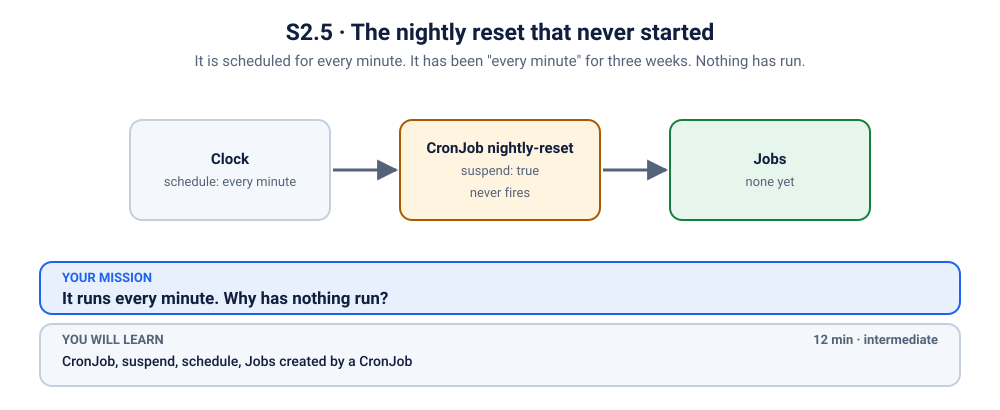
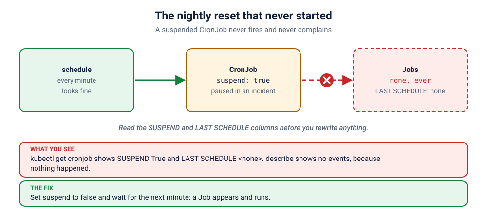

# S2.5 · The nightly reset that never started

*It is scheduled for every minute. It has been "every minute" for three weeks. Nothing has run.*

⏱ 12 min · intermediate · A nightly reset (`busybox`, 4 MB) · CronJob, `suspend`, schedule, Jobs created by a CronJob

⬇️ Nothing big: the 4 MB busybox image. A slow first pull is normal.

Output columns and wording can differ a little between kubectl versions and clusters (kind, minikube, Docker Desktop, playgrounds). The ideas never change.

> 🧭 **Section 2, "Workloads"**. Previous: [S2.4](../4-leaderboard-reset-job/README.md). Next: [Section 3](../../README.md#section-3-services-ingress-and-networking).

## 📖 The story
Every night the leaderboard must be wiped for tomorrow's game. That is a job for a **CronJob**: a Kubernetes object that creates a Job on a schedule, like an alarm clock. Three weeks ago, during an incident, someone paused it "for five minutes" and went to lunch. The CronJob is still there, still green, still scheduled for every minute. It has not run since.

## 🏆 Rules of this one
- **The schedule is fine.** Look elsewhere.
- **Wait one minute before you conclude anything.** Alarm clocks are slow.
- **Questions first, commands second.**



## 🧠 The concept



A **CronJob** does one thing: at the times in `schedule` (five fields: minute, hour, day, month, weekday), it creates a **Job**, and the Job creates a Pod that runs to the end. Useful knobs:

| Field | Meaning |
|---|---|
| `schedule` | when (cron syntax) |
| `suspend` | pause the clock without deleting anything |
| `concurrencyPolicy` | `Forbid` = skip a run if the last one is still going |
| `successfulJobsHistoryLimit` / `failedJobsHistoryLimit` | how many finished Jobs to keep for reading |

A CronJob that is suspended shows no error. It just never fires.

## 🔮 Predict first
The CronJob's schedule says "every minute". You wait two minutes. How many Jobs do you expect to see, and what could make the answer zero? Write it down.

<details><summary>Check your prediction</summary>

Two, if nothing is wrong. Zero if the CronJob is suspended, if its time has not come (a schedule typo), or if the controller is not running. A CronJob never explains itself, so you look at its spec and its `LAST SCHEDULE` column.
</details>

## 💥 Break it
```bash
cd break && python3 run.py
```
```bash
kubectl get cronjob,jobs -n k-24-cronjob
```
Wait a minute or two and run it again.

## 🔍 Investigate: you drive
**What is the first thing you look at?**
<details><summary>💡 Tier 1: a nudge</summary>
Read every column of `kubectl get cronjob`, especially `SUSPEND` and `LAST SCHEDULE`.
</details>
<details><summary>💡 Tier 2: the commands</summary>

```bash
kubectl get cronjob nightly-reset -n k-24-cronjob
kubectl describe cronjob nightly-reset -n k-24-cronjob | head -n 25
```
</details>
<details><summary>💡 Tier 3: the answers to look for</summary>

`SUSPEND` is `True` and `LAST SCHEDULE` is `<none>`: the CronJob has never fired. `describe` shows no events at all, because nothing happened. The spec says `suspend: true`.
</details>

## 🪤 The tempting wrong fix
Delete the CronJob and create a new one, or "fix the schedule". The schedule was never the problem, and a new CronJob would be suspended or not by the same hand that created it. **Read the spec before you rewrite it.** (Also: do not run the Job by hand and call it fixed. The reset must run by itself.)

## 🩺 Root cause
<details><summary>Reveal after the room guesses</summary>

The CronJob's `spec.suspend` is `true`: someone paused it during an incident and never resumed it. A suspended CronJob creates no Jobs, so nothing runs and nothing errors. It looks perfectly healthy.
</details>

## 🔧 Fix it
```bash
cd ../fix && python3 run.py
```
The reference fix sets `suspend: false`. By hand: `kubectl patch cronjob nightly-reset -n k-24-cronjob -p '{"spec":{"suspend":false}}'`. Then wait for the next minute and watch a Job appear.

## ✅ Verify it yourself
```bash
cd .. && ./check.sh
```
It checks that the CronJob is not suspended **and** that a run has succeeded (`lastSuccessfulTime` is set). After the fix, give it up to a minute.

## 🎯 Key takeaways
- **A suspended CronJob is silent.** Check `SUSPEND` and `LAST SCHEDULE` first.
- **CronJob makes a Job, a Job makes a Pod.** Follow the chain.
- **Keep some history** (`...HistoryLimit`) so you can read yesterday's logs.
- **Whoever pauses something owns resuming it.** Write it down.

## 💎 Lifelong lesson
> An alarm clock that was switched off still shows the right time.

## 🏢 Where you'll meet this at work
- **Nightly backups and reports** quietly stopped during an incident and never restarted (everyone).
- **`kubectl get cronjob` in a runbook** as the first thing to run on a "the job did not run" ticket (platform team).

## 🧹 Clean up
```bash
python3 cleanup.py
```

## Next →
Next, the next section: [S3.1](../../3-services-ingress-and-networking/1-it-tools-no-endpoints/README.md): Every Pod is Running. Every request fails.
