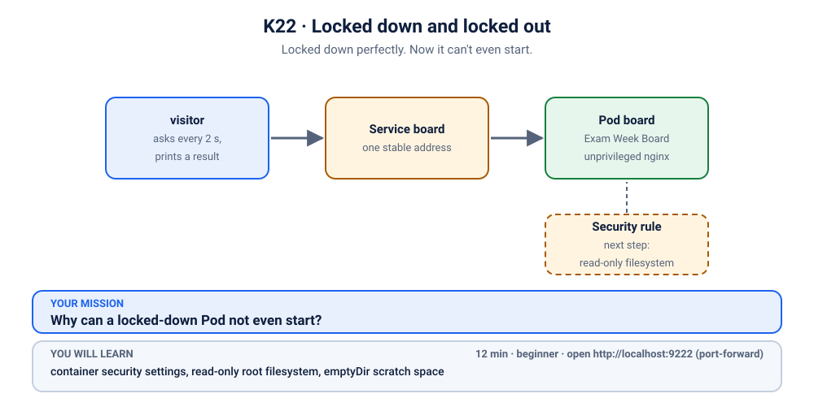

# K22 · Locked down and locked out

*Locked down perfectly. Now it can't even start.*

⏱ 12 min · beginner · Exam Week Board (a small offline HTML page, served by `nginxinc/nginx-unprivileged:1.27.5-alpine`) · container security settings, read-only root filesystem, `emptyDir` scratch space

⬇️ The tiny 4 MB visitor image downloads when you break it, and so does the nginx-unprivileged image (about 22 MB). The fix needs no new download. On a cold cluster the break step can take a little longer on slow Wi-Fi; that is normal. Presenters: preload (`kubernetes/scenarios/preload.sh`) or run the scenario once before class.

Output columns and wording can differ a little between kubectl versions and clusters (kind, minikube, Docker Desktop, playgrounds). The ideas never change.

## 📖 The story
Lakshmi runs the **Exam Week Board** (the college notice board for exam season), a page that lists exam timetables, hall allocations and where to get help. It is exam week, so everyone is looking at it. Last week the security team made the board run as a normal user, and Ravi fixed it (that story is [K21](../21-notice-board-runasnonroot/README.md)). This week the security team is back with "the next step" for every app on the cluster, and Ravi adds it to the notice board's Deployment before lunch. The Pods now start, stop, start, stop, and the whole college is staring at an empty board again.



## 🧠 The concept: why, what, how
A container's filesystem is the image's files, plus a thin writable layer on top. By default a running program can change anything in there. That is convenient, but it also means an attacker who hijacks the program can drop in tools, edit config files or plant scripts.

- `readOnlyRootFilesystem: true` (a container `securityContext` setting) makes the container's whole root filesystem **read-only**. Nothing can be created or changed there, by the app or by an attacker.
- Well-behaved apps only need a few places to write: a pid file, temp files, a cache. Those places must be given to them on purpose.
- The tool for that is a **volume**. An `emptyDir` is scratch space: an empty folder created when the Pod starts and removed when the Pod goes away; it lives as long as the Pod: it survives container restarts and is wiped only when the Pod is replaced. You mount it at exactly the path the app writes to, and only that path stays writable.
- Analogy: a museum with every display case locked. The curator can still work in the staff room. Lock the whole building and the curator can't even put a coat down, so give them a table.

```
 container root filesystem:  read-only  (image files stay as built)
        + emptyDir mounted at a path  →  that one path is writable scratch space
```

## 🏢 Where you'll meet this at work
- **Hardened-cluster rules.** Hardening guides (such as the NSA/CISA Kubernetes hardening guidance) and admission policies (Kyverno or OPA rules) often require read-only root filesystems, so every team's Deployment must cope (platform team, security engineers, developers).
- **Packaging an app for production.** Developers find out which paths their app really writes (logs, temp files, caches) and declare them as volumes (developer).
- **Incident response.** When a container is compromised, a read-only filesystem stops the attacker from installing tools there (SRE, security team).

## 💥 Break it
```bash
cd break && ./break.sh
```
What the room should see: the script deploys the notice board and finishes. The two `board` Pods are not healthy. A small `visitor` Pod, which asks for the board every few seconds, gets no answer:
```bash
kubectl logs visitor -n k-22-readonly-fs --tail=2
```
```
❌ 00:06:42 no answer from http://board
❌ 00:06:45 no answer from http://board
```
(Times will differ.) You can follow it live with `kubectl logs -f visitor -n k-22-readonly-fs` and stop it with Ctrl+C. We'll watch it again live when we fix things.

## 🔍 Investigate
Guess first, then run these **in order**. The visitor's log already told us the symptom: nobody answers.

**1. What state are the Pods in?** Start with the Pods, always.
```bash
kubectl get pods -n k-22-readonly-fs
```
```
NAME                     READY   STATUS             RESTARTS      AGE
board-665c58f47c-dtxkl   0/1     CrashLoopBackOff   1 (15s ago)   16s
board-665c58f47c-vh2cl   0/1     CrashLoopBackOff   1 (15s ago)   16s
visitor                  1/1     Running            0             16s
```
(Ages and Pod names will differ.) The `visitor` runs, but both `board` Pods have `RESTARTS` going up, and the status flips between `Error` and `CrashLoopBackOff` (a Pod can briefly show `Error` while it waits for the next try; both usually show `CrashLoopBackOff`) ("crashed, waiting a bit before trying again"). Unlike a Pod that never starts, this container did start and then died.

<details><summary>💡 Hint</summary>
The container really runs for a moment and then exits, and a program that exits usually says why on its way out. Read the logs of the <em>previous</em> run, and ask: what did the program try to do just before it stopped? Then think about what changed in this Deployment since last week.
</details>

**2. How did the container end?** The Pod keeps the last exit details; use one of your own Pod names from step 1.
```bash
kubectl describe pod board-665c58f47c-dtxkl -n k-22-readonly-fs | grep -A6 'Last State'
```
```
    Last State:     Terminated
      Reason:       Error
      Exit Code:    1
      Started:      Mon, 09 Nov 2026 05:36:32 +0530
      Finished:     Mon, 09 Nov 2026 05:36:32 +0530
    Ready:          False
    Restart Count:  1
```
(Dates and names will differ.) Started and finished in the same second, exit code 1: nginx did not get running and stop later, it failed immediately. That is a crash on startup, so its last words are in the logs.

**3. What did nginx say?** The container is being restarted, so the current logs may be empty or brand new. `--previous` shows the run that just crashed.
```bash
kubectl logs board-665c58f47c-dtxkl -n k-22-readonly-fs --previous
```
```
/docker-entrypoint.sh: /docker-entrypoint.d/ is not empty, will attempt to perform configuration
/docker-entrypoint.sh: Looking for shell scripts in /docker-entrypoint.d/
/docker-entrypoint.sh: Launching /docker-entrypoint.d/10-listen-on-ipv6-by-default.sh
10-listen-on-ipv6-by-default.sh: info: can not modify /etc/nginx/conf.d/default.conf (read-only file system?)
/docker-entrypoint.sh: Sourcing /docker-entrypoint.d/15-local-resolvers.envsh
/docker-entrypoint.sh: Launching /docker-entrypoint.d/20-envsubst-on-templates.sh
/docker-entrypoint.sh: Launching /docker-entrypoint.d/30-tune-worker-processes.sh
/docker-entrypoint.sh: Configuration complete; ready for start up
2026/11/09 00:06:32 [emerg] 1#1: mkdir() "/tmp/proxy_temp" failed (30: Read-only file system)
nginx: [emerg] mkdir() "/tmp/proxy_temp" failed (30: Read-only file system)
```
The last two lines are the crash: nginx tried to create the folder `/tmp/proxy_temp` (one of its temp folders) and the system said `Read-only file system`. (The earlier "can not modify default.conf" line is only a polite note: that step is optional and nginx carries on.) So the container's filesystem cannot be written to. Who asked for that?

**4. Where does the demand come from?** Look at the container's security settings in the Deployment.
```bash
kubectl get deploy board -n k-22-readonly-fs -o jsonpath='{.spec.template.spec.containers[0].securityContext}{"\n"}'
```
```
{"readOnlyRootFilesystem":true}
```
There is "the security team's next step": the container's root filesystem is read-only. The image was built for a normal user (that is why last week's fix works), but it still wants a writable `/tmp` for its pid file and temp folders. The setting and the app disagree, so nginx stops before it ever serves a page.

## 🩺 Root cause
<details><summary>Reveal after the room guesses</summary>

The Deployment sets `readOnlyRootFilesystem: true` on the container, but nginx must create its temp folders (and its pid file) under `/tmp` when it starts. It cannot, exits with code 1, and Kubernetes restarts it again and again: `CrashLoopBackOff`. The policy is right, the page and the Service are fine. The app simply has no place to write.
</details>

## 🔧 Fix it
Before you run it, open a **second terminal** and start the live visitor log, so the room sees red turn green:
```bash
kubectl logs -f visitor -n k-22-readonly-fs
```
Then, in the first terminal:
```bash
cd ../fix && ./fix.sh
```
Within about half a minute the log flips from ❌ to ✅ lines (Ctrl+C to stop it):
```
❌ 00:06:48 no answer from http://board
✅ 00:06:50 HTTP 200
```
(shortened.) What changed:
```bash
diff ../break/app.yaml app.yaml
```
```
1,2c1
< # K22 break (2/3): the Exam Week Board, still on the unprivileged nginx image.
< # The security team's next step has been added to this Deployment.
---
> # K22 fix: the same notice board and the same policy, plus a scratch folder for the one place nginx writes.
33a33,35
>             # nginx keeps its pid file and temp folders in /tmp: give it a writable scratch folder there.
>             - name: tmp
>               mountPath: /tmp
37a40,42
>         # Scratch space that lives as long as the Pod.
>         - name: tmp
>           emptyDir: {}
```
One `emptyDir` volume (scratch space that lives as long as the Pod), mounted at `/tmp`. The `readOnlyRootFilesystem` setting was not touched.

**How we found the exact path.** We did not guess. The first crash named `/tmp/proxy_temp`, so we mounted an `emptyDir` at `/tmp` and restarted. If the next error had named another path (for example `/var/cache/nginx`), we would have added a second mount and repeated. In this image there was no next error: nginx-unprivileged keeps its pid file and all its temp folders (`client_temp`, `proxy_temp`, `fastcgi_temp`, `uwsgi_temp`, `scgi_temp`) under `/tmp`, and logs to the console. You can see them listed in the verify step below. (The plain `nginx` image would also want `/var/cache/nginx` and `/var/run`; this unprivileged image does not.) Mount the **minimum** you find, not "everything just in case".

By hand (this replaces `./fix.sh`, so you don't need to run both): from the `fix` folder, apply the corrected file.
```bash
kubectl apply -f app.yaml
```

**Why not just turn `readOnlyRootFilesystem` off?** Because it would work, and that is the trap. The board would come up in seconds, and you would have quietly removed the security team's rule for this app. A read-only filesystem is one of the cheapest protections there is: the attacker who gets into this container cannot write tools or edit config anywhere except the small scratch folder you chose. The policy was right. What was missing was a scratchpad, so add the scratchpad.

## ✅ Verify it yourself
```bash
kubectl get pods -n k-22-readonly-fs
```
```
NAME                     READY   STATUS    RESTARTS   AGE
board-745b47688c-fsrmw   1/1     Running   0          9s
board-745b47688c-jdwfn   1/1     Running   0          9s
visitor                  1/1     Running   0          26s
```
(Names and ages will differ.) Both board Pods are `Running` with no restarts. Is the rule still on?
```bash
kubectl get deploy board -n k-22-readonly-fs -o jsonpath='{.spec.template.spec.containers[0].securityContext}{"\n"}'
```
```
{"readOnlyRootFilesystem":true}
```
Now prove it from the inside: writing to the root filesystem fails, writing to the scratch folder works.
```bash
kubectl exec deploy/board -n k-22-readonly-fs -- touch /etc/probe
kubectl exec deploy/board -n k-22-readonly-fs -- touch /tmp/probe
```
```
touch: /etc/probe: Read-only file system
command terminated with exit code 1
```
The first command is refused; the second prints nothing, which means success. Which folders does nginx actually use? List the scratch folder (it also holds the `probe` file we just made):
```bash
kubectl exec deploy/board -n k-22-readonly-fs -- ls /tmp
```
```
client_temp
fastcgi_temp
nginx.pid
probe
proxy_temp
scgi_temp
uwsgi_temp
```
The pid file and all five temp folders are in there, and nowhere else. The visitor's log is green (if you still see a ❌, wait a few seconds and run it again):
```bash
kubectl logs visitor -n k-22-readonly-fs --tail=3
```
```
✅ 00:06:54 HTTP 200
✅ 00:06:56 HTTP 200
✅ 00:06:58 HTTP 200
```
Now look at the board yourself. In a **second terminal** (leave it running):
```bash
kubectl port-forward -n k-22-readonly-fs svc/board 9222:80
```
```
Forwarding from 127.0.0.1:9222 -> 8080
Forwarding from [::1]:9222 -> 8080
```
On a playground, add `--address 0.0.0.0` and open the URL for port 9222.
Back in the first terminal:
```bash
curl -s -o /dev/null -w '%{http_code}\n' localhost:9222
```
```
200
```
(The port-forward terminal also prints `Handling connection for 9222`.) Or open http://localhost:9222 in your browser: click the tabs, and claim the scientific calculator. The page needs no internet. Press Ctrl+C in the second terminal to stop the port-forward.

## 🎯 Key takeaways
- **`readOnlyRootFilesystem: true` makes the whole container filesystem read-only.** It protects you, and it also exposes every place your app quietly wrote to.
- **`CrashLoopBackOff` plus `kubectl logs --previous` is the recipe.** The crashed run's last lines name the exact path.
- **Find the writable paths one by one:** crash, read the path, mount an `emptyDir` there, repeat until quiet. Keep the list minimal.
- **An `emptyDir` is scratch space that lives as long as the Pod.** It is wiped when the Pod is replaced, so never keep data you need in it.
- Fix the app's needs, not the rule: turning the setting off is the wrong fix.

## 💎 Lifelong lesson
> Read-only filesystems are great. Give apps a scratchpad for what they must write.

## 🧹 Clean up
Press Ctrl+C in the port-forward terminal first, then:
```bash
cd .. && ./cleanup.sh
```

## Next →
[K23](../23-dark-mode-not-applied/README.md): Dark mode is ON in the config. The site is still blinding white.
