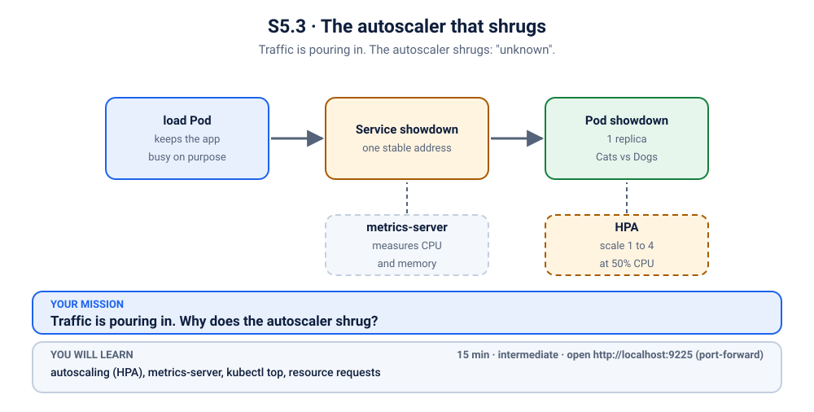
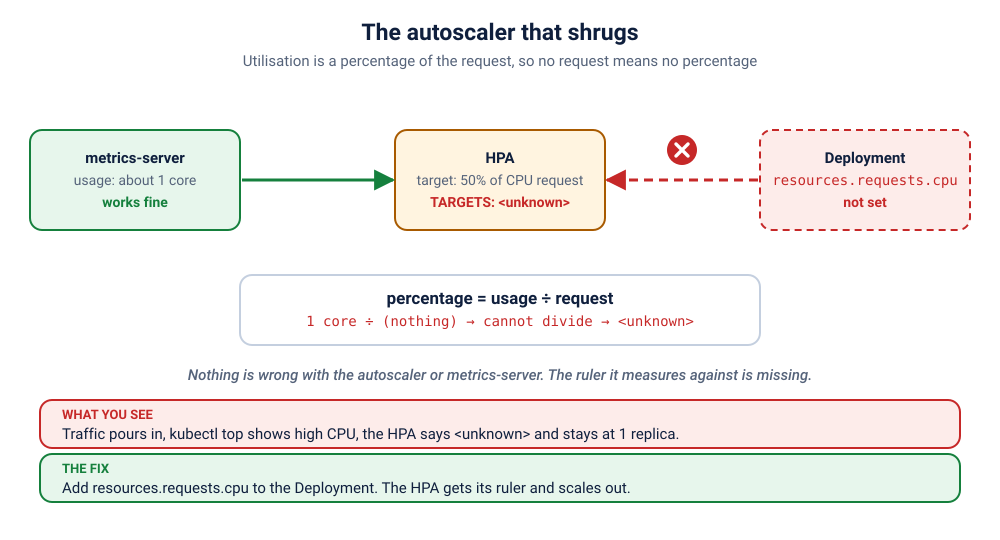

# K25 · The autoscaler that shrugs

*Traffic is pouring in. The autoscaler shrugs: "unknown".*

⏱ 15 min · intermediate · Cats vs Dogs voting app (`python:3.12-alpine`, about 19 MB) plus metrics-server (about 22 MB) · autoscaling (HPA), metrics-server, `kubectl top`, resource requests

⬇️ First run downloads about 19 MB (Python), a tiny 4 MB load image (`busybox`) and, only if your cluster has no metrics-server yet, about 22 MB for metrics-server. A slow first download is normal: do it on good Wi-Fi, before the session. Expect `break.sh` to take about a minute on a warm cluster, and several minutes on a cold one.

Output columns and wording can differ a little between kubectl versions, container runtimes and clusters (kind, minikube, Docker Desktop, playgrounds). The ideas never change.

> **Installs something cluster-wide.** To measure CPU, Kubernetes needs *metrics-server*. If your cluster already has one (say the minikube `metrics-server` addon is enabled, or your playground provides it), `break.sh` installs nothing and `cleanup.sh` never removes it. If not, `break.sh` installs it into `kube-system` (every object is labelled `z2h.scenario=k25-installed`) and `cleanup.sh` removes exactly that. Run this scenario alone, not alongside other scenarios.

## 📖 The story
Meera's team launches the campus-fest voting poll at noon, and the whole college opens it at once. Lakshmi set up an autoscaler the night before: "if the app gets busy, add more copies". Now the load is real, the one app Pod is flat out, and Ravi checks the autoscaler. It has not added a single copy, and instead of a number it says `<unknown>`. The metrics are there. The traffic is there. Why does the autoscaler shrug?



## 🧠 The concept: why, what, how
A **HorizontalPodAutoscaler (HPA)** watches a number and adds or removes Pod copies to keep it near a target. Here the number is CPU, and the target is "50%".
- **metrics-server** is the add-on that measures how much CPU and memory every Pod uses right now. It is what makes `kubectl top` work. The HPA asks it, about every 15 seconds. A new Pod's first readings take up to a minute to show up.
- But **50% of what?** CPU use is a raw number (say 120 millicores, "120m", where 1000m is one core). To turn it into a percentage, the HPA divides by something. That something is the Pod's CPU **request**: the amount the Pod told Kubernetes it needs.
- Think of a restaurant that says "add another waiter when the staff are 50% busy". Busy compared to what? You first have to say how much work one waiter is meant to handle.

## 🏢 Where you'll meet this at work
- **Launch day and sale days:** an HPA that quietly does nothing is found out when the traffic arrives (SRE, platform team).
- **Copy-pasted Deployments:** a Deployment from a tutorial gets an HPA bolted on later, and nobody checks the Pod spec (developer).
- **Cost reviews:** requests also decide how much room a Pod reserves on a node, so the same number drives scheduling, autoscaling and the bill (platform team, FinOps).

## 💥 Break it
```bash
cd break && ./break.sh
```
What the room should see: the script makes sure metrics-server is available (installing it if the cluster has none), deploys the Cats vs Dogs app (1 replica), an autoscaler that targets 50% CPU with 1 to 4 replicas, and a small `load` Pod that keeps asking the app to work hard. It waits until the autoscaler has reported, then stops. Open a **second terminal** and watch the autoscaler (Ctrl+C to stop):
```bash
kubectl get hpa -n k-25-hpa -w
```
```
NAME       REFERENCE             TARGETS              MINPODS   MAXPODS   REPLICAS   AGE
showdown   Deployment/showdown   cpu: <unknown>/50%   1         4         1          69s
```
(Your `AGE` will differ.) `-w` prints the current line once, and after that **only when the autoscaler's record changes**. While it is stuck, that can mean nothing new for a minute or two, so a quiet watch is not a frozen one. Leave it running; it comes back to life in the Fix step.

## 🔍 Investigate
Guess first, then run these **in order**.

**1. Which Pods exist, and are they healthy?** Always start with the Pod list.
```bash
kubectl get pods -n k-25-hpa
```
```
NAME                        READY   STATUS    RESTARTS   AGE
load                        1/1     Running   0          81s
showdown-54fcdcc496-skf64   1/1     Running   0          81s
```
(Ages and Pod names will differ.) Everything is Running and Ready. There is nothing broken at the Pod level.

**2. What does the autoscaler itself say?** It is the object that should be reacting, so look at it next.
```bash
kubectl get hpa -n k-25-hpa
```
```
NAME       REFERENCE             TARGETS              MINPODS   MAXPODS   REPLICAS   AGE
showdown   Deployment/showdown   cpu: <unknown>/50%   1         4         1          92s
```
(The exact `TARGETS` format differs a little between kubectl versions; older ones print `<unknown>/50%`.) The target is 50%, but the current value is `<unknown>`, so the autoscaler cannot decide anything and stays at 1 replica.

<details><summary>💡 Hint</summary>
Two questions. First: is the number missing because nobody is measuring, or because it cannot be turned into a percentage? Ask the metrics side directly (<code>kubectl top</code>). Second: "50%" is a percentage of something. What does the autoscaler divide by, and where in the Deployment would that be written?
</details>

**3. Is the measuring broken?** If metrics-server were down, `kubectl top` would fail too. Ask it for the Pods' CPU.
```bash
kubectl top pods -n k-25-hpa
```
```
NAME                        CPU(cores)   MEMORY(bytes)   
load                        2m           0Mi             
showdown-54fcdcc496-skf64   972m         12Mi            
```
(Your numbers will differ. If you get "Metrics not available yet", wait a minute and try again.) The measuring works: the app is using about 972m, close to a whole CPU core. So the raw number exists. Something stops the autoscaler from using it.

**4. What reason does the autoscaler give?** It records why it is stuck, in its conditions and events.
```bash
kubectl describe hpa showdown -n k-25-hpa | sed -n '/^Conditions/,$p'
```
```
Conditions:
  Type           Status  Reason                   Message
  ----           ------  ------                   -------
  AbleToScale    True    SucceededGetScale        the HPA controller was able to get the target's current scale
  ScalingActive  False   FailedGetResourceMetric  the HPA was unable to compute the replica count: failed to get cpu utilization: missing request for cpu in container showdown of Pod showdown-54fcdcc496-skf64
Events:
  Type     Reason                        Age                From                       Message
  ----     ------                        ----               ----                       -------
  Warning  FailedGetResourceMetric       101s               horizontal-pod-autoscaler  failed to get cpu utilization: unable to get metrics for resource cpu: no metrics returned from resource metrics API
  Warning  FailedComputeMetricsReplicas  101s               horizontal-pod-autoscaler  invalid metrics (1 invalid out of 1), first error is: failed to get cpu resource metric value: failed to get cpu utilization: unable to get metrics for resource cpu: no metrics returned from resource metrics API
  Warning  FailedGetResourceMetric       86s                horizontal-pod-autoscaler  failed to get cpu utilization: did not receive metrics for targeted pods (pods might be unready)
  Warning  FailedComputeMetricsReplicas  86s                horizontal-pod-autoscaler  invalid metrics (1 invalid out of 1), first error is: failed to get cpu resource metric value: failed to get cpu utilization: did not receive metrics for targeted pods (pods might be unready)
  Warning  FailedGetResourceMetric       11s (x5 over 71s)  horizontal-pod-autoscaler  failed to get cpu utilization: missing request for cpu in container showdown of Pod showdown-54fcdcc496-skf64
  Warning  FailedComputeMetricsReplicas  11s (x5 over 71s)  horizontal-pod-autoscaler  invalid metrics (1 invalid out of 1), first error is: failed to get cpu resource metric value: failed to get cpu utilization: missing request for cpu in container showdown of Pod showdown-54fcdcc496-skf64
```
(Wording can differ a little between Kubernetes versions. The older "no metrics returned" and "did not receive metrics" lines are the first seconds, before the first readings arrived; ignore them.) Read the newest message: **missing request for cpu in container showdown**. The autoscaler wants a CPU *request* and the container has none.

**5. Is that true in the Deployment?** Check what we actually wrote.
```bash
kubectl get deployment showdown -n k-25-hpa -o jsonpath='{.spec.template.spec.containers[0].resources}{"\n"}'
```
```
{}
```
Empty. No CPU request (and no limit) anywhere.

## 🩺 Root cause
<details><summary>Reveal after the room guesses</summary>

The HPA's `Utilization` target is "a percentage of the Pod's CPU **request**". The Deployment has no `resources.requests.cpu`, so there is nothing to divide by: the percentage cannot be computed, the HPA reports `<unknown>`, and it never scales. metrics-server was fine all along (`kubectl top` showed the app at about one full core). The fix is not in the HPA or in metrics-server: it is in the Deployment.


</details>

## 🔧 Fix it
Before you run it, in the **second terminal** start watching the autoscaler (if it is still running from earlier, just leave it):
```bash
kubectl get hpa -n k-25-hpa -w
```
Then, in the first terminal:
```bash
cd ../fix && ./fix.sh
```
`fix.sh` applies the change, waits for the new Pod, then waits (up to 240 seconds) until the autoscaler shows a real number and has added replicas. Expect roughly 1 to 3 minutes: the new Pod's first CPU readings take about a minute, and the autoscaler looks every ~15 seconds. In the watch you will see `<unknown>` turn into a percentage, then `REPLICAS` jump:
```
NAME       REFERENCE             TARGETS              MINPODS   MAXPODS   REPLICAS   AGE
showdown   Deployment/showdown   cpu: <unknown>/50%   1         4         1          69s
showdown   Deployment/showdown   cpu: <unknown>/50%   1         4         1          3m
showdown   Deployment/showdown   cpu: <unknown>/50%   1         4         1          3m15s
showdown   Deployment/showdown   cpu: 189%/50%        1         4         1          3m30s
showdown   Deployment/showdown   cpu: 190%/50%        1         4         4          3m45s
showdown   Deployment/showdown   cpu: 90%/50%         1         4         4          4m
```
(The first line is the one from the Break step; the gap to the next is the quiet minutes before the fix. Your numbers and timing will differ.)

Look at the `189%/50%` line. The autoscaler's rule is **desired replicas = ceil(current replicas × actual ÷ target)**, here ceil(1 × 189 ÷ 50) = ceil(3.78) = 4, which is also the `maxReplicas` cap. One more check about 15 seconds later and `REPLICAS` is 4. Once the load is spread over four copies, the average drops (here to 90%), still above 50%, but the cap stops it from asking for more.

Here is exactly what is different from the broken file:
```bash
diff ../break/app.yaml app.yaml
```
```
1c1
< # K25 break: the Cats vs Dogs app, one replica, behind a Service.
---
> # K25 fix: the same Deployment, now with a CPU request (what the autoscaler measures against) and a CPU limit.
30a31,35
>           resources:
>             requests:
>               cpu: 100m
>             limits:
>               cpu: 200m
```
(Run it from the `fix` folder; the first lines are only the comment, the real change is the five new lines.) The **request** (100m) is what the HPA divides by. The **limit** (200m) caps how much CPU one copy may use, so one busy copy can never read more than 200m ÷ 100m = 200%, which is why the first reading was about 190%. A CPU limit *throttles* (the container is slowed down); it never kills the container, unlike a memory limit. If a copy stays `Pending` on a small cluster, the node is out of CPU room: that is the request being honoured, not a bug.

By hand (this replaces `./fix.sh`, so you don't need to run both):
```bash
kubectl apply -f app.yaml
kubectl rollout status deployment/showdown -n k-25-hpa --timeout=180s
```
Then watch the autoscaler as above until `TARGETS` shows a number.

## ✅ Verify it yourself
```bash
kubectl get hpa -n k-25-hpa
```
```
NAME       REFERENCE             TARGETS        MINPODS   MAXPODS   REPLICAS   AGE
showdown   Deployment/showdown   cpu: 90%/50%   1         4         4          4m13s
```
(Your percentage and replica count will differ: anything from 2 to 4 replicas is right. `TARGETS` should be a number, not `<unknown>`. The percentage updates only every ~15 s, so it lags `kubectl top`.) The autoscaler measures, decides and scales.
```bash
kubectl get pods -n k-25-hpa
```
```
NAME                        READY   STATUS    RESTARTS   AGE
load                        1/1     Running   0          4m24s
showdown-649647567d-b5gcw   1/1     Running   0          98s
showdown-649647567d-g5hj4   1/1     Running   0          54s
showdown-649647567d-n9v9t   1/1     Running   0          54s
showdown-649647567d-rm864   1/1     Running   0          54s
```
(Ages and Pod names will differ. On a very small laptop cluster a 4th copy can sit `Pending` for a moment while it looks for room.) Brand-new Pod names, plus extra copies. Now the spec that is running:
```bash
kubectl get deployment showdown -n k-25-hpa -o jsonpath='{.spec.template.spec.containers[0].resources}{"\n"}'
```
```
{"limits":{"cpu":"200m"},"requests":{"cpu":"100m"}}
```
And the load, now spread over the copies:
```bash
kubectl top pods -n k-25-hpa
```
```
NAME                        CPU(cores)   MEMORY(bytes)   
load                        2m           0Mi             
showdown-649647567d-b5gcw   49m          12Mi            
showdown-649647567d-g5hj4   124m         12Mi            
showdown-649647567d-n9v9t   89m          12Mi            
showdown-649647567d-rm864   138m         12Mi            
```
Now open it yourself. First press Ctrl+C in the terminal that runs the `-w` watch, then use that **second terminal** (leave it running):
```bash
kubectl port-forward -n k-25-hpa svc/showdown 9225:80
```
```
Forwarding from 127.0.0.1:9225 -> 8080
Forwarding from [::1]:9225 -> 8080
```
On a playground, add `--address 0.0.0.0` and open the URL for port 9225.
Back in the first terminal:
```bash
curl -s localhost:9225/healthz
```
```
{"status": "alive", "served_by": "showdown-649647567d-b5gcw"}
```
Or open http://localhost:9225 in your browser and cast a vote. Press Ctrl+C in the second terminal to stop the port-forward.

Good to know: when the load stops, the HPA waits about 5 minutes before removing copies, so the replica count does not drop right away.

## 🎯 Key takeaways
- **`<unknown>` in `kubectl get hpa` means "cannot compute", not "zero".** Read the HPA's conditions and events (`kubectl describe hpa`) for the reason.
- **Utilization targets are percentages of the request.** Without `resources.requests.cpu` the HPA has nothing to divide by.
- **`kubectl top` separates the suspects:** if it shows numbers, metrics-server is fine and the problem is somewhere else.
- **Give the app a limit too,** so one busy copy cannot take a whole node.

## 💎 Lifelong lesson
> Autoscaling percentages are percentages of what you requested. No request, no scaling.

## 🧹 Clean up
Press Ctrl+C in any terminal still running the port-forward, then:
```bash
cd .. && ./cleanup.sh
```
This deletes the namespace and, only if this scenario installed it, metrics-server. If you press Ctrl+C in the middle of `break.sh`, just run `cleanup.sh`: it is safe at any point.

## Next →
[K26](../26-showdown-init-stuck/README.md): Cats vs Dogs is waiting for its database. Forever.
