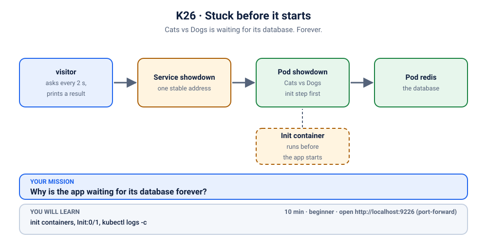

# K26 · Stuck before it starts

*Cats vs Dogs is waiting for its database. Forever.*

⏱ 10 min · beginner · Cats vs Dogs voting app (`python:3.12-alpine`, about 19 MB) plus Redis (`redis:7.4.12-alpine`, about 59 MB on disk) · init containers, `Init:0/1`, `kubectl logs -c`

⬇️ First run downloads about 19 MB (Python), about 59 MB (Redis) and a tiny 4 MB helper image (`busybox`, also used by the visitor). A slow first download is normal: do it on good Wi-Fi, before the session.

Output columns and wording can differ a little between kubectl, container runtimes and clusters (kind, minikube, Docker Desktop, playgrounds). The ideas never change.

## 📖 The story
It is the evening before the Christ University inter-department showdown, and Ravi has added a real database to the "Cats vs Dogs" poll: Redis, so votes survive an app restart. He deploys both, sees `created` twice, and goes to get chai. Redis is green. The poll page never loads, and the vote count is stuck at zero because the app Pod never shows `Running`. The status column shows a word he has never seen before. Everyone assumes the app is broken. He opens its logs, and Kubernetes answers... with an error instead of logs.



## 🧠 The concept: why, what, how
Some apps must not start until something else is ready: a database, a config service, a migration. Kubernetes gives a Pod **init containers** for exactly this. They are small helper containers that run **one at a time, in order, before the app container**. Each one must exit successfully (exit code 0) before the next starts, and the app containers only start after the last one finishes.

- The status `Init:0/1` reads "0 of 1 init containers finished". The app container has not even been created yet, so it has no logs, and a Pod that never leaves Init never becomes Ready.
- A common init container is a tiny loop: "keep asking until my dependency answers, then exit". If the dependency never answers, the loop never ends, and neither does the wait. There is no timeout and no crash: it is just patiently waiting, and `RESTARTS` stays at `0`.
- The Pod has **more than one container**, so `kubectl logs` has to be told which one you mean: `-c <container-name>`. Without `-c` it picks the main app container, which is not running yet.

Think of a restaurant kitchen: the head chef (the app) won't start cooking until the helper has checked that the gas is on. If the helper keeps checking the wrong meter, the chef just stands there, and asking the chef what went wrong gets you nothing. You have to ask the helper.

```
 init container 1 --> exit 0? --> init container 2 --> exit 0? --> app container starts
        |
        '-- never exits --> Pod stays Init:0/1, app never starts, app has no logs
```

## 🏢 Where you'll meet this at work
- **An app that waits for its database or message broker** (`wait-for-db`, `wait-for-kafka`) and sits in `Init` after the dependency was renamed or moved (developer, SRE).
- **A Pod with a service-mesh or secrets-fetching init step** that can't reach its control plane, so every new Pod hangs at `Init:0/2` (platform team).
- **A database-migration init container** that fails or hangs during a deploy, so the new version never comes up while the old one keeps serving (developer, release engineer).

## 💥 Break it
```bash
cd break && ./break.sh
```
What the room should see: the script says Redis is running, but the app is not coming up and nobody can vote. A small `visitor` Pod keeps asking the app "are you ready?" every 2 seconds and gets no answer:
```bash
kubectl logs visitor -n k-26-init-stuck --tail=3
```
```
❌ 00:17:33 no answer from http://showdown/readyz
❌ 00:17:36 no answer from http://showdown/readyz
❌ 00:17:39 no answer from http://showdown/readyz
```
You can follow it live with `kubectl logs -f visitor -n k-26-init-stuck` (Ctrl+C to stop). We'll watch it again when we fix things.

## 🔍 Investigate
Guess first, then run these **in order**.

**1. What state are the Pods in?** Before guessing at causes, we need the one-line status of everything we deployed.
```bash
kubectl get pods -n k-26-init-stuck
```
```
NAME                       READY   STATUS     RESTARTS   AGE
redis-7f87b86754-tj9vp     1/1     Running    0          12s
showdown-9d66c75f5-jp8zk   0/1     Init:0/1   0          12s
visitor                    1/1     Running    0          12s
```
(Ages and Pod names will differ.) Redis is fine, and so is the visitor. The app Pod is `0/1`, with zero restarts and a status we haven't seen before: `Init:0/1`. Wait a minute and run it again: nothing changes. It isn't crashing. It just isn't getting anywhere.

<details><summary>💡 Hint</summary>
Look closely at the status: it isn't <code>Pending</code>, <code>Running</code> or <code>CrashLoopBackOff</code>. What does the <code>Init:</code> in front tell you about <em>what</em> the Pod is busy with? And if the app hasn't started yet, who is the one doing something right now?
</details>

**2. What does the app say?** The natural first move for any sick Pod is its logs.
```bash
kubectl logs -n k-26-init-stuck -l app=showdown
```
```
Defaulted container "showdown" out of: showdown, wait-for-redis (init)
Error from server (BadRequest): container "showdown" in pod "showdown-9d66c75f5-jp8zk" is waiting to start: PodInitializing
```
(Exact wording differs a little between kubectl versions.) No logs, because the app container is "waiting to start". But look at the first line: Kubernetes tells us this Pod has **two** containers, `showdown` and `wait-for-redis (init)`, and that we were given the first one by default. So `kubectl logs` without `-c` asks the wrong container.

**3. Which container is actually doing something?** Step 2 told us the Pod has an init container, so next we ask `describe` for the state of every container.
```bash
kubectl describe pod -n k-26-init-stuck -l app=showdown | grep -E '^(Init )?Containers:|State:|Reason:'
```
```
Init Containers:
    State:          Running
Containers:
    State:          Waiting
      Reason:       PodInitializing
```
The first `State:` (under `Init Containers:`) is the init container: **Running**. The second one, under `Containers:`, is the app `showdown`: **Waiting** for it. The Pod is stuck on the first step of its start-up, so the answer will be in the init container's log.

**4. What is the init container saying?** Now ask it, with `-c` and its name.
```bash
kubectl logs -n k-26-init-stuck -l app=showdown -c wait-for-redis --tail=4
```
```
waiting for redsi
waiting for redsi
waiting for redsi
waiting for redsi
```
There it is, as plain as it gets: it keeps waiting for something called `redsi`. Our database is called `redis`.

**5. Does anything called `redsi` exist?** Let's ask the cluster's DNS ourselves, from the visitor Pod, and then list the Services.
```bash
kubectl exec visitor -n k-26-init-stuck -- nslookup redsi
```
```
Server:		10.96.0.10
Address:	10.96.0.10:53

** server can't find redsi.cluster.local: NXDOMAIN

** server can't find redsi.k-26-init-stuck.svc.cluster.local: NXDOMAIN

** server can't find redsi.cluster.local: NXDOMAIN

** server can't find redsi.svc.cluster.local: NXDOMAIN

** server can't find redsi.k-26-init-stuck.svc.cluster.local: NXDOMAIN

** server can't find redsi.svc.cluster.local: NXDOMAIN

command terminated with exit code 1
```
(The order of the lines and the exit-code line vary a little by cluster.) `NXDOMAIN` means "no such name". The name `redsi` is not known anywhere in the namespace, so waiting for it will never end.
```bash
kubectl get svc -n k-26-init-stuck
```
```
NAME       TYPE        CLUSTER-IP      EXTERNAL-IP   PORT(S)    AGE
redis      ClusterIP   10.96.62.154    <none>        6379/TCP   12s
showdown   ClusterIP   10.96.247.145   <none>        80/TCP     12s
```
The Service that exists is `redis`. One letter pair swapped.

**6. Where does `redsi` come from?** We know the name is wrong. Which object holds it? The Deployment's Pod template.
```bash
kubectl get deploy showdown -n k-26-init-stuck -o yaml | grep -A8 'initContainers:'
```
```
      initContainers:
      - command:
        - sh
        - -c
        - until nc -z redsi 6379 2>/dev/null; do echo waiting for redsi; sleep 2;
          done
        image: busybox:1.36
        imagePullPolicy: IfNotPresent
        name: wait-for-redis
```
(`kubectl` wraps the long line.) The Deployment's init container runs a loop: "try to open a connection to `redsi` on port 6379 (Redis's port); if that fails, say so and try again in 2 seconds". The name was typed wrong, so it can never succeed.

## 🩺 Root cause
<details><summary>Reveal after the room guesses</summary>

The Pod has an init container, `wait-for-redis`, whose job is to hold the app back until Redis accepts connections. Its loop tries to connect to `redsi` on port 6379, a typo of `redis`, so the connection never succeeds and the loop never exits. Kubernetes only starts the app container after every init container has exited successfully, so the app never started: no logs, no restarts, just `Init:0/1`. Redis itself, the Service and the app code were all fine.

If an init container had *failed* (exited with an error), the Pod's `restartPolicy` would retry it, and you would see `Init:Error` and then `Init:CrashLoopBackOff`. This one never exits at all, so it sits quietly at `Init:0/1`.
</details>

## 🔧 Fix it
Before you run it, open a **second terminal** and start the live visitor log, so the room sees red turn green:
```bash
kubectl logs -f visitor -n k-26-init-stuck
```
Then, in the first terminal:
```bash
cd ../fix && ./fix.sh
```
Within about 15 seconds the log flips from ❌ to ✅ (Ctrl+C to stop it). The init container in the new Pod reaches `redis` straight away, exits, and the app starts. What changed: one word.
```bash
diff ../break/app.yaml app.yaml
```
```
1c1
< # K26 break: the Cats vs Dogs app, deployed.
---
> # K26 fix: the same Deployment, corrected.
25c25
<             - until nc -z redsi 6379 2>/dev/null; do echo waiting for redsi; sleep 2; done
---
>             - until nc -z redis 6379 2>/dev/null; do echo waiting for redis; sleep 2; done
```
What you saw in the second terminal (shortened: the first lines of the log are cut off, and the ✅ lines keep coming every 2 seconds until you stop it):
```
❌ 00:17:42 no answer from http://showdown/readyz
❌ 00:17:45 no answer from http://showdown/readyz
✅ 00:17:47 HTTP 200
✅ 00:17:49 HTTP 200
✅ 00:17:51 HTTP 200
```
(The app's `REDIS_HOST` was already `redis`, so the app and its start-up check now both use the same name.)

By hand (this replaces `./fix.sh`, so you don't need to run both): apply the fixed file from the `fix` folder.
```bash
kubectl apply -f app.yaml
```
The init container is part of the Pod template, so changing it makes the Deployment start a **new** Pod and remove the stuck one.

## ✅ Verify it yourself
```bash
kubectl get pods -n k-26-init-stuck
```
```
NAME                        READY   STATUS    RESTARTS   AGE
redis-7f87b86754-tj9vp      1/1     Running   0          25s
showdown-857dfb5d55-k779h   1/1     Running   0          9s
visitor                     1/1     Running   0          25s
```
(Ages and Pod names will differ.) The app Pod is `Running`, `1/1` Ready. The visitor's log is green again (if you still see a ❌, wait a few seconds and run it again):
```bash
kubectl logs visitor -n k-26-init-stuck --tail=3
```
```
✅ 00:17:49 HTTP 200
✅ 00:17:51 HTTP 200
✅ 00:17:53 HTTP 200
```
The init container did its job and finished, and the app took over:
```bash
kubectl describe pod -n k-26-init-stuck -l app=showdown | grep -E '^(Init )?Containers:|State:|Reason:'
```
```
Init Containers:
    State:          Terminated
      Reason:       Completed
Containers:
    State:          Running
```
And now the app has logs, because it finally got to run (the first line is kubectl telling you which container it picked):
```bash
kubectl logs -n k-26-init-stuck -l app=showdown
```
```
Defaulted container "showdown" out of: showdown, wait-for-redis (init)
2026-11-09T00:17:46 [showdown-857dfb5d55-k779h] 🚀 Cats vs Dogs v1.0.0 (Cats vs Dogs) listening on :8080, votes stored in redis redis
```
Now open it yourself. In a **second terminal** (leave it running):
```bash
kubectl port-forward -n k-26-init-stuck svc/showdown 9226:80
```
```
Forwarding from 127.0.0.1:9226 -> 8080
Forwarding from [::1]:9226 -> 8080
```
On a playground, run the same command with `--address 0.0.0.0` added, and open the URL for port 9226.
Back in the first terminal, check the page, then cast a vote and read it back. The count comes from Redis, not from the app's memory:
```bash
curl -s -o /dev/null -w '%{http_code}\n' localhost:9226
```
```
200
```
```bash
curl -s 'localhost:9226/api/vote?option=cats'
```
```
{"voted": "cats", "results": {"cats": 1, "dogs": 0}, "total": 1, "storage": "redis", "served_by": "showdown-857dfb5d55-k779h", "version": "1.0.0"}
```
```bash
curl -s localhost:9226/api/results
```
```
{"results": {"cats": 1, "dogs": 0}, "total": 1, "storage": "redis", "served_by": "showdown-857dfb5d55-k779h", "version": "1.0.0"}
```
(If you vote in the browser first, your counts will be higher.) Or open http://localhost:9226 in your browser and cast a vote. Press Ctrl+C in the second terminal to stop the port-forward.

## 🎯 Key takeaways
- **`Init:N/M` means N of M init containers have finished.** The app container hasn't started, so the app's own logs don't exist yet. Look at the init container.
- **A Pod with several containers needs `kubectl logs -c <name>`.** Read the "Defaulted container … out of: …" line: it lists the names, and `(init)` marks init containers.
- **An init container that waits for something can wait forever.** No crash, no restart count, no error: just a patient loop. Check the name or address it is waiting for.
- **`describe` shows the state of every container** (`Running`, `Waiting`, `Terminated`), which tells you whose turn it is.

## 💎 Lifelong lesson
> `Init:0/1` means look at the init container's logs, not the app's.

## 🧹 Clean up
Press Ctrl+C in the port-forward terminal first, then:
```bash
cd .. && ./cleanup.sh
```

## Next →
[K27](../27-dashboard-config-missing-key/README.md): The dashboard is ready. Its config is right there. It still won't start.
