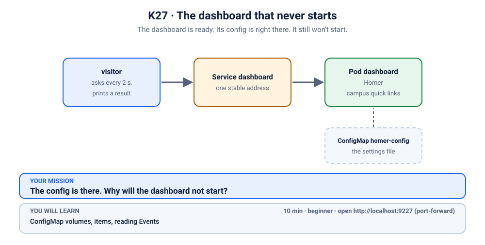

# K27 · The dashboard that never starts

*The dashboard is ready. Its config is right there. It still won't start.*

⏱ 10 min · beginner · "Campus quick links" page (Homer dashboard, `b4bz/homer:v25.10.1`) · ConfigMap volumes, `items`, reading Events

⬇️ The tiny 4 MB visitor image downloads when you break it. The Homer image (about 7 MB) is usually pulled later, at fix time. That is quick, even on slow Wi-Fi. Presenters: preload it (`kubernetes/scenarios/preload.sh`) if you like.

Output columns and wording can differ a little between kubectl versions and clusters (kind, minikube, Docker Desktop, playgrounds). The ideas never change.

## 📖 The story
The Student Council wants one page with everything a student needs: the canteen menu, library hours, the last bus. Lakshmi writes the "Campus quick links" settings, and Ravi deploys the dashboard with a single `kubectl apply`. `kubectl` says `deployment.apps/dashboard created` and `configmap/homer-config created`. Green, green. The settings are in the cluster, the Deployment is in the cluster, the image is a good one. But the page never appears, and a small visitor who checks it every few seconds keeps getting no answer. The Pod is not crashing, either. It is just... getting ready. Forever.



## 🧠 The concept: why, what, how
A **ConfigMap** keeps settings outside your container image, so one image can run in many places. One way to hand it to a Pod is as a **volume**: Kubernetes turns the ConfigMap into files, and the kubelet (the agent on each node that starts your containers) puts them inside the container before it starts.

- Each **key** in the ConfigMap becomes one file. By default you get all of them.
- With **`items`** you pick exactly which keys you want and what each file is called: "take the key *this*, and make it the file *that*".
- The kubelet sets up the volume **before** it creates the container. If the volume can't be built, the container never starts, and the Pod waits in `ContainerCreating` while the kubelet keeps trying.
- A Pod stuck there never ran, so there are **no logs**. The explanation is in the Events.

Analogy: the ConfigMap is a cupboard of labelled boxes, and `items` is the shopping list you hand the helper. The helper packs your bag before the trip starts. If a box on your list isn't in the cupboard, the helper doesn't guess: you simply don't leave.

## 🏢 Where you'll meet this at work
- **A config file mounted from a ConfigMap** (nginx, Prometheus, Grafana, Homer) where a rename or typo in one place doesn't match the other (developer, SRE).
- **Helm and Kustomize changes** that rename a ConfigMap or its keys, while the Deployment still asks for the old name (platform team).
- **A first deploy to a new environment** where "the Pod is stuck in `ContainerCreating`" is the whole bug report (on-call engineer).

## 💥 Break it
```bash
cd break && ./break.sh
```
What the room should see: the script deploys the dashboard and a small `visitor`, waits until the first problem shows up, and finishes without errors. The `visitor` Pod keeps asking the dashboard for its page:
```bash
kubectl logs -f visitor -n k-27-config-key
```
```
❌ 00:27:07 no answer from http://dashboard
❌ 00:27:10 no answer from http://dashboard
```
(Times will differ.) You can stop it with Ctrl+C. We'll watch it again live when we fix things.

## 🔮 Predict first (60 seconds)
The ConfigMap key is `config.yaml`, and the volume asks for `config.yml`. Before you look:
1. Will the Pod start?
2. Where will the reason be?

<details><summary>Check your prediction</summary>

1. No: it stays stuck before starting.
2. In the Pod's Events: the volume cannot be built because the key does not exist.
</details>

## 🔍 Investigate
Guess first, then run these **in order**. The symptom: nobody answers.

**1. Is the dashboard even running?** Start with the basics: what state is the Pod in?
```bash
kubectl get pods -n k-27-config-key
```
```
NAME                         READY   STATUS              RESTARTS   AGE
dashboard-76b8d8f4cb-stpjx   0/1     ContainerCreating   0          17s
visitor                      1/1     Running             0          17s
```
(Pod names and ages will differ.) The dashboard is `0/1` and `ContainerCreating`, and it has been for a while. `ContainerCreating` is normal for a few seconds (the Pod is being set up). Staying there is not. It has no restarts and no `CrashLoopBackOff`, so the container never even started.

<details><summary>💡 Hint</summary>
A Pod that never started has no logs to read, so <code>kubectl logs</code> will tell you nothing. But Kubernetes writes down every step of the setup in the Pod's <em>Events</em>. Read them, then compare what the Pod <em>asks for</em> with what the cluster <em>has</em>.
</details>

**2. Why is it stuck?** The Events list what the scheduler and the kubelet did, in order.
```bash
kubectl describe pod -n k-27-config-key -l app=dashboard | sed -n '/^Events:/,$p'
```
```
Events:
  Type     Reason       Age               From               Message
  ----     ------       ----              ----               -------
  Normal   Scheduled    24s               default-scheduler  Successfully assigned k-27-config-key/dashboard-76b8d8f4cb-stpjx to z2h-test-worker2
  Warning  FailedMount  8s (x6 over 24s)  kubelet            MountVolume.SetUp failed for volume "config" : configmap references non-existent config key: config.yml
```
(Which node, and the exact wording, can differ a little between Kubernetes versions. The `x6` means the kubelet has tried, and failed, six times already.) The Pod was **scheduled** fine. Then the **kubelet** failed to set up the volume called `config`, and the message says a key doesn't exist.

**3. What does that volume look like?** The Events named the volume `config`: see what it is built from.
```bash
kubectl describe pod -n k-27-config-key -l app=dashboard | grep -A6 '^Volumes:'
```
```
Volumes:
  config:
    Type:      ConfigMap (a volume populated by a ConfigMap)
    Name:      homer-config
    Optional:  false
  kube-api-access-s726f:
    Type:                    Projected (a volume that contains injected data from multiple sources)
```
The volume `config` comes from the ConfigMap `homer-config`, and it is **not optional** (`Optional: false`). We checked what that means for `items`: a listed key that is missing stops the Pod, unless the volume says `optional: true`, in which case the Pod starts anyway, just without that file. Failing loudly is the safer default, because skipping silently would hide a typo like this one. (`kube-api-access-…` is a volume Kubernetes adds to every Pod; ignore it.)

**4. What does the Deployment ask for from it?** The `items` list is the shopping list.
```bash
kubectl get deploy dashboard -n k-27-config-key -o jsonpath='{.spec.template.spec.volumes[0].configMap.items}{"\n"}'
```
```
[{"key":"config.yml","path":"config.yml"}]
```
The Pod asks for one key and will save it as one file. Now see what the cupboard actually holds.

**5. What keys does the ConfigMap have?** List just the key names.
```bash
kubectl get cm homer-config -n k-27-config-key -o go-template='{{range $k, $v := .data}}{{$k}}{{"\n"}}{{end}}'
```
```
config.yaml
```
Put the two answers side by side: the Pod asks for `config.yml`, the ConfigMap has `config.yaml`.

## 🪤 The tempting wrong fix: delete the Pod
"Maybe the volume will mount next time."
```bash
kubectl delete pods -n k-27-config-key -l app=dashboard
kubectl get pods -n k-27-config-key
```
The new Pod asks for the same missing key and is stuck in the same place. `.yml` and `.yaml` are different strings, however alike they look.

## 🩺 Root cause
<details><summary>Reveal after the room guesses</summary>

The ConfigMap's key is spelled `config.yaml`, and the Deployment's volume asks for `config.yml` (the file name Homer reads). A key name is just a string, so `.yml` and `.yaml` are two different keys, even though they mean the same format. Because the volume lists the key under `items`, the kubelet needs exactly that key. It can't find it, so it can't build the volume. Without the volume it can't create the container, so the Pod waits in `ContainerCreating` and the kubelet retries over and over. Nothing is wrong with Homer, the image or the node: the ConfigMap and the Pod just disagree on a name.
</details>

## 🔧 Fix it
Before you run it, open a **second terminal** and start the live visitor log, so the room sees red turn green:
```bash
kubectl logs -f visitor -n k-27-config-key
```
Then, in the first terminal:
```bash
cd ../fix && ./fix.sh
```
`fix.sh` corrects the ConfigMap and also restarts the Pod, so you don't wait out the kubelet's retry timer. It prints a few "waiting" lines and finishes. On our test cluster, with Homer already downloaded, it finished in a couple of seconds (add the 7 MB download the first time), and the visitor flipped from ❌ to ✅ (Ctrl+C to stop it):
```
❌ 00:27:58 no answer from http://dashboard
❌ 00:28:01 no answer from http://dashboard
✅ 00:28:03 HTTP 200
✅ 00:28:05 HTTP 200
```
(shortened.) What changed: only the name of the key in the ConfigMap. Run this from the `27-dashboard-config-missing-key` folder:
```bash
diff break/links.yaml fix/links.yaml
```
```
1c1
< # K27 break (1/3): the "Campus quick links" page for Homer, written for this course.
---
> # K27 fix (1/1): the "Campus quick links" page for Homer, written for this course.
8c8
<   config.yaml: |
---
>   config.yml: |
```
(The first change is only the comment at the top.) The Deployment is untouched: we fixed the ConfigMap to match what the Pod asks for.

By hand (this replaces `./fix.sh`, so you don't need to run both):
```bash
kubectl apply -f fix/links.yaml
kubectl rollout restart deployment/dashboard -n k-27-config-key
kubectl rollout status deployment/dashboard -n k-27-config-key --timeout=180s
```

**Why the restart?** Side note: it is not strictly needed here. The kubelet keeps retrying the failed volume setup, with pauses that grow up to about 2 minutes, so once the key exists the **same Pod** would start by itself (we saw that on our cluster in an earlier rehearsal, about half a minute after the fix). But at a presenter's pace the retry timer may be at its longest, which means dead air. The restart replaces the Pod at once.

**Careful, this only worked because the container never started.** With a mount that uses `subPath`, like this one, a **running** Pod never sees later edits to the ConfigMap. So when you change config for a Pod that is already running, restart it (see [K23](../23-dark-mode-not-applied/README.md)).

## ✅ Verify it yourself
```bash
kubectl get pods -n k-27-config-key
```
```
NAME                         READY   STATUS    RESTARTS   AGE
dashboard-5675cc44ff-zvl6r   1/1     Running   0          16s
visitor                      1/1     Running   0          71s
```
(Names and ages will differ.) The dashboard is `1/1` and `Running`, with **0 restarts**, and it is a **new** Pod (a different name and a younger age than the visitor), because `fix.sh` restarted it. The visitor's log is green (if you still see a ❌, wait a few seconds and run it again):
```bash
kubectl logs visitor -n k-27-config-key --tail=2
```
```
✅ 00:28:21 HTTP 200
✅ 00:28:23 HTTP 200
```
Now open the page yourself. In a **second terminal** (leave it running):
```bash
kubectl port-forward -n k-27-config-key svc/dashboard 9227:80
```
```
Forwarding from 127.0.0.1:9227 -> 8080
Forwarding from [::1]:9227 -> 8080
```
On a playground, add `--address 0.0.0.0` and open the URL for port 9227.
Back in the first terminal, ask for the settings file the Pod now has:
```bash
curl -s localhost:9227/assets/config.yml | head -3
```
```
title: "Campus quick links"
subtitle: "Bengaluru campus · everything a student needs before the 9 AM bell"
header: true
```
(The port-forward terminal also prints `Handling connection for 9227`.) Or open http://localhost:9227 in your browser: a teal "Campus quick links" page with Food and chai, Study and Getting around. Press Ctrl+C in the second terminal to stop the port-forward.

## 🎯 Key takeaways
- **`ContainerCreating` that never ends** means the container was never created: look at the Pod's Events, not its logs.
- **`FailedMount` in the Events** is the kubelet saying "I couldn't build a volume". Read the rest of the line: it names the volume and what was missing.
- **Names must match exactly.** A key listed under `items` has to exist in the ConfigMap; `.yml` and `.yaml` are different strings.
- **Fix the ConfigMap, then restart the Pod.** A stuck Pod would start by itself on the kubelet's next retry (up to about two minutes), but restart it to skip the wait. And remember the caveat: that worked only because the container never started. A running Pod with a `subPath` mount never sees later ConfigMap edits, so restart it.

## 💎 Lifelong lesson
> `ContainerCreating` that never ends is almost always storage or config. Read the Events.

## 🧹 Clean up
Press Ctrl+C in the port-forward terminal first, then:
```bash
cd .. && ./cleanup.sh
```

## 🧪 Quick recap (3 questions)
1. Why are `config.yml` and `config.yaml` different?
2. How can you list the keys a ConfigMap really has?
3. What does `items` in a volume do?

<details><summary>Answers</summary>

1. A key name is just a string: it must match exactly.
2. `kubectl describe configmap` or `kubectl get configmap -o yaml`.
3. It picks which keys become files, so each listed key must exist.
</details>

## Next →
[K28](../28-leaderboard-reset-job/README.md): The midnight reset ran. Three times. Then gave up.
