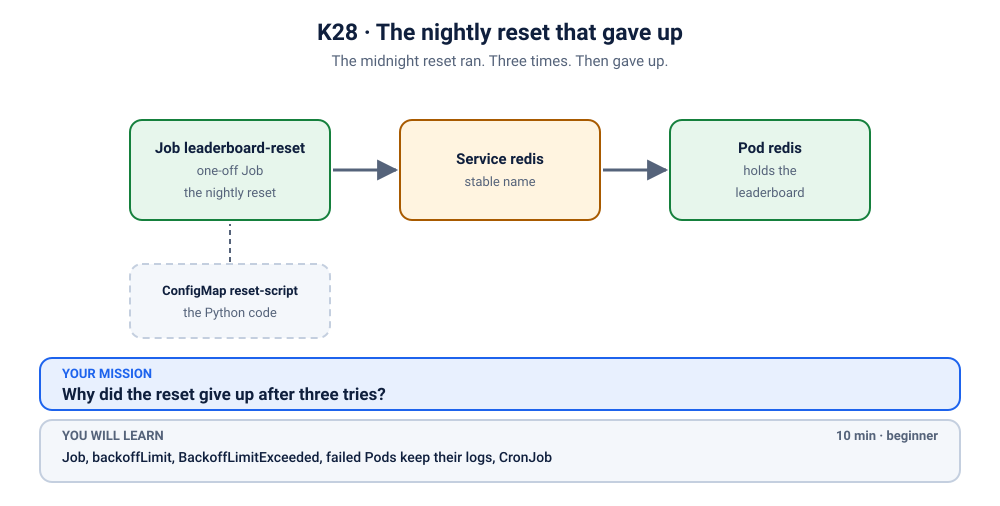

# K28 · The nightly reset that gave up

*The midnight reset ran. Three times. Then gave up.*

⏱ 10 min · beginner · a one-off reset Job (`python:3.12-alpine`, about 19 MB) plus a real Redis (`redis:7.4.12-alpine`, about 59 MB on disk) · Job, `backoffLimit`, `BackoffLimitExceeded`, failed Pods keep their logs, CronJob

⬇️ First run downloads Python (about 19 MB) and Redis (about 59 MB on disk). A slow first download is normal: do it on good Wi-Fi, before the session.

Output columns and wording can differ a little between kubectl versions and clusters (kind, minikube, Docker Desktop, playgrounds). For example, older kubectl versions have no `STATUS` column for Jobs. The ideas never change.

## 📖 The story
It's the night before the Christ University hackathon final. Lakshmi's team leaderboard still shows last week's practice scores, so Ravi wrote a small script to wipe them and start the final from zero. He runs it as a Kubernetes Job, goes for chai, and comes back to a board that has not changed. The Job is not running. It is not finished either. Kubernetes tried it three times and then stopped, politely and without any fuss.



## 🧠 The concept: why, what, how
A **Deployment** keeps something running forever. A **Job** is for work that should *finish*: a database backup, a report, a reset. It runs a Pod to completion and then it is done.

- If the Pod fails, the Job starts a **new** Pod and tries again. It waits a little longer before each retry (10 seconds, then 20, and so on).
- `backoffLimit` says how many retries are allowed. Ours is `2`, so the Job makes 3 attempts in total.
- When the retries run out, the Job gives up: its condition becomes **Failed** with the reason **`BackoffLimitExceeded`**. Nothing tries again after that.
- Because we set `restartPolicy: Never`, each attempt is its own Pod, and the failed Pods are **kept** (showing `Error`), so you can still read what each one said. (With `restartPolicy: OnFailure` it is different: the Job reuses one Pod, `RESTARTS` climbs, and `kubectl logs` shows only the latest try; earlier logs are lost unless you ask for `--previous`.)
- The kept Pods live and die with the Job: delete the Job, or set `ttlSecondsAfterFinished` so Kubernetes deletes it later, and its Pods (and their logs) vanish too. Read them before that. Retry waits double each time but are capped at about 6 minutes.
- A Job's Pod template can't be edited after the Job exists. To change what it runs, you delete the Job and create it again.
- Think of a courier who rings your bell three times. If nobody answers, he leaves a slip and goes. He doesn't ring forever, and he doesn't come back unless you book him again.
- Need it every night? That is a **CronJob**: it creates a fresh Job on a schedule (we don't create one here; our Job is the thing a CronJob would run).

```
 Job ──▶ Pod #1 fails ──▶ wait 10 s ──▶ Pod #2 fails ──▶ wait 20 s ──▶ Pod #3 fails ──▶ Job: Failed (BackoffLimitExceeded)
                                                                         └─ the three Pods stay, with their logs
```

## 🏢 Where you'll meet this at work
- **A bank's nightly batch job.** The statement run fails at 2 a.m., the Job gives up, and the first sign is a missing report in the morning (SRE, on-call).
- **A database migration Job before a release.** It runs once per deploy. If it fails, the release must stop (developer, platform team).
- **A CronJob that "stopped working".** Every night it creates a Job; one bad setting makes every Job fail the same way (SRE).

## 💥 Break it
```bash
cd break && ./break.sh
```
What the room should see: the script puts five players on a Redis leaderboard, runs the reset Job, waits about half a minute while it retries, and finishes saying the scores were meant to be reset and the Job has stopped trying. There is no web page here, only a Job, Pods and logs.

## 🔮 Predict first (60 seconds)
The Job's Redis host name is mistyped. Before you look:
1. How many Pods will the Job create before giving up?
2. Will retrying help?

<details><summary>Check your prediction</summary>

1. Three (the Job's retry limit), then it stops.
2. No: retrying the same wrong name cannot work.
</details>

## 🔍 Investigate
Guess first, then run these **in order**.

**1. What happened to the Job?** Always start by looking at the Job and its Pods together.
```bash
kubectl get job,pods -n k-28-job
```
```
NAME                          STATUS   COMPLETIONS   DURATION   AGE
job.batch/leaderboard-reset   Failed   0/1           38s        38s

NAME                          READY   STATUS    RESTARTS   AGE
pod/leaderboard-reset-bv9ht   0/1     Error     0          8s
pod/leaderboard-reset-ct2vb   0/1     Error     0          28s
pod/leaderboard-reset-rskpp   0/1     Error     0          38s
pod/redis-7f87b86754-xcmtr    1/1     Running   0          39s
```
(Names and ages will differ.) The Job is **Failed**, `0/1` completions. There are **three** Pods, all in `Error`: the first try plus the two retries, spaced about 10 and 20 seconds apart (the ages show it). Redis is fine. To look at only the Job's Pods, use its label:
```bash
kubectl get pods -n k-28-job -l job-name=leaderboard-reset
```
```
NAME                      READY   STATUS   RESTARTS   AGE
leaderboard-reset-bv9ht   0/1     Error    0          13s
leaderboard-reset-ct2vb   0/1     Error    0          33s
leaderboard-reset-rskpp   0/1     Error    0          43s
```
The failed Pods were not cleaned away. That is on purpose: they are the evidence.

<details><summary>💡 Hint</summary>
Three Pods, three failures, the same program each time. Each Pod printed something before it died, and Kubernetes kept it. The program did one thing that needs another computer in the cluster: find it. What does it need before it can connect to anything?
</details>

**2. What did a failed Pod say?** The Pods are finished but not deleted, so their logs are still there. `logs job/…` picks one of the Job's Pods for you.
```bash
kubectl logs job/leaderboard-reset -n k-28-job
```
```
Found 3 pods, using pod/leaderboard-reset-rskpp
resetting the leaderboard on leaderbord:6379
Traceback (most recent call last):
  File "/script/reset.py", line 19, in <module>
    with socket.create_connection((host, 6379), timeout=5) as s:
         ^^^^^^^^^^^^^^^^^^^^^^^^^^^^^^^^^^^^^^^^^^^^^^^^^
  File "/usr/local/lib/python3.12/socket.py", line 841, in create_connection
    for res in getaddrinfo(host, port, 0, SOCK_STREAM):
               ^^^^^^^^^^^^^^^^^^^^^^^^^^^^^^^^^^^^^^^
  File "/usr/local/lib/python3.12/socket.py", line 978, in getaddrinfo
    for res in _socket.getaddrinfo(host, port, family, type, proto, flags):
               ^^^^^^^^^^^^^^^^^^^^^^^^^^^^^^^^^^^^^^^^^^^^^^^^^^^^^^^^^^^
socket.gaierror: [Errno -2] Name does not resolve
```
(The `^^^^` marker lines come from Python 3.12 and may be missing in other versions; the exact wording of the last line can vary a little too.) The last line is the answer: `gaierror` ("get address info") with *Name does not resolve*. The script asked DNS for the address of a name, and DNS said it has never heard of it. The first line says which name it asked for.

**3. Did Kubernetes say why it stopped?** The Job's own events give the official reason.
```bash
kubectl describe job leaderboard-reset -n k-28-job | grep -A6 '^Events:'
```
```
Events:
  Type     Reason                Age   From            Message
  ----     ------                ----  ----            -------
  Normal   SuccessfulCreate      53s   job-controller  Created pod: leaderboard-reset-rskpp
  Normal   SuccessfulCreate      43s   job-controller  Created pod: leaderboard-reset-ct2vb
  Normal   SuccessfulCreate      23s   job-controller  Created pod: leaderboard-reset-bv9ht
  Warning  BackoffLimitExceeded  21s   job-controller  Job has reached the specified backoff limit
```
Three Pods created, then `BackoffLimitExceeded`. That is only the *what*; the Pod logs from step 2 are the *why*.

**4. Which name did we give the script?** The name is not typed in the Python code. It comes in through an environment variable, so read it from the Job.
```bash
kubectl get job leaderboard-reset -n k-28-job -o jsonpath='{.spec.template.spec.containers[0].env}'
```
```
[{"name":"REDIS_HOST","value":"leaderbord"}]
```
(No newline at the end of this output; your prompt may appear right after it.) `REDIS_HOST` is `leaderbord`. Is that the name of anything in this namespace?

**5. What names do exist here?** Inside a cluster, a Service's name *is* its DNS name.
```bash
kubectl get svc -n k-28-job
```
```
NAME    TYPE        CLUSTER-IP     EXTERNAL-IP   PORT(S)    AGE
redis   ClusterIP   10.96.131.14   <none>        6379/TCP   65s
```
The only Service is `redis`. Compare it with the value in step 4, letter by letter.

**6. Did the failed reset change anything?** Look at the real scores in Redis.
```bash
kubectl exec -n k-28-job deploy/redis -- redis-cli ZRANGE scores 0 -1 REV WITHSCORES
```
```
Lakshmi
120
Ravi
95
Meera
80
Priya
60
Arjun
45
```
The old scores are all still there. The reset never reached Redis.

## 🪤 The tempting wrong fix: raise the retry limit
"Give it more tries."
With a higher `backoffLimit` you would simply get more failures instead of three: ten Pods trying the same name that does not exist, instead of three. (Text only.) Retries help when something is *temporarily* wrong. A typo is permanent.

## 🩺 Root cause
<details><summary>Reveal after the room guesses</summary>

The Job's `REDIS_HOST` was set to `leaderbord`. The only Service in the namespace is called `redis`, and nothing is called `leaderbord`, so that name doesn't exist in DNS. The script can't even open a connection. Every retry hits the same wall, because retrying the same wrong name can't help. After the third Pod failed, the Job reached its `backoffLimit` of 2 and became `Failed`. Redis and the cluster were fine the whole time.
</details>

## 🔧 Fix it
```bash
cd ../fix && ./fix.sh
```
```
▶ Deleting the failed Job (its Pod template is immutable) and creating it again…
▶ Waiting for the Job to complete…

👀 What you should see now
   ✅ Fixed. Now verify it yourself:

👉 Next
   kubectl get job -n k-28-job
   kubectl logs job/leaderboard-reset -n k-28-job
```
What changed? Compare the two Job files (the only real difference is one line):
```bash
diff ../break/job.yaml job.yaml
```
```
1c1
< # K28: the nightly leaderboard reset, as a one-off Job.
---
> # K28 fix: the same Job with the Redis host corrected.
18c18
<               value: leaderbord
---
>               value: redis
```
The host is now `redis`, the name of the Service. You can't simply `kubectl edit` this: a Job's Pod template is **immutable**, because Pods that already ran should not pretend they ran something else. So the fix is to delete the Job (its failed Pods go with it) and create it again.

By hand (this replaces `./fix.sh`: run `./fix.sh` or these, not both):
```bash
kubectl delete job leaderboard-reset -n k-28-job
kubectl apply -f job.yaml
kubectl wait --for=condition=complete job/leaderboard-reset -n k-28-job --timeout=120s
```
Kubernetes answers with "deleted", then "created", then "condition met" (the exact wording of the first line depends on your kubectl version).

## ✅ Verify it yourself
```bash
kubectl get job,pods -n k-28-job
```
```
NAME                          STATUS     COMPLETIONS   DURATION   AGE
job.batch/leaderboard-reset   Complete   1/1           3s         13s

NAME                          READY   STATUS      RESTARTS   AGE
pod/leaderboard-reset-xd2m5   0/1     Completed   0          13s
pod/redis-7f87b86754-xcmtr    1/1     Running     0          88s
```
(Names and ages will differ.) The Job is **Complete**, `1/1`. One Pod, `Completed`; the three failed ones were deleted together with the old Job. The logs:
```bash
kubectl logs job/leaderboard-reset -n k-28-job
```
```
resetting the leaderboard on redis:6379
✅ leaderboard reset
```
Finally, the leaderboard itself: every player is back to 0.
```bash
kubectl exec -n k-28-job deploy/redis -- redis-cli ZRANGE scores 0 -1 REV WITHSCORES
```
```
Ravi
0
Priya
0
Meera
0
Lakshmi
0
Arjun
0
```
(Ties are sorted by name, reversed.) This scenario has no web page, so there is no port-forward to open.

## 🎯 Key takeaways
- **A Job runs to completion.** It retries failed Pods with growing waits, up to `backoffLimit`, then stops with `Failed` / `BackoffLimitExceeded`.
- **Failed Pods are kept** (with `restartPolicy: Never`), so `kubectl logs job/<name>` and `kubectl get pods -l job-name=<name>` still show what happened.
- **A Job's Pod template is immutable.** To change what a Job runs, delete it and create it again.
- **A Service's name is its DNS name.** "Name does not resolve" usually means the name asked for isn't the name that exists.
- Debug path: `get job,pods` → `logs job/…` → `describe job` → read the settings the Job was given → `get svc`.
- Need it on a schedule? A **CronJob** creates a new Job at each tick and can keep a few old ones for you to inspect.

## 💎 Lifelong lesson
> Jobs retry, then stop. Read the failed Pods: they keep the evidence.

## 🧹 Clean up
```bash
cd .. && ./cleanup.sh
```

## 🧪 Quick recap (3 questions)
1. What does `backoffLimit` control?
2. Why do failed Job Pods stick around?
3. Why do you delete and recreate a Job to change its environment?

<details><summary>Answers</summary>

1. How many times the Job retries before it is marked failed.
2. So you can read their logs.
3. A Job's Pod template cannot be edited after creation.
</details>

## Next →
[K29](../29-log-sidecar-half-ready/README.md): Half ready. Fully confusing.
