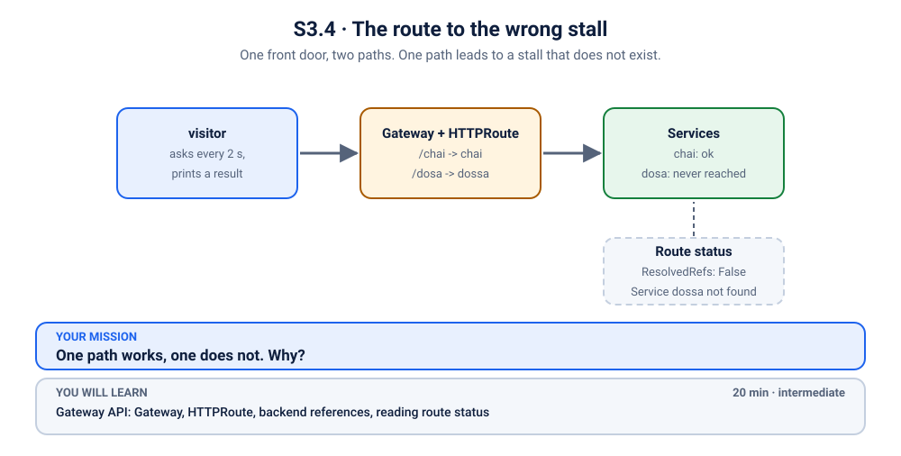
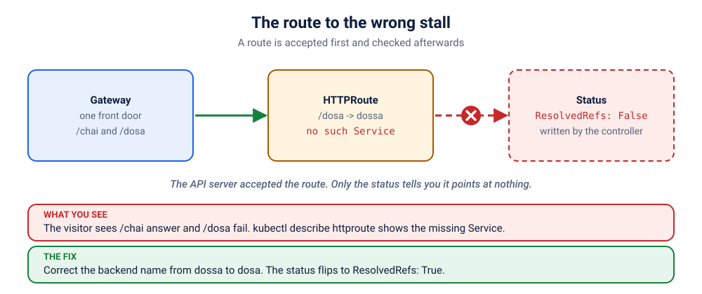

# S3.4 · The route to the wrong stall

*One front door, two paths. One path leads to a stall that does not exist.*

⏱ 20 min · intermediate · Two stalls behind one Gateway (`http-echo`, 17 MB, plus Envoy Gateway) · Gateway API: Gateway, HTTPRoute, backend references, reading route status

⬇️ The 17 MB `hashicorp/http-echo` image, plus the Envoy Gateway controller (installed once by `./scripts/install-gateway.sh`, about 1 GB of memory). A slow first pull is normal.

Output columns and wording can differ a little between kubectl versions and clusters (kind, minikube, Docker Desktop, playgrounds). The ideas never change.

> 🧭 **Section 3, "Services, ingress and networking"**. Previous: [S3.3](../3-showdown-dns-namespaces/README.md). Next: [S3.5](../5-lockdown-blocks-dns/README.md).
>
> 🧰 **Needs a Gateway controller.** Install it once: `./scripts/install-gateway.sh`. (Gateway API is the modern successor of `Ingress`; the old community ingress-nginx controller was retired in March 2026. The ideas are the same: one front door, rules for who goes where.)

## 📖 The story
The market has one front door and two stalls behind it. A **Gateway** is the door, and an **HTTPRoute** is the signboard just inside: *"/chai goes to the chai stall, /dosa goes to the dosa stall."* Last night a developer typed the dosa stall's name with one letter too many. The signboard now points at a stall that does not exist. The chai queue is happy. The dosa queue is looking at a door that politely returns an error.

## 🏆 Rules of this one
- **Find the broken route, not the broken stall.** Both stalls are fine.
- **The route explains itself.** Ask it.
- **Questions only.**



## 🧠 The concept



**Ingress and Gateway API do the same job:** route outside traffic to Services inside the cluster by host and path. Gateway API splits it into roles: a **GatewayClass** (which controller), a **Gateway** (the door: ports and listeners) and **HTTPRoutes** (the rules). Both need a **controller** running in the cluster to make the rules real (here, Envoy Gateway).

An HTTPRoute's `backendRefs` point at Services **by name**. If the name is wrong, Kubernetes accepts the route (it is valid YAML), but the controller reports it in the route's **status**: `ResolvedRefs: False`, `BackendNotFound`. The data plane then answers that path with an error. The chai path keeps working, so the symptom looks "half broken".

## 🔮 Predict first
The /dosa rule names a Service that does not exist. Will `kubectl apply` complain? Will `/chai` still work? Write it down.

<details><summary>Check your prediction</summary>

No complaint: the route is valid YAML, and the API server does not check that a Service exists. `/chai` keeps working. Only `/dosa` fails. The problem shows up in the route's **status**, written by the controller.
</details>

## 💥 Break it
```bash
cd break && python3 run.py
```
```bash
kubectl get gateway,httproute,svc -n k-33-gateway
kubectl logs -f visitor -n k-33-gateway
```
Stop the logs with Ctrl+C.

## 🔍 Investigate: you drive
**What is the first thing you look at?**
<details><summary>💡 Tier 1: a nudge</summary>
The visitor says one path works and one does not. Ask the route what it thinks about its own backends.
</details>
<details><summary>💡 Tier 2: the commands</summary>

```bash
kubectl describe httproute menu -n k-33-gateway | tail -n 20
kubectl get svc -n k-33-gateway
```
Compare each `backendRefs` name in the route with the Services that exist.
</details>
<details><summary>💡 Tier 3: the answers to look for</summary>

The route's status says `ResolvedRefs: False` with a message like `Service k-33-gateway/dossa not found`. The Services that exist are `chai` and `dosa`. The route names `dossa`.
</details>

## 🪤 The tempting wrong fix
Recreate the Gateway, restart the controller, or add a Service called `dossa` "to make the error go away". The Gateway and the controller are healthy: the signboard has a typo. **Read the status the controller wrote before you touch the controller.**

## 🩺 Root cause
<details><summary>Reveal after the room guesses</summary>

The `/dosa` rule's `backendRefs` points at a Service called `dossa`, which does not exist. The API server accepts it (a route may refer to something created later), but the Gateway controller marks `ResolvedRefs: False` and answers that path with an error. `/chai` is untouched.
</details>

## 🔧 Fix it
```bash
cd ../fix && python3 run.py
```
The reference fix changes the backend name to `dosa`. By hand: `kubectl edit httproute menu -n k-33-gateway`. The status flips to `ResolvedRefs: True` within seconds.

## ✅ Verify it yourself
```bash
cd .. && ./check.sh
```
It checks that the route's references resolve and that the visitor sees ✅ on both paths.

## 🎯 Key takeaways
- **Ingress and Gateway API are the front door.** Same job, newer shape.
- **Routes name Services by name.** A typo is accepted, then reported in the status.
- **`kubectl describe httproute` is the first command.** The controller writes its opinion there.
- **One bad rule breaks one path**, not the whole door.

## 💎 Lifelong lesson
> The door is fine. Read the signboard.

## 🏢 Where you'll meet this at work
- **A new route that "does nothing"** because the Service name or port is wrong (developer).
- **Migrating from Ingress to Gateway API**, where each rule must still point at the right Service (platform team).

## 🧹 Clean up
```bash
python3 cleanup.py
```

## Next →
Next, in this section: [S3.5](../5-lockdown-blocks-dns/README.md): Security locked the app down so it can only talk to Redis. And now the app cannot even find Redis.
