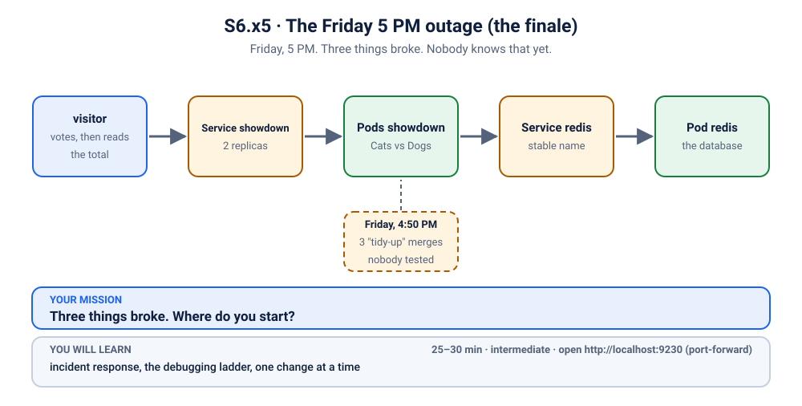
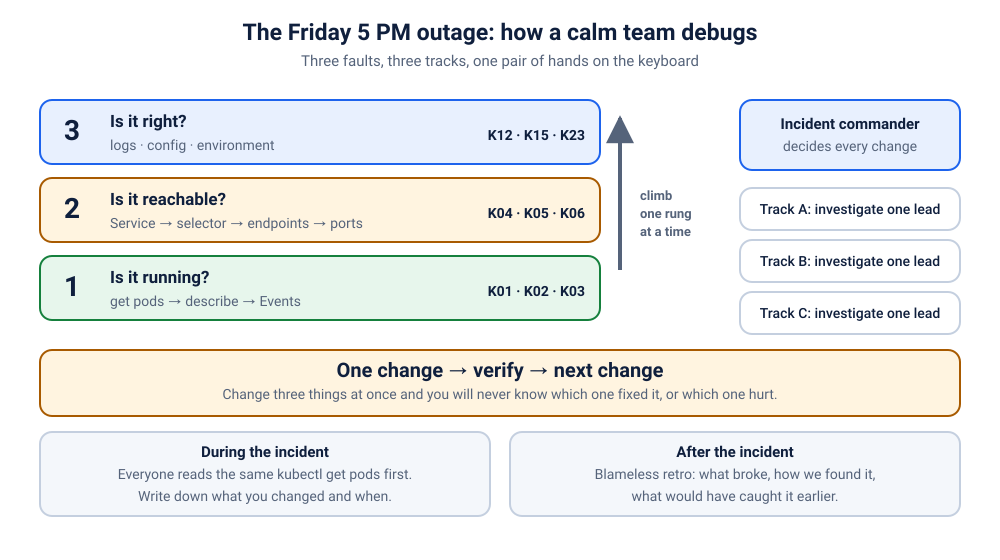

# K30 · The Friday 5 PM outage (the finale)

*Friday, 5 PM. Three things broke. Nobody knows that yet.*

⏱ 25–30 min · intermediate · Cats vs Dogs voting app (`python:3.12-alpine`, about 19 MB) plus Redis (`redis:7.4.12-alpine`, about 59 MB on disk) · incident response, the debugging ladder, one change at a time

⬇️ First run downloads about 19 MB (Python) and a tiny 4 MB helper image (`busybox`, used by the visitor) when you break it, and the Redis image (about 59 MB on disk) later, during the incident. A slow first download is normal: do it on good Wi-Fi, before the session, or preload it (`kubernetes/scenarios/preload.sh`).

Output columns and wording can differ a little between kubectl, container runtimes and clusters (kind, minikube, Docker Desktop, playgrounds). The ideas never change.

## 📖 The story
It's the last Friday before the Christ University fest, and the Cats vs Dogs grand final goes live on the big screen at 7 PM. At 4:50 PM three teammates each merge one small "tidy-up" to the poll's Kubernetes files. Each change is a line or two. Each one looks obviously safe. Nobody runs them together. At 5:00 PM the team deploys the lot, closes their laptops and heads for the bus. At 5:02 her phone buzzes: the poll page doesn't load. Priya, on call this week, opens a terminal and calls the team back to the room.

Three things broke. Nobody knows that yet.



## 🧠 The concept: why, what, how
When production breaks, the worst thing you can do is panic-change things. **Incident response** is the calm routine teams use instead:

1. **Triage together.** Everyone looks at the same picture first (`kubectl get pods`), so nobody chases a ghost.
2. **Split the leads, keep one pair of hands.** Several people investigate at once, each on one lead (a *track*). One person, the **incident commander**, decides what gets changed and when.
3. **One change, verify, then the next.** If you change three things at once and it works, you don't know which change fixed it. If it gets worse, you don't know which one hurt.

Every track climbs the same **debugging ladder** you've used since K01, one rung at a time:

```
 Rung 1  Is it running?     kubectl get pods → describe → Events     (K01, K02, K03)
 Rung 2  Is it reachable?   Service → endpoints → ports              (K04, K05, K06)
 Rung 3  Is it right?       logs → config → environment              (K12, K15, K23)
```

Think of a doctor whose patient arrives with three symptoms. A good doctor doesn't prescribe three medicines in one go: one treatment, watch the patient, then the next. Otherwise, when the patient feels better (or worse), nobody knows why.



## 🏢 Where you'll meet this at work
- **A release train** where several teams' changes ship in one deploy, and the outage turns out to be more than one bug at once (developer, release manager).
- **An on-call page at 5 PM on a Friday** (or 3 AM on a Sunday): the SRE runs the incident, hands out tracks, and keeps a timeline of every change (SRE, on-call engineer).
- **A post-incident review** the next week: what broke, why nothing caught it, and what the team changes so it can't happen the same way again (whole team, engineering manager).

## 💥 Break it
```bash
cd break && ./break.sh
```
What the room should see: the release is out, and the visitor can't get an answer from the app. The `visitor` Pod is a fan who votes 🐶 every 2 seconds and then reads the vote total twice. It prints one line per round (its clock is UTC, so your times will differ):
```bash
kubectl logs visitor -n k-30-friday --tail=3
```
```
❌ 00:41:28 no answer from http://showdown
❌ 00:41:32 no answer from http://showdown
❌ 00:41:34 no answer from http://showdown
```
Now open a **second terminal** and leave this running for the whole incident. It's the room's live dashboard (Ctrl+C to stop it):
```bash
kubectl logs -f visitor -n k-30-friday
```
It shows three kinds of line: ❌ (no answer at all), ⚠️ (the app answers, but not everything is right yet) and ✅ (all good).

## 🔍 Investigate: the incident
### 🚨 Triage: everyone, together
Before anyone splits up, the whole room takes one look at everything we deployed.
```bash
kubectl get pods -n k-30-friday
```
```
NAME                        READY   STATUS         RESTARTS   AGE
redis-6b7b8bf77b-rxd5j      0/1     ErrImagePull   0          12s
showdown-6748c7c6b8-24wbh   1/1     Running        0          13s
showdown-6748c7c6b8-ll2lw   1/1     Running        0          12s
visitor                     1/1     Running        0          12s
```
(Ages and Pod names will differ. The `redis` status switches between `ErrImagePull` and `ImagePullBackOff`.)

Priya, the incident commander, writes the incident brief on the whiteboard:

> **Incident brief, 17:05.** Users can't open the poll. One lead per track, one rung each. Investigate in parallel; fixes go in **one at a time, A → B → C**, and we check the visitor after each one.
> - **Track A, Lakshmi: the database.** The `redis` Pod is `0/1` and not `Running`. *Rung 1: is it running?*
> - **Track B, Ravi: the front door.** Both app Pods are `1/1 Running`, yet the visitor gets no answer. *Rung 2: is it reachable?*
> - **Track C, Meera: the app itself.** The app Pods look healthy. Once users can reach them, will they behave? *Rung 3: is it right?*

Why A → B → C? It goes bottom-up: the database, then the door to the app, then the app's settings, so each fix can be checked on its own. Any order works in the end (Track C explains what changes).

Split the room into three groups, one per track. Each group guesses first, then opens its hint.

---

### 🅰️ Track A: the database (rung 1: is it running?)
**Symptom:** in the triage output, `redis` is `0/1` with `ErrImagePull` (or `ImagePullBackOff`), and `RESTARTS` is `0`: it has never started at all.

<details><summary>💡 Hint for Track A</summary>
You've seen this status before, in <a href="../02-image-typo/README.md">K02</a>. Before a container can start, the node has to download its image. Where does Kubernetes write down <em>why</em> a download failed, and which image was it asked for?
</details>

**A1. What does the Pod say went wrong?** A Pod that never started has no logs, so we read its description: the image it wants and its Events.
```bash
kubectl describe pod -n k-30-friday -l app=redis | grep -E 'Image:|not found'
```
```
    Image:          redis:7.4.12-alpnie
  Warning  Failed     2s (x2 over 16s)  kubelet            spec.containers{redis}: Failed to pull image "redis:7.4.12-alpnie": rpc error: code = NotFound desc = failed to pull and unpack image "docker.io/library/redis:7.4.12-alpnie": failed to resolve reference "docker.io/library/redis:7.4.12-alpnie": docker.io/library/redis:7.4.12-alpnie: not found
```
(The error wording differs between container runtimes; look for `not found`.) The node asked the registry (Docker Hub) for that image, and the registry said: no such thing.

**A2. Where does that name come from?** The Pod got it from its Deployment, so that's where the fix has to go. Read the name slowly.
```bash
kubectl get deploy redis -n k-30-friday -o jsonpath='{..image}'; echo
```
```
redis:7.4.12-alpnie
```

<details><summary>🩺 Track A root cause (reveal after the group guesses)</summary>

The Redis Deployment asks for the image `redis:7.4.12-alpnie`. The real tag is `redis:7.4.12-alpine`: two letters swapped. That tag doesn't exist, so the image can't be downloaded and the Redis container never starts. Kubernetes keeps retrying, waiting longer each time (`ImagePullBackOff`).
</details>

**Fix A, by hand.** Lakshmi tells Priya, and Priya gives the go-ahead. Set the correct image and wait for the new Pod:
```bash
kubectl set image deployment/redis -n k-30-friday redis=redis:7.4.12-alpine
```
```
deployment.apps/redis image updated
```
```bash
kubectl rollout status deployment/redis -n k-30-friday
```
```
Waiting for deployment "redis" rollout to finish: 1 old replicas are pending termination...
Waiting for deployment "redis" rollout to finish: 1 old replicas are pending termination...
Waiting for deployment "redis" rollout to finish: 1 old replicas are pending termination...
deployment "redis" successfully rolled out
```
On a cold cluster this is the moment the Redis image downloads for the first time (about 59 MB on disk, up to a minute or two on slow Wi-Fi).

**Check A.** First check the thing you fixed:
```bash
kubectl get pods -n k-30-friday -l app=redis
```
```
NAME                     READY   STATUS    RESTARTS   AGE
redis-7f87b86754-pnc27   1/1     Running   0          5s
```
Redis is `1/1 Running`. Now look at the visitor:
```bash
kubectl logs visitor -n k-30-friday --tail=3
```
```
❌ 00:41:56 no answer from http://showdown
❌ 00:41:58 no answer from http://showdown
❌ 00:42:00 no answer from http://showdown
```
Still ❌, and that's expected. The visitor never got as far as the database, so this fix can't change what users see yet. A real fix that doesn't change the user's symptom is normal in a multi-fault incident. That's why you verify the thing you fixed, not only the symptom. One down, two to go.

---

### 🅱️ Track B: the front door (rung 2: is it reachable?)
**Symptom:** both app Pods are `1/1 Running` (Running *and* Ready), yet every visitor round says `no answer from http://showdown`.

<details><summary>💡 Hint for Track B</summary>
Running is not the same as reachable (<a href="../04-it-tools-no-endpoints/README.md">K04</a>, <a href="../05-excalidraw-wrong-port/README.md">K05</a>). The visitor never talks to a Pod directly: it talks to the Service <code>showdown</code>. Does the Service find the Pods? And which door does it knock on?
</details>

**B1. Does the Service find the Pods?** First rule out the K04 problem: a Service with no endpoints.
```bash
kubectl get endpointslices -n k-30-friday -l kubernetes.io/service-name=showdown
```
```
NAME             ADDRESSTYPE   PORTS   ENDPOINTS                 AGE
showdown-72ng2   IPv4          8000    10.244.1.58,10.244.2.81   39s
```
Two endpoints, one per app Pod, so the labels are fine. But look at `PORTS`: traffic goes to port **8000** on each Pod.

**B2. Which port does the Service send traffic to?** The Service found its Pods, so the next suspect is the door it knocks on.
```bash
kubectl get svc showdown -n k-30-friday -o jsonpath='{.spec.ports}'; echo
```
```
[{"port":80,"protocol":"TCP","targetPort":8000}]
```
The Service listens on port 80 and forwards to `targetPort` 8000.

**B3. Which port does the app actually listen on?** Ask the Deployment what the container declares.
```bash
kubectl get deploy showdown -n k-30-friday -o jsonpath='{..containerPort}'; echo
```
```
8080
```
(Track C will see the same in the app's own log: `listening on :8080`.)

<details><summary>🩺 Track B root cause (reveal after the group guesses)</summary>

The Service `showdown` forwards to `targetPort: 8000`, but the app listens on **8080**. The Service finds both Pods (so the endpoints look fine), then knocks on a door nobody opens: every connection is refused. The Pods themselves are healthy, because their readiness check uses the right port, 8080.
</details>

**Fix B, by hand.** Ravi reports to Priya: go. Point the Service at the right port:
```bash
kubectl patch svc showdown -n k-30-friday -p '{"spec":{"ports":[{"port":80,"targetPort":8080}]}}'
```
```
service/showdown patched
```
This one works at once: a Service is only a routing rule, so no Pod restarts.

**Check B.** Watch the second terminal flip within a round or two. Here's the same moment in the log:
```bash
kubectl logs visitor -n k-30-friday --tail=4
```
```
❌ 00:42:18 no answer from http://showdown
⚠️  00:42:20 HTTP 200 · storage: memory · total votes, read twice: 1 then 0
⚠️  00:42:22 HTTP 200 · storage: memory · total votes, read twice: 1 then 1
⚠️  00:42:24 HTTP 200 · storage: memory · total votes, read twice: 1 then 2
```
❌ became ⚠️, not ✅. The app answers now (HTTP 200), so users can open the poll. But it says `storage: memory`, and the vote total, read twice in a row, doesn't always agree with itself (`1 then 0`, `1 then 2`). That's Track C's case. Two down, one to go.

---

### 🅲 Track C: the app itself (rung 3: is it right?)
**C1. What does the app say about itself?** The app Pods look healthy, but healthy isn't the same as correct. The app writes one line when it starts, saying how it's set up, so read its log.
```bash
kubectl logs -n k-30-friday deploy/showdown
```
```
Found 2 pods, using pod/showdown-6748c7c6b8-24wbh
2026-11-09T00:41:28 [showdown-6748c7c6b8-24wbh] 🚀 Friday Finals: Cats vs Dogs v3.0.0 (Cats vs Dogs) listening on :8080, votes stored in MEMORY (this container only)
2026-11-09T00:42:20 [showdown-6748c7c6b8-24wbh] vote for dogs
2026-11-09T00:42:20 [showdown-6748c7c6b8-24wbh] ::ffff:10.244.2.82 "GET /api/vote?option=dogs HTTP/1.1" 200 -
```
(Shortened: more `vote for dogs` lines follow, one per visitor round that lands on this Pod.) `kubectl logs deploy/...` picks one of the two Pods for you. The startup line is the symptom: **votes stored in MEMORY (this container only)**. (Working on Track C while the front door is still broken? You'll see no `vote for dogs` lines yet, and later `dogs: 0` on both Pods. That's expected: the startup line and the cat test below still work.)

<details><summary>💡 Hint for Track C</summary>
The whole point of adding Redis was that both replicas share one set of votes. "This container only" means each Pod keeps its own private tally. How does the app decide between memory and Redis? Something has to tell it where Redis is. Is anything telling it?
</details>

**C2. Is it really one tally per Pod?** Prove it: cast a vote at one Pod directly, then ask the other Pod. First grab the two Pod IPs (these commands print nothing):
```bash
P1=$(kubectl get pods -n k-30-friday -l app=showdown -o jsonpath='{.items[0].status.podIP}')
P2=$(kubectl get pods -n k-30-friday -l app=showdown -o jsonpath='{.items[1].status.podIP}')
```
Vote 🐱 at Pod 1, from inside the visitor Pod:
```bash
kubectl exec visitor -n k-30-friday -- wget -qO- "http://$P1:8080/api/vote?option=cats"; echo
```
```
{"voted": "cats", "results": {"cats": 1, "dogs": 7}, "total": 8, "storage": "memory", "served_by": "showdown-6748c7c6b8-24wbh", "version": "3.0.0"}
```
Now ask Pod 2:
```bash
kubectl exec visitor -n k-30-friday -- wget -qO- "http://$P2:8080/api/results"; echo
```
```
{"results": {"cats": 0, "dogs": 4}, "total": 4, "storage": "memory", "served_by": "showdown-6748c7c6b8-ll2lw", "version": "3.0.0"}
```
Pod 1 counted the cat vote; Pod 2 has never heard of it (`"cats": 0`), and even the dog counts differ. Each request through the Service lands on either Pod, so a voter's vote "disappears" half the time. That's why the visitor's two reads disagree.

**C3. What settings does the app get?** The app learns where Redis is from its environment variables, so list the ones the Deployment sets.
```bash
kubectl set env deployment/showdown -n k-30-friday --list
```
```
# Deployment showdown, container showdown
TITLE=Friday Finals: Cats vs Dogs
APP_VERSION=3.0.0
```

**C4. Which setting does the app expect?** The app's code (it comes from the ConfigMap `showdown-code`) documents every setting at the top. Look up the Redis one.
```bash
kubectl get configmap showdown-code -n k-30-friday -o jsonpath='{.data.app\.py}' | grep 'REDIS_HOST  '
```
```
  REDIS_HOST     Redis hostname. Empty = store votes in this container's memory
```

<details><summary>🩺 Track C root cause (reveal after the group guesses)</summary>

The app's Deployment never sets `REDIS_HOST`. Without it, the app quietly falls back to keeping votes in each container's memory. Nothing crashes and every health check passes, but with 2 replicas there are two separate tallies, and every vote is lost when its Pod restarts. The Redis Service was right there the whole time. Nobody told the app its name.
</details>

**Fix C, by hand.** Meera reports to Priya: go. Give the app its Redis host:
```bash
kubectl set env deployment/showdown -n k-30-friday REDIS_HOST=redis
```
```
deployment.apps/showdown env updated
```
```bash
kubectl rollout status deployment/showdown -n k-30-friday
```
```
Waiting for deployment "showdown" rollout to finish: 1 out of 2 new replicas have been updated...
Waiting for deployment "showdown" rollout to finish: 1 out of 2 new replicas have been updated...
Waiting for deployment "showdown" rollout to finish: 1 out of 2 new replicas have been updated...
Waiting for deployment "showdown" rollout to finish: 1 old replicas are pending termination...
Waiting for deployment "showdown" rollout to finish: 1 old replicas are pending termination...
deployment "showdown" successfully rolled out
```
Why a rollout this time? An app reads its environment variables **once, when it starts**, just like the config file in [K23](../23-dark-mode-not-applied/README.md). So the running Pods can never pick up the change, and only new Pods can. `set env` changes the Deployment's Pod template, and the Deployment replaces the Pods one at a time. A new Pod only gets traffic once its readiness check passes, and this app's readiness check pings Redis.

**Check C.** The second terminal turns green:
```bash
kubectl logs visitor -n k-30-friday --tail=4
```
```
⚠️  00:42:56 HTTP 200 · storage: memory · total votes, read twice: 10 then 10
✅ 00:42:58 HTTP 200 · storage: redis · total votes, read twice: 10 then 1
✅ 00:43:00 HTTP 200 · storage: redis · total votes, read twice: 2 then 2
✅ 00:43:02 HTTP 200 · storage: redis · total votes, read twice: 3 then 3
```
⚠️ became ✅: `storage: redis`, and the two reads agree. The odd `10 then 1` round happened mid-rollout: one read reached an old Pod that was still counting in memory, the other a new one. The old in-memory votes are gone for good with the old Pods, because they were never saved anywhere. That was the bug. Three down. 🎉

**What if the room fixed things in a different order?** Any order ends at ✅. The only difference is what the visitor shows along the way:
- **Track C before Track A:** the first new app Pod starts but stays `0/1`, because its readiness check can't reach Redis yet. The Deployment keeps the old Pods serving and `rollout status` just waits. Nothing gets worse. As soon as Track A lands, the rollout finishes by itself. (If that takes more than 10 minutes, `rollout status` gives up with a "progress deadline" error. The rollout still finishes once Redis is up: just run `rollout status` again.)
- **Track B last:** the visitor stays ❌ until the Service is fixed, then jumps straight to ✅.

## 🩺 Root cause
<details><summary>The incident summary (reveal after all three tracks)</summary>

Three independent one-line mistakes shipped together. Each one hid behind another, and each was found on a different rung of the ladder:

| Track | Rung | What the room saw | Root cause | Fix |
|---|---|---|---|---|
| A | 1 · running? | `redis` Pod `ErrImagePull` / `ImagePullBackOff` | image tag `redis:7.4.12-alpnie` (typo) | `redis:7.4.12-alpine` |
| B | 2 · reachable? | app Pods Ready, visitor gets no answer | Service `targetPort: 8000`, app listens on 8080 | `targetPort: 8080` |
| C | 3 · right? | `storage: memory`, votes differ between Pods | `REDIS_HOST` never set, so the app falls back to memory | `REDIS_HOST=redis`, then a rollout |

Track B hid Track C: while nobody could reach the app, nobody could see that it was storing votes in the wrong place. Track A was invisible to users: they would have hit Track C's problem first.
</details>

## 🔧 Fix it
The three by-hand fixes above together replace `./fix.sh`. You don't need both, but `fix.sh` is safe to run any time. It applies the same three fixes **one at a time, in the same order**, and waits wherever a fix needs Pods to roll. Each fix is applied whatever its current state, so it works whether you've fixed zero, one, two or all three tracks by hand. It's the safety net when a demo goes sideways. We ran it right after Track C, with everything already fixed:
```bash
cd ../fix && ./fix.sh
```
```
▶ Fix 1 of 3 (Track A): Redis image tag redis:7.4.12-alpine…
▶ Fix 2 of 3 (Track B): Service showdown targetPort 8080…
▶ Fix 3 of 3 (Track C): REDIS_HOST=redis for the app, new Pods roll out…
⏳ Waiting for the old app Pods to be removed  ✔ ready

👀 What you should see now
   ✅ Fixed. Now verify it yourself:

👉 Next
   kubectl logs visitor -n k-30-friday --tail=3
   kubectl port-forward -n k-30-friday svc/showdown 9230:80   (in a second terminal; then open http://localhost:9230; on a playground add --address 0.0.0.0 and open the URL for port 9230)
```
It changed nothing, because nothing needed changing: no new Pods, and the visitor stayed ✅. Short on time on stage? Skip the by-hand fixes, keep `kubectl logs -f visitor -n k-30-friday` open in the second terminal, and run `./fix.sh` straight after the triage. The ❌ lines turn ✅ within about 20 seconds (longer the first time, while the Redis image downloads). The three fixes land so close together that you may not see the ⚠️ stage at all.

What changed, one line per track:
```bash
for f in redis service app; do echo "== $f.yaml"; diff ../break/$f.yaml $f.yaml; done
```
```
== redis.yaml
30c30
<           image: redis:7.4.12-alpnie
---
>           image: redis:7.4.12-alpine
== service.yaml
12c12
<       targetPort: 8000
---
>       targetPort: 8080
== app.yaml
26a27,28
>             - name: REDIS_HOST
>               value: "redis"
```

## ✅ Verify it yourself
```bash
kubectl get pods -n k-30-friday
```
```
NAME                        READY   STATUS    RESTARTS   AGE
redis-7f87b86754-pnc27      1/1     Running   0          83s
showdown-7b7cb4db6d-975dd   1/1     Running   0          19s
showdown-7b7cb4db6d-m9hqz   1/1     Running   0          21s
visitor                     1/1     Running   0          109s
```
(Ages and Pod names will differ.) Everything is `1/1 Running`. The visitor is green (if you still see a ❌ or ⚠️, wait a few seconds and run it again):
```bash
kubectl logs visitor -n k-30-friday --tail=3
```
```
✅ 00:43:15 HTTP 200 · storage: redis · total votes, read twice: 9 then 9
✅ 00:43:17 HTTP 200 · storage: redis · total votes, read twice: 10 then 10
✅ 00:43:19 HTTP 200 · storage: redis · total votes, read twice: 11 then 11
```
The app now says where its votes live:
```bash
kubectl logs -n k-30-friday deploy/showdown
```
```
Found 2 pods, using pod/showdown-7b7cb4db6d-m9hqz
2026-11-09T00:42:57 [showdown-7b7cb4db6d-m9hqz] 🚀 Friday Finals: Cats vs Dogs v3.0.0 (Cats vs Dogs) listening on :8080, votes stored in redis redis
2026-11-09T00:42:58 [showdown-7b7cb4db6d-m9hqz] vote for dogs
2026-11-09T00:42:58 [showdown-7b7cb4db6d-m9hqz] ::ffff:10.244.2.82 "GET /api/vote?option=dogs HTTP/1.1" 200 -
```
(Shortened: the `vote for dogs` lines go on.) Now open it yourself. In a **second terminal** (stop the visitor log with Ctrl+C first, or open a third):
```bash
kubectl port-forward -n k-30-friday svc/showdown 9230:80
```
```
Forwarding from 127.0.0.1:9230 -> 8080
Forwarding from [::1]:9230 -> 8080
```
On a playground, run the same command with `--address 0.0.0.0` added, and open the URL for port 9230.
Back in the first terminal, check the page and the storage, then cast a vote:
```bash
curl -s -o /dev/null -w '%{http_code}\n' localhost:9230
```
```
200
```
```bash
curl -s localhost:9230/api/info
```
```
{"app": "z2h-showdown", "title": "Friday Finals: Cats vs Dogs", "version": "3.0.0", "hostname": "showdown-7b7cb4db6d-m9hqz", "options": [{"id": "cats", "emoji": "🐱", "label": "Cats"}, {"id": "dogs", "emoji": "🐶", "label": "Dogs"}], "storage": "redis", "theme": "#ff5a5f", "uptime_seconds": 33}
```
```bash
curl -s 'localhost:9230/api/vote?option=cats'
```
```
{"voted": "cats", "results": {"cats": 1, "dogs": 18}, "total": 19, "storage": "redis", "served_by": "showdown-7b7cb4db6d-m9hqz", "version": "3.0.0"}
```
Now repeat Track C's test on the new Pods: vote at one Pod, read at the other. The Pods are new, so grab their IPs again:
```bash
P1=$(kubectl get pods -n k-30-friday -l app=showdown -o jsonpath='{.items[0].status.podIP}')
P2=$(kubectl get pods -n k-30-friday -l app=showdown -o jsonpath='{.items[1].status.podIP}')
kubectl exec visitor -n k-30-friday -- wget -qO- "http://$P1:8080/api/vote?option=cats"; echo
```
```
{"voted": "cats", "results": {"cats": 2, "dogs": 22}, "total": 24, "storage": "redis", "served_by": "showdown-7b7cb4db6d-975dd", "version": "3.0.0"}
```
```bash
kubectl exec visitor -n k-30-friday -- wget -qO- "http://$P2:8080/api/results"; echo
```
```
{"results": {"cats": 2, "dogs": 23}, "total": 25, "storage": "redis", "served_by": "showdown-7b7cb4db6d-m9hqz", "version": "3.0.0"}
```
Both Pods agree, `"cats": 2`: your port-forward vote plus the one at Pod 1, now shared through Redis. (The dog count keeps climbing because the visitor votes every 2 seconds. If you vote in the browser, your counts will be higher.) Open http://localhost:9230 and watch the dogs pull ahead live. Press Ctrl+C in the port-forward terminal when you're done.

## 🔁 Incident retro (blameless)
On Monday the team meets for 20 minutes. Nobody asks "who broke it?". They ask "how did three small mistakes get all the way to production, and what catches them next time?"

| What slipped through | What we'll do differently |
|---|---|
| An image tag that doesn't exist | **Pin and verify image tags in CI**: the pipeline pulls (or inspects) every image before merge, so a typo fails in 30 seconds, not at 5 PM. |
| A Service pointing at the wrong port | **Smoke-test through the Service after every deploy**, exactly like our visitor: one real request to `http://showdown`, not just "the Pods are Running". Review `port`/`targetPort`/`containerPort` together. |
| A missing setting that fails silently | **Validate config at start-up**: in production the app should refuse to become Ready without `REDIS_HOST`, instead of quietly falling back to memory. Loud failures are cheap; silent ones are expensive. |
| Three changes in one deploy, on a Friday evening | **Ship small and separately**, each with its own check, and keep a no-deploy window before a big event. |

What went well: one shared triage, three tracks in parallel, one pair of hands on the keyboard, and a check after every change.

## 🎯 Key takeaways
- **Several faults can stack up and hide each other.** Fixing one may not change the user's symptom (Track A), or may just reveal the next one (Track B → C). That's progress, not failure.
- **Climb the ladder: running? reachable? right?** Each rung has its own commands: `get pods`/`describe`/Events, then Service/endpoints/ports, then logs/config/env.
- **Verify the thing you fixed, then the user's view.** `kubectl get pods` proved Track A; the visitor proved Tracks B and C.
- **Environment changes need new Pods.** Apps read env vars at start, and `kubectl set env` triggers a rolling update that only moves traffic to Pods that pass readiness.

## 💎 Lifelong lesson
> When everything is on fire, fix one thing, verify, then the next. Never three changes at once.

## 🧹 Clean up
Press Ctrl+C in the port-forward terminal (and the visitor log, if it's still running) first, then:
```bash
cd .. && ./cleanup.sh
```

## Next →
**That was the finale: you've finished the 30 main Kubernetes scenarios.** 🏆 Want more reps? The [practice lane](../31-two-stalls-one-signboard/README.md) (K31 to K33) turns one idea, "Services find Pods", into three more problems, ending in a boss.

Think back to K01: a whiteboard stuck in `Pending`, and one question, "why won't it start?". Since then you've chased image typos, crash loops, wrong ports, impatient probes, out-of-memory kills, missing secrets and disks, DNS across namespaces, locked-down networks, forbidden bots, taints, quotas, security rules, stale config, stuck init containers, failing Jobs and half-ready sidecars. Today you handled three at once, calmly, one change at a time. That's what on-call engineers do for a living.

Take a bow, then pick your next step:
- Back to the [Kubernetes scenarios index](../README.md), to rerun a favourite or present one yourself.
- Back to the [Kubernetes track](../../README.md), and its capstone lab [The Showdown Goes to Production](../../18-capstone/README.md), where you build this whole app properly, from the ground up.
