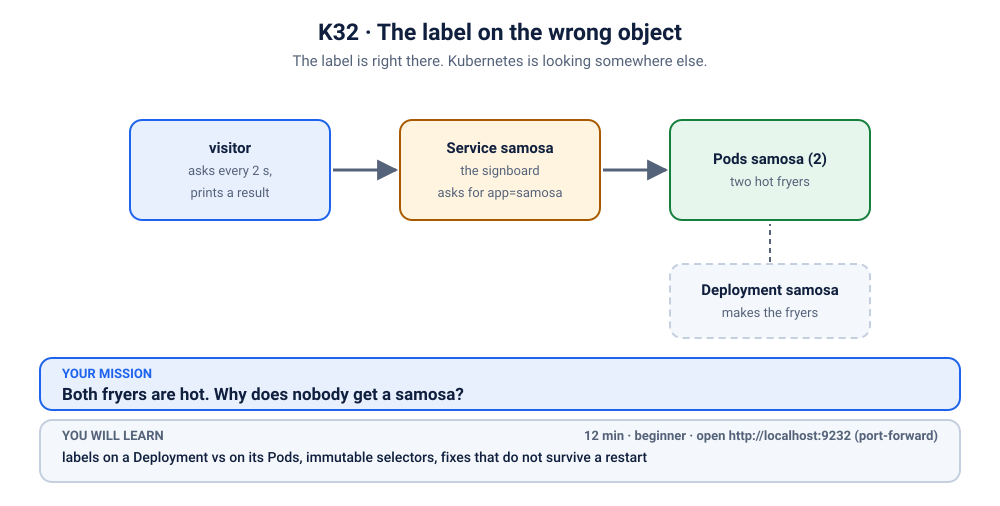
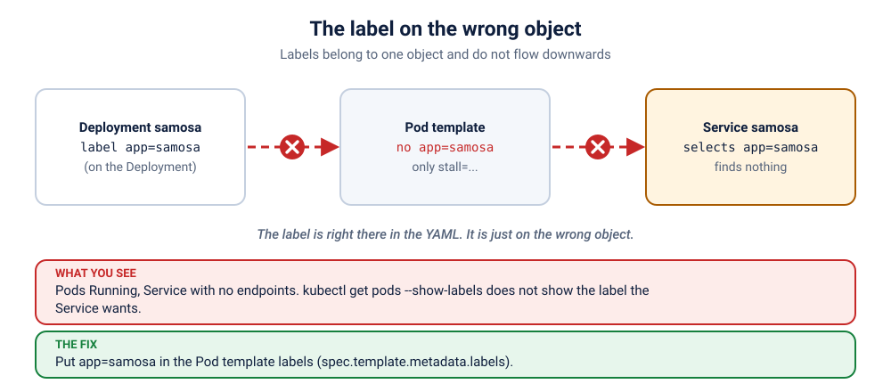

# K32 · The label on the wrong object

*The label is right there. Kubernetes is looking somewhere else.*

⏱ 12 min · beginner · Samosa stall (`hashicorp/http-echo`, about 17 MB) · labels on a Deployment vs on its Pods, immutable selectors, fixes that do not survive a restart

⬇️ First run downloads about 17 MB (the stall) plus a tiny 4 MB visitor image. A slow first download is normal: do it on good Wi-Fi, before the session.

Output columns and wording can differ a little between kubectl versions and clusters (kind, minikube, Docker Desktop, playgrounds). The ideas never change.

> 🧭 **Section 2, "Workloads".** Deployments and ReplicaSets: labels on the Deployment are not the labels on its Pods. Less hand-holding, and one trap that *looks* like it works.

## 📖 The story
Meera's samosa stall has two fryers (Pods) and one signboard (a Service). She did the sensible, tidy thing: she put the badge `app: samosa` on the Deployment. It is right there if you ask the Deployment. It is exactly what the signboard asks for.

And yet the stall is open, both fryers are hot, and the visitor is going hungry. It is a bit like hanging the "OPEN" sign on the licence in the drawer and wondering why nobody walks in.



## 🧠 The concept: why, what, how



Every Kubernetes object has its **own** labels. The labels on a Deployment describe the *Deployment*. The labels on a Pod describe the *Pod*. They are not shared, and a Deployment does **not** copy its labels onto its Pods.

- The Deployment stamps its Pods using the **Pod template** (`spec.template.metadata.labels`). Only those labels reach the Pods.
- A Service reads **Pods**, never Deployments.
- A Deployment's `spec.selector` must match its template labels (that is how it finds its own Pods). It **cannot be edited** after creation, but you *can* add more labels to the template.

```
 Deployment samosa   labels: app=samosa        ← the paperwork (the Service never reads this)
   └─ template labels: stall=samosa-fryer
        └─ Pod  labels: stall=samosa-fryer     ← what the Service actually sees
```

## 🔮 Predict first (60 seconds)
`kubectl get deployment samosa --show-labels` is going to show `app=samosa`, the exact label the Service wants.
1. Will the Service find its Pods? Yes or no, and why?
2. Which command would settle it in one line?

<details><summary>Check your prediction</summary>

No. The Service looks at the labels on the **Pods**, and a Deployment's own labels are not passed down. One line settles it: <code>kubectl get pods --show-labels</code>. Always look at the Pods, not at the thing that makes them.
</details>

## 💥 Break it
```bash
cd break && ./break.sh
```
```bash
kubectl logs -f visitor -n k-32-wrong-object
```
You should see ❌ lines saying nobody is serving samosas, while `kubectl get pods` insists the Pods are `Running` and `1/1`. Stop the log with Ctrl+C.

## 🔍 Investigate: you drive
No step list this time, just the questions a good engineer asks. Hints are there if you need them.

**Q1. Is the Service finding anything at all?**
<details><summary>💡 Hint</summary>

Services keep a list of the addresses they send traffic to:
```bash
kubectl get endpointslices -n k-32-wrong-object -l kubernetes.io/service-name=samosa
```
An empty `ENDPOINTS` column means the Service found no Ready Pod.
</details>

**Q2. What badge does the Service ask for, and what do the Pods actually wear?**
<details><summary>💡 Hint</summary>

```bash
kubectl get service samosa -n k-32-wrong-object -o wide
kubectl get deployment,pods -n k-32-wrong-object --show-labels
```
Compare the Service's `SELECTOR` with the labels on the **Pod** rows, not the Deployment row.
</details>

**Q3. Where did the right label end up, and why didn't it reach the Pods?**
<details><summary>💡 Hint</summary>

```bash
kubectl get deployment samosa -n k-32-wrong-object -o yaml
```
Find the two `labels:` blocks. One is under the top-level `metadata:`, the other is under `spec.template.metadata:`. Only the second one is copied onto Pods.
</details>

## 🪤 The tempting wrong fix: label the Pod by hand
This one *works*, which is exactly why it is dangerous. Try it.
```bash
POD=$(kubectl get pods -n k-32-wrong-object -l stall=samosa-fryer -o name | head -1)
kubectl label $POD -n k-32-wrong-object app=samosa
```
Check the visitor: it starts getting samosas. Victory? Now do what Kubernetes does every day, and replace the Pod:
```bash
kubectl delete $POD -n k-32-wrong-object
kubectl get pods -n k-32-wrong-object --show-labels
```
The replacement was stamped from the **template**, which still lacks the label. The fix vanished with the Pod. A fix that does not survive a restart is a loan, not a fix.

## 🩺 Root cause
<details><summary>Reveal after the room guesses</summary>

The label `app: samosa` was put on the Deployment object, but the Pod template only carries `stall: samosa-fryer`. Pods are stamped from the template, so they never get `app: samosa`, and the Service (which selects `app: samosa`) matches nothing. Labels are per object and do not flow downwards.
</details>

## 🔧 Fix it
```bash
cd ../fix && ./fix.sh
```
That adds `app: samosa` to the **Pod template** (the selector stays as it is, which is allowed) and the Deployment replaces the Pods one by one. By hand, there are two good options:
```bash
# Option A: teach the Pods the badge (edit spec.template.metadata.labels, add: app: samosa)
kubectl edit deployment samosa -n k-32-wrong-object

# Option B: ask for the badge the Pods already wear
kubectl patch service samosa -n k-32-wrong-object --type merge -p '{"spec":{"selector":{"stall":"samosa-fryer"}}}'
```
You will also find that you cannot "fix" the Deployment by editing its `spec.selector`: Kubernetes refuses, because that field is immutable.

## ✅ Verify it yourself
```bash
cd .. && ./check.sh
```
Then replay the trap from above: delete a Pod and confirm the replacement is still found. If it is, your fix survives restarts.

## 🎯 Key takeaways
- **Labels belong to one object each.** A Deployment's labels are not copied to its Pods.
- **Pods are stamped from `spec.template.metadata.labels`.** That is the only place that counts for the Service.
- **A Deployment's `spec.selector` is immutable**, but you can add labels to the template.
- **A manual `kubectl label pod` is temporary.** The next replacement Pod starts clean.

## 💎 Lifelong lesson
> Put the badge on the fryer, not on the licence in the drawer.

## 🏢 Where you'll meet this at work
- **Helm charts** where the top-level `labels` and the Pod template labels are written in two different places, and only one got updated (platform team).
- **Someone ran `kubectl label deployment …`** hoping it would reach the Pods (developer).
- **A hot-fix `kubectl label pod`** that "worked" until the next deploy wiped it (SRE, 2 AM).

## 🧹 Clean up
```bash
./cleanup.sh
```

## Next →
Next, in this section: [K15](../15-stall-that-opens-one-at-a-time/README.md): Three stalls were ordered. One opened. The other two are not even built.
