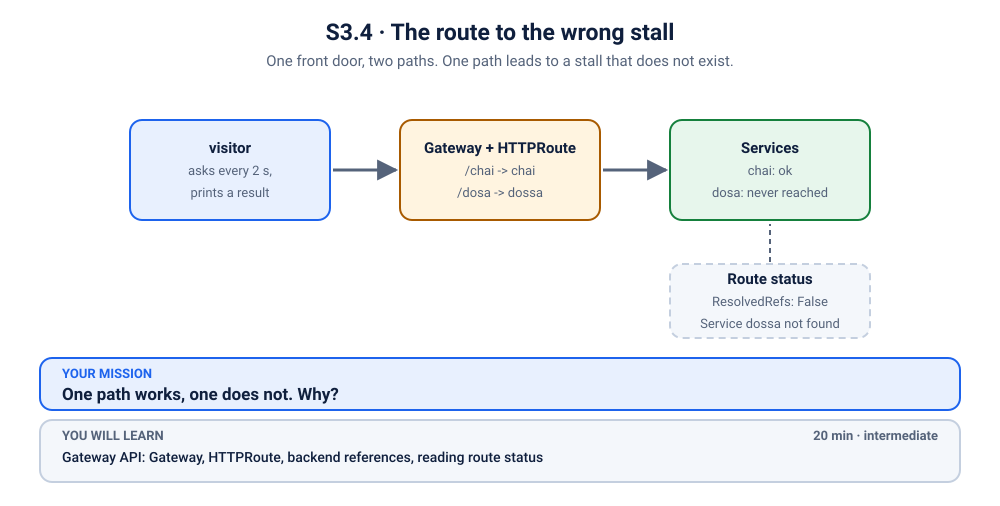

# K33 · Two bugs in one trench coat

*You fixed it. It is still broken. Welcome to the boss level.*

⏱ 15 min · intermediate · Canteen counter (`hashicorp/http-echo`, about 17 MB) · stacked faults, re-checking the symptom after every fix, Service `targetPort`, immutable selectors

⬇️ First run downloads about 17 MB (the counter) plus a tiny 4 MB visitor image. A slow first download is normal: do it on good Wi-Fi, before the session.

Output columns and wording can differ a little between kubectl versions and clusters (kind, minikube, Docker Desktop, playgrounds). The ideas never change.

> 🧭 **Practice lane: "Services find Pods".** The boss of the lane, after [K04](../04-it-tools-no-endpoints/README.md), [K31](../31-two-stalls-one-signboard/README.md) and [K32](../32-label-on-the-wrong-object/README.md). Nothing new to learn here: it is all about using what you already know, when there is more than one thing wrong.

## 📖 The story
Lakshmi runs the website for the college canteen counter. Last night two small changes were merged, by two well-meaning people, a few minutes apart. One of them made a typo in a label. The other "tidied up" a port number.

Each change alone is a one-line mistake. Together they make the best kind of puzzle: fix the first one, and the problem does not get better. It just gets *different*. The lemon rice is getting cold. Tick tock.

## 🏆 Boss rules
- **First 5 minutes: no hints.** You know enough already.
- **After every single change, check the symptom again** (the visitor log, not your confidence).
- `./check.sh` tells you, any time, whether you are done. It never changes anything.
- **Scoring (for fun):** gold = fixed in under 8 minutes with no hints, silver = under 15 minutes, bronze = you used the hints. Everyone still gets the lemon rice.



## 🧠 The concept
Nothing new, which is the point. A request to a Service has to get through **two doors**:
1. **Finding the Pods:** the Service's selector must match the Pods' labels (K04, K31, K32).
2. **Reaching the Pods:** the Service's `targetPort` must be the port the container really listens on (K05).

A Pod can be found and still be unreachable. Fix the first door, and you may only discover the second.

## 🔮 Predict first
Before you break it: how many separate things do you expect to be wrong? Write down a number.

<details><summary>Check your prediction</summary>

Don't take our word for it: you will count them yourself while investigating. (There are more than one, as the title suggests.)
</details>

## 💥 Break it
```bash
cd break && ./break.sh
```
```bash
kubectl logs -f visitor -n k-33-canteen
```
Expect ❌ lines: the counter is closed. Stop the log with Ctrl+C. Everything in the cluster says `Running`.

## 🔍 Investigate: you drive
Start with the question, then open a hint only if you have to. Each tier costs you a bit of gold.

**What is the first thing you would look at?**
<details><summary>💡 Tier 1: a nudge</summary>
The visitor cannot reach the canteen. A Service has two jobs: <em>find</em> Pods, and <em>reach</em> them. Which job is failing first? Is there anything behind the Service at all?
</details>
<details><summary>💡 Tier 2: the commands</summary>

```bash
kubectl get endpointslices -n k-33-canteen -l kubernetes.io/service-name=canteen
kubectl get service canteen -n k-33-canteen -o wide
kubectl get pods -n k-33-canteen --show-labels
```
Compare the Service's `SELECTOR` with the Pods' `LABELS`, character by character.
</details>
<details><summary>💡 Tier 3: the other bug</summary>

After you make the Service find its Pods, look again at the visitor log. Still ❌? Then the Service is finding the Pods but cannot *reach* them. Check the Service's `targetPort` against the port the container really listens on:
```bash
kubectl get service canteen -n k-33-canteen -o jsonpath='{.spec.ports[0].targetPort}{"\n"}'
kubectl get deployment canteen -n k-33-canteen -o jsonpath='{.spec.template.spec.containers[0].ports[0].containerPort}{"\n"}'
```
</details>

## 🪤 The tempting wrong fix: declare victory too early
Make the Service select the Pods' label (the quick way to get endpoints):
```bash
kubectl patch service canteen -n k-33-canteen --type merge -p '{"spec":{"selector":{"app":"cantene"}}}'
kubectl get endpointslices -n k-33-canteen -l kubernetes.io/service-name=canteen
```
Endpoints appear. It *feels* done. Now look at the visitor log: still ❌. The first bug was hiding the second one. **Always re-check the symptom, never the cause you just fixed.**

## 🩺 Root cause
<details><summary>Reveal after the room guesses</summary>

Two independent mistakes:
1. The Pods are labelled `app: cantene` (a typo), but the Service selects `app: canteen`. Nothing matches, so the Service has no endpoints.
2. The Service forwards to `targetPort: 8080`, but the container listens on `5678`. Even with the right label, every connection to the Pod is refused.

Because bug 1 produced "no endpoints", bug 2 was invisible until bug 1 was gone.
</details>

## 🔧 Fix it
```bash
cd ../fix && ./fix.sh
```
The reference fix corrects the label **at the source** (the Pod template) and the port. A Deployment's `spec.selector` cannot be edited, so the script deletes and recreates the Deployment. There is also a shortcut that works: point the Service at `app: cantene` and set its `targetPort` to `5678`. That fixes the symptom but leaves a typo in the Pods' label. Which would you rather find at 2 AM?

## ✅ Verify it yourself
```bash
cd .. && ./check.sh
```
Then glance at the visitor log: a stream of 🍛 means both doors are open.

## 🎯 Key takeaways
- **A Service can fail at two doors:** finding the Pods (selector) and reaching them (`targetPort`).
- **Faults stack.** Fixing one can reveal the next. After every change, re-check the symptom.
- **A Deployment's selector cannot be edited.** To fix a label at the source you recreate the Deployment.
- **Compare character by character.** `canteen` and `cantene` look identical at a glance.

## 💎 Lifelong lesson
> Fixing the first bug is not the same as fixing the problem.

## 🏢 Where you'll meet this at work
- **A deploy that "fixed" an incident and revealed another one** a minute later (everyone, eventually).
- **Two PRs merged close together**, each fine on its own (platform team).
- **Typos in labels and ports** after a copy-paste (developer, always).

## 🧹 Clean up
```bash
./cleanup.sh
```

## Next →
[K05](../05-excalidraw-wrong-port/README.md): revisit the second door on its own, with the whole story of `port` and `targetPort`.
