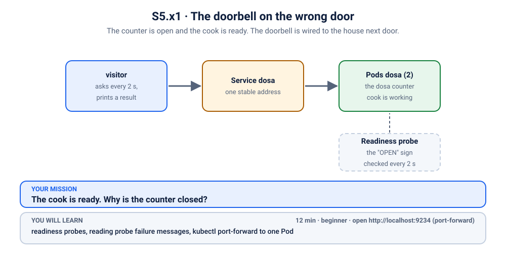
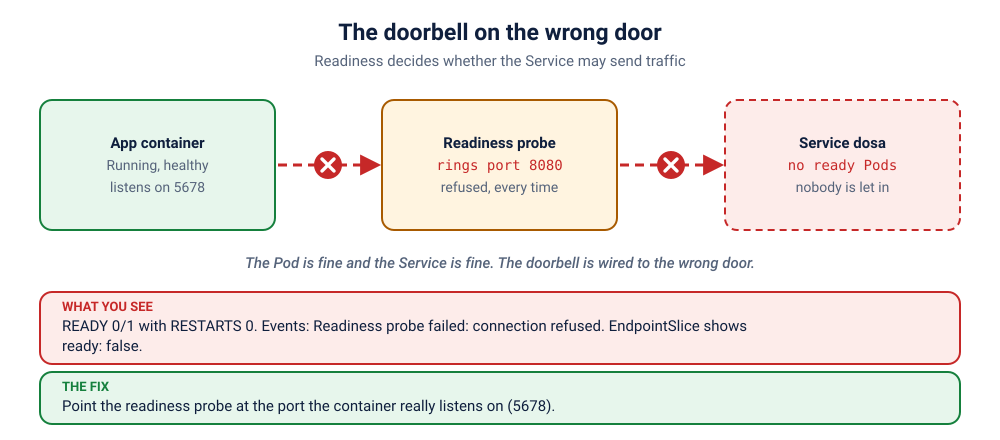

# K34 · The doorbell on the wrong door

*The counter is open and the cook is ready. The doorbell is wired to the house next door.*

⏱ 12 min · beginner · Dosa counter (`hashicorp/http-echo`, about 17 MB) · readiness probes, reading probe failure messages, `kubectl port-forward` to one Pod

⬇️ First run downloads about 17 MB (the counter) plus a tiny 4 MB visitor image. A slow first download is normal: do it on good Wi-Fi, before the session.

Output columns and wording can differ a little between kubectl versions and clusters (kind, minikube, Docker Desktop, playgrounds). The ideas never change.

> 🧭 **Practice lane: "Ready or alive?"** [K06](../06-kanboard-never-ready/README.md) and [K07](../07-showdown-slow-start/README.md) are the worked examples. This is practice problem 1 of 3: the same idea, a new twist, fewer hints. Then [K35](../35-biryani-that-needs-20-seconds/README.md), then the [K36](../36-two-probes-two-mistakes/README.md) boss.

## 📖 The story
Ravi runs the dosa counter's website. The cook is ready, the batter is perfect and the tawa is hot. But the counter keeps the "OPEN" sign switched off, and not because the cook says so. A little inspector (the **readiness probe**) knocks on a door every two seconds, to ask "may we send customers?", and gets no answer.

It is knocking on the right house, but the wrong door. Nobody told the inspector that the cook works in the back.



## 🧠 The concept: why, what, how



A **readiness probe** is the "OPEN" sign. Every few seconds the kubelet (the agent on each node) knocks on a door you described, a port and a path, and asks: "ready for customers?"

- **Yes:** the Pod is `Ready` and the Service sends it traffic.
- **No:** the Pod stays `Running` but not `Ready`, and the Service **leaves it out**. Nothing is restarted. The Pod just waits, and waits.
- A probe answers *only* for the door it knocks on. If you describe the wrong door, it will report "no answer" truthfully, forever.

```
 kubelet ──▶ knocks on  port 8080 ✗   (nobody there)      ──▶ not Ready ──▶ Service skips the Pod
              the app really listens on port 5678 ✔
```


## 🔮 Predict first (60 seconds)
The Pods are `Running`. Before you look:
1. Will the `RESTARTS` column go up?
2. Which column in `kubectl get pods` shows that something is wrong?

<details><summary>Check your prediction</summary>

1. No. A failing *readiness* probe never restarts anything. (A failing *liveness* probe does: that is K35.)
2. `READY`. It will say `0/1`: the container is running, but not ready.
</details>

## 💥 Break it
```bash
cd break && ./break.sh
```
```bash
kubectl logs -f visitor -n k-34-doorbell
```
Expect ❌ lines: the counter is closed. Stop with Ctrl+C. Note what is *not* happening: no crashes, no restarts, no angry red `Error`. It is a very quiet failure.

## 🔍 Investigate: you drive
Three questions. Try each yourself, and open a hint only when stuck.

**1. Are the Pods running? Are they ready?**
<details><summary>💡 Hint</summary>

```bash
kubectl get pods -n k-34-doorbell
```
Read `READY` and `RESTARTS` together.
</details>

**2. What does the cluster say when the inspector knocks?** Probe failures leave a note in the events, with their own reason.
<details><summary>💡 Hint 1</summary>
Events have a <em>reason</em> field, and <code>kubectl get events</code> can filter on it. The reason for a failed probe is <code>Unhealthy</code>.
</details>
<details><summary>💡 Hint 2: the command</summary>

```bash
kubectl get events -n k-34-doorbell --field-selector reason=Unhealthy
```
Read the message to the end. It tells you not only that the probe failed, but *how*. "Connection refused" means nothing was listening on that port. (Compare [K06](../06-kanboard-never-ready/README.md), where the message was a 404: the door existed, the page did not.)
</details>

**3. Is the app itself healthy? Prove it without trusting the probe.**
<details><summary>💡 Hint 1</summary>
You can talk to a single Pod directly, skipping the Service and the probe. Think about <code>port-forward</code>, but to a <em>Pod</em>, not a Service.
</details>
<details><summary>💡 Hint 2: the commands</summary>

```bash
POD=$(kubectl get pods -n k-34-doorbell -o name | grep dosa | head -1)
kubectl port-forward $POD -n k-34-doorbell 18080:5678
```
In a second terminal:
```bash
curl localhost:18080
```
You get a dosa. The app is perfectly fine and has been all along. Press Ctrl+C to stop the port-forward.
</details>

## 🪤 The tempting wrong fix: remove the probe
"If the probe is the problem, delete the probe." It does work: with no readiness probe, the Pods are `Ready` the moment they start, and the Service sends traffic.

But look at what you gave up. From now on, **every** deploy sends customers to Pods that are not ready yet. The probe was doing its job: it reported honestly that nothing answered on port 8080. The bug is the *address* you gave it, not the existence of the probe. Never shoot the inspector.

## 🩺 Root cause
<details><summary>Reveal after the room guesses</summary>

The readiness probe knocks on port `8080`, but the container listens on port `5678`. Every knock gets "connection refused", so the Pod is never marked Ready, and the Service never sends it traffic. Nothing is wrong with the app, the image or the Service.
</details>

## 🔧 Fix it
```bash
cd ../fix && ./fix.sh
```
That points the probe at port `5678`. By hand, it is a one-line change to the Deployment:
```bash
kubectl patch deployment dosa -n k-34-doorbell --type json \
  -p '[{"op":"replace","path":"/spec/template/spec/containers/0/readinessProbe/httpGet/port","value":5678}]'
```
Changing a probe changes the Pod template, so the Deployment replaces the Pods (a rolling update, just like a new release).

## ✅ Verify it yourself
```bash
cd .. && ./check.sh
```
A green message means both Pods are Ready and the Service has endpoints. The visitor log should fill with 🥞.

## 🎯 Key takeaways
- **A readiness probe decides whether a Pod gets customers.** Not ready means the Service leaves it out; it does not restart.
- **Read the probe's failure message to the end.** "Connection refused" means a wrong port, "404" means a wrong path.
- **`kubectl get events --field-selector reason=Unhealthy`** shows probe failures quickly.
- **`kubectl port-forward pod/…`** lets you test one Pod directly, to separate "the app is broken" from "the probe is wrong".

## 💎 Lifelong lesson
> A probe tells the truth about the door it knocks on, not the door you meant.

## 🏢 Where you'll meet this at work
- **A probe copied from another service** with a different port (developer).
- **A port changed in the container** and not in its probe, after a refactor (platform team).
- **"Everything is Running, nothing is Ready"** on a new deploy (SRE, every release).

## 🧹 Clean up
```bash
./cleanup.sh
```

## Next →
[K35](../35-biryani-that-needs-20-seconds/README.md): the biryani that takes 20 seconds, and a manager who gives up after 8 seconds.
