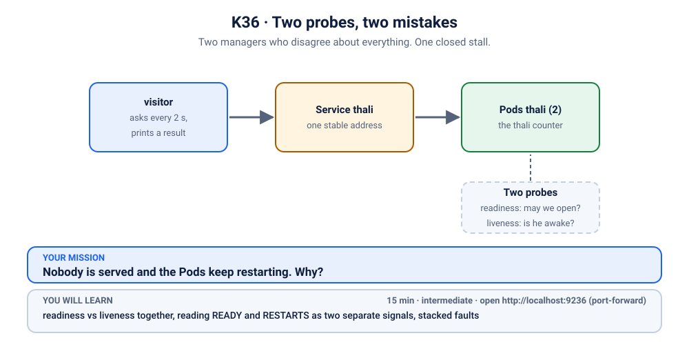

# K36 · Two probes, two mistakes

*Two managers who disagree about everything. One closed stall.*

⏱ 15 min · intermediate · Thali counter (`busybox`, about 4 MB, already on your machine from the other scenarios) · readiness vs liveness together, reading `READY` and `RESTARTS` as two separate signals, stacked faults

⬇️ Nothing big to download: this scenario reuses the 4 MB busybox image. A slow first pull is still normal.

Output columns and wording can differ a little between kubectl versions and clusters (kind, minikube, Docker Desktop, playgrounds). The ideas never change.

> 🧭 **Practice lane: "Ready or alive?"** The boss of the lane, after [K06](../06-kanboard-never-ready/README.md), [K07](../07-showdown-slow-start/README.md), [K34](../34-doorbell-on-the-wrong-door/README.md) and [K35](../35-biryani-that-needs-20-seconds/README.md). Nothing new to learn: use what you know when more than one thing is wrong.

## 📖 The story
The thali counter has two managers. One (the **readiness probe**) decides whether customers may be let in. The other (the **liveness probe**) decides whether the cook is awake, and replaces him if not.

Someone gave each manager the wrong instructions. One is told to check a page that does not exist. The other is told to knock on a door nobody answers. The result: customers are never let in, *and* the cook is replaced every few seconds. It is a very busy way to serve nothing.

## 🏆 Boss rules
- **First 5 minutes: no hints.** You have already met both probes.
- **Read two columns, not one.** `READY` and `RESTARTS` are answering different questions.
- **After every change, check the symptom again.** `./check.sh` tells you, any time, whether you are done.
- **Scoring (for fun):** gold = under 8 minutes, no hints; silver = under 15; bronze = you used the hints. Everyone still gets a thali.



## 🧠 The concept
Nothing new, which is the point. Two probes can fail **independently**, and each leaves a different fingerprint:

| What you see | Which probe | Because |
|---|---|---|
| `READY 0/1` | readiness | not ready, so the Service skips the Pod |
| `RESTARTS` climbing | liveness | not alive, so the container is replaced |

If both are wrong at once, you see both. And fixing one reveals the other.


## 🔮 Predict first
Before you break it: if both probes are wrong, and you fix **only** the liveness probe, what do you expect to see next? Write it down.

<details><summary>Check your prediction</summary>

The restarts stop, but the Pods stay `0/1`: the readiness probe is still wrong, so the stall is still closed. (You will see this happen for real.)
</details>

## 💥 Break it
```bash
cd break && ./break.sh
```
```bash
kubectl get pods -n k-36-two-probes -w
```
Watch `READY` and `RESTARTS` together. In another terminal:
```bash
kubectl logs -f visitor -n k-36-two-probes
```
Stop either with Ctrl+C.

## 🔍 Investigate: you drive
**What is the first thing you look at?**
<details><summary>💡 Tier 1: a nudge</summary>
Two columns, two stories. One says "not ready". The other says "restarted". Treat them as <em>two</em> problems.
</details>
<details><summary>💡 Tier 2: the commands</summary>

```bash
kubectl get events -n k-36-two-probes --field-selector reason=Unhealthy
kubectl get deployment thali -n k-36-two-probes -o jsonpath='{.spec.template.spec.containers[0].readinessProbe}{"\n"}{.spec.template.spec.containers[0].livenessProbe}{"\n"}'
```
The events name each probe separately. Compare each probe's path and port with what the app really serves: a page at `/` on port `8080`.
</details>
<details><summary>💡 Tier 3: the answers to look for</summary>

Readiness is asking for a path that returns **404**. Liveness is knocking on a port that returns **connection refused**. They are two different mistakes in two different probes.
</details>

## 🪤 The tempting wrong fix: fix only one
Fix just the liveness probe (the loud one, because of the restarts):
```bash
kubectl patch deployment thali -n k-36-two-probes --type json \
  -p '[{"op":"replace","path":"/spec/template/spec/containers/0/livenessProbe/httpGet/port","value":8080}]'
kubectl get pods -n k-36-two-probes -w
```
The restarts stop, and it *feels* like progress. But look at `READY`: still `0/1`. The quiet bug was hiding behind the loud one. **Always re-check the symptom you care about (can customers be served?), not just the one you just fixed.**

## 🩺 Root cause
<details><summary>Reveal after the room guesses</summary>

Two independent mistakes:
1. The **readiness** probe asks for `/ready`, a page that does not exist, so every check is a 404 and the Pod is never Ready.
2. The **liveness** probe knocks on port `8081`, where nothing listens, so every check is refused and the container is restarted every few seconds.
</details>

## 🔧 Fix it
```bash
cd ../fix && ./fix.sh
```
The reference fix corrects both: readiness asks for `/`, liveness uses port `8080`. By hand, that is two edits to the same Deployment.

## ✅ Verify it yourself
```bash
cd .. && ./check.sh
```
It checks that both Pods are Ready, then watches for 12 seconds to confirm there are no new restarts.

## 🎯 Key takeaways
- **`READY` and `RESTARTS` answer different questions.** Read both.
- **Two probes can be wrong at once**, and fixing one reveals the other.
- **After every change, re-check the real symptom** (can customers be served?).
- **Probes should describe the app as it really is**: the right port and a page that exists.

## 💎 Lifelong lesson
> Two managers need two instructions, and two checks.

## 🏢 Where you'll meet this at work
- **Copy-pasted probe blocks** where one value was edited and the other was forgotten (developer).
- **A new health endpoint** added to the app, but the probes still point at the old one (platform team).
- **Two PRs touching the same Deployment**, each fine alone (everyone).

## 🧹 Clean up
```bash
./cleanup.sh
```

## Next →
Back to [K06](../06-kanboard-never-ready/README.md) and [K07](../07-showdown-slow-start/README.md), the two worked examples, with fresh eyes. Or carry on with the rest of the [scenarios](../README.md).
