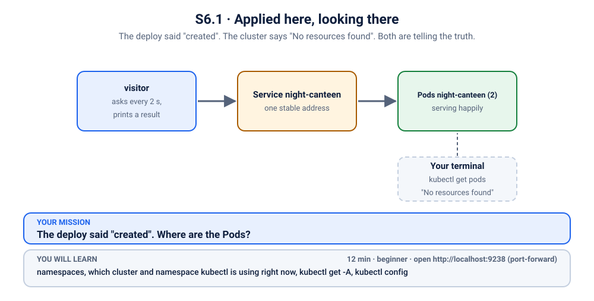

# K38 · Applied here, looking there

*The deploy said "created". The cluster says "No resources found". Both are telling the truth.*

⏱ 12 min · beginner · Night canteen (`hashicorp/http-echo`, about 17 MB) · namespaces, which cluster and namespace kubectl is using right now, `kubectl get -A`, `kubectl config`

⬇️ First run downloads about 17 MB (the canteen) plus a tiny 4 MB visitor image. A slow first download is normal: do it on good Wi-Fi, before the session.

Output columns and wording can differ a little between kubectl versions and clusters (kind, minikube, Docker Desktop, playgrounds). The ideas never change.

> 🧭 **New topic: where am I?** The most common beginner mistake, and the most dangerous expert one. Heads up: this scenario's fix changes your kubeconfig's *current namespace*. `./cleanup.sh` puts it back, and only if this scenario was the one that changed it.

## 📖 The story
Lakshmi runs the late-night canteen's website. She copies a manifest from a teammate and runs `kubectl apply`. The answer: `deployment.apps/night-canteen created`. Lovely.

She runs `kubectl get pods`. The answer: `No resources found in default namespace.` She runs `kubectl apply` again. The answer: `unchanged`. Kubernetes insists it exists. Kubernetes also insists it does not. She starts to suspect the cluster is haunted.

It is not haunted. It is serving customers right now, perfectly happily, in the next room.



## 🧠 The concept: why, what, how
Every `kubectl` command is aimed by two things:
- the **context**: *which cluster* (and which user) you are talking to;
- the **namespace**: *which room inside that cluster* you are looking in.

Objects live in a namespace, and `kubectl get pods` looks **only in your current namespace** (usually `default`). A manifest can name its own `namespace:` and then ignores where you happen to be looking. So you can create something in one room and search for it in another, and both commands are correct.

```
 kubectl apply   ──▶ namespace written in the manifest   ← where it was created
 kubectl get     ──▶ your current namespace (default)     ← where you looked
```


## 🔮 Predict first (60 seconds)
The night canteen is serving visitors right now. You are about to run two plain commands:
```bash
kubectl get pods
kubectl logs visitor
```
What will each one say?

<details><summary>Check your prediction</summary>

The first says something like `No resources found`, and the second says the Pod `visitor` was not found. Both are true *for the namespace you are in*. The Pods exist, in another one.
</details>

## 💥 Break it
```bash
cd break && ./break.sh
```
Now do what Lakshmi did, with no `-n` at all:
```bash
kubectl get pods
```
Nothing. Yet the canteen is alive.

## 🔍 Investigate: you drive
**Q1. Where am I actually looking?** Which cluster, and which namespace?
<details><summary>💡 Hint</summary>

```bash
kubectl config current-context
kubectl config view --minify -o jsonpath='{..namespace}{"\n"}'
```
An empty second answer means `default`.
</details>

**Q2. Is the canteen anywhere in this cluster?** One flag searches every namespace.
<details><summary>💡 Hint</summary>

```bash
kubectl get deployments -A
```
`-A` means all namespaces. Look for `night-canteen`, and read the `NAMESPACE` column.
</details>

**Q3. Prove it is alive, without moving.**
<details><summary>💡 Hint</summary>

Use the namespace you just found:
```bash
kubectl get pods -n k-38-night-canteen
kubectl logs visitor -n k-38-night-canteen --tail=3
```
The visitor log should show the canteen answering. Everything is fine, you were just looking in the wrong room.
</details>

## 🪤 The tempting wrong fix: apply it again, "here"
"If it is not in `default`, I will apply it into `default`."
```bash
kubectl apply -f app.yaml -n default
```
(run this from inside the `break` folder). Kubernetes **refuses**, with an error saying the namespace from the provided object does not match the namespace `default`. The manifest names its own namespace, and Kubernetes catches the conflict instead of silently making a second copy somewhere else. Good. Read errors like this one to the end: they usually tell you exactly what is wrong.

## 🩺 Root cause
<details><summary>Reveal after the room guesses</summary>

The manifest says `namespace: k-38-night-canteen`, so the Deployment was created there. Lakshmi's `kubectl` was looking in `default`, which has nothing in it. Nothing is wrong with the canteen, the Service or the cluster: she was applying and looking in two different places.
</details>

## 🔧 Fix it
Make plain `kubectl` commands look in the canteen's namespace:
```bash
cd ../fix && ./fix.sh
```
By hand, that is:
```bash
kubectl config set-context --current --namespace=k-38-night-canteen
```
Now a plain `kubectl get pods` shows the canteen. You have a few other good options, depending on the day:
- `kubectl get pods -n k-38-night-canteen` for a one-off look.
- `kubectl get pods -A` to search everywhere.
- A prompt that always shows the current context and namespace, or a tool such as `kubens`.

## ✅ Verify it yourself
```bash
cd .. && ./check.sh
kubectl get pods
```
Run the plain `kubectl get pods` again. This time you see the canteen's two Pods.

## 🎯 Key takeaways
- **Every kubectl command is aimed by a context (which cluster) and a namespace (which room).**
- **`kubectl get` looks only in your current namespace.** `-n <name>` picks another, `-A` searches all.
- **A manifest can name its own namespace**, and then ignores where you are looking.
- **Before you apply or delete anything, check `kubectl config current-context`.** The most dangerous kubectl mistake is being on the wrong cluster.

## 💎 Lifelong lesson
> Before you debug the cluster, check which cluster, and which room.

## 🏢 Where you'll meet this at work
- **A copied manifest** with a hard-coded `namespace:` (developer, weekly).
- **Several clusters in one kubeconfig** (staging and production), and a command run on the wrong one (everyone, once).
- **Helm releases** installed into a namespace you forgot to look in (platform team).

## 🧹 Clean up
```bash
./cleanup.sh
```
It also puts your context's namespace back, but only if it was left pointing at this scenario's namespace.

## Next →
[K39](../39-robot-that-cannot-move-the-stalls/README.md): the maintenance robot is refused, every single night.
