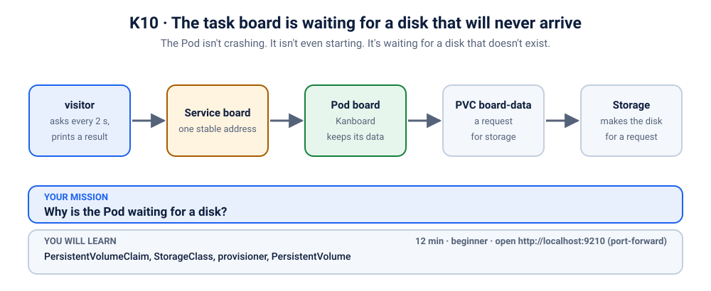
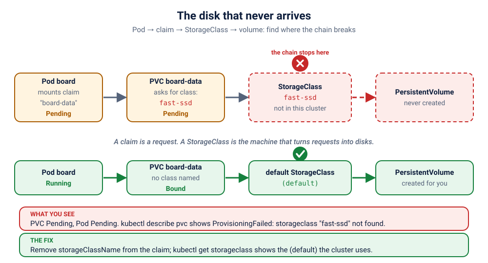

# S4.3 · The task board is waiting for a disk that will never arrive

*The Pod isn't crashing. It isn't even starting. It's waiting for a disk that doesn't exist.*

⏱ 12 min · beginner · Kanboard (`kanboard/kanboard`, about 33 MB) · PersistentVolumeClaim, StorageClass, provisioner, PersistentVolume

⬇️ The tiny 4 MB visitor image downloads when you break it. The Kanboard image (about 33 MB) downloads only at fix time, because the board Pod never starts while it is broken. On a cold cluster the fix moment waits on that download (up to a minute or two). Presenters: preload it (`kubernetes/scenarios/preload.sh`) or run the scenario once before class, on good Wi-Fi.

Output columns and wording can differ a little between kubectl versions and clusters (kind, minikube, Docker Desktop, playgrounds). The ideas never change.

## 📖 The story
Ravi's team runs a Kanboard (a Trello-style task board) for the hackathon, and it keeps every task on a disk so nothing is lost on restart. The manifests were copied straight from the company's cloud cluster, where the disk type is called `fast-ssd`. On the laptop cluster the deploy "works": no error message, nothing red. But the Pod never starts, and the board never opens.



## 🧠 The concept: why, what, how
A container's own filesystem disappears when the container does. To keep data, Kubernetes separates *asking for a disk* from *making a disk*:

- **PersistentVolumeClaim (PVC):** your request, "I need 1 GiB of disk." Think of filling in a hostel room-request form.
- **StorageClass:** the kind of disk you want ("fast-ssd", "standard"). Think of the room type on the form: single, double.
- **Provisioner:** the storage driver behind a StorageClass. When a PVC names a class, the provisioner creates the real disk, a **PersistentVolume (PV)**, and the PVC becomes `Bound`.
- If you name **no** class, the cluster's **default** StorageClass is used (marked `(default)` in `kubectl get storageclass`).
- Some classes use **WaitForFirstConsumer**: the disk is created only when a Pod that uses the PVC is scheduled. A PVC sitting `Pending` with *no* class problem can be perfectly normal until the Pod shows up.

```
 Pod ──▶ PVC "board-data" ──▶ StorageClass "fast-ssd" ──▶ provisioner ──▶ PV (the real disk)
                              does not exist here  ✗  the chain stops here
```

## 🏢 Where you'll meet this at work
- **Copying manifests between clouds.** `gp3` on AWS, `premium-rwo` on GKE, `managed-csi` on Azure, `standard` on a laptop: a manifest that names one fails on the others (developer, platform team).
- **Restoring a backup into a new cluster.** The PVCs come back naming a class the new cluster doesn't have (SRE).
- **A database that "won't start" after a migration.** The Pod is Pending, so there are no logs to read: the answer is in the PVC (on-call).

## 💥 Break it
```bash
cd break && python3 run.py
```
What the room should see: the script finishes happily and says the board is waiting for a disk. Nothing crashed. A small `visitor` Pod, which asks for the board every 2 seconds, never gets an answer:
```bash
kubectl logs -f visitor -n k-10-pvc-pending
```
```
❌ 05:00:54 no answer from http://board
❌ 05:00:57 no answer from http://board
```
You can stop it with Ctrl+C. We'll watch it again live when we fix things.

## 🔮 Predict first (60 seconds)
A Pod needs a disk that cannot be provided. Before you look:
1. What will the Pod's status be?
2. Where will you find the real reason?

<details><summary>Check your prediction</summary>

1. `Pending`.
2. On the **PVC**, not the Pod: `kubectl describe pvc`.
</details>

## 🔍 Investigate
Guess first, then run these **in order**. The visitor's log already told us the symptom: nobody is served.

**1. Is the Pod OK?** Always start with the Pods.
```bash
kubectl get pods -n k-10-pvc-pending
```
```
NAME                     READY   STATUS    RESTARTS   AGE
board-5679595f5f-g4xb6   0/1     Pending   0          3s
visitor                  1/1     Running   0          3s
```
(Ages and Pod names will differ.) The `board` Pod is **Pending** with 0 restarts: it has not even been placed on a node, so there is no container and no log to read.

<details><summary>💡 Hint</summary>
Compare with <a href="../02-image-typo/README.md">S1.2</a> and <a href="../03-showdown-crashloop/README.md">S1.3</a>: there the container at least tried to start. Here the Pod is stuck <i>before</i> that, waiting for something it needs. What does a Pod need before it can be placed? Look at what the Pod says it is waiting for.
</details>

**2. What is it waiting for?** `describe` shows the events: the scheduler explains why it can't place the Pod.
```bash
kubectl describe pod -n k-10-pvc-pending -l app=board | grep -A6 "^Events"
```
```
Events:
  Type     Reason            Age   From               Message
  ----     ------            ----  ----               -------
  Warning  FailedScheduling  3s    default-scheduler  0/3 nodes are available: pod has unbound immediate PersistentVolumeClaims. preemption: 0/3 nodes are available: 3 Preemption is not helpful for scheduling.
```
(The node count and exact wording vary by cluster and version.) "Unbound PersistentVolumeClaims": the Pod needs a disk, and its disk request has not been granted. The `Volumes:` section of the same `describe` names the request, `ClaimName: board-data`.

**3. What state is the disk request in?** Follow the chain one link: Pod → PVC.
```bash
kubectl get pvc -n k-10-pvc-pending
```
```
NAME         STATUS    VOLUME   CAPACITY   ACCESS MODES   STORAGECLASS   VOLUMEATTRIBUTESCLASS   AGE
board-data   Pending                                      fast-ssd       <unset>                 3s
```
`STATUS` is **Pending**, `VOLUME` is empty (no real disk was made), and the request names a `STORAGECLASS` called **fast-ssd**.

**4. Why is it still Pending?** Next link: ask the PVC itself.
```bash
kubectl describe pvc board-data -n k-10-pvc-pending | grep -A5 "^Events"
```
```
Events:
  Type     Reason              Age              From                         Message
  ----     ------              ----             ----                         -------
  Warning  ProvisioningFailed  1s (x2 over 3s)  persistentvolume-controller  storageclass.storage.k8s.io "fast-ssd" not found
```
(Exact wording can differ a little between clusters.) There is no StorageClass called `fast-ssd` here. Which ones does this cluster have?

**5. What classes exist in this cluster?** Last link: list the StorageClasses.
```bash
kubectl get storageclass
```
```
NAME                 PROVISIONER             RECLAIMPOLICY   VOLUMEBINDINGMODE      ALLOWVOLUMEEXPANSION   AGE
standard (default)   rancher.io/local-path   Delete          WaitForFirstConsumer   false                  4h46m
```
(The name differs per cluster: `standard` on kind and minikube, `hostpath` on Docker Desktop, `local-path` on Killercoda. Look for the one marked `(default)`.) There is no `fast-ssd`; there is a default.

## 🪤 The tempting wrong fix: delete the Pod
"Maybe the Pod is stuck."
```bash
kubectl delete pods -n k-10-pvc-pending -l app=board
kubectl get pods,pvc -n k-10-pvc-pending
```
The new Pod waits for the same claim, and the claim is still `Pending`. The Pod is only a passenger: the problem is further down the chain.

## 🩺 Root cause
<details><summary>Reveal after the room guesses</summary>

The PVC `board-data` asks for `storageClassName: fast-ssd`, a class that exists in the company's cloud cluster but not in this one. With no such class, no provisioner will ever create the disk, so the PVC stays `Pending` forever, and a Pod that needs the PVC can never be scheduled. Nothing is wrong with Kanboard, the image or the cluster. The chain Pod → PVC → StorageClass stops at the StorageClass.


</details>

## 🔧 Fix it
Before you run it, open a **second terminal** and start the live visitor log, so the room sees red turn green:
```bash
kubectl logs -f visitor -n k-10-pvc-pending
```
Then, in the first terminal:
```bash
cd ../fix && python3 run.py
```
Within about twenty seconds once Kanboard is downloaded (the first time, up to a minute or two) the log flips from ❌ to ✅ lines (Ctrl+C to stop it):
```
❌ 05:01:06 no answer from http://board
❌ 05:01:09 no answer from http://board
✅ 05:01:11 HTTP 200
✅ 05:01:13 HTTP 200
```
(shortened.) What changed:
```bash
diff ../break/app.yaml app.yaml
```
```
10d9
<   storageClassName: fast-ssd
```
One line of config is gone (plus the header comment): with no `storageClassName`, the cluster's default class is used. But you can't just `kubectl apply` that: a PVC's spec is **immutable** (Kubernetes refuses to change the class of an existing PVC). So `fix.sh` deletes the Deployment (a PVC that a Pod uses is protected and would hang in `Terminating`), then deletes the PVC, then applies the corrected file, which creates a new PVC and a new Pod. If your default class uses WaitForFirstConsumer (as on kind), the new PVC may show `Pending` for a moment: that is normal, it binds as soon as the Pod is scheduled.

By hand (this replaces `./fix.sh`, so you don't need to run both): from the `fix` folder,
```bash
kubectl delete deployment board -n k-10-pvc-pending
kubectl delete pvc board-data -n k-10-pvc-pending
kubectl apply -f app.yaml
kubectl rollout status deployment/board -n k-10-pvc-pending --timeout=180s
```

## ✅ Verify it yourself
Short on time? `cd .. && ./check.sh` says in one line whether you are done. It only looks, it never changes anything. The steps below show you *why* it says so.

```bash
kubectl get pods,pvc -n k-10-pvc-pending
```
```
NAME                         READY   STATUS    RESTARTS   AGE
pod/board-5679595f5f-jhfrm   1/1     Running   0          13s
pod/visitor                  1/1     Running   0          26s

NAME                               STATUS   VOLUME                                     CAPACITY   ACCESS MODES   STORAGECLASS   VOLUMEATTRIBUTESCLASS   AGE
persistentvolumeclaim/board-data   Bound    pvc-39311f64-1d64-4986-b656-5ed416cdd990   1Gi        RWO            standard       <unset>                 13s
```
(Names, volume ids and ages will differ. If you run this very early, the PVC may still say `Pending` until the Pod is scheduled: that is WaitForFirstConsumer, run it again.) The Pod is `1/1`, and the PVC is **Bound** to a real volume, using the default class. Kanboard keeps its data in that volume; check that its database lives there:
```bash
kubectl exec -n k-10-pvc-pending deploy/board -- ls /var/www/app/data
```
```
db.sqlite
```
The visitor's log is green (if you still see a ❌, wait a few seconds and run it again):
```bash
kubectl logs visitor -n k-10-pvc-pending --tail=3
```
```
✅ 05:01:27 HTTP 200
✅ 05:01:29 HTTP 200
✅ 05:01:31 HTTP 200
```
Now open it yourself. In a **second terminal** (leave it running):
```bash
kubectl port-forward -n k-10-pvc-pending svc/board 9210:80
```
```
Forwarding from 127.0.0.1:9210 -> 80
Forwarding from [::1]:9210 -> 80
```
On a playground, add `--address 0.0.0.0` and open the URL for port 9210.
Back in the first terminal:
```bash
curl -s localhost:9210/healthcheck.php; echo
```
```
{"status":200,"message":"Database connection is OK"}
```
(The port-forward terminal also prints `Handling connection for 9210`.) Or open http://localhost:9210 in your browser. Kanboard's login is `admin` / `admin`: change it on any real board. Press Ctrl+C in the second terminal to stop the port-forward.

## 👀 See it in monitoring (optional)
If you installed the monitoring stack ([lab K19](../../../19-observability/README.md)), watch a disk that is never granted as a number. In Prometheus (`kubectl port-forward -n monitoring svc/kube-prometheus-stack-prometheus 9090:9090`, then http://localhost:9090) run:
```
kube_persistentvolumeclaim_status_phase{namespace="k-10-pvc-pending",phase="Pending"} == 1
```
The claim is Pending and the Pod waits for it. `kube_persistentvolumeclaim_info` lists the StorageClass the claim asked for.

## 🎯 Key takeaways
- **A PVC is a request, a StorageClass is the menu, a provisioner makes the disk.** If the class doesn't exist, nothing is ever made.
- **A Pending Pod with no logs: look at what it is waiting for.** `describe pod` names the PVC; `describe pvc` names the missing class.
- **StorageClass names differ per cluster and cloud.** Leave `storageClassName` out to get the default, or parameterise it per environment.
- **A PVC's spec is immutable:** to change the class you delete and re-create it (and the Pod that uses it goes first).
- Debug path: `get pods` (Pending) → `describe pod` (unbound PVC) → `get pvc` → `describe pvc` (class not found) → `get storageclass` (which one is the default?).

## 💎 Lifelong lesson
> Follow the chain: Pod → PVC → StorageClass. The break is where the chain stops.

## 🧹 Clean up
Press Ctrl+C in the port-forward terminal first, then:
```bash
cd .. && ./cleanup.sh
```

## 🧪 Quick recap (3 questions)
1. What is the chain from a Pod to a real disk?
2. Which command shows why a PVC is `Pending`?
3. What happens if a claim names no `storageClassName`?

<details><summary>Answers</summary>

1. Pod → PersistentVolumeClaim → StorageClass → PersistentVolume.
2. `kubectl describe pvc` (the Events).
3. The cluster's default StorageClass is used.
</details>

## Next →
Next, in this section: [S4.4](../4-leaderboard-bot-forbidden/README.md): The bot has a valid ID card. The API still says: not allowed.
