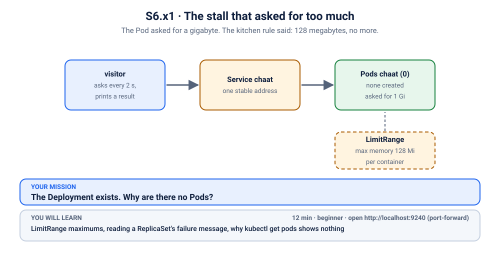

# K40 · The stall that asked for too much

*The Pod asked for a gigabyte. The kitchen rule said: 128 megabytes, no more.*

⏱ 12 min · beginner · Chaat stall (`http-echo`, 17 MB) · `LimitRange` maximums, reading a ReplicaSet's failure message, why `kubectl get pods` shows nothing

⬇️ Nothing big: the 17 MB `hashicorp/http-echo` image and the 4 MB busybox visitor. A slow first pull is normal.

Output columns and wording can differ a little between kubectl versions and clusters (kind, minikube, Docker Desktop, playgrounds). The ideas never change.

> 🧭 **Practice lane: "Resources"**, after [K08](../08-ai-trainer-oomkilled/README.md) and [K20](../20-surprise-limitrange-oom/README.md). Guided: questions and a hint ladder. Next up: [K41](../41-autoscaler-pointing-at-nobody/README.md).

## 📖 The story
The market has a house rule, pinned on the kitchen wall by the market committee: *no stall may take more than 128 MB of the shared counter space*. A new chaat stall owner, hoping for a busy festival weekend, writes "1 Gi" on the form. Why not? More is better.

The committee does not shout. It just never lets the stall open. The form was filed, the Deployment says "created", and `kubectl get pods` shows nothing at all. A visitor stands outside, asking for chaat every two seconds.

## 🏆 Rules of this one
- **Say your prediction out loud first.**
- **Hint ladder:** open one tier at a time, only when stuck.
- **There is no Pod to look at.** Whatever is wrong happened one level above the Pod.



## 🧠 The concept
A **`LimitRange`** is a rule for one namespace: "no single container may ask for more than X" (a `max`), "at least Y" (a `min`), and sensible defaults. It is checked when a Pod is **created**, by the API server. If a Pod breaks the rule it is never created at all.

So the Deployment cannot make Pods, and the object that tells you why is the **ReplicaSet** between them, in its `ReplicaFailure` condition and its events. Compare with [K19](../19-hackathon-quota/README.md), the same "created nothing" mystery, with a different rule.

## 🔮 Predict first
Before you break it: the chaat stall is refused. Will `kubectl get pods` show a Pod in some error state, or nothing? Write it down.

<details><summary>Check your prediction</summary>

Nothing. The Pod was never created, so there is no Pod to be in an error state. The refusal is recorded on the ReplicaSet.
</details>

## 💥 Break it
```bash
cd break && ./break.sh
```
```bash
kubectl get deployment,pods -n k-40-limit-max
kubectl logs -f visitor -n k-40-limit-max
```
Stop the logs with Ctrl+C.

## 🔍 Investigate: you drive
**What is the first thing you look at?**
<details><summary>💡 Tier 1: a nudge</summary>
The Deployment wants 2 Pods and has 0. Who creates Pods for a Deployment? Look one level down.
</details>
<details><summary>💡 Tier 2: the commands</summary>

```bash
kubectl get rs -n k-40-limit-max
kubectl describe rs -n k-40-limit-max | tail -n 15
kubectl describe limitrange -n k-40-limit-max
```
</details>
<details><summary>💡 Tier 3: the answers to look for</summary>

The ReplicaSet's events say `maximum memory usage per Container is 128Mi, but limit is 1Gi`. The `LimitRange` named `stall-limits` sets `max: memory: 128Mi`. The stall asked for `limits.memory: 1Gi`.
</details>

## 🪤 The tempting wrong fix
Ask the committee to remove the rule (`kubectl delete limitrange stall-limits`). The stall opens, and the rule, which exists for everyone else, is gone. `check.sh` notices and says no. **Fix the request, not the rule**, unless the rule itself is wrong and its owner agrees.

## 🩺 Root cause
<details><summary>Reveal after the room guesses</summary>

The Deployment asks for `limits.memory: 1Gi`, above the namespace maximum of `128Mi`. The API server refuses every Pod the ReplicaSet tries to create, so there are no Pods and no Pod events. The message lives on the ReplicaSet.
</details>

## 🔧 Fix it
```bash
cd ../fix && ./fix.sh
```
The reference fix sets the limit to `128Mi`. By hand: `kubectl edit deployment chaat -n k-40-limit-max` and lower `resources.limits.memory`.

## ✅ Verify it yourself
```bash
cd .. && ./check.sh
```
It checks that the rule is still in place and both Pods are Ready.

## 🎯 Key takeaways
- **A Deployment with 0 Pods and no Pod errors?** Look at the ReplicaSet.
- **A `LimitRange` is checked when a Pod is created.** Refusal means no Pod at all.
- **Fix the request, not the rule.** Rules exist for everyone in the namespace.

## 💎 Lifelong lesson
> The rule is for everyone; the request is for you.

## 🏢 Where you'll meet this at work
- **A new team's namespace** with a LimitRange, and a Helm chart whose defaults are too big (platform team).
- **Copying production limits** into a dev namespace (developer).

## 🧹 Clean up
```bash
./cleanup.sh
```

## Next →
Next in the lane: [K41](../41-autoscaler-pointing-at-nobody/README.md).
