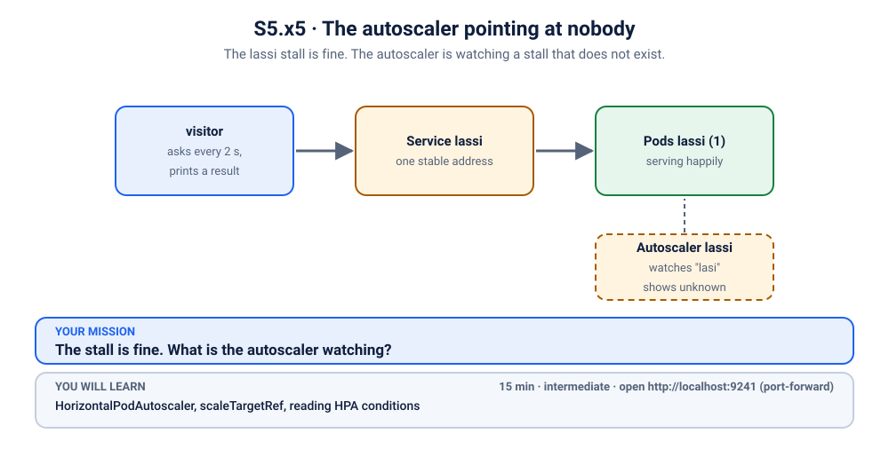
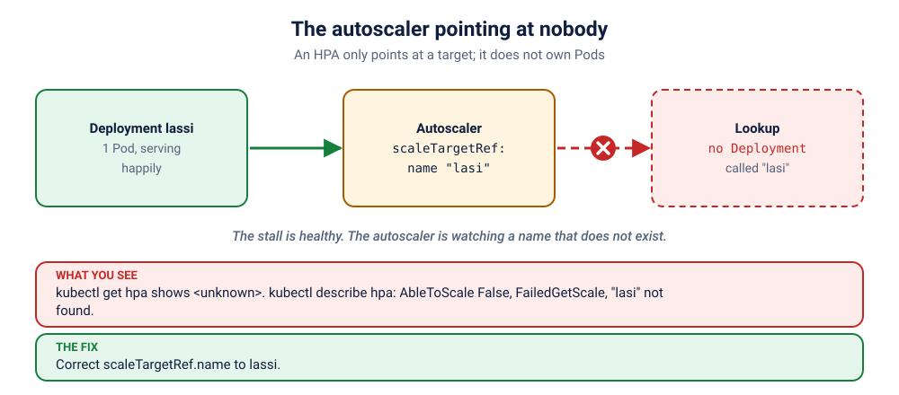

# K41 · The autoscaler pointing at nobody

*The lassi stall is fine. The autoscaler is watching a stall that does not exist.*

⏱ 15 min · intermediate · Lassi stall (`http-echo`, 17 MB) · `HorizontalPodAutoscaler`, `scaleTargetRef`, reading HPA conditions

⬇️ Nothing big: the 17 MB `hashicorp/http-echo` image and the 4 MB busybox visitor. A slow first pull is normal. This scenario does not need metrics-server; the autoscaler's complaint is about its target, which you can read without one.

Output columns and wording can differ a little between kubectl versions and clusters (kind, minikube, Docker Desktop, playgrounds). The ideas never change.

> 🧭 **Practice lane: "Resources"**, after [K25](../25-showdown-hpa-not-scaling/README.md). Mostly solo: questions only. Previous: [K40](../40-stall-that-asked-for-too-much/README.md). Next: [K42](../42-who-gets-evicted-first/README.md).

## 📖 The story
The lassi stall is doing fine. To handle the festival rush, its owner hired an **autoscaler**, a manager who adds helpers when the queue grows. The manager has a clipboard with the name of the stall to watch. The name on the clipboard is spelled wrong by one letter.

The manager does not shout, does not quit. They just stand there, watching a stall that does not exist, and report `<unknown>` all day. Meanwhile the real stall serves happily, so nobody notices until the rush.

## 🏆 Rules of this one
- **The stall is healthy.** The visitor shows ✅ the whole time. Do not hunt for a problem in the Pods.
- **Questions only.** Predict, investigate, fix. Hint ladder at the end of the section if you are stuck.



## 🧠 The concept



An **HPA** has a `scaleTargetRef`: the *kind* and *name* of the thing to scale. It never owns Pods. It looks up the target, reads its Pods' CPU, and changes `replicas`. If the name is wrong, the HPA cannot find anything to scale, and it says so in its **conditions** (`AbleToScale: False`, reason `FailedGetScale`).

In [K25](../25-showdown-hpa-not-scaling/README.md) the target was right and the *numbers* were missing. Here the numbers do not matter yet: there is nothing to read them from.

## 🔮 Predict first
The stall is healthy and serving. Is the autoscaler's `TARGETS` column going to show a number or `<unknown>`? Is the *stall* affected? Write it down.

<details><summary>Check your prediction</summary>

`<unknown>`, and the stall is not affected at all. The autoscaler failing to find its target does not harm the app. It only means nothing will ever scale it.
</details>

## 💥 Break it
```bash
cd break && ./break.sh
```
```bash
kubectl get hpa,deployment -n k-41-hpa-target
kubectl logs -f visitor -n k-41-hpa-target
```
Stop the logs with Ctrl+C.

## 🔍 Investigate: you drive
**What is the first thing you look at?**
<details><summary>💡 Tier 1: a nudge</summary>
Read the autoscaler's own words. `describe` prints its **Conditions** and recent events.
</details>
<details><summary>💡 Tier 2: the commands</summary>

```bash
kubectl describe hpa lassi -n k-41-hpa-target
kubectl get hpa lassi -n k-41-hpa-target -o jsonpath='{.spec.scaleTargetRef}{"\n"}'
kubectl get deployment -n k-41-hpa-target
```
</details>
<details><summary>💡 Tier 3: the answers to look for</summary>

The condition `AbleToScale` is `False` with reason `FailedGetScale`: `deployments/scale.apps "lasi" not found`. Compare the name in `scaleTargetRef` with the Deployment's real name: `lasi` vs `lassi`.
</details>

## 🪤 The tempting wrong fix
Add `--min` / `--max` changes, bigger limits, or install a metrics-server. None of it helps: the autoscaler cannot find its target, so every other setting is irrelevant. **Fix the first thing in the chain** before tuning anything behind it.

## 🩺 Root cause
<details><summary>Reveal after the room guesses</summary>

The HPA's `scaleTargetRef.name` is `lasi`, a typo for `lassi`. The API cannot find a Deployment by that name, so the HPA cannot read or change its scale.
</details>

## 🔧 Fix it
```bash
cd ../fix && ./fix.sh
```
The reference fix corrects the name. By hand: `kubectl edit hpa lassi -n k-41-hpa-target`. Note: the `scaleTargetRef` can be changed in place.

## ✅ Verify it yourself
```bash
cd .. && ./check.sh
```
It checks the HPA reports `AbleToScale: True`. Whether it also has CPU numbers depends on your cluster having a metrics-server, which is a separate matter ([K25](../25-showdown-hpa-not-scaling/README.md)).

## 🎯 Key takeaways
- **An HPA only points at a target.** It does not own the Pods.
- **Read the HPA's Conditions.** They say exactly what it can and cannot do.
- **Chains fail from the front.** Fix the first broken link before tuning the rest.

## 💎 Lifelong lesson
> A manager with the wrong name on the clipboard works very hard on nothing.

## 🏢 Where you'll meet this at work
- **Renamed a Deployment** and forgot the HPA, or the Helm release name changed (platform team).
- **Environment drift**: the HPA name matches in staging, not in prod (everyone).

## 🧹 Clean up
```bash
./cleanup.sh
```

## Next →
Next in the lane: [K42](../42-who-gets-evicted-first/README.md).
