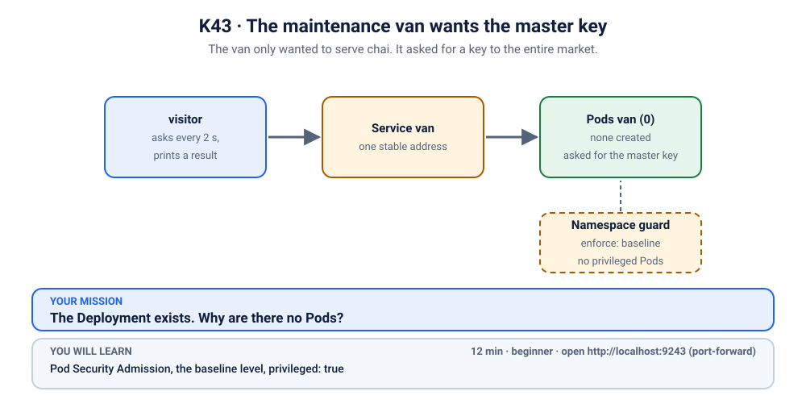

# K43 · The maintenance van wants the master key

*The van only wanted to serve chai. It asked for a key to the entire market.*

⏱ 12 min · beginner · Chai van (`http-echo`, 17 MB) · Pod Security Admission, the `baseline` level, `privileged: true`

⬇️ Nothing big: the 17 MB `hashicorp/http-echo` image and the 4 MB busybox visitor. A slow first pull is normal.

Output columns and wording can differ a little between kubectl versions and clusters (kind, minikube, Docker Desktop, playgrounds). The ideas never change.

> 🧭 **Practice lane: "Security"**, after [K21](../21-notice-board-runasnonroot/README.md) and [K22](../22-notice-board-readonly-fs/README.md). Guided: questions and a hint ladder. Next: [K44](../44-the-checklist/README.md).

## 📖 The story
The market committee has a rule at the gate, applied to the whole **namespace**: *no stall may carry the master key*, the one that opens every door in the building. A mobile chai van is added to the market. Its form has a line the owner copied from a blog post: `privileged: true`. The owner has no idea what it means. It "made the error go away" on the blog.

The gate does not argue. It simply does not let the van in. The form is filed, and no van appears.

## 🏆 Rules of this one
- **Say your prediction out loud first.**
- **Hint ladder:** open one tier at a time.
- **Remember K40:** there is no Pod, so ask the ReplicaSet.



## 🧠 The concept
**Pod Security Admission (PSA)** is a built-in gate. Label a namespace with one of three levels and the API server checks every new Pod against it:

| Level | Meaning |
|---|---|
| `privileged` | anything goes |
| `baseline` | blocks the clearly dangerous (privileged containers, host networking, and so on) |
| `restricted` | a strict checklist (see [K44](../44-the-checklist/README.md)) |

It is checked when a Pod is **created**, just like a `LimitRange`. A Pod that breaks the rule is never created.

## 🔮 Predict first
This namespace enforces `baseline`. The van asks for `privileged: true`. Do you expect the Deployment to be created, the Pods, both, or neither? Write it down.

<details><summary>Check your prediction</summary>

The Deployment is created, the Pods are not. PSA checks Pods, not Deployments, so `kubectl apply` succeeds (perhaps with a warning) and the ReplicaSet's Pods are refused.
</details>

## 💥 Break it
```bash
cd break && ./break.sh
```
```bash
kubectl get deployment,pods -n k-43-van
kubectl logs -f visitor -n k-43-van
```
Stop the logs with Ctrl+C.

## 🔍 Investigate: you drive
**What is the first thing you look at?**
<details><summary>💡 Tier 1: a nudge</summary>
No Pods. Who tries to create them? Ask that object why it failed.
</details>
<details><summary>💡 Tier 2: the commands</summary>

```bash
kubectl describe rs -n k-43-van | tail -n 12
kubectl get namespace k-43-van --show-labels
```
</details>
<details><summary>💡 Tier 3: the answers to look for</summary>

The ReplicaSet says: `violates PodSecurity "baseline:latest": privileged (container "stall" must not set securityContext.privileged=true)`. The namespace carries the label `pod-security.kubernetes.io/enforce=baseline`.
</details>

## 🪤 The tempting wrong fix
Change the namespace label to `privileged`. The van opens, and every other Pod in the namespace can now be privileged too. `check.sh` notices the guard is off and refuses. **Removing the gate is not a fix**, unless the gate itself is wrong and its owner agrees.

## 🩺 Root cause
<details><summary>Reveal after the room guesses</summary>

The container sets `privileged: true`, and the namespace enforces `baseline`, which forbids it. The API server refuses every Pod the ReplicaSet creates. The message sits on the ReplicaSet.
</details>

## 🔧 Fix it
```bash
cd ../fix && ./fix.sh
```
The reference fix removes `privileged: true` from the container. A chai van needs no master key. By hand: `kubectl edit deployment van -n k-43-van`.

## ✅ Verify it yourself
```bash
cd .. && ./check.sh
```
It checks that the guard is still on `baseline` and both Pods are Ready.

## 🎯 Key takeaways
- **PSA checks Pods, not Deployments.** A Deployment can look fine and have no Pods.
- **`privileged: true` is almost never needed.** If it "fixed" something, find out what and ask for just that.
- **Do not switch off the gate to get through it.**

## 💎 Lifelong lesson
> If a blog post tells you to ask for the master key, ask the blog what it opens.

## 🏢 Where you'll meet this at work
- **Copy-pasted manifests** with `privileged: true` from the first search result (everyone).
- **A shared cluster** where a platform team enforces `baseline` on every team namespace (platform team).

## 🧹 Clean up
```bash
./cleanup.sh
```

## Next →
Next in the lane: [K44](../44-the-checklist/README.md).
