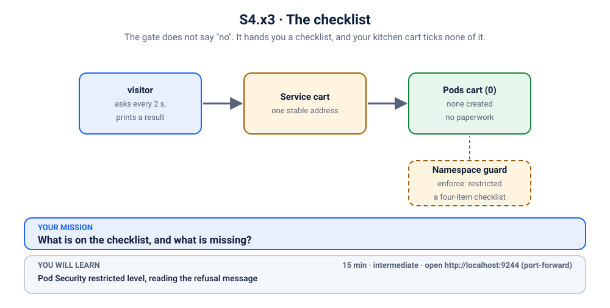
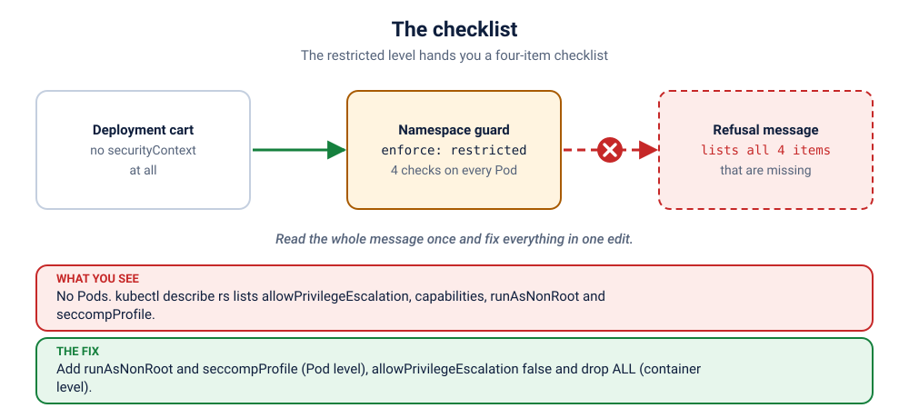

# K44 · The checklist

*The gate does not say "no". It hands you a checklist, and your kitchen cart ticks none of it.*

⏱ 15 min · intermediate · Kitchen cart (`http-echo`, 17 MB) · Pod Security `restricted` level, reading the refusal message, `securityContext` at Pod and container level

⬇️ Nothing big: the 17 MB `hashicorp/http-echo` image and the 4 MB busybox visitor. A slow first pull is normal.

Output columns and wording can differ a little between kubectl versions and clusters (kind, minikube, Docker Desktop, playgrounds). The ideas never change.

> 🧭 **Practice lane: "Security"**, after [K21](../21-notice-board-runasnonroot/README.md), [K22](../22-notice-board-readonly-fs/README.md) and [K43](../43-maintenance-van-wants-the-master-key/README.md). Mostly solo: questions only. Next: [K45](../45-the-locked-down-kitchen/README.md).

## 📖 The story
The same market, a stricter gate. This namespace is for the kitchen carts that serve the **night shift**, and the committee runs the **restricted** checklist on every cart. The new kitchen cart's owner has done everything right except the paperwork: there is none.

The gate does not just say "no". The refusal message is a list of everything on the checklist you did not tick. Reading it carefully is the whole exercise.

## 🏆 Rules of this one
- **Questions only.** Predict, investigate, fix.
- **The refusal message is the answer key.** Read all of it, not just the first line.
- **Use `./check.sh`** to find out whether you are done.



## 🧠 The concept



The **restricted** level asks for four things (on current Kubernetes):

1. `allowPrivilegeEscalation: false` on every container
2. `capabilities.drop: ["ALL"]` on every container
3. `runAsNonRoot: true` (Pod or container level)
4. `seccompProfile.type: RuntimeDefault` (or `Localhost`) (Pod or container level)

The first two are per container; the last two can be set once for the whole Pod. The refusal lists exactly what is missing.

## 🔮 Predict first
The cart sets nothing. How many things do you expect the refusal message to name: one, or all of the missing ones? Write it down.

<details><summary>Check your prediction</summary>

All of them, in one message. The checklist is evaluated in one go, so you can fix everything at once instead of one retry at a time.
</details>

## 💥 Break it
```bash
cd break && ./break.sh
```
```bash
kubectl get deployment,pods -n k-44-checklist
kubectl logs -f visitor -n k-44-checklist
```
Stop the logs with Ctrl+C.

## 🔍 Investigate: you drive
**What is the first thing you look at?**
<details><summary>💡 Tier 1: a nudge</summary>
No Pods again. You know where to look. This time, read the **whole** message.
</details>
<details><summary>💡 Tier 2: the commands</summary>

```bash
kubectl describe rs -n k-44-checklist | tail -n 12
```
The message lists each missing item in parentheses.
</details>
<details><summary>💡 Tier 3: the answers to look for</summary>

Four items: `allowPrivilegeEscalation != false`, `unrestricted capabilities` (drop ALL), `runAsNonRoot != true`, and `seccompProfile`. Fix them all in one edit.
</details>

## 🪤 The tempting wrong fix
Set only the one the message mentions first, apply, read the new message, repeat. It works, slowly. Better: read the whole list once, then fix everything in one go. Or the shortcut people reach for: relabel the namespace to `baseline`. **That removes the gate** and `check.sh` refuses.

## 🩺 Root cause
<details><summary>Reveal after the room guesses</summary>

The cart sets no `securityContext`, so it fails all four checklist items. The restricted level lists them all in the refusal.
</details>

## 🔧 Fix it
```bash
cd ../fix && ./fix.sh
```
The reference fix adds `runAsNonRoot` and a `seccompProfile` at the Pod level, and `allowPrivilegeEscalation: false` with `capabilities.drop: ["ALL"]` on the container.

## ✅ Verify it yourself
```bash
cd .. && ./check.sh
```
It checks that the guard is still `restricted` and both Pods are Ready.

## 🎯 Key takeaways
- **Read the whole refusal.** It is a checklist, not a single error.
- **Two settings are Pod-wide, two are per container.**
- **`restricted` is the safe default** for ordinary apps. Almost nothing needs more.

## 💎 Lifelong lesson
> A checklist you have read once is quicker than a checklist you discover one failure at a time.

## 🏢 Where you'll meet this at work
- **Hardening a platform**: the security team turns on `restricted` for new namespaces (platform team).
- **Helm charts** that need a values override to satisfy it (developer).

## 🧹 Clean up
```bash
./cleanup.sh
```

## Next →
Next in the lane: [K45](../45-the-locked-down-kitchen/README.md), the boss.
