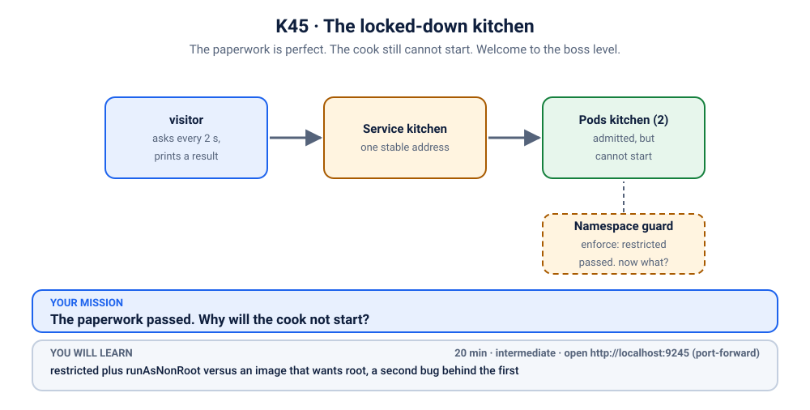
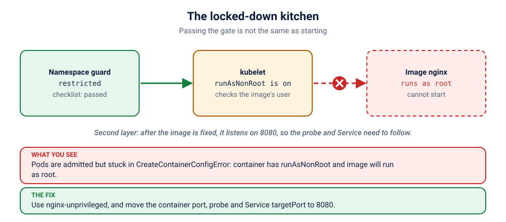

# K45 · The locked-down kitchen

*The paperwork is perfect. The cook still cannot start. Welcome to the boss level.*

⏱ 20 min · intermediate · Kitchen (`nginx` 1.27.5 alpine, about 20 MB; fix: `nginx-unprivileged`, about 22 MB) · `restricted` plus `runAsNonRoot` versus an image that wants root, a second bug behind the first

⬇️ Two nginx images (about 20 MB and 22 MB) and the 4 MB busybox visitor. A slow first pull is normal.

Output columns and wording can differ a little between kubectl versions and clusters (kind, minikube, Docker Desktop, playgrounds). The ideas never change.

> 🧭 **Practice lane: "Security"**, the boss of the lane, after [K21](../21-notice-board-runasnonroot/README.md), [K43](../43-maintenance-van-wants-the-master-key/README.md) and [K44](../44-the-checklist/README.md). No hints for the first 5 minutes. Previous: [K44](../44-the-checklist/README.md).

## 📖 The story
The kitchen finally has all the paperwork the gate wants. This time it passes. The Pods are admitted, and then they sit there, unable to start.

It turns out the cook was hired before the rule existed, and he can only work as the head chef of the building (root). The rule says the kitchen must be run by an ordinary staff member. The paperwork was fine. The cook was not. And when you replace the cook, the new one works a different door.

## 🏆 Rules of this one
- **First 5 minutes: no hints.** You have met both halves of this.
- **Two layers of failure.** Fix one, re-check the symptom, then look again.
- **Scoring (for fun):** gold = under 12 minutes, no hints; silver = under 20; bronze = hints used.



## 🧠 The concept



Two different checks can stop a Pod:

1. **Admission** (the gate): is the Pod *allowed* to be created? (K43, K44.)
2. **The kubelet**: can the container actually *start* with these settings? `runAsNonRoot: true` makes the kubelet refuse to start a container whose image runs as root. The Pod exists, but shows `CreateContainerConfigError`.

A Pod can pass the first and fail the second. Fixing the image can move the port, too.

## 🔮 Predict first
The Pods are admitted. They will not be `Running`. Which status do you expect to see in the `STATUS` column? Write it down.

<details><summary>Check your prediction</summary>

`CreateContainerConfigError`. The Pod was admitted, but the kubelet refuses to start an image that would run as root when `runAsNonRoot: true` is set.
</details>

## 💥 Break it
```bash
cd break && ./break.sh
```
```bash
kubectl get pods -n k-45-lockdown
kubectl logs -f visitor -n k-45-lockdown
```
Stop the logs with Ctrl+C.

## 🔍 Investigate: you drive
**What is the first thing you look at?**
<details><summary>💡 Tier 1: a nudge</summary>
This time there are Pods, so ask a Pod. `describe` shows why the container could not start.
</details>
<details><summary>💡 Tier 2: the commands</summary>

```bash
kubectl describe pod -n k-45-lockdown -l app=kitchen | tail -n 15
```
Then compare: what port does the new image listen on, and what do the probe and the Service say?
</details>
<details><summary>💡 Tier 3: the answers to look for</summary>

Event: `container has runAsNonRoot and image will run as root`. The fix is an image that runs as a normal user: `nginxinc/nginx-unprivileged`. That image listens on **8080**, not 80, so the probe and the Service `targetPort` must change too.
</details>

## 🪤 The tempting wrong fix
Remove `runAsNonRoot: true` from the Pod. The kitchen opens, but the rule that kept the kitchen safe is gone, and the Pod runs as root again. `check.sh` only passes with the checklist intact. Or: change the image but not the port, and the Pods start but never turn Ready. **Re-check the real symptom after each change.**

## 🩺 Root cause
<details><summary>Reveal after the room guesses</summary>

Two stacked mistakes. The image runs as root, which `runAsNonRoot: true` forbids, so the container never starts. After switching to the unprivileged image, which listens on 8080, the readiness probe and the Service still point at port 80, so the Pods start but never become Ready.
</details>

## 🔧 Fix it
```bash
cd ../fix && ./fix.sh
```
The reference fix swaps the image for `nginxinc/nginx-unprivileged`, and moves the container port, the probe and the Service `targetPort` to 8080.

## ✅ Verify it yourself
```bash
cd .. && ./check.sh
```
It checks that the guard is still `restricted` and both Pods are Ready.

## 🎯 Key takeaways
- **Passing admission is not the same as starting.** Two different checks.
- **`runAsNonRoot` needs an image that is built to run as a normal user.**
- **Unprivileged images often change the port.** Re-check the Service and the probes.
- **Fix one, re-check the symptom, look again.**

## 💎 Lifelong lesson
> Paperwork gets you in the building. It does not make the cook come to work.

## 🏢 Where you'll meet this at work
- **Switching to hardened base images** and forgetting the port (platform team).
- **Rolling out `restricted` on old workloads** that quietly assumed root (everyone).

## 🧹 Clean up
```bash
./cleanup.sh
```

## Next →
That finishes the Security lane. Back to the [scenario list](../README.md).
